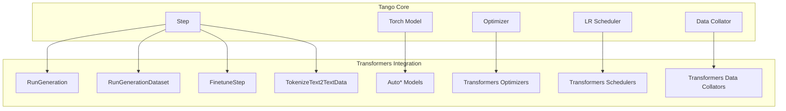
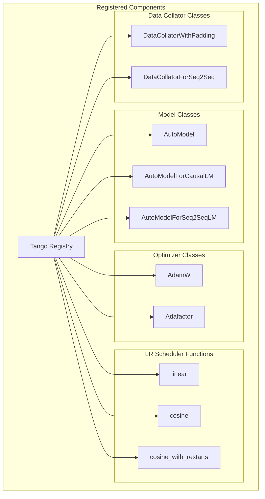
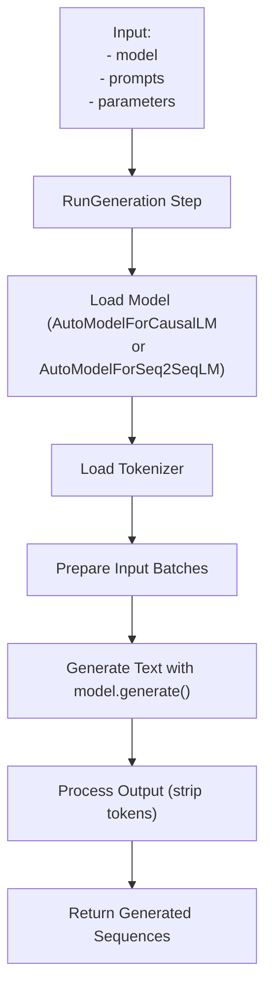
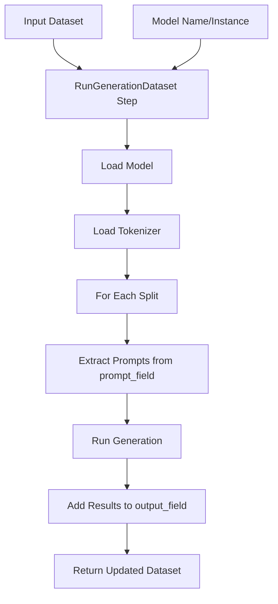
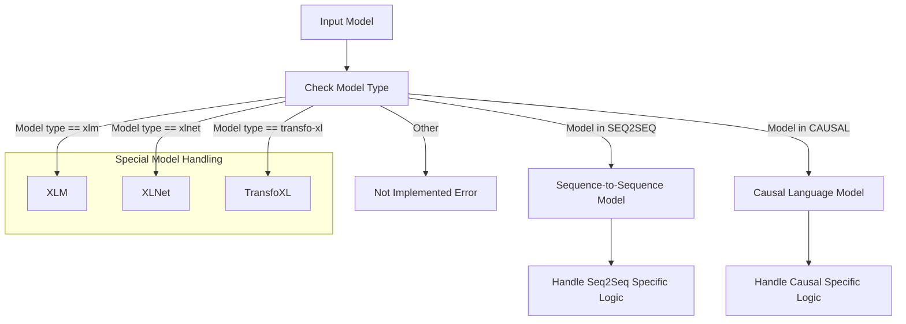

<!-- source: DeepWiki mcp.deepwiki.com · repo allenai/tango · page 6.2 Transformers · fetched 2026-10-26 -->

# Transformers

<details>
<summary>Relevant source files</summary>

The following files were used as context for generating this wiki page:

- [.github/workflows/main.yml](.github/workflows/main.yml)
- [docs/source/api/integrations/beaker.rst](docs/source/api/integrations/beaker.rst)
- [pyproject.toml](pyproject.toml)
- [tango/common/exceptions.py](tango/common/exceptions.py)
- [tango/common/file_lock.py](tango/common/file_lock.py)
- [tango/common/registrable.py](tango/common/registrable.py)
- [tango/integrations/beaker/__init__.py](tango/integrations/beaker/__init__.py)
- [tango/integrations/torch/optim.py](tango/integrations/torch/optim.py)
- [tango/integrations/transformers/__init__.py](tango/integrations/transformers/__init__.py)
- [tango/integrations/transformers/run_generation.py](tango/integrations/transformers/run_generation.py)
- [tango/integrations/wandb/__init__.py](tango/integrations/wandb/__init__.py)
- [test_fixtures/common/params_example.yaml](test_fixtures/common/params_example.yaml)
- [tests/common/registrable_test.py](tests/common/registrable_test.py)

</details>


This document describes Tango's integration with the Hugging Face Transformers library, which enables the use of pre-trained transformer models and related components within Tango workflows. The integration provides steps for text generation, dataset processing, and model fine-tuning, as well as registering various Transformers components for use within Tango.

## Installation and Requirements

To use the Transformers integration, you must install Tango with the "transformers" extra:

```bash
pip install tango[transformers]
```

Or install the dependencies separately:

```bash
pip install transformers datasets sentencepiece sacremoses
```

Sources: [tango/integrations/transformers/__init__.py:1-9](), [pyproject.toml:74-81]()

## Integration Architecture

The Transformers integration connects Tango's core components with Hugging Face's Transformers library, providing a seamless way to use transformer models in ML workflows.



Sources: [tango/integrations/transformers/__init__.py:7-143]()

## Available Components

The Transformers integration provides several step classes and registers numerous components from the Transformers library.

### Step Classes

| Step Class | Purpose |
|------------|---------|
| `RunGeneration` | Runs transformer models for text generation |
| `RunGenerationDataset` | Runs generation on datasets and adds results as a new field |
| `TokenizeText2TextData` | Tokenizes text for text-to-text tasks |
| `FinetuneStep` | Fine-tunes transformer models |

### Registered Components

The integration registers the following types of components:

1. **Models**: All transformer "auto" model classes (e.g., `AutoModelForCausalLM`)
2. **Optimizers**: Transformers optimizers like `AdamW` and `Adafactor`
3. **LR Schedulers**: Learning rate schedulers such as `linear` and `cosine_with_restarts`
4. **Data Collators**: Data collators like `DataCollatorWithPadding` and `DataCollatorForSeq2Seq`



Sources: [tango/integrations/transformers/__init__.py:10-142](), [tango/integrations/torch/optim.py:8-88]()

## RunGeneration Step

The `RunGeneration` step allows running transformer models for text generation. It takes a model and prompts as input and produces generated text as output.

### Key Parameters

| Parameter | Description |
|-----------|-------------|
| `model` | Model name or instance to use for generation |
| `prompts` | Input prompts for text generation |
| `batch_size` | Number of sequences to process at once |
| `max_length` | Maximum generation length |
| `temperature` | Controls randomness in generation |
| `repetition_penalty` | Controls repetition (1.0 means no penalty) |
| `k`, `p` | Top-k and top-p sampling parameters |
| `num_return_sequences` | Number of sequences to generate per prompt |

### Generation Workflow



Sources: [tango/integrations/transformers/run_generation.py:73-231](), [tango/integrations/transformers/run_generation.py:243-343]()

## RunGenerationDataset Step

The `RunGenerationDataset` step is similar to `RunGeneration` but works with datasets. It runs generation on a field in the dataset and adds the results as a new field.

### Key Parameters

All parameters from `RunGeneration`, plus:

| Parameter | Description |
|-----------|-------------|
| `input` | Input dataset (DatasetDict or HfDatasetDict) |
| `prompt_field` | Field in the dataset to use as prompts |
| `output_field` | Field name to store generation results |
| `splits` | Dataset splits to process (optional) |

### Dataset Generation Workflow



Sources: [tango/integrations/transformers/run_generation.py:346-489]()

## Using Transformers Models in Tango

The integration registers all "auto" model classes from Transformers, allowing you to use them in Tango configurations. Models are registered with names like `transformers::AutoModelForCausalLM::from_pretrained`.

### Example: Loading a Pretrained Model

```python
from tango.integrations.torch import Model

model = Model.from_params({
    "type": "transformers::AutoModelForCausalLM::from_pretrained",
    "pretrained_model_name_or_path": "gpt2",
})
```

Sources: [tango/integrations/transformers/__init__.py:16-26]()

## Using Transformers Optimizers and Schedulers

The integration registers all optimizers and learning rate schedulers from Transformers.

### Example: Using a Transformers Optimizer and Scheduler

```python
from tango.integrations.torch import Optimizer, LRScheduler

optimizer = Optimizer.from_params({
    "type": "transformers::AdamW",
    "params": model.parameters(),
    "lr": 5e-5,
})

scheduler = LRScheduler.from_params({
    "type": "transformers::linear",
    "optimizer": optimizer,
    "num_warmup_steps": 100,
    "num_training_steps": 1000,
})
```

Sources: [tango/integrations/transformers/__init__.py:53-102]()

## Using Transformers Data Collators

The integration registers all data collators from Transformers.

### Example: Using a Transformers Data Collator

```python
from tango.integrations.torch import DataCollator

collator = DataCollator.from_params({
    "type": "transformers::DataCollatorWithPadding",
    "tokenizer": {
        "pretrained_model_name_or_path": "bert-base-uncased",
    },
})
```

Sources: [tango/integrations/transformers/__init__.py:103-142]()

## Implementation Details

### Model Class Registration

The integration registers Transformers components through Tango's `Registrable` system, which allows components to be instantiated from configuration.

The registration process uses Python's introspection capabilities to find and register all relevant classes from the Transformers library.

### Generation Implementation

The generation functionality is implemented in the `_generate` function, which:

1. Sets up the model and tokenizer
2. Handles different model types (causal vs. seq2seq)  
3. Processes inputs in batches
4. Generates text using model-specific parameters
5. Post-processes the generated text (removing special tokens, etc.)

Sources: [tango/integrations/transformers/run_generation.py:88-231](), [tango/common/registrable.py:41-142]()

## Model Compatibility

The `RunGeneration` and `RunGenerationDataset` steps support two main types of models:

1. **Causal Language Models** (via `AutoModelForCausalLM`)
2. **Sequence-to-Sequence Models** (via `AutoModelForSeq2SeqLM`) 

The steps also include special handling for specific model architectures such as XLNet, TransfoXL, and XLM.



Sources: [tango/integrations/transformers/run_generation.py:46-68](), [tango/integrations/transformers/run_generation.py:107-178]()

## Conclusion

The Transformers integration provides a powerful way to use Hugging Face Transformers models and components within Tango workflows. With this integration, you can easily perform text generation, fine-tune models, and leverage the full capabilities of the Transformers library.

For more information on other Tango integrations, see the [PyTorch](#6.1), [Weights & Biases](#6.3), and [Beaker](#6.4) documentation.

---

