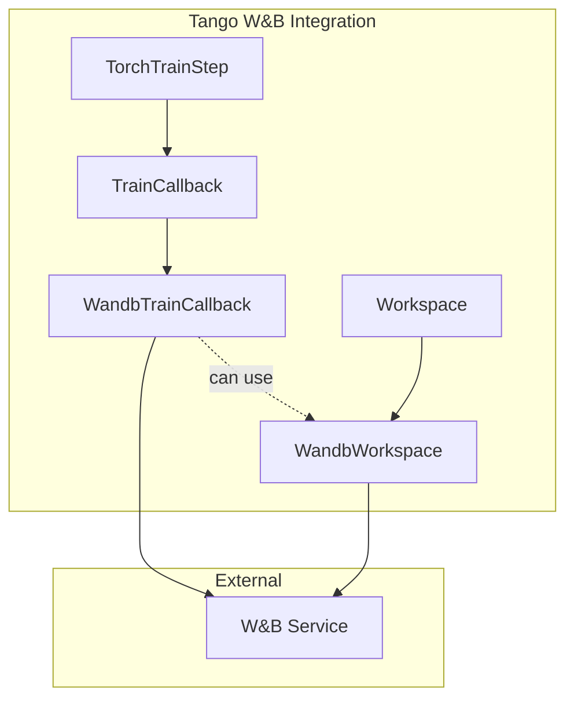
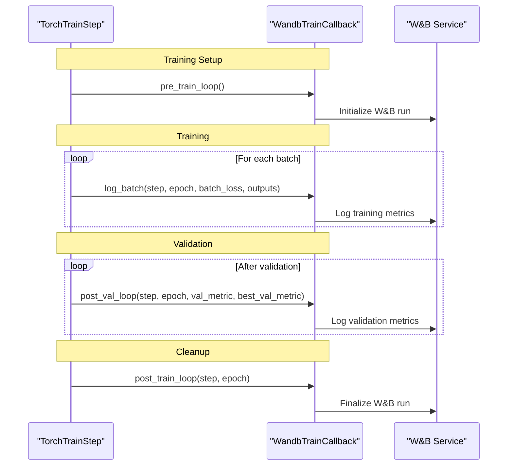
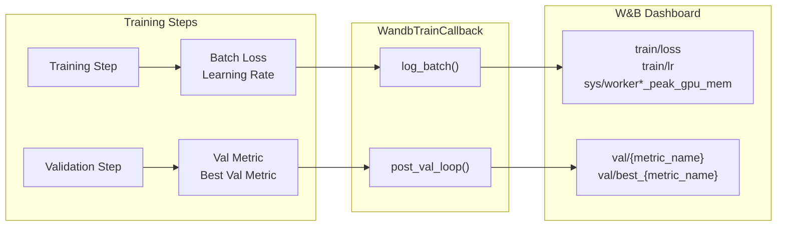
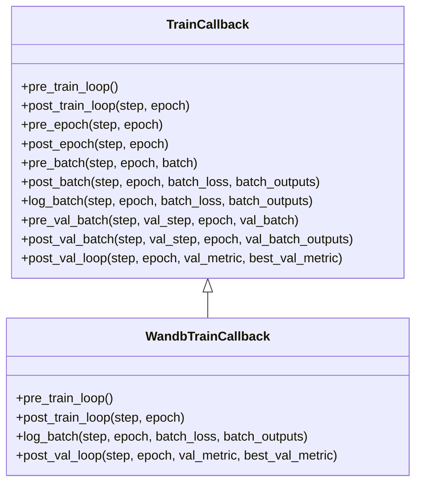
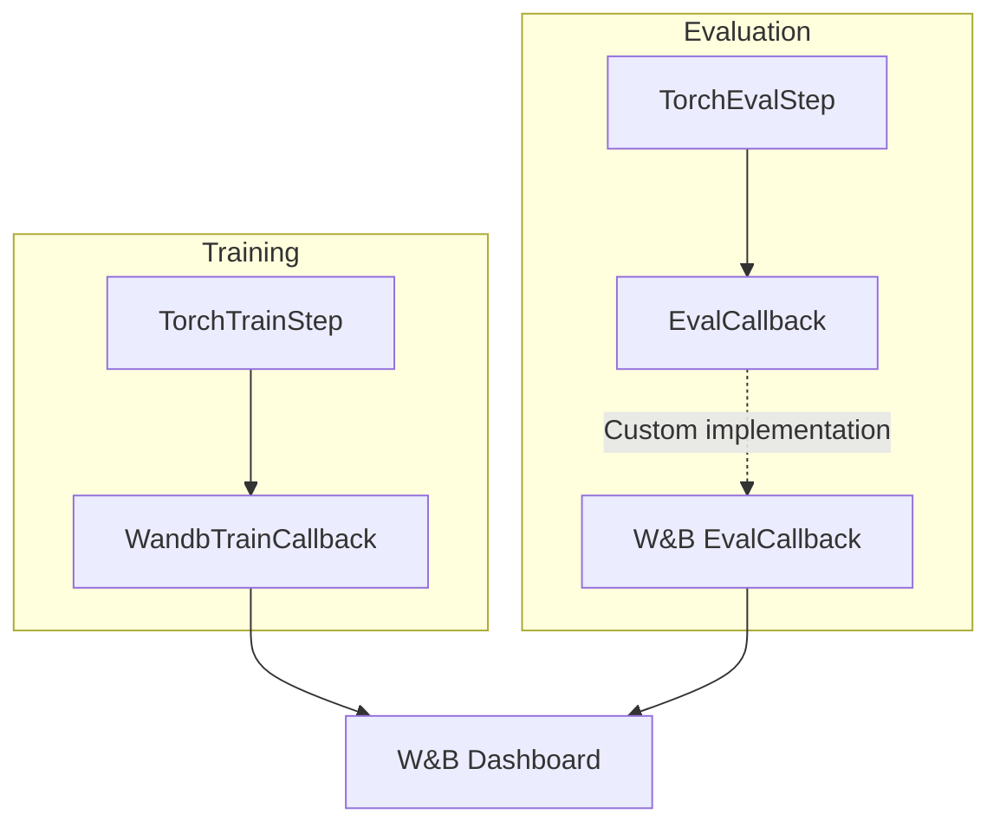

<!-- source: DeepWiki mcp.deepwiki.com · repo allenai/tango · page 6.3 Weights & Biases · fetched 2026-10-26 -->

# Weights & Biases

<details>
<summary>Relevant source files</summary>

The following files were used as context for generating this wiki page:

- [docs/source/api/integrations/torch.rst](docs/source/api/integrations/torch.rst)
- [tango/integrations/torch/eval.py](tango/integrations/torch/eval.py)
- [tango/integrations/torch/model.py](tango/integrations/torch/model.py)
- [tango/integrations/torch/train.py](tango/integrations/torch/train.py)
- [tango/integrations/torch/train_callback.py](tango/integrations/torch/train_callback.py)
- [tango/integrations/torch/train_config.py](tango/integrations/torch/train_config.py)
- [tango/integrations/wandb/torch_train_callback.py](tango/integrations/wandb/torch_train_callback.py)
- [tests/integrations/torch/train_callback_test.py](tests/integrations/torch/train_callback_test.py)

</details>


This document covers the integration of [Weights & Biases](https://wandb.ai) (W&B) with Tango for experiment tracking and visualization. Tango provides built-in support for logging training metrics, artifacts, and model checkpoints to W&B.

## Overview

Tango's W&B integration enables you to:

1. Track and visualize training metrics in real-time
2. Log model parameters and hyperparameters
3. Monitor system metrics like GPU usage
4. Compare different experiments
5. Store model artifacts

The integration consists of two main components:

1. **WandbTrainCallback**: Used with `TorchTrainStep` to log training metrics to W&B
2. **WandbWorkspace**: A workspace implementation for storing step results in W&B



*Diagram: Core components of Tango's W&B integration*

Sources: [tango/integrations/wandb/torch_train_callback.py:1-215]()

## Using WandbTrainCallback

`WandbTrainCallback` logs training and validation metrics to W&B during model training. It can be used with any workspace implementation, including `WandbWorkspace`.



*Diagram: Flow of data from TorchTrainStep to W&B via WandbTrainCallback*

Sources: [tango/integrations/wandb/torch_train_callback.py:14-216](), [tango/integrations/torch/train_callback.py:16-223]()

### Setup

To use `WandbTrainCallback`, add it to the `callbacks` parameter of `TorchTrainStep`:

```python
from tango.integrations.torch import TorchTrainStep
from tango.common.lazy import Lazy

step = TorchTrainStep(
    model=model,
    training_engine=training_engine,
    dataset_dict=dataset_dict,
    train_dataloader=train_dataloader,
    callbacks=[
        Lazy(
            "wandb::log",
            project="my-project",
            entity="my-entity",
            watch_model=True
        )
    ]
)
```

Sources: [tango/integrations/wandb/torch_train_callback.py:14-78]()

### Configuration Options

The `WandbTrainCallback` accepts the following configuration options:

| Parameter | Type | Description |
|-----------|------|-------------|
| `project` | str | W&B project to associate this run with |
| `entity` | str | W&B entity (user or organization) to associate this run with |
| `group` | str | W&B group to associate this run with (defaults to step ID) |
| `name` | str | Name of the run in W&B (defaults to step name) |
| `notes` | str | Arbitrary notes to add in W&B to this run |
| `tags` | List[str] | Arbitrary tags to add in W&B to this run |
| `watch_model` | bool | If True, calls `wandb.watch()` to collect gradients and model information |
| `wandb_config` | Dict[str, Any] | Arbitrary configuration fields to set in W&B for this run |

Sources: [tango/integrations/wandb/torch_train_callback.py:64-77]()

### Metrics Logged

By default, `WandbTrainCallback` logs the following metrics:

1. **Training metrics**:
   - `train/loss`: The batch loss
   - `train/lr`: Current learning rate
   - GPU memory usage per worker: `sys/worker{rank}_peak_gpu_mem`
   - Epoch number

2. **Validation metrics**:
   - `val/{val_metric_name}`: The validation metric
   - `val/best_{val_metric_name}`: The best validation metric so far
   - Epoch number



*Diagram: Metrics flow from training to W&B dashboard*

Sources: [tango/integrations/wandb/torch_train_callback.py:178-207]()

### Using with WandbWorkspace

When `WandbTrainCallback` is used with the `WandbWorkspace`, it will log metrics to the same W&B project that the workspace uses. In this case, you should not set the `project`, `entity`, `group`, or `name` parameters in the callback as they will be automatically set from the workspace configuration.

A `ConfigurationError` will be raised if any of these parameters are set manually when using `WandbWorkspace`.

```python
# This will raise a ConfigurationError if used with WandbWorkspace
callbacks=[
    Lazy(
        "wandb::log",
        project="my-project",  # Don't set this with WandbWorkspace
        entity="my-entity",    # Don't set this with WandbWorkspace
        watch_model=True       # This is fine
    )
]
```

Sources: [tango/integrations/wandb/torch_train_callback.py:83-96]()

## Integration with Training Loop

`WandbTrainCallback` integrates with the PyTorch training loop in Tango through the `TrainCallback` interface, which provides hooks for various stages of the training process.



*Diagram: Class hierarchy of WandbTrainCallback*

Sources: [tango/integrations/torch/train_callback.py:16-223](), [tango/integrations/wandb/torch_train_callback.py:14-216]()

The `WandbTrainCallback` primarily implements four hooks from the `TrainCallback` interface:

1. **pre_train_loop()**: Initializes the W&B run and calls `wandb.watch()` if `watch_model=True`
2. **log_batch()**: Logs training metrics at regular intervals (controlled by the `log_every` parameter in `TorchTrainStep`)
3. **post_val_loop()**: Logs validation metrics after each validation run
4. **post_train_loop()**: Finalizes the W&B run when training completes

Sources: [tango/integrations/wandb/torch_train_callback.py:136-207]()

## Advanced Usage

### Model Watching

Setting `watch_model=True` in the callback configuration enables `wandb.watch()` on your model, which logs gradients, parameter updates, and more:

```python
callbacks=[
    Lazy(
        "wandb::log",
        watch_model=True
    )
]
```

This is particularly useful for debugging and understanding how your model is learning.

Sources: [tango/integrations/wandb/torch_train_callback.py:162-163]()

### Custom Configuration

You can add custom configuration fields to your W&B run using the `wandb_config` parameter:

```python
callbacks=[
    Lazy(
        "wandb::log",
        wandb_config={
            "architecture": "transformer",
            "dataset_size": 10000,
            "custom_field": "custom_value"
        }
    )
]
```

The callback will merge these fields with the default configuration derived from `TrainConfig`.

Sources: [tango/integrations/wandb/torch_train_callback.py:109-114]()

### Using with Evaluation

While `WandbTrainCallback` is designed for use with `TorchTrainStep`, you can use similar principles to log evaluation metrics from `TorchEvalStep` by creating a custom `EvalCallback` that logs to W&B.



*Diagram: Integration with training and evaluation steps*

Sources: [tango/integrations/torch/eval.py:20-190](), [tango/integrations/torch/train.py:33-807]()

## Summary

Tango's W&B integration provides a seamless way to track and visualize your machine learning experiments. The `WandbTrainCallback` automatically logs training and validation metrics during model training, allowing you to monitor progress in real-time and compare different experiments.

When used with `WandbWorkspace`, you can also store step results and artifacts in W&B, creating a complete record of your experiments.

For more information about other Tango integrations, see:
- [PyTorch](#6.1) for details on the PyTorch integration
- [Transformers](#6.2) for details on the Hugging Face Transformers integration
- [Beaker](#6.4) for details on distributed execution with Beaker

Sources: [tango/integrations/wandb/torch_train_callback.py:1-215]()

---

