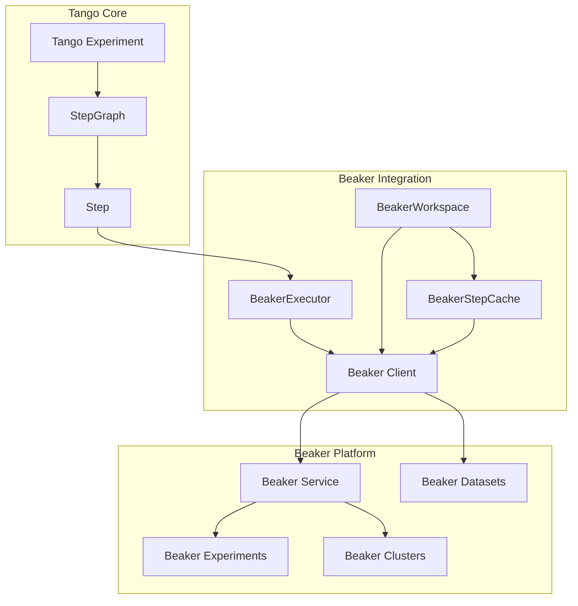
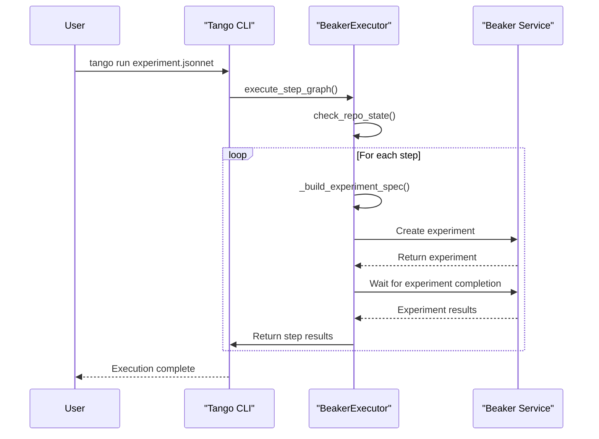
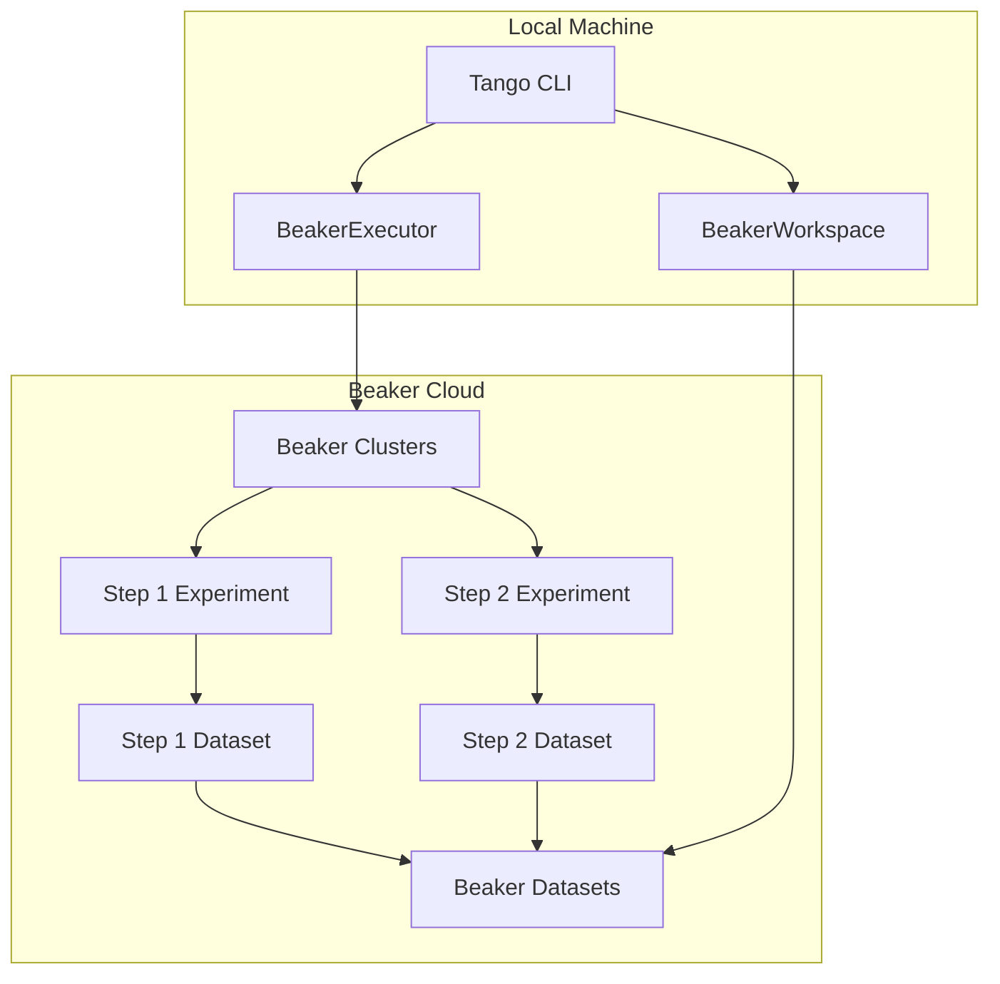
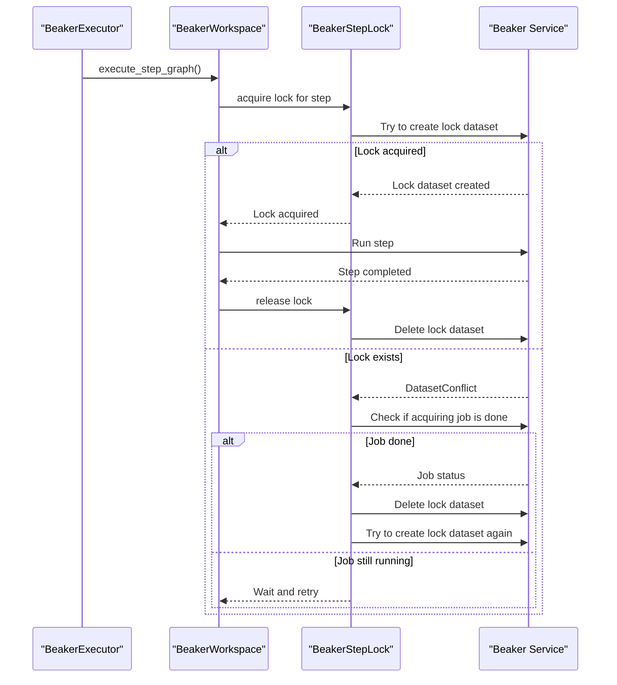
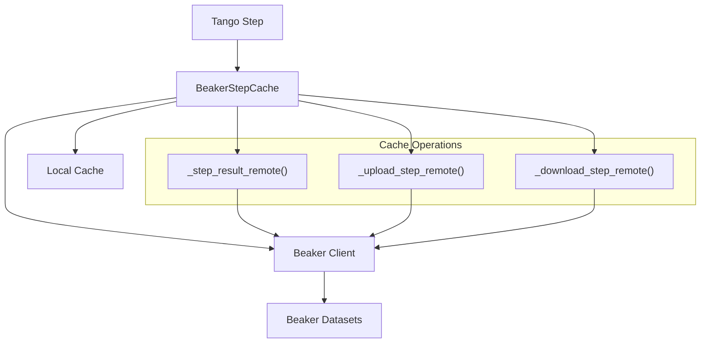
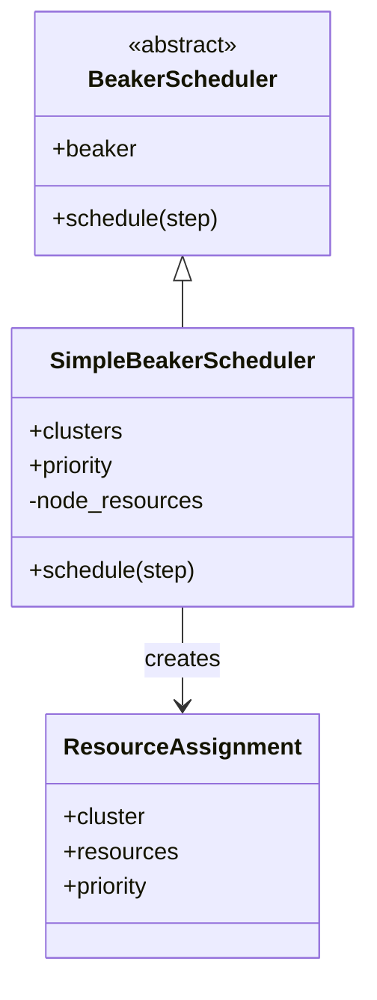

<!-- source: DeepWiki mcp.deepwiki.com · repo allenai/tango · page 6.4 Beaker · fetched 2026-10-26 -->

# Beaker

<details>
<summary>Relevant source files</summary>

The following files were used as context for generating this wiki page:

- [tango/integrations/beaker/common.py](tango/integrations/beaker/common.py)
- [tango/integrations/beaker/executor.py](tango/integrations/beaker/executor.py)
- [tango/integrations/beaker/step_cache.py](tango/integrations/beaker/step_cache.py)
- [tango/integrations/beaker/workspace.py](tango/integrations/beaker/workspace.py)
- [tango/step_info.py](tango/step_info.py)
- [tests/integrations/beaker/conftest.py](tests/integrations/beaker/conftest.py)

</details>


This document describes Tango's integration with [Beaker](https://beaker.org), a platform for running containerized machine learning experiments. Tango provides two main Beaker integrations: `BeakerExecutor` for distributed step execution on Beaker's infrastructure, and `BeakerWorkspace` for storing step artifacts on Beaker's cloud storage.

## Overview

Tango's Beaker integration enables distributed execution of complex machine learning pipelines by offloading step execution to Beaker's computing infrastructure. This is especially useful for steps that require specialized hardware (e.g., GPUs) or need significant computational resources.



Sources: [tango/integrations/beaker/executor.py:178-336](), [tango/integrations/beaker/workspace.py:37-76](), [tango/integrations/beaker/step_cache.py:21-56]()

## Components

### BeakerExecutor

The `BeakerExecutor` is responsible for executing Tango steps on Beaker's infrastructure. Each step is run as a separate Beaker experiment, with the executor managing the creation, execution, and monitoring of these experiments.

#### Requirements and Setup

To use the `BeakerExecutor`, you need:

1. **A GitHub repository**: Your code must be in a GitHub repository
2. **GitHub personal access token**: With at least the "repo" scope
3. **Beaker account and workspace**: To run the experiments
4. **Dependencies specification**: Via requirements.txt, setup.py, or environment.yml



Sources: [tango/integrations/beaker/executor.py:178-336](), [tango/integrations/beaker/executor.py:340-467]()

#### Configuration

The `BeakerExecutor` can be configured in your `tango.yml` file:

```yaml
executor:
  type: beaker
  beaker_workspace: your-organization/your-workspace
  clusters:
    - your-org/your-cluster
  budget: your-budget-id
```

Key configuration options include:

| Parameter | Description |
|-----------|-------------|
| `beaker_workspace` | The Beaker workspace where experiments will be created |
| `clusters` | List of Beaker clusters where steps can run |
| `budget` | Budget ID for Beaker resource tracking (required) |
| `github_token` | GitHub personal access token (can also use GITHUB_TOKEN env var) |
| `beaker_image` | Beaker image to use for running steps |
| `docker_image` | Docker image to use for running steps |
| `venv_name` | Name of conda environment to use or create |
| `priority` | Priority for Beaker tasks (default: normal) |
| `allow_dirty` | Whether to allow running with uncommitted changes |

Sources: [tango/integrations/beaker/executor.py:178-334](), [tango/integrations/beaker/executor.py:340-467]()

#### Using GPUs

To run steps with GPUs, you need to:

1. Configure proper GPU environment (either through docker_image or environment.yml)
2. Specify GPU requirements in the step's configuration:

```json
"steps": {
    "train": {
        "type": "torch::train",
        "step_resources": {
            "gpu_count": 1,
            "gpu_type": "A100" 
        }
    }
}
```

The BeakerExecutor uses a scheduler to assign appropriate resources to each step.

Sources: [tango/integrations/beaker/executor.py:92-175](), [tango/integrations/beaker/executor.py:264-328]()

### BeakerWorkspace

The `BeakerWorkspace` stores step artifacts as Beaker datasets. It works in conjunction with the `BeakerStepCache` to handle caching of step results.

```mermaid
classDiagram
    Workspace <|-- RemoteWorkspace
    RemoteWorkspace <|-- BeakerWorkspace
    BeakerWorkspace --> BeakerStepCache
    BeakerWorkspace --> "Beaker Client"
    
    class Workspace {
        +step_cache
        +step_info(step)
        +step_starting(step)
        +step_finished(step, result)
    }
    
    class RemoteWorkspace {
        #_remote_lock(step)
    }
    
    class BeakerWorkspace {
        +beaker
        +url
        +current_beaker_experiment
        -_step_location(step)
        -_remote_lock(step)
        -_get_step_info_from_dataset(dataset)
    }
    
    class BeakerStepCache {
        +beaker
        +_step_result_remote(step)
        +_upload_step_remote(step, objects_dir)
        +_download_step_remote(step_result, target_dir)
    }
```

Sources: [tango/integrations/beaker/workspace.py:37-77](), [tango/integrations/beaker/step_cache.py:21-56]()

#### Configuration

The `BeakerWorkspace` can be configured in your `tango.yml` file:

```yaml
workspace:
  type: beaker
  workspace: your-organization/your-workspace
```

Sources: [tango/integrations/beaker/workspace.py:37-77]()

### Integration with BeakerExecutor

When using `BeakerExecutor` together with `BeakerWorkspace`, the integration provides a seamless experience:

1. The `BeakerExecutor` runs steps on Beaker's infrastructure
2. The `BeakerWorkspace` stores step artifacts as Beaker datasets
3. The `BeakerStepCache` handles caching of step results
4. When a step needs to run, dependencies are resolved and their results are fetched from Beaker



Sources: [tango/integrations/beaker/executor.py:178-336](), [tango/integrations/beaker/workspace.py:37-76]()

## Step Locking and Concurrency

Tango provides a locking mechanism to prevent multiple processes from running the same step simultaneously. For the Beaker integration, this is implemented through `BeakerStepLock`, which creates a lock dataset on Beaker.



Sources: [tango/integrations/beaker/common.py:65-187]()

## BeakerStepCache

The `BeakerStepCache` is responsible for storing and retrieving step results from Beaker datasets. It maintains a local cache to avoid repeated downloads of step results that have been accessed before.

Key functionality:
- Uploads step results to Beaker datasets
- Downloads step results from Beaker datasets
- Maintains a local cache of step results



Sources: [tango/integrations/beaker/step_cache.py:21-106]()

## Putting It All Together

Using Beaker with Tango involves configuring both the executor and workspace in your `tango.yml` file:

```yaml
workspace:
  type: beaker
  workspace: your-organization/your-workspace

executor:
  type: beaker
  beaker_workspace: your-organization/your-workspace
  clusters:
    - your-org/your-cluster
  budget: your-budget-id
  github_token: "${GITHUB_TOKEN}"
```

When you run `tango run experiment.jsonnet`, Tango will:

1. Parse your experiment configuration
2. Build a step graph of all the steps to run
3. For each step:
   - Check if it's already in the cache
   - If not, submit it as a Beaker experiment
   - Monitor the experiment until completion
   - Store the results in the Beaker workspace
   - Return the results to Tango

Sources: [tango/integrations/beaker/executor.py:512-696](), [tango/integrations/beaker/workspace.py:109-177]()

## Resource Scheduling

The `BeakerExecutor` includes a scheduling system to assign appropriate resources to each step. The default scheduler is `SimpleBeakerScheduler`, which assigns steps to clusters based on their resource requirements.



Sources: [tango/integrations/beaker/executor.py:92-175]()

The scheduler is responsible for matching step requirements with available resources on Beaker clusters, ensuring that steps are executed on appropriate hardware.

## Error Handling

The Beaker integration includes robust error handling to manage various failure scenarios:

| Error Type | Description |
|------------|-------------|
| `StepFailedError` | Raised when a step fails on Beaker |
| `ResourceAssignmentError` | Raised when resources can't be found for a step |
| `UnrecoverableResourceAssignmentError` | Raised when resource assignment can't be recovered |

Sources: [tango/integrations/beaker/executor.py:52-69]()

## Conclusion

Tango's Beaker integration provides a powerful way to run machine learning experiments at scale. By leveraging Beaker's infrastructure, you can distribute step execution across multiple machines, use specialized hardware like GPUs, and store step artifacts in the cloud.

To get started with Beaker integration, ensure you have:
1. A Beaker account and workspace
2. A GitHub repository with your code
3. A GitHub personal access token
4. Properly configured `tango.yml` file

With these in place, you can run distributed Tango experiments with the full power of Beaker's computing infrastructure.

---

