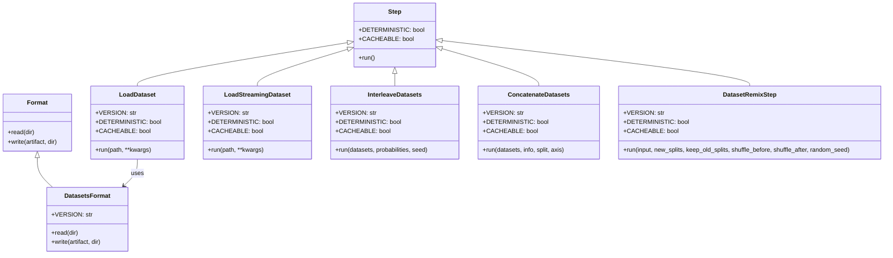
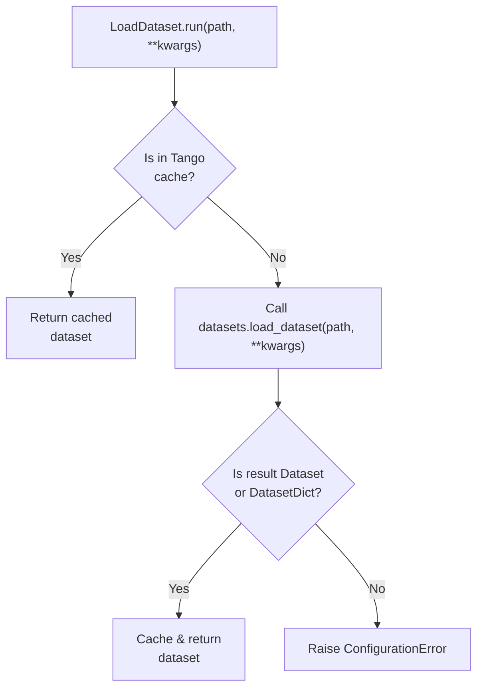
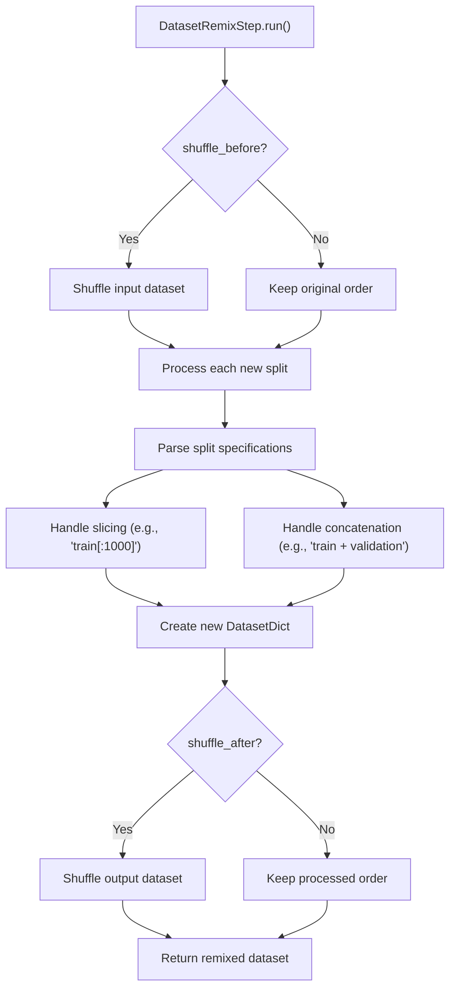
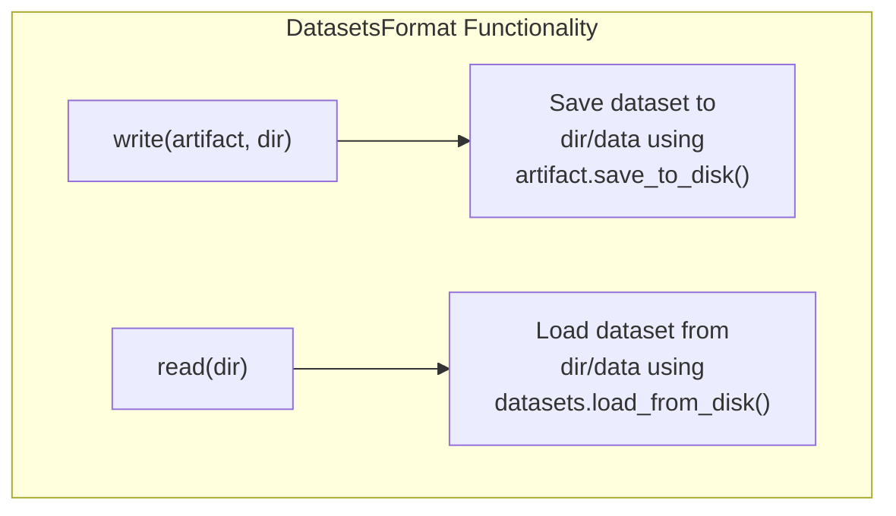
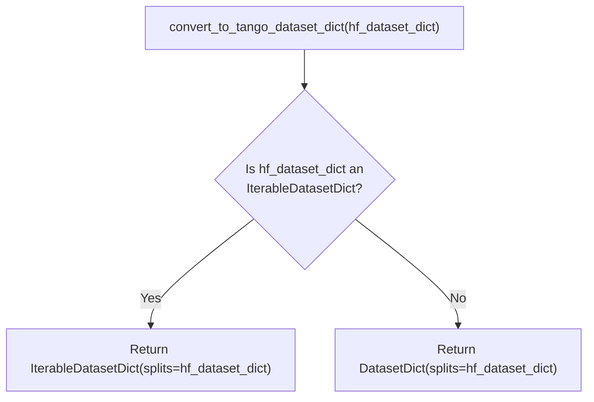
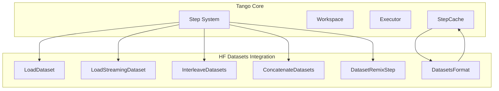

<!-- source: DeepWiki mcp.deepwiki.com · repo allenai/tango · page 6.5 Hugging Face Datasets · fetched 2026-10-26 -->

# Hugging Face Datasets

<details>
<summary>Relevant source files</summary>

The following files were used as context for generating this wiki page:

- [docs/source/api/integrations/datasets.rst](docs/source/api/integrations/datasets.rst)
- [tango/integrations/beaker/entrypoint.sh](tango/integrations/beaker/entrypoint.sh)
- [tango/integrations/datasets/__init__.py](tango/integrations/datasets/__init__.py)
- [tests/integrations/datasets/dataset_test.py](tests/integrations/datasets/dataset_test.py)

</details>


This page documents Tango's integration with [🤗 Datasets](https://huggingface.co/docs/datasets/), a popular library for accessing and manipulating datasets commonly used in machine learning tasks. The integration provides step components for loading, manipulating, and caching datasets from the Hugging Face ecosystem.

## Installation Requirements

To use the Hugging Face Datasets integration, you need to install Tango with the "datasets" extra:

```bash
pip install tango[datasets]
```

Alternatively, you can install the datasets library separately:

```bash
pip install datasets
```

Sources: [tango/integrations/datasets/__init__.py:1-7]()

## Core Components Overview

The Hugging Face Datasets integration in Tango consists of several components that facilitate working with datasets:



Sources: [tango/integrations/datasets/__init__.py:25-49](), [tango/integrations/datasets/__init__.py:76-123](), [tango/integrations/datasets/__init__.py:140-172](), [tango/integrations/datasets/__init__.py:178-202](), [tango/integrations/datasets/__init__.py:205-230](), [tango/integrations/datasets/__init__.py:233-354]()

## Loading Datasets

Tango provides two main steps for loading datasets from Hugging Face:

1. **LoadDataset** (`datasets::load`): For loading regular datasets
2. **LoadStreamingDataset** (`datasets::load_streaming`): For loading streaming/iterable datasets

### LoadDataset

The `LoadDataset` step loads a standard Hugging Face dataset and supports caching to avoid repeated downloads.



Sources: [tango/integrations/datasets/__init__.py:100-137]()

### LoadStreamingDataset

The `LoadStreamingDataset` step is specifically for loading streaming datasets (which cannot be cached in the same way as regular datasets).

Sources: [tango/integrations/datasets/__init__.py:140-172]()

## Dataset Manipulation Steps

The integration provides several steps for manipulating datasets:

### InterleaveDatasets

The `InterleaveDatasets` step interleaves multiple datasets using `datasets.interleave_datasets()`. This is useful when you want to mix examples from different sources, with optional control over the sampling probabilities.

Sources: [tango/integrations/datasets/__init__.py:178-202]()

### ConcatenateDatasets

The `ConcatenateDatasets` step concatenates multiple datasets using `datasets.concatenate_datasets()`. This is useful when you want to combine datasets sequentially.

Sources: [tango/integrations/datasets/__init__.py:205-230]()

### DatasetRemixStep

The `DatasetRemixStep` allows for remixing splits in a `DatasetDict` into new splits. This is particularly useful for creating custom training/validation/test splits.



Example usage of DatasetRemixStep:
```python
new_splits = {
    "all": "train + validation",
    "crossval_train": "train[:1] + validation[1:]",
    "crossval_test": "train[1:] + validation[:1]",
}
step = DatasetRemixStep()
remixed_dataset = step.run(input=dataset_dict, new_splits=new_splits)
```

Sources: [tango/integrations/datasets/__init__.py:233-354](), [tests/integrations/datasets/dataset_test.py:60-73]()

## Format for Storage

The integration includes a `DatasetsFormat` class that extends Tango's `Format` interface to support reading and writing Hugging Face datasets to disk.



Sources: [tango/integrations/datasets/__init__.py:76-97]()

## Conversion Utilities

Tango provides the `convert_to_tango_dataset_dict` function to convert between Hugging Face's dataset dictionaries and Tango's own dataset dictionary classes:



Sources: [tango/integrations/datasets/__init__.py:52-74](), [tests/integrations/datasets/dataset_test.py:15-37]()

## Complete Example

Here's a complete example of how to use the various components of the Hugging Face Datasets integration:

```json
{
  "steps": {
    "train_data": {
      "type": "datasets::load",
      "path": "lhoestq/test"
    },
    "dev_data": {
      "type": "datasets::load",
      "path": "lhoestq/test"
    },
    "concatenated": {
      "type": "datasets::concatenate",
      "datasets": [
        {"ref": "train_data"},
        {"ref": "dev_data"}
      ]
    },
    "interleaved": {
      "type": "datasets::interleave",
      "datasets": [
        {"ref": "train_data"},
        {"ref": "dev_data"}
      ],
      "probabilities": [0.7, 0.3]
    }
  }
}
```

This configuration:
1. Loads the same test dataset twice (as "train_data" and "dev_data")
2. Concatenates the two datasets
3. Creates an interleaved version with different sampling probabilities

You could run this with:
```bash
tango run config.json
```

Sources: [tango/integrations/datasets/__init__.py:9-23](), [tests/integrations/datasets/dataset_test.py:39-49]()

## Integration with Tango Step System

The Hugging Face Datasets integration leverages Tango's Step system for caching, dependency management, and workflow orchestration. Here's how it fits into the larger Tango ecosystem:



The integration components are registered with Tango's core systems:
- All dataset steps extend the `Step` class
- `DatasetsFormat` extends the `Format` class
- Steps are registered with specific names in the Tango registry

Sources: [tango/integrations/datasets/__init__.py:80-81](), [tango/integrations/datasets/__init__.py:100-101](), [tango/integrations/datasets/__init__.py:140-141](), [tango/integrations/datasets/__init__.py:178-179](), [tango/integrations/datasets/__init__.py:205-206](), [tango/integrations/datasets/__init__.py:233-234]()

## Caching Behavior

Different steps in the Hugging Face Datasets integration have different caching behaviors:

| Step | CACHEABLE | Notes |
|------|-----------|-------|
| LoadDataset | True | Uses DatasetsFormat for caching |
| LoadStreamingDataset | False | Streaming datasets can't be cached efficiently |
| InterleaveDatasets | False | Not considered worth caching |
| ConcatenateDatasets | False | Not considered worth caching |
| DatasetRemixStep | True | Can be cached |

Even though Hugging Face Datasets has its own caching mechanism, Tango's caching can be beneficial for datasets that take a long time to download from Hugging Face.

Sources: [tango/integrations/datasets/__init__.py:116-122](), [tango/integrations/datasets/__init__.py:153-154](), [tango/integrations/datasets/__init__.py:190-191](), [tango/integrations/datasets/__init__.py:218-219](), [tango/integrations/datasets/__init__.py:272-273]()

## Related Pages

For more information about Tango's step system, see [Step System](#2).
For more information about caching in Tango, see [Step Caching](#2.3).
For more information about Hugging Face Transformers integration, see [Transformers](#6.2).

---

