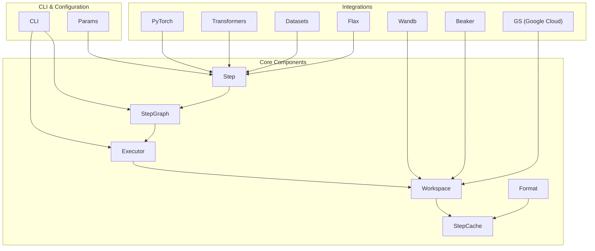
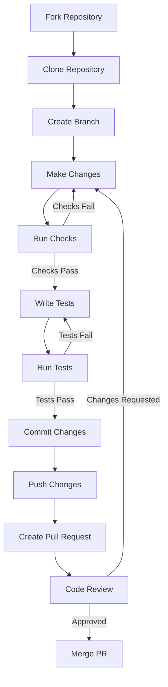
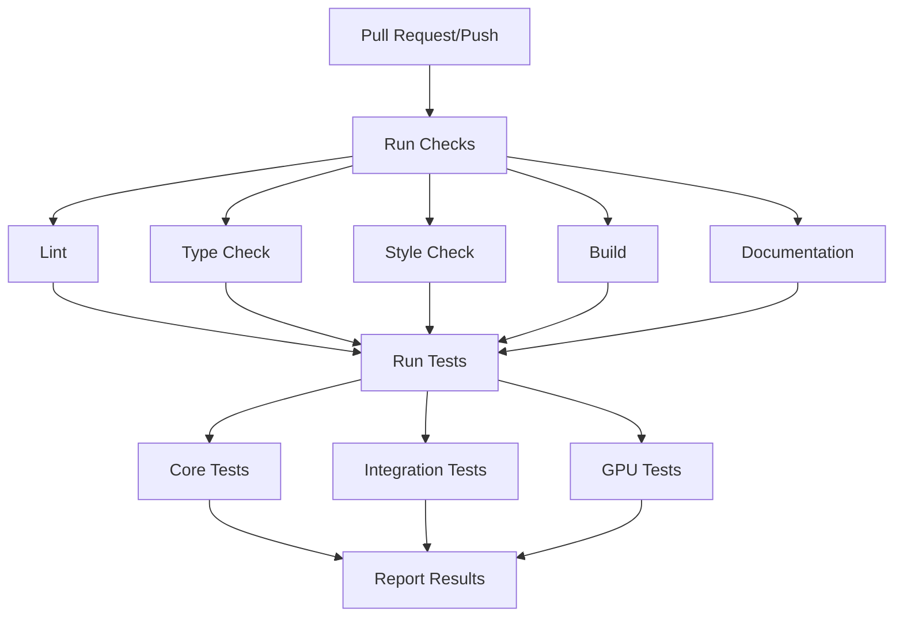
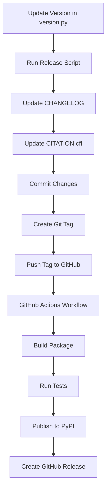
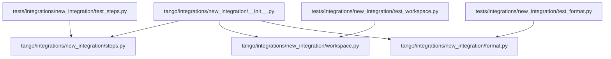

<!-- source: DeepWiki mcp.deepwiki.com · repo allenai/tango · page 7 Development · fetched 2026-10-26 -->

# Development

<details>
<summary>Relevant source files</summary>

The following files were used as context for generating this wiki page:

- [.github/workflows/main.yml](.github/workflows/main.yml)
- [CHANGELOG.md](CHANGELOG.md)
- [CITATION.cff](CITATION.cff)
- [RELEASE_PROCESS.md](RELEASE_PROCESS.md)
- [pyproject.toml](pyproject.toml)
- [scripts/prepare_changelog.py](scripts/prepare_changelog.py)
- [scripts/prepare_citation_cff.py](scripts/prepare_citation_cff.py)
- [scripts/release.sh](scripts/release.sh)
- [tango/common/file_lock.py](tango/common/file_lock.py)
- [tango/integrations/torch/optim.py](tango/integrations/torch/optim.py)
- [tango/integrations/transformers/__init__.py](tango/integrations/transformers/__init__.py)
- [tango/version.py](tango/version.py)

</details>


This page provides information for developers who want to contribute to the Tango codebase. It covers the development environment setup, code organization, testing procedures, and release process.

## Development Environment Setup

To set up a development environment for Tango:

1. Clone the repository:
   ```bash
   git clone https://github.com/allenai/tango.git
   cd tango
   ```

2. Create a virtual environment:
   ```bash
   python -m venv .venv
   source .venv/bin/activate  # On Windows: .venv\Scripts\activate
   ```

3. Install Tango in development mode with all required dependencies:
   ```bash
   pip install -e ".[dev,all]"
   ```

   For a lighter installation with specific integrations, you can choose which extras to install:
   ```bash
   pip install -e ".[dev,torch,transformers]"
   ```

Sources: [pyproject.toml:42-111](), [.github/workflows/main.yml:164-225]()

## Code Organization

Tango follows a modular architecture with several key components:



The main components of Tango are:

- **Step**: The fundamental unit of computation in Tango
- **StepGraph**: Manages dependencies between steps
- **Executor**: Responsible for executing steps and handling caching
- **Workspace**: Manages the storage of step results and metadata
- **Format**: Handles serialization and deserialization of step results

Sources: [tango/version.py:1-9]()

## Development Workflow

The typical development workflow for contributing to Tango is:



Sources: [.github/workflows/main.yml:27-257]()

## Testing

Tango uses pytest for testing. Tests are organized to match the structure of the codebase.

### Running Tests

To run all the tests:

```bash
pytest
```

To run tests for a specific module:

```bash
pytest tests/path/to/test_module.py
```

To run tests for a specific integration:

```bash
pytest tests/integrations/torch/
```

### Test Types

Tango has several types of tests:

| Test Type | Description | Command |
|-----------|-------------|---------|
| Unit Tests | Test individual components | `pytest tests/` |
| Integration Tests | Test integrations with other libraries | `pytest tests/integrations/` |
| End-to-end Tests | Test complete workflows | `pytest tests/end_to_end/` |
| GPU Tests | Tests that require GPU | `pytest -m gpu tests/` |
| Documentation Tests | Test code examples in docstrings | `pytest --doctest-modules tango/` |

### CI/CD Pipeline

Tango uses GitHub Actions for continuous integration. The CI pipeline runs on every pull request and push to the main branch.



Sources: [.github/workflows/main.yml:27-302]()

## Style Guide

Tango follows these code quality tools:

- **Black**: For code formatting
- **isort**: For import sorting
- **Ruff**: For linting
- **mypy**: For type checking

You can run these tools locally:

```bash
# Format code
black .
isort .

# Check code
ruff check .
mypy --check-untyped-defs .
```

Sources: [pyproject.toml:140-210](), [.github/workflows/main.yml:39-69]()

## Release Process

Tango follows semantic versioning. The release process is automated through a release script.



### Release Steps

1. Update the version in `tango/version.py`
2. Run the release script:
   ```bash
   ./scripts/release.sh
   ```
3. The script will:
   - Update the CHANGELOG.md
   - Update CITATION.cff
   - Commit the changes
   - Create a git tag
   - Push the tag to GitHub
4. GitHub Actions will:
   - Build the package
   - Run tests
   - Publish to PyPI
   - Create a GitHub release

Sources: [RELEASE_PROCESS.md:1-25](), [scripts/release.sh:1-21](), [scripts/prepare_changelog.py:1-39](), [scripts/prepare_citation_cff.py:1-26](), [CHANGELOG.md:1-15]()

## Adding a New Integration

Tango is designed to be extensible with integrations to other libraries. To add a new integration:

1. Create a new directory in `tango/integrations/`
2. Create an `__init__.py` file that checks for the required dependencies
3. Implement the integration components
4. Add tests in `tests/integrations/`
5. Add the integration to `pyproject.toml` as an optional dependency

Here's an example structure for a new integration:



Sources: [tango/integrations/transformers/__init__.py:1-171](), [pyproject.toml:74-111]()

## Project Structure

Tango is organized into several key directories:

| Directory | Description |
|-----------|-------------|
| `tango/` | Core code |
| `tango/integrations/` | Integrations with other libraries |
| `tests/` | Test code |
| `scripts/` | Utility scripts for development |
| `docs/` | Documentation |
| `examples/` | Example configurations and code |

Sources: [.github/workflows/main.yml:75-148](), [pyproject.toml:120-131]()

## Common Development Tasks

### Adding a New Step

Steps are the fundamental unit of computation in Tango. To add a new step:

1. Create a new class that inherits from `Step`
2. Implement the `run` method
3. Register the step using the `@Step.register('name')` decorator
4. Add tests for the step

### Adding a New Format

Formats handle serialization and deserialization of step results. To add a new format:

1. Create a new class that inherits from `Format`
2. Implement the `read` and `write` methods
3. Register the format using the `@Format.register('name')` decorator
4. Add tests for the format

### Adding a New Workspace

Workspaces manage storage of step results and metadata. To add a new workspace:

1. Create a new class that inherits from `Workspace`
2. Implement the required methods
3. Register the workspace using the `@Workspace.register('name')` decorator
4. Add tests for the workspace

Sources: [tango/integrations/torch/optim.py:1-89](), [tango/common/file_lock.py:1-74]()

---

