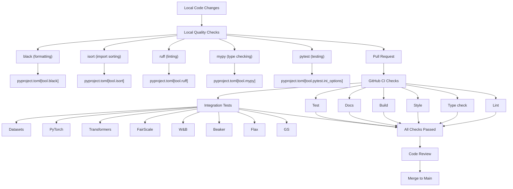

<!-- source: DeepWiki mcp.deepwiki.com · repo allenai/tango · page 7.1 Contributing · fetched 2026-10-26 -->

# Contributing

<details>
<summary>Relevant source files</summary>

The following files were used as context for generating this wiki page:

- [.github/workflows/main.yml](.github/workflows/main.yml)
- [CITATION.cff](CITATION.cff)
- [RELEASE_PROCESS.md](RELEASE_PROCESS.md)
- [pyproject.toml](pyproject.toml)
- [scripts/prepare_changelog.py](scripts/prepare_changelog.py)
- [scripts/prepare_citation_cff.py](scripts/prepare_citation_cff.py)
- [scripts/release.sh](scripts/release.sh)
- [tango/common/file_lock.py](tango/common/file_lock.py)
- [tango/integrations/torch/optim.py](tango/integrations/torch/optim.py)
- [tango/integrations/transformers/__init__.py](tango/integrations/transformers/__init__.py)

</details>


This page provides guidelines for contributing to the Tango project. It covers setting up your development environment, understanding code quality requirements, testing your changes, and the overall contribution workflow.

For information about the release process, see [Release Process](#7.3).

## Development Environment Setup

To set up a development environment for Tango, you'll need to install the project with its development dependencies.

1. Fork and clone the repository:
   ```bash
   git clone https://github.com/yourusername/tango.git
   cd tango
   ```

2. Create and activate a virtual environment (optional but recommended):
   ```bash
   python -m venv .venv
   source .venv/bin/activate  # On Windows, use `.venv\Scripts\activate`
   ```

3. Install the project with development dependencies:
   ```bash
   pip install -e ".[dev]"
   ```

   For working with specific integrations, you can include additional extras:
   ```bash
   # For all integrations
   pip install -e ".[dev,all]"
   
   # For specific integrations
   pip install -e ".[dev,torch,transformers]"
   ```

Sources: [pyproject.toml:42-66](), [.github/workflows/main.yml:171-219]()

## Code Quality Standards

Tango maintains high code quality standards through several tools that are run automatically in the CI/CD pipeline. You should run these tools locally before submitting a pull request.

### Formatting and Style

Tango uses Black and isort for code formatting and import sorting:

```bash
# Check formatting
black --check .
isort --check .

# Fix formatting
black .
isort .
```

### Linting

Tango uses Ruff for linting:

```bash
ruff check .
```

### Type Checking

Tango uses Mypy for type checking:

```bash
mypy --check-untyped-defs .
```

Sources: [pyproject.toml:140-190](), [.github/workflows/main.yml:39-63]()

## Tango Project Structure

### Component and Contribution Architecture

```mermaid
graph TD
    ContributorRole["Contributor"] --> CodeChanges["Code Changes"]
    CodeChanges --> TangoComponents["Tango Components"]
    CodeChanges --> TangoIntegrations["Tango Integrations"]
    
    TangoComponents --> StepClass["Step (tango/step.py)"]
    TangoComponents --> StepGraphClass["StepGraph (tango/step_graph.py)"]
    TangoComponents --> ExecutorClass["Executor (tango/executor.py)"] 
    TangoComponents --> WorkspaceClass["Workspace (tango/workspace.py)"]
    TangoComponents --> StepCacheClass["StepCache (tango/step_cache.py)"]
    TangoComponents --> FormatClass["Format (tango/format.py)"]
    
    TangoIntegrations --> PyTorchInt["PyTorch (tango/integrations/torch/)"]
    TangoIntegrations --> TransformersInt["Transformers (tango/integrations/transformers/)"]
    TangoIntegrations --> DatasetsInt["Datasets (tango/integrations/datasets/)"]
    TangoIntegrations --> FairScaleInt["FairScale (tango/integrations/fairscale/)"]
    TangoIntegrations --> FlaxInt["Flax (tango/integrations/flax/)"]
    TangoIntegrations --> WandBInt["W&B (tango/integrations/wandb/)"]
    TangoIntegrations --> BeakerInt["Beaker (tango/integrations/beaker/)"]
    TangoIntegrations --> GSInt["GS (tango/integrations/gs/)"]
    
    PyTorchInt --> TorchModel["Model"]
    PyTorchInt --> TorchOptimizer["Optimizer"]
    PyTorchInt --> TorchLRScheduler["LRScheduler"]
    
    TransformersInt --> TokenizerClass["Tokenizer"]
    TransformersInt --> RunGenerationClass["RunGeneration"]
    TransformersInt --> FinetuneClass["FinetuneStep"]
```



Sources: [tango/integrations/transformers/__init__.py:1-170](), [tango/integrations/torch/optim.py:1-89]()

## Contribution Workflow

### Code Quality and CI/CD Process



Sources: [.github/workflows/main.yml:26-263]()

## Testing

Tango uses pytest for testing. You should run tests locally before submitting a pull request.

### Running Core Tests

```bash
pytest -v --durations=10 --color=yes --doctest-modules --ignore=tests/integrations --ignore=tango/integrations tests/ tango/
```

### Running Integration Tests

For specific integrations:

```bash
# PyTorch integration
pytest -v --color=yes --doctest-modules tango/integrations/torch tests/integrations/torch

# Transformers integration
pytest -v --color=yes --doctest-modules tango/integrations/transformers tests/integrations/transformers
```

Sources: [.github/workflows/main.yml:74-123](), [pyproject.toml:194-210]()

## Documentation

Tango uses Sphinx for documentation. You can build the documentation locally:

```bash
cd docs && make html
```

Sources: [.github/workflows/main.yml:65-69]()

## Integrations

Tango supports various integrations with popular libraries and services. When contributing to an integration, make sure to test it thoroughly.

Available integrations:

| Integration | Description | Extra | File Path |
|-------------|-------------|-------|-----------|
| PyTorch | Integration with PyTorch | torch | tango/integrations/torch/ |
| Transformers | Integration with Hugging Face Transformers | transformers | tango/integrations/transformers/ |
| Datasets | Integration with Hugging Face Datasets | datasets | tango/integrations/datasets/ |
| FairScale | Integration with FairScale | fairscale | tango/integrations/fairscale/ |
| Flax | Integration with JAX/Flax | flax | tango/integrations/flax/ |
| W&B | Integration with Weights & Biases | wandb | tango/integrations/wandb/ |
| Beaker | Integration with Beaker | beaker | tango/integrations/beaker/ |
| GS | Integration with Google Cloud Storage | gs | tango/integrations/gs/ |

Sources: [pyproject.toml:70-111](), [tango/integrations/transformers/__init__.py:1-170]()

## Python Version Compatibility

Tango is compatible with Python 3.8, 3.9, and 3.10. When contributing, ensure your code works across all supported Python versions. The CI pipeline runs tests on all these versions.

Sources: [pyproject.toml:21](), [.github/workflows/main.yml:37-148]()

## GPU Tests

If your contribution involves GPU functionality, note that GPU tests are run separately in the CI pipeline using Beaker. These tests are marked with the `@pytest.mark.gpu` decorator.

Sources: [.github/workflows/main.yml:264-302](), [pyproject.toml:200-202]()

## Common Issues

### File Permissions

When working with shared resources or caches, you might encounter file permission issues. Tango includes a `FileLock` class in `tango/common/file_lock.py` that handles these scenarios gracefully.

Sources: [tango/common/file_lock.py:1-74]()

## Release Process

The release process for Tango is automated but requires manual version updates. For more details, see [Release Process](#7.3).

Sources: [RELEASE_PROCESS.md:1-25](), [scripts/release.sh:1-21](), [scripts/prepare_changelog.py:1-39](), [scripts/prepare_citation_cff.py:1-26]()

## Citation and Credits

When making significant contributions to Tango, you may be added to the citation file. The project uses a CITATION.cff file that includes author information and project details.

Sources: [CITATION.cff:1-20]()

---

