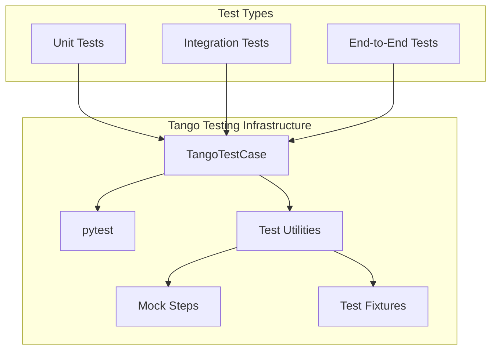
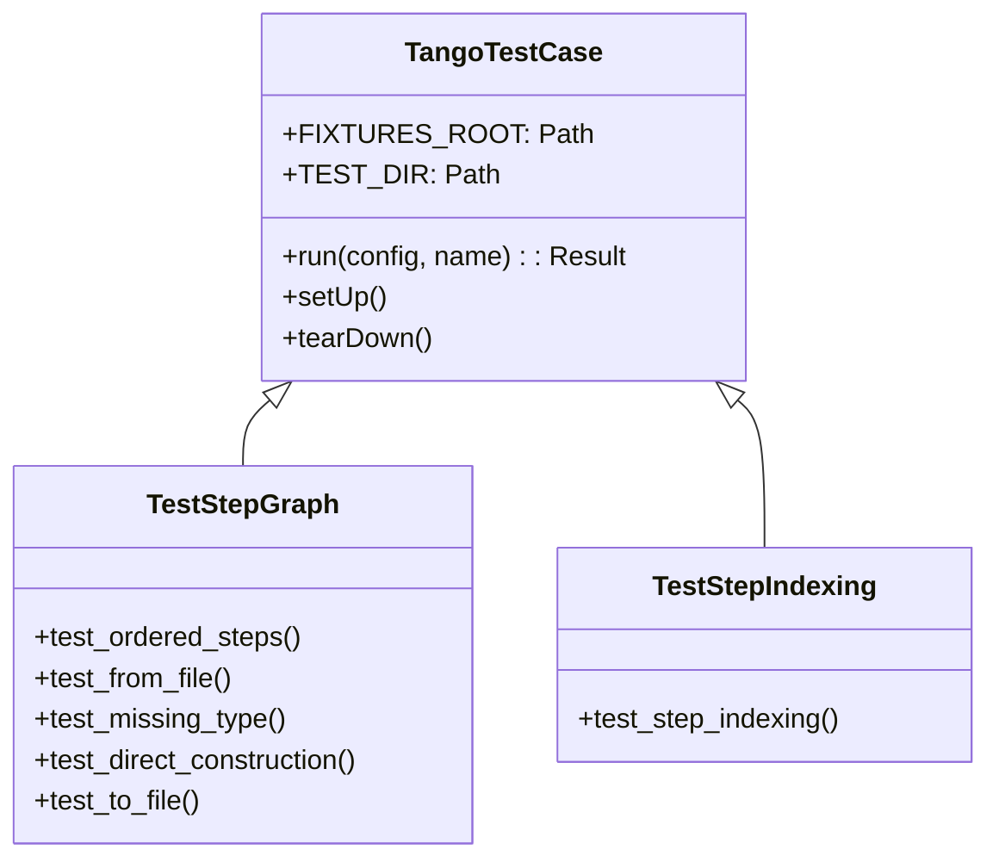
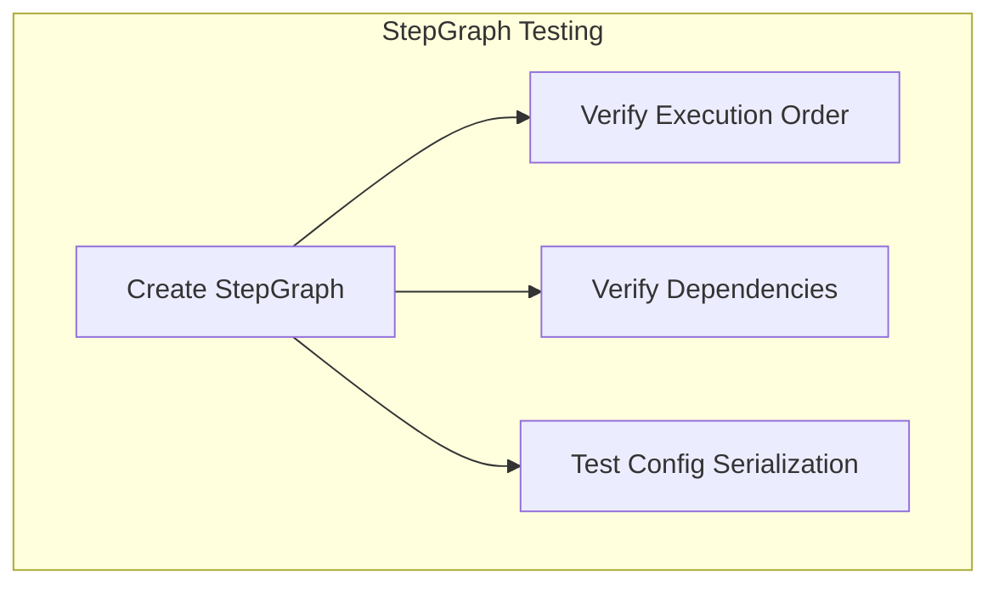
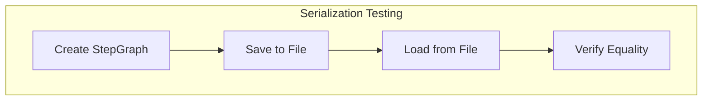

<!-- source: DeepWiki mcp.deepwiki.com · repo allenai/tango · page 7.2 Testing · fetched 2026-10-26 -->

# Testing

<details>
<summary>Relevant source files</summary>

The following files were used as context for generating this wiki page:

- [tango/common/testing/steps.py](tango/common/testing/steps.py)
- [tests/end_to_end/test_step_indexing.py](tests/end_to_end/test_step_indexing.py)
- [tests/step_graph_test.py](tests/step_graph_test.py)

</details>


This page provides comprehensive documentation for testing Tango components. It covers the testing framework, available test utilities, and best practices for writing effective tests for your Tango code. For information about contributing to Tango, see [Contributing](#7.1).

## Testing Framework Overview

Tango uses pytest as its primary testing framework, combined with custom test utilities that simplify testing Tango-specific components. The testing infrastructure is designed to make it easy to test Steps, StepGraphs, Workspaces, and Executors with minimal boilerplate code.



Sources: [tests/step_graph_test.py:7-8]()), [tango/common/testing/steps.py:8-10]()

## TangoTestCase Base Class

The `TangoTestCase` class is the foundation for testing Tango components. It extends the standard pytest functionality with Tango-specific utilities that make it easier to test Steps, StepGraphs, and other Tango components.

Key features of TangoTestCase include:
- Access to test fixtures directory via `self.FIXTURES_ROOT`
- Temporary test directory via `self.TEST_DIR`
- Helper methods for running Tango experiments
- Utilities for setting up and validating workspaces

All Tango component tests should inherit from this class to benefit from these utilities.



Sources: [tests/step_graph_test.py:8-17]()), [tests/end_to_end/test_step_indexing.py:1-4]()

## Mock Steps for Testing

Tango provides a collection of mock Step implementations in `tango/common/testing/steps.py` that can be used in tests. These mock steps have simple, predictable behaviors and are designed to test specific aspects of the Tango framework without the complexity of real-world steps.

| Step Class | Purpose | Behavior |
|------------|---------|----------|
| `FloatStep` | Return a float | Simply returns the provided float |
| `StringStep` | Return a string | Simply returns the provided string |
| `ConcatStringsStep` | Concatenate strings | Joins two strings with an optional separator |
| `NoisyStep` | Test logging | Outputs log messages at different levels |
| `RandomStringStep` | Generate random data | Creates a random string of specified length |
| `AddNumbersStep` | Basic computation | Adds two numbers together |
| `SleepPrintMaybeFail` | Test error handling | Sleeps, prints, and optionally fails |
| `LoggingStep` | Test progress output | Outputs log messages with progress bar |
| `MultiprocessingStep` | Test multiprocessing | Creates child processes with their own logging |
| `RangeOutput` | Generate list output | Returns a range as a list |

Sources: [tango/common/testing/steps.py:13-150]()

## Unit Testing Tango Components

### Testing Steps

When testing custom Steps, you should test both the correct behavior of the Step's `run()` method and how the Step interacts with the Tango framework (e.g., caching, dependency resolution).

Example of a simple Step test:

```python
class TestMyCustomStep(TangoTestCase):
    def test_step_execution(self):
        # Create and run the step
        step = MyCustomStep(param1="value1", param2=123)
        result = step.run()
        
        # Assert expected behavior
        assert result == expected_value
```

### Testing StepGraph

The StepGraph class is responsible for managing the dependencies between Steps and ensuring they execute in the correct order. Testing StepGraph functionality typically involves creating a graph with known dependencies and verifying that the steps are executed in the correct order.



Example test pattern from StepGraph tests:

```python
def test_ordered_steps(self):
    # Create a step graph with known dependencies
    step_graph = StepGraph.from_params({
        "stepB": {
            "type": "add_numbers",
            "a_number": 2,
            "b_number": 3,
        },
        "stepC": {
            "type": "add_numbers",
            "a_number": {"type": "ref", "ref": "stepB"},
            "b_number": 5,
        },
        "stepA": {
            "type": "add_numbers",
            "a_number": 3,
            "b_number": 1,
        },
    })

    # Verify steps are ordered correctly based on dependencies
    result = StepGraph.ordered_steps(step_graph.parsed_steps)
    assert [res.name for res in result] == ["stepB", "stepC", "stepA"]
```

Sources: [tests/step_graph_test.py:17-40]()

### Testing Dependencies and References

Tango's StepGraph allows steps to reference outputs from other steps. Testing this functionality ensures that the dependency resolution works correctly.

Example of testing step dependencies:

```python
def test_with_forced_dependencies(self):
    config = {
        "some_string": {
            "type": "string",
            "result": "I should run second",
            "step_extra_dependencies": [{"type": "ref", "ref": "other_string"}],
        },
        "other_string": {"type": "string", "result": "I should run first"},
        "added": {
            "type": "concat_strings",
            "string1": "Some string:",
            "string2": {"type": "ref", "ref": "some_string"},
        },
    }
    step_graph = StepGraph.from_params(deepcopy(config))
    assert step_graph["some_string"].dependencies == {step_graph["other_string"]}
    assert step_graph["added"].recursive_dependencies == {
        step_graph["other_string"],
        step_graph["some_string"],
    }
```

Sources: [tests/step_graph_test.py:110-129]()

## Integration and End-to-End Testing

Integration tests verify that different Tango components work together correctly. End-to-end tests simulate real-world usage by running complete Tango workflows and verifying the results.

### End-to-End Tests

End-to-end tests typically involve:
1. Creating a configuration for a complete workflow
2. Running the workflow using `self.run()`
3. Verifying the results in the workspace

Example of an end-to-end test:

```python
def test_step_indexing(self):
    run_name = "run1"
    config = {
        "steps": {
            "list": {"type": "range_step", "start": 0, "end": 3},
            "added": {
                "type": "add_numbers",
                "a_number": 2,
                "b_number": {"type": "ref", "ref": "list", "key": 1},
            },
        }
    }
    self.run(config, name=run_name)
    workspace = LocalWorkspace(self.TEST_DIR / "workspace")
    result = workspace.step_result_for_run(run_name, "added")
    assert result == 3
```

Sources: [tests/end_to_end/test_step_indexing.py:5-21]()

## Testing Serialization and Deserialization

Tango relies heavily on serialization and deserialization for caching step results and saving configurations. Testing these aspects ensures that steps can be correctly serialized to and deserialized from storage.



Example from the StepGraph tests:

```python
def test_to_file(self):
    step_graph = StepGraph.from_file(self.FIXTURES_ROOT / "experiment" / "hello_world.jsonnet")

    with NamedTemporaryFile(
        prefix="test-step-graph-to-file-", suffix=".jsonnet", dir=self.TEST_DIR
    ) as file_ref:
        step_graph.to_file(file_ref.name)

        new_step_graph = StepGraph.from_file(file_ref.name)
        assert step_graph == new_step_graph
```

Sources: [tests/step_graph_test.py:70-79]()

## Best Practices for Testing Tango Components

1. **Use TangoTestCase**: Always extend TangoTestCase for access to testing utilities.

2. **Use Mock Steps**: Utilize the provided mock steps for testing instead of creating complex custom steps.

3. **Test Both Success and Failure Cases**: Ensure your tests cover both successful execution and error handling.

4. **Test Configuration Parsing**: Verify that your components can be correctly instantiated from configuration.

5. **Temporary Resources**: Use `self.TEST_DIR` for temporary files to ensure tests clean up after themselves.

6. **Use Fixtures**: The fixtures directory (`self.FIXTURES_ROOT`) contains example files that can be used in tests.

7. **Test Caching Behavior**: Verify that cacheable steps are cached correctly and that cache invalidation works as expected.

8. **Test Determinism**: For deterministic steps, verify that running the step multiple times with the same inputs produces the same output.

## Conclusion

Testing is a critical aspect of developing with Tango. The framework provides robust testing utilities that make it easy to test Steps, StepGraphs, and complete workflows. By following the patterns demonstrated in the existing test suite, you can ensure that your Tango components are reliable and work correctly with the rest of the framework.

For information about the release process, see [Release Process](#7.3).

---

