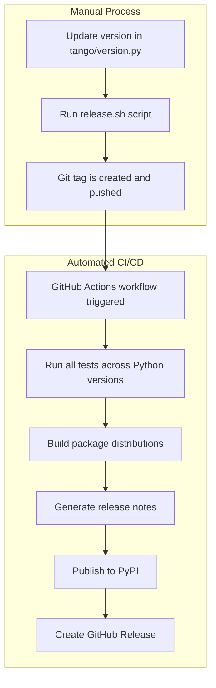
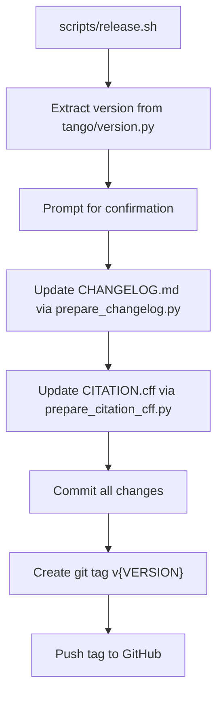
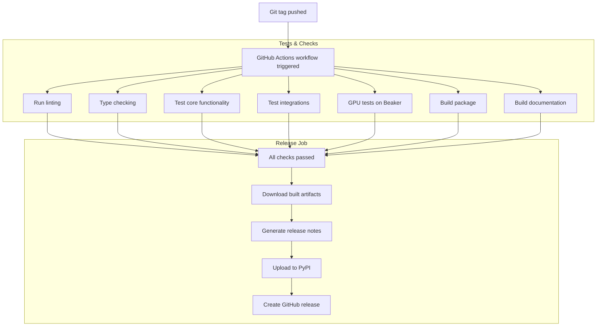
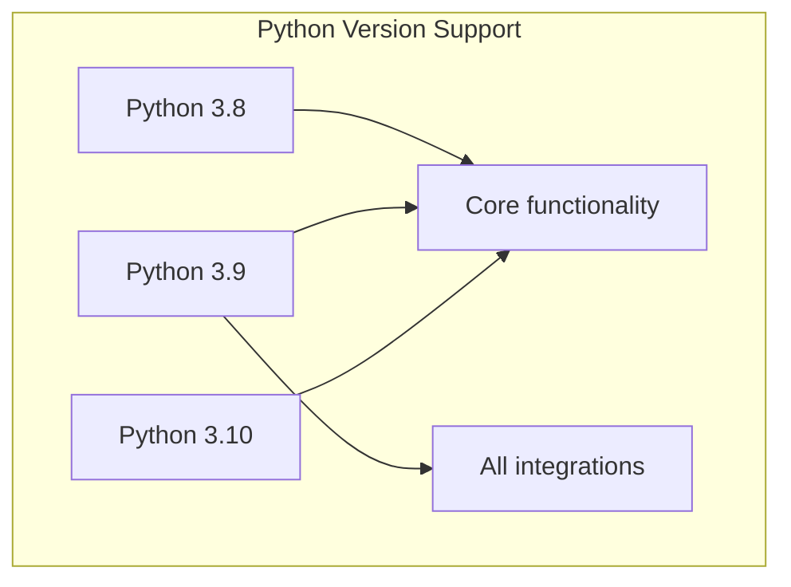

<!-- source: DeepWiki mcp.deepwiki.com · repo allenai/tango · page 7.3 Release Process · fetched 2026-10-26 -->

# Release Process

<details>
<summary>Relevant source files</summary>

The following files were used as context for generating this wiki page:

- [.github/workflows/main.yml](.github/workflows/main.yml)
- [CITATION.cff](CITATION.cff)
- [RELEASE_PROCESS.md](RELEASE_PROCESS.md)
- [pyproject.toml](pyproject.toml)
- [scripts/prepare_changelog.py](scripts/prepare_changelog.py)
- [scripts/prepare_citation_cff.py](scripts/prepare_citation_cff.py)
- [scripts/release.sh](scripts/release.sh)
- [tango/common/file_lock.py](tango/common/file_lock.py)
- [tango/integrations/torch/optim.py](tango/integrations/torch/optim.py)
- [tango/integrations/transformers/__init__.py](tango/integrations/transformers/__init__.py)

</details>


This page documents the process for releasing new versions of Tango. It covers how to prepare and initiate a release, the automated CI/CD pipeline that handles the release, and how to troubleshoot failed releases.

## Overview

The Tango release process follows a semi-automated approach where maintainers manually prepare and initiate the release, after which GitHub Actions takes over to perform testing, building, and publishing of the package to PyPI and GitHub Releases.



Sources: [RELEASE_PROCESS.md:1-25](), [.github/workflows/main.yml:303-347]()

## Manual Release Steps

### 1. Update Version Number

The first step is to update the version number in `tango/version.py`. Tango follows semantic versioning (MAJOR.MINOR.PATCH).

### 2. Run the Release Script

After updating the version, run the release script:

```bash
./scripts/release.sh
```

This script performs several important tasks:



Sources: [scripts/release.sh:1-21](), [scripts/prepare_changelog.py:1-39](), [scripts/prepare_citation_cff.py:1-26]()

The `prepare_changelog.py` script automatically adds a new version section in the CHANGELOG.md file with the current date. It looks for the "Unreleased" section and inserts the new version information below it.

The `prepare_citation_cff.py` script updates the `CITATION.cff` file with the new version number and current release date.

## Automated CI/CD Process

When the git tag is pushed to GitHub, it triggers a GitHub Actions workflow that handles testing, building, and publishing the release.

### CI/CD Workflow



Sources: [.github/workflows/main.yml:1-347]()

### Release Job Details

The release job is triggered only when a tag matching the pattern `v*.*.*` is pushed. It depends on the successful completion of all test jobs. The job performs the following steps:

1. Checkout the repository code
2. Setup Python environment
3. Install requirements
4. Download the package distribution files built in the earlier steps
5. Generate release notes using `scripts/release_notes.py`
6. Upload the package to PyPI using `twine`
7. Create a GitHub release with the generated notes and package files

The release job sets the `prerelease` flag to true if the version contains `rc` (release candidate).

Sources: [.github/workflows/main.yml:303-347]()

## Package Dependencies and Artifacts

Tango is published with several optional dependencies that users can choose to install. These are defined in `pyproject.toml` and include:

| Extra | Purpose |
|-------|---------|
| dev | Development tools |
| torch | PyTorch integration |
| transformers | Hugging Face Transformers integration |
| datasets | Hugging Face Datasets integration |
| fairscale | FairScale integration |
| flax | JAX/Flax integration |
| wandb | Weights & Biases integration |
| beaker | Beaker integration |
| gs | Google Cloud Storage integration |
| all | All of the above |

Sources: [pyproject.toml:42-111]()

## Fixing Failed Releases

If the GitHub Actions release workflow fails, you need to:

1. Delete the release tag from GitHub
2. Delete the tag from your local repository:
   ```bash
   git tag -l | xargs git tag -d && git fetch -t
   ```
3. Fix the issue that caused the failure
4. Repeat the release process from the beginning

Sources: [RELEASE_PROCESS.md:16-25]()

## Version Compatibility

Tango maintains compatibility with multiple Python versions. The core functionality is tested against Python 3.8, 3.9, and 3.10, while integrations are primarily tested on Python 3.9.



Sources: [.github/workflows/main.yml:27-148](), [pyproject.toml:21-22]()

## Integration Testing

During the release process, Tango runs tests for all its integrations to ensure compatibility:

| Integration | Testing |
|-------------|---------|
| PyTorch | Unit tests for torch integration |
| Transformers | Unit tests for transformers integration |
| Datasets | Unit tests for datasets integration |
| FairScale | Unit tests for fairscale integration |
| Weights & Biases | Unit tests for wandb integration |
| Beaker | Unit tests for beaker integration |
| Flax | Unit tests for flax integration |
| Google Cloud Storage | Unit tests for gs integration |

Sources: [.github/workflows/main.yml:77-123](), [tango/integrations/transformers/__init__.py:1-171](), [tango/integrations/torch/optim.py:1-89]()

---

