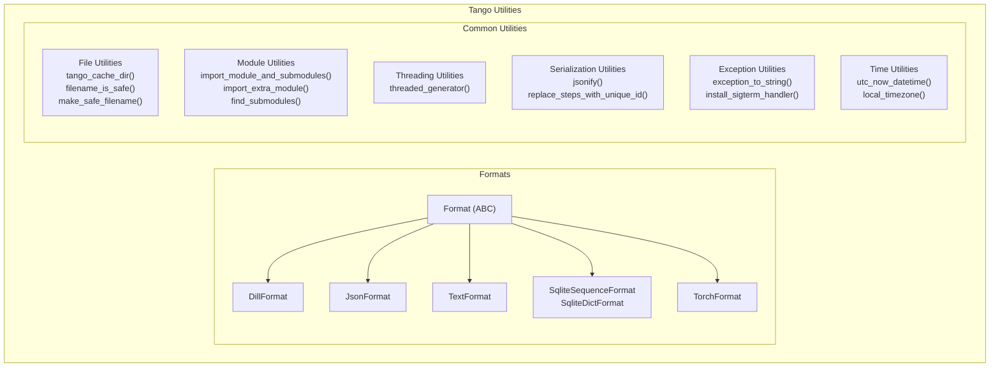
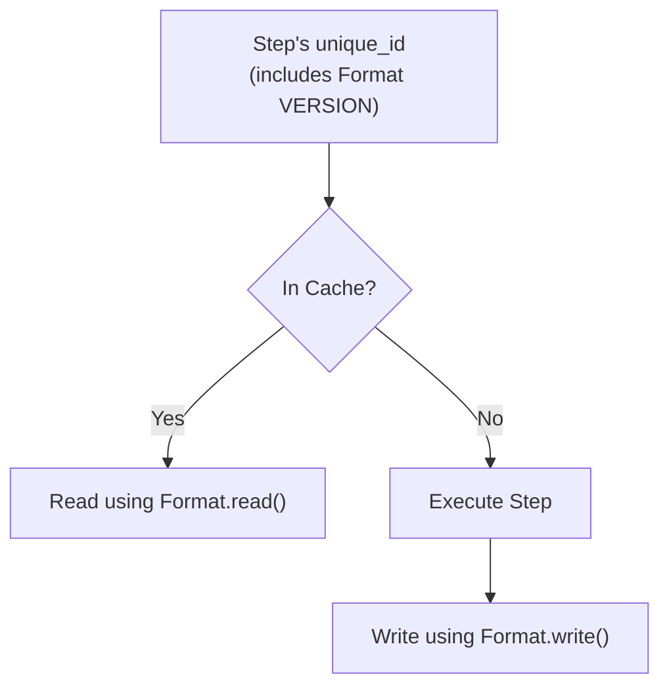
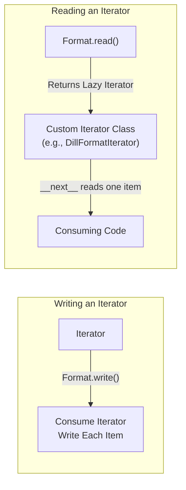
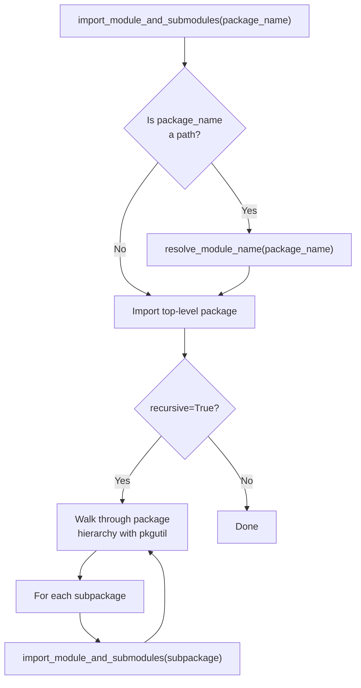
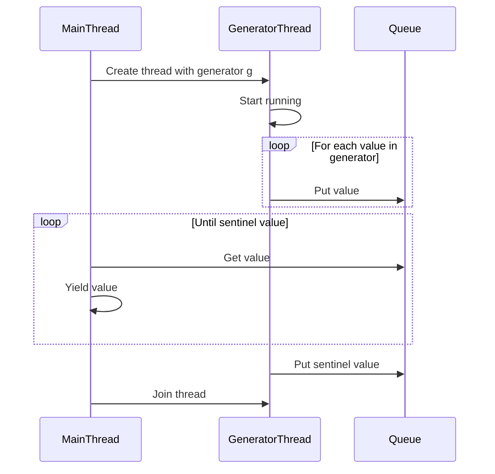

<!-- source: DeepWiki mcp.deepwiki.com · repo allenai/tango · page 8 Utilities · fetched 2026-10-26 -->

# Utilities

<details>
<summary>Relevant source files</summary>

The following files were used as context for generating this wiki page:

- [tango/common/util.py](tango/common/util.py)
- [tango/format.py](tango/format.py)
- [tango/integrations/torch/format.py](tango/integrations/torch/format.py)
- [tests/common/util_test.py](tests/common/util_test.py)
- [tests/format_test.py](tests/format_test.py)

</details>


This page documents the utility modules and functions in Tango that provide common functionality across the framework. These utilities include serialization formats and helper functions that support Tango's core components. For specific format implementations used with ML frameworks, see [Integrations](#6).

## Overview

Tango's utility components serve two main purposes:

1. **Formats** - Serialization and deserialization of step results
2. **Common Utilities** - Helper functions for file operations, module importing, threading, etc.



Sources: [tango/format.py:38-70](), [tango/common/util.py]()

## Formats

Formats in Tango handle the serialization and deserialization of step results. The `Format` class is an abstract base class that defines the interface for all format implementations.

### Format Base Class

The `Format` abstract base class defines two key methods that all format implementations must provide:
- `write(artifact, dir)` - Writes an artifact to a directory
- `read(dir)` - Reads an artifact from a directory

```mermaid
classDiagram
    class "Format[T]" {
        +VERSION: str
        +write(artifact: T, dir: PathOrStr)
        +read(dir: PathOrStr) -> T
        +_to_params() -> Dict[str, Any]
    }
    
    class "Registrable" {
        +register(name, constructor)
        +by_name(name)
    }
    
    "Registrable" <|-- "Format[T]"
    
    class "DillFormat[T]" {
        +VERSION = "001"
        +__init__(compress: Optional[str] = None)
        +write(artifact: T, dir: PathOrStr)
        +read(dir: PathOrStr) -> T
    }
    
    class "JsonFormat[T]" {
        +VERSION = "002"
        +__init__(compress: Optional[str] = None)
        +write(artifact: T, dir: PathOrStr)
        +read(dir: PathOrStr) -> T
    }
    
    class "TextFormat" {
        +VERSION = "001"
        +__init__(compress: Optional[str] = None)
        +write(artifact: Union[str, Iterable[str]], dir: PathOrStr)
        +read(dir: PathOrStr) -> Union[str, Iterable[str]]
    }
    
    class "SqliteSequenceFormat[T]" {
        +VERSION = "003"
        +write(artifact: Sequence[T], dir: PathOrStr)
        +read(dir: PathOrStr) -> Sequence[T]
    }
    
    class "SqliteDictFormat" {
        +VERSION = "003"
        +write(artifact: DatasetDict, dir: PathOrStr)
        +read(dir: PathOrStr) -> DatasetDict
    }
    
    class "TorchFormat[T]" {
        +VERSION = "002"
        +write(artifact: T, dir: PathOrStr)
        +read(dir: PathOrStr) -> T
    }
    
    "Format[T]" <|-- "DillFormat[T]"
    "Format[T]" <|-- "JsonFormat[T]"
    "Format[T]" <|-- "TextFormat"
    "Format[T]" <|-- "SqliteSequenceFormat[T]"
    "Format[T]" <|-- "SqliteDictFormat"
    "Format[T]" <|-- "TorchFormat[T]"
```

Sources: [tango/format.py:38-70]()

### Available Format Implementations

Tango provides several built-in format implementations to handle different types of data:

| Format | Description | Best for | Registration Name |
|--------|-------------|----------|-------------------|
| `DillFormat` | Uses dill (enhanced pickle) for serialization | General Python objects | "dill" |
| `JsonFormat` | Uses JSON for serialization | JSON-compatible data structures | "json" |
| `TextFormat` | Text-based format | Strings or iterables of strings | "text" |
| `SqliteSequenceFormat` | Uses SQLite for sequences | Large sequences | "sqlite_sequence" |
| `SqliteDictFormat` | Uses SQLite for datasets | `DatasetDict` objects | "sqlite" |
| `TorchFormat` | PyTorch-specific format | PyTorch models and tensors | "torch" |

Sources: [tango/format.py:106-523](), [tango/integrations/torch/format.py:13-42]()

### Format Versioning

Each format implementation has a `VERSION` attribute. When a format's implementation changes in a backward-incompatible way, its version number is incremented. This version is part of a step's unique identifier, ensuring that changes in serialization format trigger recomputation of steps that use that format.



Sources: [tango/format.py:46-51]()

### Compression Support

Most formats (`DillFormat`, `JsonFormat`, `TextFormat`) support compression to reduce storage space. You can specify a compression method when creating a format instance:

```python
format = DillFormat(compress="gzip")  # Options: None, "gz"/"gzip", "bz"/"bz2"/"bzip"/"bzip2", "lzma"
```

Sources: [tango/format.py:73-103]()

### Working with Iterables

Several formats (`DillFormat`, `JsonFormat`, `TextFormat`) have special support for iterables. When you write an iterator, these formats consume the iterator and store its items. When you read back an iterator, these formats return a lazy iterator that reads items on demand, minimizing memory usage.



Sources: [tango/format.py:161-190](), [tango/format.py:298-320](), [tango/format.py:392-416]()

## Common Utilities

Tango provides several utility functions to handle common tasks across the framework. These are organized in the `tango.common.util` module.

### File and Path Utilities

#### Cache Directory

The `tango_cache_dir()` function returns a directory suitable for caching Tango-related data, typically `$HOME/.cache/tango`.

Sources: [tango/common/util.py:19-26]()

#### Filename Safety

Tango provides utilities to check and ensure that filenames are safe to use:

- `filename_is_safe(filename)` - Checks if a filename only contains safe characters
- `make_safe_filename(name)` - Converts a string to a safe filename by removing unsafe characters and adding a hash if needed

Sources: [tango/common/util.py:204-220]()

### Module Importing Utilities

Tango includes several utilities for importing modules and discovering submodules:



The key module utilities include:

- `import_module_and_submodules(package_name, exclude=None, recursive=True)` - Imports a module and all its submodules
- `import_extra_module(package_name)` - Imports a module and tracks it as an "extra" module
- `find_submodules(module=None, match=None, exclude=None, recursive=True)` - Finds all submodules of a module
- `find_integrations()` - Finds all Tango integration modules

Sources: [tango/common/util.py:37-201]()

### Threading Utilities

The `threaded_generator(g, queue_size=16)` function puts the generating side of a generator into its own thread. This is useful when you have a generator that reads data and a consumer that processes the data, allowing both to run concurrently:



Sources: [tango/common/util.py:233-266]()

### Serialization Utilities

Tango includes utilities for handling serialization of objects:

- `jsonify(o)` - Transforms an object into a JSON-serializable equivalent in a deterministic way
- `replace_steps_with_unique_id(o)` - Replaces Step objects with references to their unique IDs, useful for serialization

Sources: [tango/common/util.py:289-323]()

### Exception and Signal Handling

Tango provides utilities for handling exceptions and signals:

- `exception_to_string(e)` - Converts an exception to a string including stack trace
- `install_sigterm_handler()` - Installs a handler for SIGTERM signals to allow graceful shutdown

Sources: [tango/common/util.py:29-34](), [tango/common/util.py:268-278]()

### Date and Time Utilities

Tango includes utilities for working with date and time:

- `utc_now_datetime()` - Returns the current UTC datetime with timezone info
- `local_timezone()` - Returns the local timezone

Sources: [tango/common/util.py:281-287]()

### Other Utilities

- `could_be_class_name(name)` - Checks if a string could be a valid Python class name
- `_is_valid_python_name(name)` - Checks if a string is a valid Python identifier
- `StrEnum` - A string-based enum class that returns its string value when converted to a string

Sources: [tango/common/util.py:222-328]()

---

