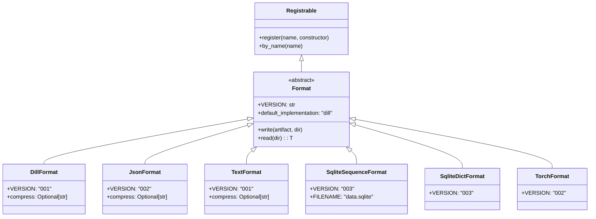
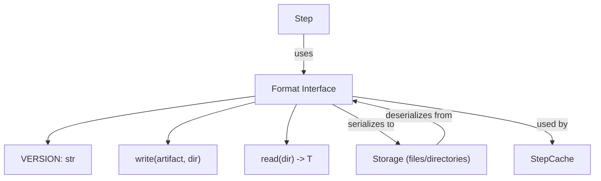
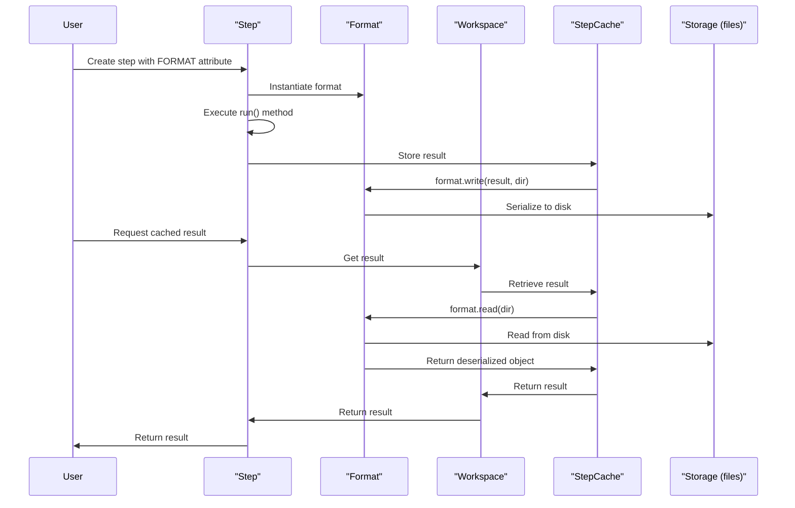
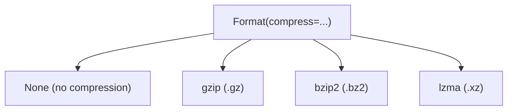
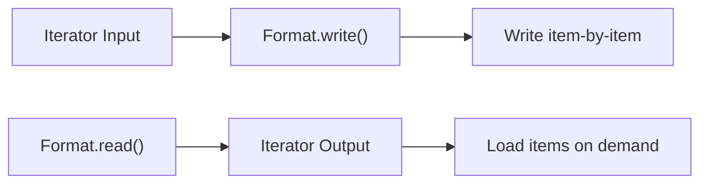
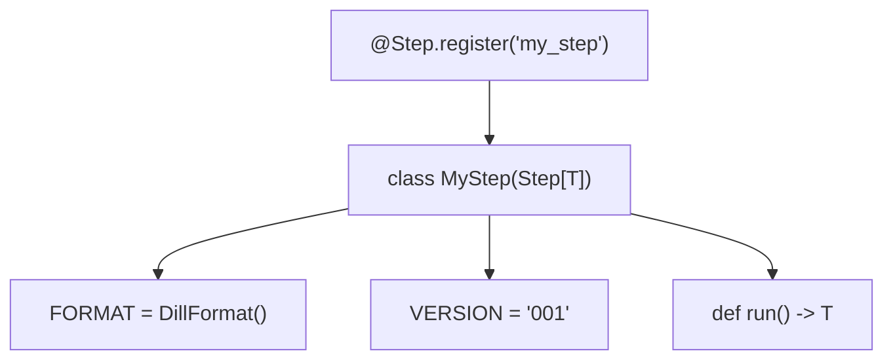
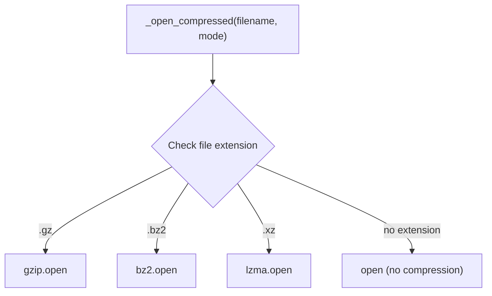

<!-- source: DeepWiki mcp.deepwiki.com · repo allenai/tango · page 8.1 Formats · fetched 2026-10-26 -->

# Formats

Relevant source files

The following files were used as context for generating this wiki page:

- [tango/format.py](tango/format.py)
- [tango/integrations/torch/format.py](tango/integrations/torch/format.py)
- [tests/format_test.py](tests/format_test.py)

## Purpose and Scope

The Format system in Tango is responsible for serializing and deserializing artifacts (typically the results of Steps) to and from storage. Formats define how data is written to and read from a workspace directory, enabling the caching mechanism that is central to Tango's efficiency. This document details the available formats, their capabilities, and guidelines for choosing the appropriate format for different use cases.

## Format System Architecture

The Format system is built around a core abstract class that defines a common interface, with multiple concrete implementations for different serialization needs.

Sources: [tango/format.py:38-70](), [tango/integrations/torch/format.py:13-41]()

## Core Format Interface

The `Format` class is a subclass of `Registrable` and defines the interface that all serialization formats must implement:

Each Format has a `VERSION` attribute which becomes part of a step's unique signature. This ensures that if a format implementation changes in a way that affects serialization, dependent steps will be recomputed.

Sources: [tango/format.py:38-70]()

## Built-in Formats

Tango provides several built-in formats to handle different types of data:

### DillFormat

The default format that uses `dill` (an extension of Python's pickle) to serialize objects.

Key features:
- Supports most Python objects
- Optional compression (None, gzip, bz2, lzma)
- Special support for iterables - consumes iterators during writing, enables lazy reading during retrieval

Sources: [tango/format.py:106-189]()

### JsonFormat

Serializes objects to JSON format.

Key features:
- Human-readable output
- Optional compression
- Support for iterables (written as JSONL)
- Fallback mechanism for non-JSON-serializable objects (like PyTorch tensors and dataclasses)

Sources: [tango/format.py:192-320]()

### TextFormat

Writes objects as plain text.

Key features:
- Works with strings or iterables of strings
- Optional compression
- Ideal for human-readable, line-based outputs

**Warning**: If your strings contain newlines, TextFormat will split them when reading, which may not be desired. Consider using JsonFormat instead for such cases.

Sources: [tango/format.py:323-416]()

### SqliteSequenceFormat

Stores sequences in SQLite database files.

Key features:
- Efficient storage for large sequences
- Supports lazy loading
- Allows random access to sequence elements

Sources: [tango/format.py:419-439]()

### SqliteDictFormat

Specifically designed for `DatasetDict` objects, storing each split in a separate SQLite database.

Key features:
- Fast writing and reading of large datasets
- Lazy loading of instances
- Efficient for large datasets with multiple splits

Sources: [tango/format.py:442-522]()

### TorchFormat

A PyTorch-specific format that uses `torch.save()`.

Key features:
- Specialized for PyTorch models and tensors
- Uses dill as the pickle module for better serialization

Sources: [tango/integrations/torch/format.py:13-41]()

## Format Integration in Tango Workflow

The following diagram illustrates how Formats integrate with the Step system and caching mechanism in Tango:

Sources: [tango/format.py:38-70]()

## Format Selection Guidelines

The following table provides guidance on choosing the appropriate format for different use cases:

| Format | Best For | Limitations |
|--------|----------|-------------|
| DillFormat | General Python objects, quick prototyping | Not human-readable |
| JsonFormat | Human-readable data, sharing with other tools | Limited to JSON-serializable types (with extensions) |
| TextFormat | Simple strings, line-based outputs | Only for strings or string iterables |
| SqliteSequenceFormat | Large sequences with random access | Only for sequences |
| SqliteDictFormat | Large datasets with splits | Only for DatasetDict objects |
| TorchFormat | PyTorch models and tensors | PyTorch-specific |

## Special Features

### Compression Support

Most text-based formats support compression options to reduce storage requirements:

The compression parameter controls which compression algorithm is used, and the appropriate file extension is automatically added.

Sources: [tango/format.py:73-85](), [tango/format.py:95-103]()

### Iterator Support

Many formats provide special handling for iterators:

When writing an iterator, the format consumes it and writes items incrementally. When reading, it returns a new iterator that loads items as needed, enabling efficient processing of large datasets.

Sources: [tango/format.py:161-189](), [tango/format.py:298-320]()

## Integration with Step System

Steps typically declare a format for their results using the `FORMAT` class attribute:

The format is used automatically by the StepCache when the step's result is stored and retrieved.

## SqliteDictFormat Best Practices

For handling large datasets, `SqliteDictFormat` offers significant performance advantages:

1. Create a `SqliteSparseSequence` in the step's work directory for each dataset split
2. Append instances to these sequences
3. Return a `DatasetDict` containing these sequences

This approach enables:
- Fast writing of results
- Instantaneous caching
- Resumable processing if a step fails
- Lazy loading of instances when reading

Sources: [tango/format.py:442-492]()

## Compression Handling

Tango provides utility functions to handle compressed files transparently:

This allows formats to read and write compressed files without having to handle the compression details themselves.

Sources: [tango/format.py:73-103]()

## Versioning

Each format implementation includes a `VERSION` attribute that becomes part of a step's unique signature. When a format's implementation changes in a way that affects serialization, incrementing this version ensures that cached results using the old format version will be recomputed.

Sources: [tango/format.py:46-51]()

---

