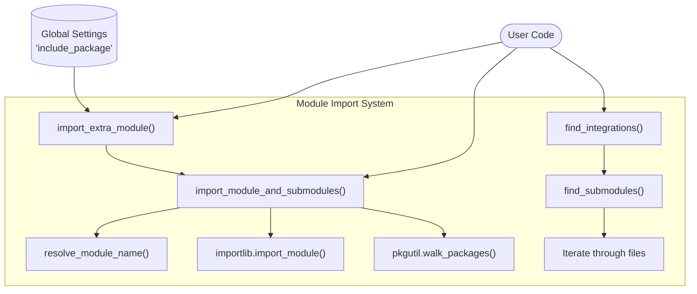
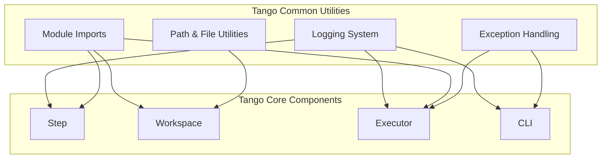

<!-- source: DeepWiki mcp.deepwiki.com · repo allenai/tango · page 8.2 Common Utilities · fetched 2026-10-26 -->

# Common Utilities

<details>
<summary>Relevant source files</summary>

The following files were used as context for generating this wiki page:

- [docs/source/api/logging.rst](docs/source/api/logging.rst)
- [tango/__main__.py](tango/__main__.py)
- [tango/common/logging.py](tango/common/logging.py)
- [tango/common/util.py](tango/common/util.py)
- [tango/steps/print.py](tango/steps/print.py)
- [tests/common/util_test.py](tests/common/util_test.py)

</details>


Tango provides a collection of common utility functions and systems that support the framework's core functionality. These utilities handle critical tasks such as logging, module importing, exception handling, and path management. This document covers the general-purpose utilities located in the `tango.common` package that are used throughout the framework.

For information about specific formats used for data serialization, see [Formats](#8.1).

## Overview

The common utilities in Tango can be categorized into several main areas:

```mermaid
flowchart TD
    subgraph "Tango Common Utilities"
        direction LR
        logging["Logging System"]
        imports["Module Imports"]
        files["Path & File Utilities"]
        exceptions["Exception Handling"]
        threading["Threading Utilities"]
        misc["Miscellaneous"]
    end

    logging --> initialize["initialize_logging()"]
    logging --> cli["cli_logger"]
    logging --> file["file_handler()"]
    logging --> worker["initialize_worker_logging()"]

    imports --> importMod["import_module_and_submodules()"]
    imports --> findInteg["find_integrations()"]
    imports --> resolveModule["resolve_module_name()"]

    files --> cacheDir["tango_cache_dir()"]
    files --> safeFile["make_safe_filename()"]

    exceptions --> exToStr["exception_to_string()"]
    exceptions --> sigHandler["install_sigterm_handler()"]

    threading --> threadGen["threaded_generator()"]

    misc --> jsonify["jsonify()"]
    misc --> dateTime["Date & Time Utilities"]
```



Sources: [tango/common/util.py:1-328](), [tango/common/logging.py:1-781]()

## Logging System

Tango uses Python's standard logging module with enhancements to provide rich, configurable logging across the framework. The logging system is designed to work well both in interactive terminal environments and in file-based or automated contexts.

### Key Logging Components

```mermaid
classDiagram
    class "initialize_logging()" {
        +log_level: Optional[str]
        +enable_cli_logs: Optional[bool]
        +file_friendly_logging: Optional[bool]
    }
    
    class "cli_logger" {
        +Logger instance
        +Rich console formatting
        +Markup support
    }
    
    class "file_handler()" {
        +Context manager
        +Routes logs to file
    }
    
    class "initialize_worker_logging()" {
        +worker_rank: Optional[int]
        +Sets up logging in worker process
    }
    
    class "RichHandler" {
        +Extends logging.Handler
        +Adds rich formatting
    }
    
    "initialize_logging()" --> "cli_logger"
    "initialize_logging()" --> "RichHandler"
    "file_handler()" --> "RichHandler"
    "initialize_worker_logging()" --> "initialize_logging()"
```

Sources: [tango/common/logging.py:80-146](), [tango/common/logging.py:445-456](), [tango/common/logging.py:493-536](), [tango/common/logging.py:537-553](), [tango/common/logging.py:743-780]()

### Setting Up Logging

The primary function for configuring logging in Tango is `initialize_logging()`, which sets up handlers, formatters, and log levels. This function is usually called early in the application lifecycle.

```python
# Example usage
from tango.common.logging import initialize_logging, teardown_logging

# Set up logging with info level
initialize_logging(log_level="info", enable_cli_logs=True)

# ... your application code ...

# Clean up at the end
teardown_logging()
```

For worker processes or threads, use `initialize_worker_logging()` to properly configure logging:

```python
# In a worker process
from tango.common.logging import initialize_worker_logging

def worker_function(worker_id):
    # Set up logging with the worker's rank
    initialize_worker_logging(worker_rank=worker_id)
    
    # Now you can use standard logging
    import logging
    logger = logging.getLogger(__name__)
    logger.info("Worker %d started", worker_id)
```

Sources: [tango/common/logging.py:493-536](), [tango/common/logging.py:537-553](), [tango/common/logging.py:693-711]()

### Redirecting Logs to Files

The `file_handler()` context manager allows you to temporarily redirect logs to a file:

```python
from tango.common.logging import file_handler
import logging

logger = logging.getLogger()

# Normal logging to console
logger.info("This goes to the console")

# Redirect to file temporarily
with file_handler("output.log"):
    logger.info("This goes to both console and file")
```

Sources: [tango/common/logging.py:743-780]()

### Command-Line Interface Logging

The `cli_logger` is a specialized logger for command-line interfaces that supports rich text formatting and colored output:

```python
from tango.common.logging import cli_logger

# Simple message
cli_logger.info("Processing complete")

# With rich markup
cli_logger.info("[bold green]Success![/] Processed [underline]%d[/] files", 10)
```

Sources: [tango/common/logging.py:445-456](), [tango/steps/print.py:1-28]()

## Module Import Utilities

Tango provides utilities for dynamically importing modules and discovering components at runtime.

### Import System Overview



Sources: [tango/common/util.py:37-202](), [tango/__main__.py:85-91]()

### Key Import Functions

- `import_module_and_submodules(package_name)`: Imports a package and all its submodules recursively, useful for registering components.
  
- `import_extra_module(package_name)`: Imports a module and remembers it in the global `_extra_imported_modules` set.
  
- `find_integrations()`: Returns an iterable of all integration module names in Tango.

- `resolve_module_name(package_name)`: Converts a file path to a Python module name.

Example usage:

```python
from tango.common.util import import_module_and_submodules, find_integrations

# Import a custom package and all its submodules
import_module_and_submodules("my_custom_package")

# Find all available Tango integrations
for integration in find_integrations():
    print(f"Found integration: {integration}")
```

Sources: [tango/common/util.py:37-202](), [tango/__main__.py:619-625]()

## Path and File Utilities

Tango provides utilities for handling files and paths safely.

### Tango Cache Directory

The `tango_cache_dir()` function returns a directory suitable for caching files from Tango, defaulting to `$HOME/.cache/tango`:

```python
from tango.common.util import tango_cache_dir

# Get the cache directory
cache_dir = tango_cache_dir()
output_file = cache_dir / "my_cached_data.json"
```

Sources: [tango/common/util.py:19-26]()

### Safe Filename Handling

Tango provides utilities to create and validate safe filenames:

- `filename_is_safe(filename)`: Checks if a filename contains only safe characters.
- `make_safe_filename(name)`: Converts an arbitrary string to a safe filename.

```python
from tango.common.util import make_safe_filename

# Convert a potentially unsafe string to a safe filename
unsafe_name = "result file (version 2.0).txt"
safe_name = make_safe_filename(unsafe_name)
```

Sources: [tango/common/util.py:204-219]()

## Exception Handling

Tango provides utilities for handling exceptions and signals.

### Exception to String Conversion

The `exception_to_string(e)` function converts an exception into a string, including the stack trace:

```python
from tango.common.util import exception_to_string

try:
    # Some code that might raise an exception
    result = 1 / 0
except Exception as e:
    error_string = exception_to_string(e)
    print(f"An error occurred: {error_string}")
```

Sources: [tango/common/util.py:268-278]()

### Signal Handling

Tango provides a SIGTERM handler to gracefully handle termination signals:

```python
from tango.common.util import install_sigterm_handler

# Install the handler at the beginning of your script
install_sigterm_handler()
```

Sources: [tango/common/util.py:29-34]()

## Threading Utilities

### Threaded Generator

The `threaded_generator(g, queue_size)` function moves the generating side of a generator into its own thread, which can improve performance when the generator is I/O bound:

```python
from tango.common.util import threaded_generator

def slow_generator():
    for i in range(100):
        # Simulate slow I/O
        time.sleep(0.1)
        yield i

# Process the items in a separate thread
for item in threaded_generator(slow_generator()):
    # Main thread can do processing while the generator runs in background
    process(item)
```

Sources: [tango/common/util.py:233-266]()

## Miscellaneous Utilities

### JSON Utilities

The `jsonify(o)` function transforms an object into a JSON-serializable equivalent in a deterministic way:

```python
from tango.common.util import jsonify
from datetime import datetime

data = {
    "timestamp": datetime.now(),
    "values": (1, 2, 3),
    "metadata": {"name": "example", "tags": {"a", "b", "c"}}
}

# Convert to JSON-serializable format
json_data = jsonify(data)
```

Sources: [tango/common/util.py:304-323]()

### Date and Time Utilities

- `utc_now_datetime()`: Returns the current UTC datetime with timezone info.
- `local_timezone()`: Returns the local timezone.

```python
from tango.common.util import utc_now_datetime, local_timezone

# Get current UTC time
now = utc_now_datetime()

# Get local timezone
local_tz = local_timezone()
```

Sources: [tango/common/util.py:281-286]()

## Integration with Tango Core



Sources: [tango/__main__.py:71-96](), [tango/common/logging.py:1-16]()

The common utilities integrate deeply with Tango's core components:

1. **Logging System**: Used by Steps to log progress, by Executors to report execution status, and by the CLI to provide user feedback.

2. **Module Import Utilities**: Used to dynamically discover and register Step implementations, Workspace types, and Executor implementations.

3. **Path and File Utilities**: Used by Workspaces to safely handle files and directories.

4. **Exception Handling**: Used throughout the framework to handle errors gracefully.

This integration allows Tango to be extensible and configurable while providing a consistent interface for developers.