# Page: Overview

# Overview

<details>
<summary>Relevant source files</summary>

The following files were used as context for generating this wiki page:

- [CHANGELOG.md](CHANGELOG.md)
- [README.md](README.md)
- [docs/source/conf.py](docs/source/conf.py)
- [docs/source/installation.md](docs/source/installation.md)
- [tango/version.py](tango/version.py)

</details>


AI2 Tango is a framework for organizing machine learning experiments into discrete, cacheable steps that can be reused throughout a research project's lifecycle. This document provides a high-level introduction to Tango's architecture, core components, and execution model.

For installation instructions, see [Installation](#1.2). For detailed information about the step system, see [Step System](#2).

## What is Tango?

Tango solves the problem of managing complex machine learning experiments by representing them as directed acyclic graphs (DAGs) of steps. Each step represents a discrete unit of computation (like data loading, preprocessing, model training, or evaluation) that can be cached based on its inputs, making experimentation more efficient and reproducible.

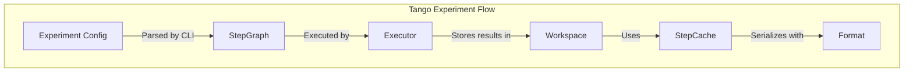

Sources: [README.md:7-9](), [README.md:243-246]()

## Key Features

- **Step-based computation**: Break down complex experiments into discrete, reusable steps
- **Intelligent caching**: Avoid redundant computation by caching step results based on inputs
- **Dependency management**: Automatically track and manage dependencies between steps
- **Multiple storage backends**: Store results locally or remotely (Google Cloud, Beaker, W&B)
- **ML framework integrations**: Work with popular frameworks like PyTorch, Flax, and Hugging Face

Sources: [README.md:97-102](), [CHANGELOG.md:62-72]()

## Core Architecture

Tango's architecture consists of six core components that work together to manage experiment workflows:

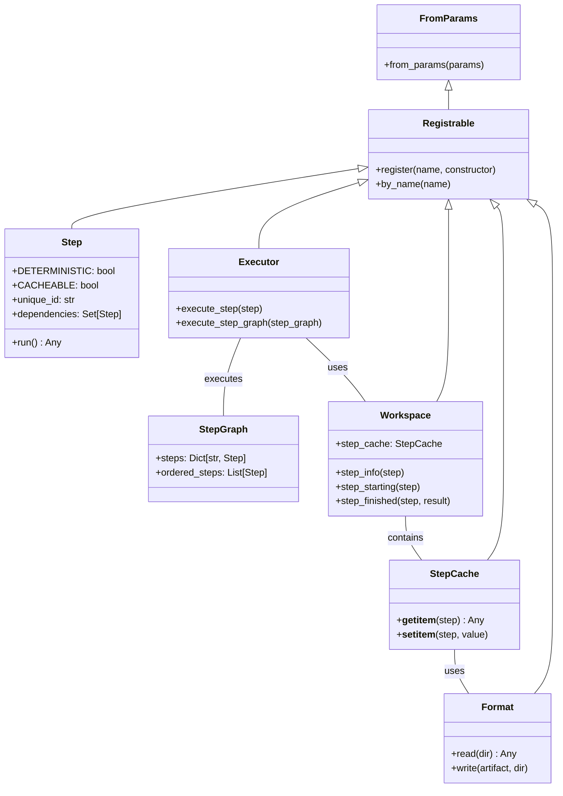

Sources: [README.md:237-251]()

### Core Components

| Component | Description | Primary Responsibility |
|-----------|-------------|------------------------|
| **Step** | Basic unit of computation | Encapsulates a discrete computation with defined inputs and outputs |
| **StepGraph** | Directed acyclic graph of steps | Manages dependencies between steps and their execution order |
| **Executor** | Executes steps in the graph | Runs steps in dependency order, handling parallelism and caching |
| **Workspace** | Manages storage of step results | Provides interfaces to different storage backends |
| **StepCache** | Caches step results | Stores and retrieves results based on step unique IDs |
| **Format** | Handles serialization | Converts step results to/from storable formats |

Sources: [CHANGELOG.md:377-384](), [CHANGELOG.md:395-402]()

## Execution Flow

The following diagram illustrates how Tango executes an experiment:

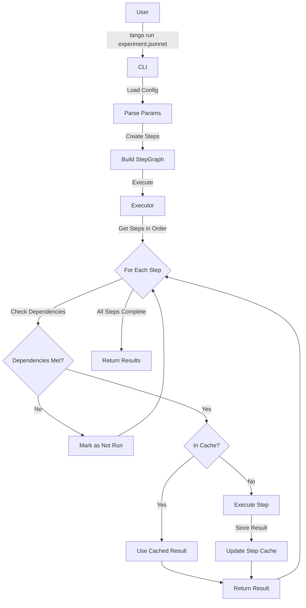

When executing steps, Tango follows these principles:
- Steps are executed in dependency order
- Before executing a step, Tango checks if its result is already in the cache
- Results are automatically cached for future reuse
- Dependencies are tracked automatically between steps

Sources: [CHANGELOG.md:41-43](), [README.md:76-102]()

## The Step System

The `Step` is the fundamental building block in Tango. Steps can be created two ways:

1. Using the `@step()` decorator on functions:

```python
@step()
def hello(name: str) -> str:
    message = f"Hello, {name}!"
    print(message)
    return message
```

2. Creating a class that inherits from `Step`:

```python
class MyStep(Step):
    DETERMINISTIC = True
    CACHEABLE = True
    
    def run(self, input_data):
        # Process input_data and return result
        return processed_data
```

Each step has a unique identifier based on:
1. The step's fully qualified name
2. The step's inputs
3. The step's `VERSION` class variable

This unique ID is used for caching purposes.

Sources: [README.md:53-60](), [README.md:243-251]()

## Integration Ecosystem

Tango integrates with popular ML frameworks and infrastructure tools:

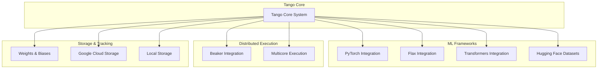

Sources: [CHANGELOG.md:62-72](), [CHANGELOG.md:140-147](), [CHANGELOG.md:332-341]()

## Workspace System

The `Workspace` component manages the storage of step results and metadata. Tango provides several workspace implementations:

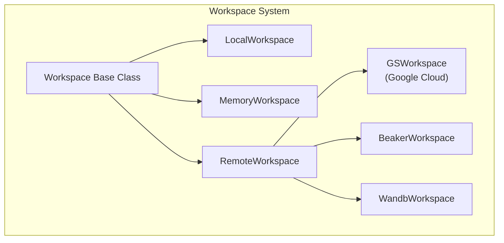

- **LocalWorkspace**: Stores results on the local filesystem
- **MemoryWorkspace**: Keeps results in memory (temporary)
- **GSWorkspace**: Stores results in Google Cloud Storage
- **BeakerWorkspace**: Integrates with Beaker for storage
- **WandbWorkspace**: Integrates with Weights & Biases

Sources: [CHANGELOG.md:579-583](), [CHANGELOG.md:62-72]()

## Getting Started

To create a simple Tango experiment:

1. Define a step:
```python
# hello.py
from tango import step

@step()
def hello(name: str) -> str:
    message = f"Hello, {name}!"
    print(message)
    return message
```

2. Create a configuration file:
```jsonnet
// hello.jsonnet
{
  steps: {
    hello: {
      type: "hello",
      name: "World",
    }
  }
}
```

3. Run the experiment:
```bash
tango run hello.jsonnet -w /tmp/workspace
```

Sources: [README.md:52-95]()

## Conclusion

AI2 Tango provides a structured way to manage machine learning experiments through discrete, cacheable steps. Its modular design and extensive integration ecosystem make it well-suited for research workflows, allowing researchers to focus on experimentation while Tango handles dependency management, caching, and execution.

Current version: 1.3.2

Sources: [version.py:1-8]()

---

# Page: Core Concepts

# Core Concepts

<details>
<summary>Relevant source files</summary>

The following files were used as context for generating this wiki page:

- [CHANGELOG.md](CHANGELOG.md)
- [docs/source/api/components/workspace.rst](docs/source/api/components/workspace.rst)
- [tango/__init__.py](tango/__init__.py)
- [tango/executor.py](tango/executor.py)
- [tango/step.py](tango/step.py)
- [tango/step_cache.py](tango/step_cache.py)
- [tango/step_graph.py](tango/step_graph.py)
- [tango/version.py](tango/version.py)
- [tango/workspace.py](tango/workspace.py)
- [tests/executor_test.py](tests/executor_test.py)
- [tests/main_test.py](tests/main_test.py)
- [tests/step_test.py](tests/step_test.py)

</details>


This document provides an overview of the fundamental concepts and components that make up the Tango framework. Tango is a Python library for choreographing machine learning research, designed to make experiments more reproducible, efficient, and manageable through step-based computation and caching.

## The Building Blocks of Tango

Tango organizes computation into reusable, cacheable units called Steps that can be composed into directed acyclic graphs (DAGs). These Step graphs are executed by Executors, which manage how and where Steps run. Results are stored in Workspaces using StepCaches, and are serialized and deserialized using Formats.

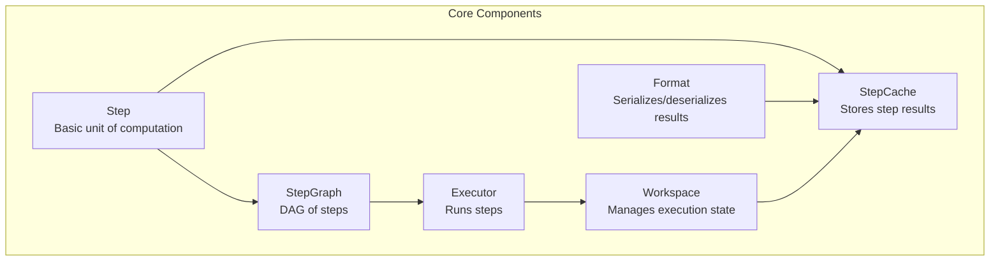

Sources: [tango/step.py:115-152](), [tango/step_graph.py:12-34](), [tango/executor.py:101-111](), [tango/workspace.py:108-119](), [tango/step_cache.py:18-29]()

## Steps: The Atomic Units of Computation

Steps are the fundamental building blocks in Tango. A Step represents a single unit of computation with well-defined inputs and outputs. Each Step can depend on other Steps, forming a directed acyclic graph of computations.

### Anatomy of a Step

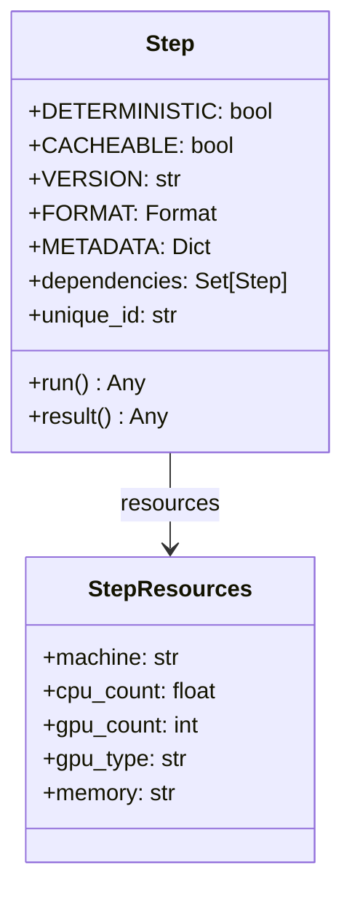

A Step is defined by:

- **DETERMINISTIC**: Whether the step produces the same output given the same inputs (default: `True`)
- **CACHEABLE**: Whether the step's output should be cached (default: inferred from `DETERMINISTIC`)
- **VERSION**: Optional version string that lets you invalidate old caches when your step implementation changes
- **FORMAT**: The format used to serialize the step's result (default: `DillFormat`)
- **unique_id**: An automatically generated identifier based on the step class, inputs, and version

Steps are executed through their `run()` method, which takes typed parameters and returns a result. Steps can be executed using the `result()` method, which handles caching and dependencies automatically.

```python
@Step.register("sum")
class AdditionStep(Step):
    DETERMINISTIC = True
    CACHEABLE = True
    
    def run(self, a: int, b: int) -> int:
        return a + b
        
# To use:
step = AdditionStep(a=1, b=2)
result = step.result()  # Returns 3, caching the result
```

You can also create Steps from functions using the `@step` decorator:

```python
@step
def add(a: int, b: int) -> int:
    return a + b
```

Sources: [tango/step.py:115-152](), [tango/step.py:153-186](), [tango/step.py:385-449](), [tango/step.py:450-459](), [tango/step.py:639-672](), [tango/step.py:65-113]()

## Step Graph: Orchestrating Workflows

A `StepGraph` represents an experiment as a directed acyclic graph of steps, where each step can depend on the results of other steps. It manages the dependencies between steps and ensures they are executed in the correct order.

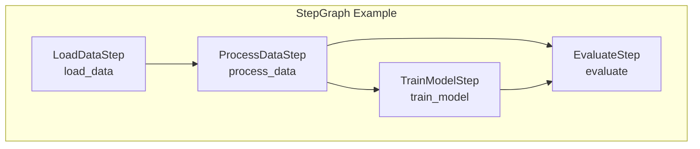

StepGraphs can be constructed either programmatically or from configuration files (JSON, JSONNET):

```python
# Programmatic construction
step_graph = StepGraph({
    "load_data": LoadDataStep(file_path="data.csv"),
    "process_data": ProcessDataStep(data=step_graph["load_data"]),
    "train_model": TrainModelStep(data=step_graph["process_data"]),
    "evaluate": EvaluateStep(model=step_graph["train_model"], data=step_graph["process_data"])
})

# From configuration
step_graph = StepGraph.from_file("experiment.jsonnet")
```

In configuration files, dependencies between steps are expressed using the `"ref"` syntax:

```json
{
  "steps": {
    "load_data": {
      "type": "load_dataset",
      "file_path": "data.csv"
    },
    "process_data": {
      "type": "process_dataset",
      "data": {"type": "ref", "ref": "load_data"}
    }
  }
}
```

Sources: [tango/step_graph.py:12-34](), [tango/step_graph.py:35-103](), [tango/step_graph.py:129-142](), [tango/step_graph.py:241-296]()

## Step Execution Flow

When steps are executed, Tango follows a specific flow to handle dependencies, caching, and execution:

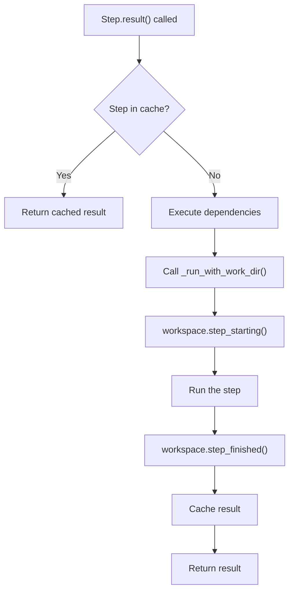

The execution flow handles:

1. **Dependency Resolution**: Before a step is executed, all its dependencies are resolved recursively
2. **Caching**: Steps check the cache before execution to avoid redundant computation
3. **Step State Management**: The workspace tracks the state of each step (not started, running, completed, or failed)
4. **Result Storage**: After execution, the step's result is stored in the cache using the configured Format

Sources: [tango/step.py:639-672](), [tango/step.py:460-497](), [tango/executor.py:125-135](), [tango/executor.py:136-174]()

## Workspaces and Step Caching

Workspaces manage the storage of step results, intermediate artifacts, and metadata. They provide the infrastructure for step caching and experiment tracking.

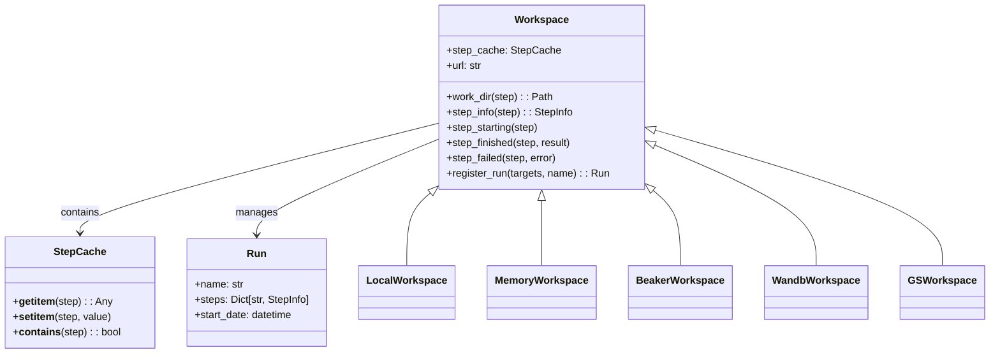

Different workspace implementations provide various storage options:

- **LocalWorkspace**: Stores results on the local filesystem
- **MemoryWorkspace**: Stores results in memory (temporary)
- **BeakerWorkspace**: Stores results in Beaker (for distributed execution)
- **WandbWorkspace**: Stores results in Weights & Biases
- **GSWorkspace**: Stores results in Google Cloud Storage

Workspaces track runs, which are collections of steps executed together with a unique name and timestamp.

Sources: [tango/workspace.py:108-119](), [tango/workspace.py:120-140](), [tango/workspace.py:178-199](), [tango/workspace.py:307-319](), [tango/step_cache.py:18-29](), [tango/workspace.py:36-70]()

## Executors: Running Steps

Executors are responsible for running steps, managing their execution environment, and handling parallelism. They interact with Workspaces to store results and track step states.

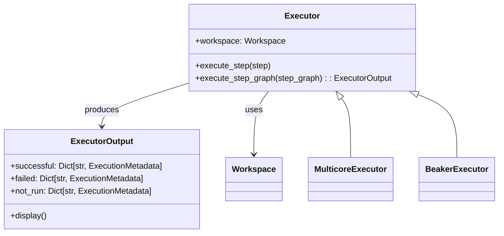

The default `Executor` runs steps sequentially, while specialized executors provide additional capabilities:

- **MulticoreExecutor**: Runs steps in parallel using multiple CPU cores
- **BeakerExecutor**: Executes steps on Beaker's cloud infrastructure

When executing a StepGraph, the executor:
1. Determines the execution order based on dependencies
2. Checks for cached results
3. Executes steps that aren't cached
4. Handles failures and reports on execution status

Sources: [tango/executor.py:101-111](), [tango/executor.py:125-135](), [tango/executor.py:136-174](), [tango/executor.py:24-98]()

## Formats: Serialization and Deserialization

Formats define how step results are serialized to and deserialized from storage. Different formats support different types of data.

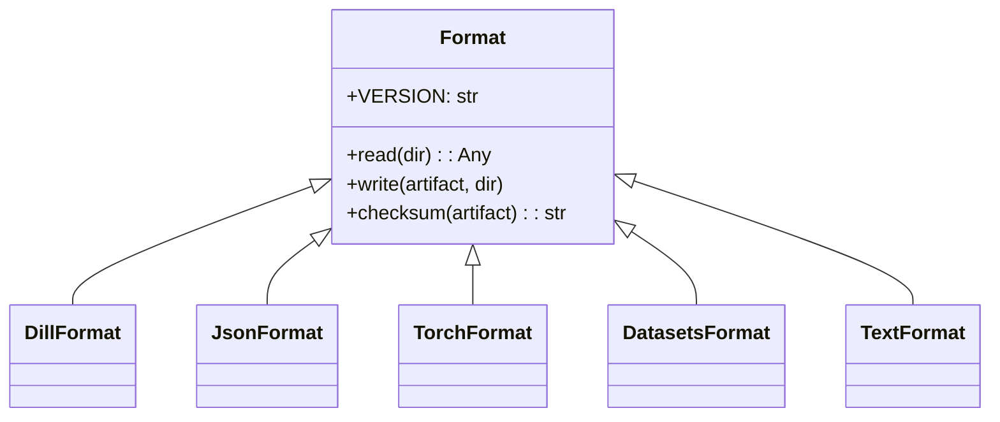

Common formats include:

- **DillFormat**: General-purpose Python object serialization (default)
- **JsonFormat**: For JSON-serializable data
- **TorchFormat**: For PyTorch models and tensors
- **TextFormat**: For plain text output

Each step can specify which format should be used to store its results through the `FORMAT` class variable.

Sources: [tango/step.py:170-172]()

## Complete Tango System Architecture

The full Tango architecture connects all these components into a cohesive system:

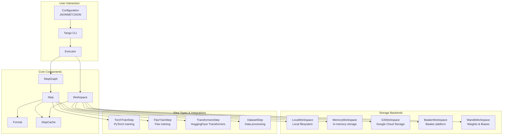

Sources: [tango/step.py:115-152](), [tango/step_graph.py:12-34](), [tango/executor.py:101-111](), [tango/workspace.py:108-119](), [tango/step_cache.py:18-29](), [tango/version.py:1-8]()

## Summary

The core concepts in Tango work together to provide a powerful framework for machine learning experimentation:

1. **Steps** are the atomic units of computation
2. **StepGraphs** organize steps into directed acyclic graphs
3. **Workspaces** manage storage and caching of step results
4. **Executors** run steps and handle execution flow
5. **Formats** serialize and deserialize step results

These components allow Tango to efficiently manage complex machine learning workflows, ensure reproducibility through caching, and facilitate experiment tracking.

---

# Page: Installation

# Installation

<details>
<summary>Relevant source files</summary>

The following files were used as context for generating this wiki page:

- [.github/workflows/main.yml](.github/workflows/main.yml)
- [Dockerfile](Dockerfile)
- [Dockerfile.test](Dockerfile.test)
- [README.md](README.md)
- [docs/source/conf.py](docs/source/conf.py)
- [docs/source/installation.md](docs/source/installation.md)
- [pyproject.toml](pyproject.toml)
- [tango/common/file_lock.py](tango/common/file_lock.py)
- [tango/integrations/torch/optim.py](tango/integrations/torch/optim.py)
- [tango/integrations/transformers/__init__.py](tango/integrations/transformers/__init__.py)

</details>


This page provides comprehensive instructions for installing AI2 Tango and its various integrations. Tango requires Python 3.8 or later and offers multiple installation methods to suit different needs. For an overview of what Tango is and its core concepts, see [Overview](#1) and [Core Concepts](#1.1).

## System Requirements

Before installing Tango, ensure your system meets the following requirements:

- Python 3.8 or later
- Sufficient disk space for caching experimental results
- Optional: GPU with CUDA support for certain integrations (PyTorch, Transformers, etc.)

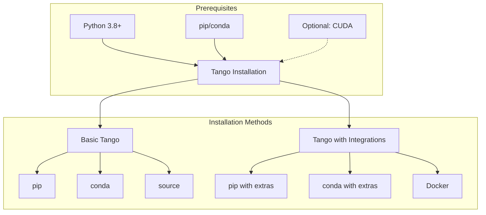

Sources: [README.md:109-111](), [pyproject.toml:22]()

## Basic Installation

### Installing with pip

The simplest way to install the base Tango package is using pip:

```bash
pip install ai2-tango
```

This installs the core functionality without any additional integrations.

### Installing with conda

Tango is also available on conda-forge:

```bash
conda install tango -c conda-forge
```

Sources: [README.md:112-118](), [README.md:132-139]()

## Installing Integrations

Tango supports various integrations with popular ML frameworks and tools. You can install these integrations individually or all at once.

### Available Integrations

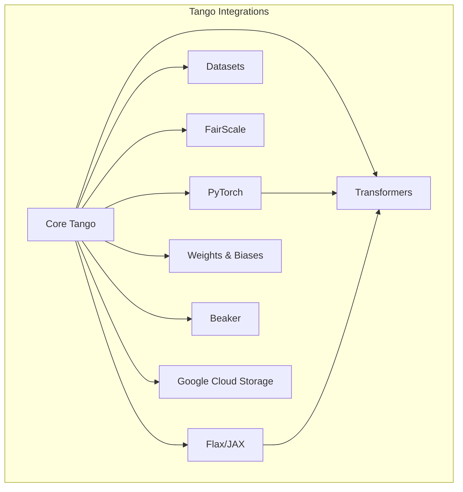

Sources: [pyproject.toml:42-111](), [tango/integrations/transformers/__init__.py:1-9]()

### Integration Dependencies

The table below shows the main dependencies for each integration:

| Integration | Main Dependencies |
|-------------|------------------|
| torch | torch, numpy |
| transformers | torch, numpy, datasets, transformers, sentencepiece, sacremoses |
| datasets | datasets |
| fairscale | torch, numpy, fairscale |
| flax | datasets, jax, jaxlib, flax, optax, tensorflow-cpu |
| wandb | wandb, retry |
| beaker | beaker-py |
| gs | google-cloud-storage, google-cloud-datastore |

Sources: [pyproject.toml:70-108]()

### Installing Specific Integrations with pip

To install Tango with a specific integration, use the following syntax:

```bash
pip install 'ai2-tango[integration_name]'
```

For example, to install with PyTorch integration:

```bash
pip install 'ai2-tango[torch]'
```

For the Transformers integration:

```bash
pip install 'ai2-tango[transformers]'
```

Sources: [README.md:119-125](), [tango/integrations/transformers/__init__.py:1-5]()

### Installing All Integrations with pip

To install Tango with all available integrations:

```bash
pip install 'ai2-tango[all]'
```

Note that this will install a large number of dependencies and may take some time.

Sources: [README.md:126-130](), [pyproject.toml:109-111]()

### Installing Integrations with conda

Conda users can install specific integrations using:

```bash
conda install tango-datasets -c conda-forge
conda install tango-torch -c conda-forge
conda install tango-wandb -c conda-forge
```

To install all integrations with conda:

```bash
conda install tango-all -c conda-forge
```

Sources: [README.md:140-152]()

## Installing from Source

For development or to use the latest features, you can install Tango directly from the source code:

1. Clone the repository:
   ```bash
   git clone https://github.com/allenai/tango.git
   cd tango
   ```

2. Install with the desired integrations:
   ```bash
   pip install -e '.[all]'  # For all integrations
   ```
   
   Or for a specific integration:
   ```bash
   pip install -e '.[torch]'  # Just for PyTorch integration
   ```
   
   Or for just the core package:
   ```bash
   pip install -e .
   ```

Sources: [README.md:158-182]()

## Docker Installation

Tango provides official Docker images that can be used as a base for your projects. This is especially useful for ensuring consistency across different environments or when deploying to cloud services.

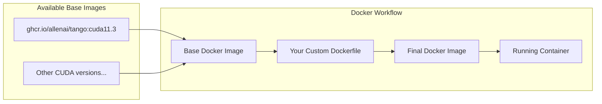

### Using a Pre-built Image

You can use one of the pre-built Tango images as a base in your Dockerfile:

```Dockerfile
# Start from a prebuilt tango base image
FROM ghcr.io/allenai/tango:cuda11.3

# Install your project's additional requirements
COPY requirements.txt .
RUN /opt/conda/bin/pip install --no-cache-dir -r requirements.txt

# Install source code
COPY . .
```

### Building a Custom Image

Alternatively, you can build your own Docker image using the official Dockerfile as a starting point:

```bash
# Clone the repository
git clone https://github.com/allenai/tango.git

# Build the Docker image
cd tango
docker build -t my-tango-image .
```

Sources: [README.md:194-217](), [Dockerfile:1-15]()

## Verifying Your Installation

After installation, you can verify that Tango was installed correctly by running:

```bash
tango info
```

This command displays information about your Tango installation, including the version and installed integrations.

For a quick test, you can run the "Hello World" example from the README:

1. Create a simple step in a file named `hello.py`:
   ```python
   from tango import step

   @step()
   def hello(name: str) -> str:
       message = f"Hello, {name}!"
       print(message)
       return message
   ```

2. Create a configuration file named `hello.jsonnet`:
   ```jsonnet
   {
     steps: {
       hello: {
         type: "hello",
         name: "World",
       }
     }
   }
   ```

3. Run the example:
   ```bash
   tango run hello.jsonnet -w /tmp/workspace
   ```

Sources: [README.md:183-193](), [README.md:47-103]()

## Installation in a CI/CD Environment

For continuous integration and automated testing environments, you may want to install Tango in a non-interactive way. The GitHub Actions workflow file in the Tango repository provides examples of how to set up Tango with different integrations in an automated environment.

Key points for CI/CD installation:

- Install the base package first: `pip install ai2-tango`
- Add integrations as needed: `pip install 'ai2-tango[integration_name]'`
- For GPU testing, consider using Docker containers with appropriate CUDA support
- Use `tango --version` or `tango info` to verify the installation

Sources: [.github/workflows/main.yml:169-237](), [Dockerfile.test:1-14]()

## Troubleshooting

### Permission Issues with File Locks

Tango uses file locks for managing concurrent access to its workspace. If you encounter permission errors, they might be related to the file locking mechanism. The error message will typically mention acquiring a lock.

Tango includes a special file lock implementation that can handle read-only environments with appropriate warnings. If you're working in an environment with restricted permissions, ensure that the workspace directory is writable by your user.

Sources: [tango/common/file_lock.py:1-74]()

### Integration-Specific Issues

If you encounter issues with a specific integration, ensure that all required dependencies are installed correctly. For example, the Transformers integration requires not just the transformers package but also torch, numpy, datasets, and other dependencies.

Check the integration's requirements in the `pyproject.toml` file or using:

```bash
pip show ai2-tango
```

### Cuda Compatibility Issues

When using GPU-accelerated integrations like PyTorch, ensure that the CUDA version on your system is compatible with the installed packages. You can specify compatible CUDA versions when installing PyTorch:

```bash
pip install torch==2.0.0 --extra-index-url https://download.pytorch.org/whl/cu117
pip install 'ai2-tango[torch]'
```

Sources: [.github/workflows/main.yml:203-207]()

---

# Page: Step System

# Step System

<details>
<summary>Relevant source files</summary>

The following files were used as context for generating this wiki page:

- [tango/common/testing/steps.py](tango/common/testing/steps.py)
- [tango/step.py](tango/step.py)
- [tango/step_graph.py](tango/step_graph.py)
- [tests/end_to_end/test_step_indexing.py](tests/end_to_end/test_step_indexing.py)
- [tests/step_graph_test.py](tests/step_graph_test.py)
- [tests/step_test.py](tests/step_test.py)

</details>


The Step System is the core computational framework within Tango that enables defining, organizing, and executing computational tasks. It provides a robust mechanism for creating dependency-aware, cacheable operations that can be composed into complex computation graphs. 

For information about specific step implementations, see [Steps](#2.1). For details on how step results are cached, see [Step Caching](#2.3).

## Overview of the Step System

The Step System consists of two main components:

1. **Step** - The fundamental unit of computation that performs a specific task
2. **StepGraph** - A collection of steps organized in a directed acyclic graph (DAG) based on their dependencies

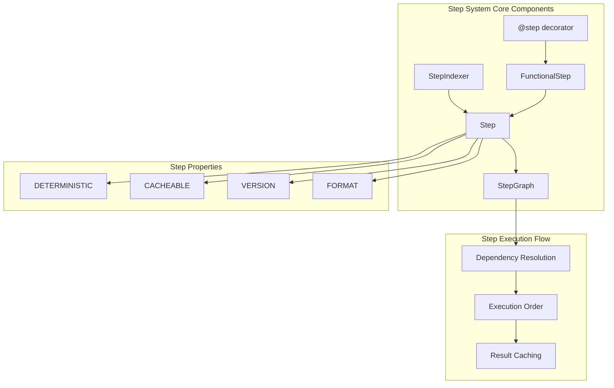

Sources: [tango/step.py:115-141](), [tango/step.py:153-172](), [tango/step_graph.py:12-19]()

## The Step Class

The `Step` class is the core building block of Tango's computation model. Each step represents a discrete unit of work that takes inputs, performs computation, and produces outputs.

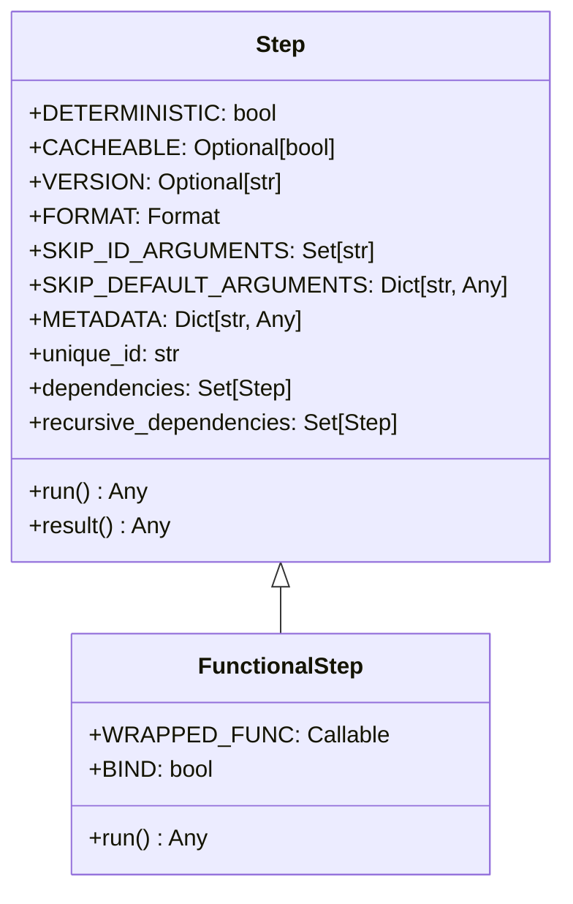

Sources: [tango/step.py:115-195](), [tango/step.py:785-797]()

### Key Attributes

| Attribute | Type | Description |
|-----------|------|-------------|
| `DETERMINISTIC` | `bool` | Whether the step produces the same output for the same inputs (default: `True`) |
| `CACHEABLE` | `Optional[bool]` | Whether results should be cached (default: `None`, which respects `DETERMINISTIC`) |
| `VERSION` | `Optional[str]` | Version identifier that can be used to invalidate caches when implementation changes |
| `FORMAT` | `Format` | Serialization format for step results (default: `DillFormat("gz")`) |
| `SKIP_ID_ARGUMENTS` | `Set[str]` | Arguments that don't affect the step's unique ID and caching |
| `SKIP_DEFAULT_ARGUMENTS` | `Dict[str, Any]` | Default argument values that don't affect the unique ID |
| `METADATA` | `Dict[str, Any]` | Arbitrary metadata associated with the step |

Sources: [tango/step.py:153-192]()

### Creating Steps

Steps can be created in two ways:

1. **Class-based steps** - By subclassing `Step` and implementing the `run()` method:

```python
@Step.register("add_numbers")
class AddNumbersStep(Step):
    DETERMINISTIC = True
    CACHEABLE = True

    def run(self, a_number: int, b_number: int) -> int:
        return a_number + b_number
```

2. **Function-based steps** - Using the `@step` decorator:

```python
@step(version="001")
def add(a: int, b: int) -> int:
    return a + b
```

Sources: [tango/step.py:800-855](), [tests/common/testing/steps.py:68-74]()

## Step Execution and Caching

When a step is invoked, Tango follows this process:

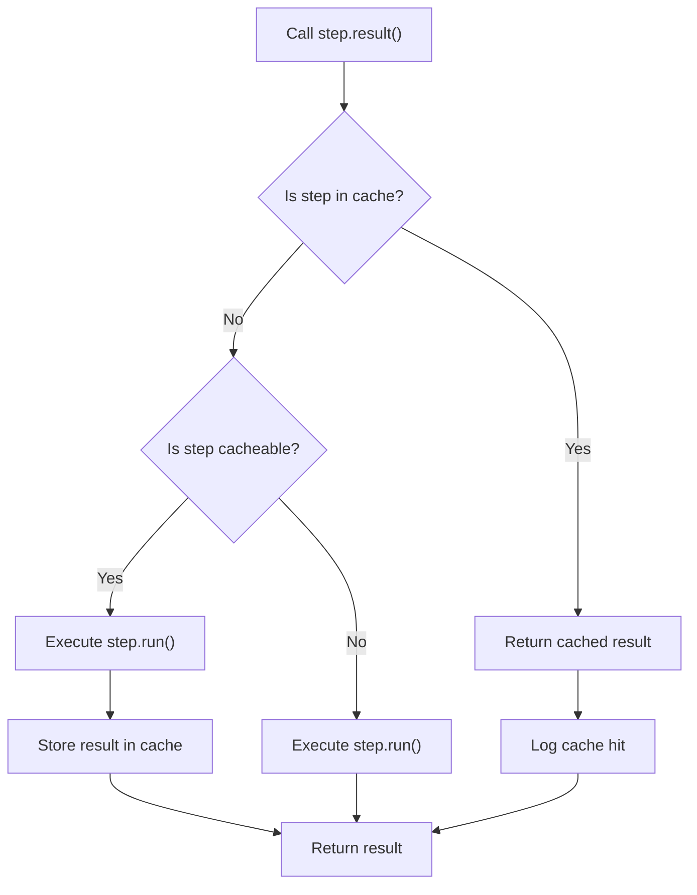

Sources: [tango/step.py:639-671](), [tango/step.py:460-498]()

The `result()` method is the primary way to execute a step. It handles:
1. Checking if the result is already in the cache
2. Running the step if necessary
3. Caching the result if the step is cacheable
4. Replacing any step dependencies with their results before execution

Sources: [tango/step.py:639-671]()

## Step Dependencies

Steps can depend on other steps, creating a directed acyclic graph of computation. When a step depends on another step, the dependent step is executed first, and its result is passed as input.

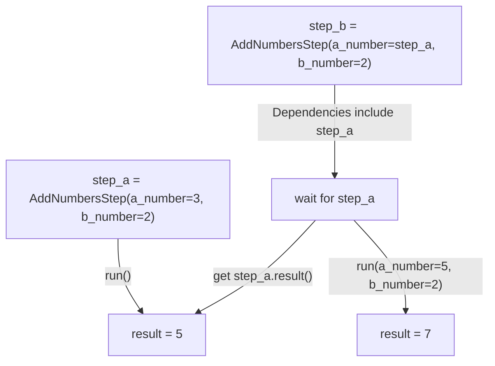

Sources: [tango/step.py:694-722](), [tango/step.py:615-637]()

Dependencies are either:
1. **Automatic** - When a step is passed as an argument to another step
2. **Explicit** - Using the `step_extra_dependencies` parameter

The `dependencies` property returns a set of direct dependencies, while `recursive_dependencies` returns all dependencies including indirect ones.

Sources: [tango/step.py:724-737]()

## The StepGraph Class

`StepGraph` represents an experiment as a directed graph of steps. It manages dependency resolution and ensures steps are executed in the correct order.

```mermaid
flowchart TD
    A["StepGraph"] --> B["Resolve dependencies"]
    B --> C["Detect circular references"]
    C --> D["Topologically sort steps"]
    D --> E["Execute in dependency order"]
    
    subgraph "StepGraph Methods"
        F["from_params()"] --> A
        G["from_file()"] --> A
        H["ordered_steps()"] --> D
    end
```

Sources: [tango/step_graph.py:12-19](), [tango/step_graph.py:103-128](), [tango/step_graph.py:212-228]()

### Creating a StepGraph

`StepGraph` can be created from:
1. A configuration file (using `from_file()`)
2. A dictionary of parameters (using `from_params()`)
3. Direct construction with a dictionary of steps

```python
# From file
step_graph = StepGraph.from_file("experiment.jsonnet")

# From parameters
step_graph = StepGraph.from_params({
    "step_a": {"type": "add_numbers", "a_number": 3, "b_number": 2},
    "step_b": {"type": "add_numbers", "a_number": {"type": "ref", "ref": "step_a"}, "b_number": 5}
})

# Direct construction
step_a = AddNumbersStep(a_number=3, b_number=2, step_name="step_a")
step_b = AddNumbersStep(a_number=step_a, b_number=5, step_name="step_b")
step_graph = StepGraph({"step_a": step_a, "step_b": step_b})
```

Sources: [tango/step_graph.py:20-34](), [tango/step_graph.py:103-128](), [tango/step_graph.py:241-243]()

### Dependency Resolution

`StepGraph` resolves dependencies by:
1. Finding all referenced steps in the configuration
2. Checking for unsatisfiable dependencies
3. Determining the correct execution order using topological sorting
4. Detecting circular dependencies

Sources: [tango/step_graph.py:46-88](), [tango/step_graph.py:154-167]()

## Unique IDs and Caching

Each step has a unique ID derived from:
- The step's class name
- The step's version
- A hash of the step's inputs (for deterministic steps)
- A random string (for non-deterministic steps)

```mermaid
flowchart LR
    A["Step unique_id"] --> B["ClassName-Version-Hash"]
    C["Step inputs"] --> |"det_hash()"| D["Input hash"]
    D --> B
    E["Step VERSION"] --> B
    F["Step class name"] --> B
```

Sources: [tango/step.py:555-594]()

This unique ID is used for:
1. Caching results
2. Determining whether a step needs to be rerun when inputs change
3. Identifying steps within a workspace

The `SKIP_ID_ARGUMENTS` and `SKIP_DEFAULT_ARGUMENTS` attributes allow you to exclude certain arguments from the unique ID calculation.

Sources: [tango/step.py:175-186]()

## Step Indexing

Tango supports indexing into step results using `StepIndexer`. This is useful when a step returns a collection and only a specific element is needed by a downstream step.

```mermaid
graph TD
    A["list_step = RangeStep(start=0, end=3)"] --> B["Result: [0, 1, 2]"]
    C["StepIndexer(list_step, key=1)"] --> D["Result: 1"]
    E["add_step = AddNumbersStep(a_number=2, b_number=StepIndexer(list_step, key=1))"] --> F["Result: 3"]
```

Sources: [tango/step.py:860-872](), [tests/end_to_end/test_step_indexing.py:6-22]()

## Step Resources

Steps can specify resource requirements using the `StepResources` class. This is particularly useful for distributed execution environments where hardware allocation is necessary.

```python
@dataclass
class StepResources(FromParams):
    machine: Optional[str] = None
    cpu_count: Optional[float] = None
    gpu_count: Optional[int] = None
    gpu_type: Optional[str] = None
    memory: Optional[str] = None
    shared_memory: Optional[str] = None
```

Sources: [tango/step.py:65-112](), [tango/step.py:544-552]()

## Conclusion

The Step System forms the backbone of Tango's computation model. By representing computations as cacheable, dependency-aware steps organized in a graph, Tango provides a powerful framework for building complex, efficient machine learning workflows.

The key advantages of this design include:
- **Caching**: Avoiding redundant computation by storing and reusing results
- **Dependency management**: Automatically determining execution order based on data dependencies
- **Reproducibility**: Through deterministic execution and version tracking
- **Flexibility**: Supporting various execution environments and resource requirements

Sources: [tango/step.py:115-783](), [tango/step_graph.py:12-300]()

---

# Page: Steps

# Steps

<details>
<summary>Relevant source files</summary>

The following files were used as context for generating this wiki page:

- [tango/common/testing/steps.py](tango/common/testing/steps.py)
- [tango/step.py](tango/step.py)
- [tango/step_graph.py](tango/step_graph.py)
- [tests/end_to_end/test_step_indexing.py](tests/end_to_end/test_step_indexing.py)
- [tests/step_graph_test.py](tests/step_graph_test.py)
- [tests/step_test.py](tests/step_test.py)

</details>


Steps are the fundamental building blocks of computation in Tango. They represent discrete, reusable, and potentially cacheable units of work that form the nodes in your experiment's computational graph. 

For information about how these Steps are organized into a dependency graph, see [StepGraph](#2.2). For details on how Step results are cached, see [Step Caching](#2.3).

## Step Anatomy

The `Step` class in Tango is a registered class that can be extended to define specific computational tasks. Each Step has:

- A `run()` method that performs the actual computation
- A unique ID for caching and identification
- Optional dependencies on other Steps
- Configuration for caching behavior, versioning, and serialization format

```mermaid
classDiagram
    class Step {
        +DETERMINISTIC: bool
        +CACHEABLE: bool
        +VERSION: str
        +FORMAT: Format
        +SKIP_ID_ARGUMENTS: Set[str]
        +METADATA: Dict[str, Any]
        +run() Any
        +result() Any
        +unique_id: str
        +dependencies: Set[Step]
    }
    
    Step <|-- CustomStep
    
    class CustomStep {
        +run() CustomResult
    }
```

Sources: [tango/step.py:115-783]()

## Creating Steps

### Method 1: Subclassing Step

The most common way to create a Step is by subclassing the `Step` class:

```python
@Step.register("add_numbers")
class AddNumbersStep(Step[int]):
    DETERMINISTIC = True
    CACHEABLE = True
    VERSION = "001"
    
    def run(self, a: int, b: int) -> int:
        return a + b
```

The `run()` method must have type hints for all parameters, which allows Tango to validate inputs and handle dependencies correctly.

### Method 2: Using the @step Decorator

For simpler cases, you can use the `@step` decorator to create a functional step:

```python
@step(version="001")
def add_numbers(a: int, b: int) -> int:
    return a + b
```

This creates a subclass of `FunctionalStep` that wraps the decorated function.

Sources: [tango/step.py:785-857]()

## Key Step Attributes

Steps have several class attributes that control their behavior:

| Attribute | Description | Default |
|-----------|-------------|---------|
| `DETERMINISTIC` | Whether the step produces the same output for the same input | `True` |
| `CACHEABLE` | Whether results can be cached | `None` (determined by `DETERMINISTIC`) |
| `VERSION` | String that invalidates cache when implementation changes | `None` |
| `FORMAT` | Format used to serialize/deserialize results | `DillFormat("gz")` |
| `SKIP_ID_ARGUMENTS` | Arguments that don't affect the unique ID | `set()` |
| `SKIP_DEFAULT_ARGUMENTS` | Default arguments that don't affect the unique ID | `{}` |
| `METADATA` | Additional information about the step | `{}` |

Sources: [tango/step.py:153-191]()

## Step Lifecycle

```mermaid
graph TD
    A["Create Step Instance"] --> B["Call step.result()"]
    B --> C{"Is result\nin cache?"}
    C -->|"Yes"| D["Return Cached Result"]
    C -->|"No"| E["Resolve Dependencies"]
    E --> F["Execute run() Method"]
    F --> G["Cache Result if CACHEABLE"]
    G --> H["Return Result"]
```

Sources: [tango/step.py:639-671]()

## Step Dependencies

Steps can depend on other steps, with dependencies automatically resolved during execution. There are several ways to specify dependencies:

### Direct Dependencies

The most common way is to pass a Step instance as an argument to another Step:

```python
step1 = AddNumbersStep(a=1, b=2)
step2 = AddNumbersStep(a=step1, b=3)  # step2 depends on step1
```

When `step2` is executed, Tango automatically:
1. Executes `step1` (if not already executed)
2. Takes the result of `step1` (which is 3)
3. Passes this result as the `a` parameter to `step2.run()`

### Configuration References

In configuration files, dependencies are specified using references:

```json
{
  "steps": {
    "step1": {
      "type": "add_numbers",
      "a": 1,
      "b": 2
    },
    "step2": {
      "type": "add_numbers",
      "a": {"type": "ref", "ref": "step1"},
      "b": 3
    }
  }
}
```

### Accessing Specific Elements with StepIndexer

Sometimes you need to access just one element of a step's result. `StepIndexer` allows this:

```python
# In Python
list_step = RangeOutput(start=0, end=3)  # Returns [0, 1, 2]
add_step = AddNumbersStep(a=2, b=StepIndexer(list_step, 1))  # Uses element 1 (which is 1)
```

In configuration:
```json
{
  "steps": {
    "list": {"type": "range_step", "start": 0, "end": 3},
    "added": {
      "type": "add_numbers",
      "a_number": 2,
      "b_number": {"type": "ref", "ref": "list", "key": 1}
    }
  }
}
```

Sources: [tango/step.py:860-871](), [tango/step_graph.py:145-192]()

## Dependency Resolution

```mermaid
graph TD
    S1["Step A"] -->|depends on| S2["Step B"]
    S2 -->|depends on| S3["Step C"]
    
    E["Tango executor"] -->|1. Execute| S3
    E -->|2. Execute| S2
    E -->|3. Execute| S1
    
    subgraph "Execution Process"
        R1["For each dependency"]
        R1 -->|call| R2["step.result()"]
        R2 --> R3{"Cached?"}
        R3 -->|Yes| R4["Use cached result"]
        R3 -->|No| R5["Run step"]
        R5 --> R6["Cache result"]
    end
```

Sources: [tango/step.py:615-637](), [tango/step_graph.py:66-89]()

## Step Execution and Caching

When you call `step.result()`, Tango:

1. Checks if the step is cacheable (`step.cache_results` is `True`)
2. If cacheable, checks if the result is already in the cache using the step's unique ID
3. If found in cache, returns the cached result
4. Otherwise:
   - Resolves dependencies by calling `result()` on any step parameters
   - Creates a working directory for the step if it's cacheable
   - Calls the step's `run()` method with the resolved parameters
   - Stores the result in the cache if the step is cacheable

The unique ID used for caching is generated based on:
- The step's class name
- Its `VERSION` (if specified)
- A deterministic hash of its inputs (for `DETERMINISTIC=True` steps)
- A random string (for `DETERMINISTIC=False` steps)

Sources: [tango/step.py:555-593]()

## Step Resources

Steps can specify resource requirements using the `step_resources` parameter:

```python
from tango.step import StepResources

step = MyStep(
    input_data="input",
    step_resources=StepResources(
        cpu_count=2,
        gpu_count=1, 
        gpu_type="NVIDIA A100-SXM-80GB",
        memory="8GiB"
    )
)
```

Available resource specifications include:

| Resource | Description | Example |
|----------|-------------|---------|
| `machine` | Executor-dependent machine specification | `"local"` |
| `cpu_count` | Minimum number of logical CPU cores | `4`, `0.5` |
| `gpu_count` | Minimum number of GPUs | `1` |
| `gpu_type` | Type of GPU required | `"NVIDIA A100-SXM-80GB"` |
| `memory` | Minimum system memory | `"8GiB"`, `"1024m"` |
| `shared_memory` | Size of `/dev/shm` | `"2.5GiB"` |

Sources: [tango/step.py:64-112](), [tango/step.py:544-552]()

## Step Metadata

You can add metadata to steps using the `step_metadata` parameter or by setting the `METADATA` class attribute:

```python
@Step.register("my_step")
class MyStep(Step):
    METADATA = {"creator": "AI2", "purpose": "Data processing"}
    
    def run(self, data: str) -> str:
        return process(data)

step = MyStep(
    data="input",
    step_metadata={"dataset": "mydata", "version": "1.0"}
)
```

The final metadata combines the class `METADATA` with the instance `step_metadata`, with the latter taking precedence.

Sources: [tango/step.py:198-139]()

## Example Step Implementations

### Basic Example: Adding Numbers

```python
@Step.register("add_numbers")
class AddNumbersStep(Step[int]):
    DETERMINISTIC = True
    CACHEABLE = True
    
    def run(self, a_number: int, b_number: int) -> int:
        return a_number + b_number

step = AddNumbersStep(a_number=1, b_number=2)
result = step.result()  # result = 3
```

### Steps with Dependencies

```python
@Step.register("string")
class StringStep(Step[str]):
    def run(self, result: str) -> str:
        return result

@Step.register("concat_strings")
class ConcatStringsStep(Step[str]):
    def run(self, string1: str, string2: str, join_with: str = " ") -> str:
        return join_with.join([string1, string2])

step1 = StringStep(result="Hello")
step2 = StringStep(result="World")
concat = ConcatStringsStep(string1=step1, string2=step2)
result = concat.result()  # result = "Hello World"
```

### Working with Step Indexers

```python
@Step.register("range_step")
class RangeOutput(Step[List[int]]):
    def run(self, start: int, end: int) -> List[int]:
        return list(range(start, end))

range_step = RangeOutput(start=0, end=3)  # Returns [0, 1, 2]
add_step = AddNumbersStep(
    a_number=2, 
    b_number=StepIndexer(range_step, 1)  # Gets element at index 1
)
result = add_step.result()  # result = 3 (2 + 1)
```

Sources: [tango/common/testing/steps.py:13-160](), [tests/end_to_end/test_step_indexing.py:1-21]()

---

# Page: StepGraph

# StepGraph

<details>
<summary>Relevant source files</summary>

The following files were used as context for generating this wiki page:

- [tango/common/testing/steps.py](tango/common/testing/steps.py)
- [tango/step.py](tango/step.py)
- [tango/step_graph.py](tango/step_graph.py)
- [tests/end_to_end/test_step_indexing.py](tests/end_to_end/test_step_indexing.py)
- [tests/step_graph_test.py](tests/step_graph_test.py)
- [tests/step_test.py](tests/step_test.py)

</details>


## Purpose and Scope

The `StepGraph` class is a core component of the Tango framework that represents an experiment as a directed graph of computational steps. It manages dependencies between steps, ensures they are executed in a valid order, and provides a dictionary-like interface for accessing steps by name. This page explains how `StepGraph` works, how to create and manipulate it, and how it fits into the larger Tango architecture.

For information about individual Steps, see [Steps](#2.1). For information about Step caching, see [Step Caching](#2.3).

Sources: [tango/step_graph.py:12-13]()

## Overview of StepGraph

`StepGraph` sits at the heart of Tango's computational model, acting as the structure that organizes steps into a coherent workflow. It is responsible for analyzing dependencies between steps, detecting circular references, and establishing a valid execution order.

### Core Functionality

- Represents an experiment as a directed acyclic graph (DAG) of steps
- Manages dependencies between steps
- Ensures steps are executed in a valid order
- Provides dictionary-like access to steps by name
- Detects circular dependencies and missing steps
- Supports serialization to and from configuration files

Sources: [tango/step_graph.py:12-18](), [tango/step_graph.py:19-34]()

## StepGraph in the Tango Architecture

The following diagram illustrates where `StepGraph` fits within Tango's core architecture:

```mermaid
flowchart TD
    subgraph "Tango Core"
        User(["User"]) -->|"Define steps"| Step["Step"]
        Step -->|"Organized by"| StepGraph["StepGraph"]
        StepGraph -->|"Executed by"| Executor["Executor"]
        Executor -->|"Stores results in"| Workspace["Workspace"]
        Workspace -->|"Manages"| StepCache["StepCache"]
    end
    
    subgraph "File System"
        ConfigFile[("Config File")] -->|"Loaded into"| StepGraph
        StepGraph -->|"Can be saved to"| ConfigFile
    end
```

Sources: [tango/step_graph.py](), [tango/step.py:115-151]()

## Creating a StepGraph

There are multiple ways to create a `StepGraph`:

### 1. Direct Construction

You can create a `StepGraph` directly from a dictionary of steps:

```mermaid
flowchart LR
    subgraph "Direct Construction"
        Step1["Step A"] --> StepDict["Step Dictionary"]
        Step2["Step B"] --> StepDict
        Step3["Step C"] --> StepDict
        StepDict -->|"StepGraph(step_dict)"| Graph["StepGraph"]
    end
```

This approach requires all dependencies to be present in the dictionary.

Sources: [tango/step_graph.py:20-34](), [tests/step_graph_test.py:58-68]()

### 2. From Parameters

The most common way to create a `StepGraph` is from a parameters dictionary using `from_params`:

```mermaid
flowchart LR
    subgraph "From Parameters"
        ParamsDict["Parameters Dictionary"] -->|"from_params()"| DependencyAnalysis["Dependency Analysis"]
        DependencyAnalysis -->|"Create in order"| Steps["Steps"]
        Steps --> Graph["StepGraph"]
    end
```

This method resolves dependencies automatically and constructs steps in the correct order.

Sources: [tango/step_graph.py:104-128](), [tests/step_graph_test.py:19-40]()

### 3. From Configuration File

You can also load a `StepGraph` from a configuration file using `from_file`:

```mermaid
flowchart LR
    subgraph "From File"
        JsonnetFile["Jsonnet File"] -->|"from_file()"| Params["Params"]
        Params -->|"from_params()"| Graph["StepGraph"]
    end
```

This method is commonly used when running experiments through the CLI.

Sources: [tango/step_graph.py:241-243](), [tests/step_graph_test.py:42-45]()

## Structure and Representation

The `StepGraph` can be viewed as a directed acyclic graph where:

- Nodes are individual `Step` objects
- Edges represent dependencies between steps
- Step names serve as identifiers for nodes

```mermaid
flowchart LR
    subgraph "StepGraph Structure"
        StepA["Step A"] -->|"depends on"| StepB["Step B"]
        StepA -->|"depends on"| StepC["Step C"]
        StepB -->|"depends on"| StepD["Step D"]
        StepC -->|"depends on"| StepD
    end
```

Sources: [tango/step_graph.py:12-18](), [tango/step_graph.py:214-228]()

## Dependency Management

One of the main functions of `StepGraph` is to manage dependencies between steps and determine the correct execution order.

### Identifying Dependencies

`StepGraph` identifies dependencies by:
1. Examining step inputs to find references to other steps
2. Creating a dependency graph based on these references
3. Validating that all dependencies can be satisfied

```mermaid
flowchart TD
    subgraph "Dependency Resolution"
        FindDeps["Find Dependencies"] -->|"for each step"| CheckRefsValid["Check Refs Valid"]
        CheckRefsValid -->|"if valid"| OrderSteps["Order Steps"]
        CheckRefsValid -->|"if invalid"| RaiseError["Raise ConfigurationError"]
        OrderSteps -->|"topological sort"| ExecutionOrder["Execution Order"]
    end
```

Sources: [tango/step_graph.py:46-64](), [tango/step_graph.py:154-167]()

### Resolving Dependencies

When resolving dependencies, `StepGraph`:
1. Ensures no circular dependencies exist
2. Checks that all referenced steps are defined
3. Constructs steps in dependency order
4. Replaces step references with actual step objects

Sources: [tango/step_graph.py:66-89](), [tango/step_graph.py:170-192]()

## Execution Order

`StepGraph` determines a valid execution order for steps through topological sorting:

```mermaid
flowchart LR
    subgraph "Step Execution Order"
        direction LR
        StepD["Step D"] --> StepB["Step B"]
        StepD --> StepC["Step C"]
        StepB --> StepA["Step A"]
        StepC --> StepA
    end
```

The `ordered_steps` method returns steps in an order that respects dependencies:

```python
# Example of execution order
ordered_steps = StepGraph.ordered_steps(step_dict)
```

Sources: [tango/step_graph.py:213-228](), [tests/step_graph_test.py:18-40]()

## StepGraph Interface

`StepGraph` implements the `Mapping` interface, allowing dictionary-like access to steps:

```mermaid
classDiagram
    class Mapping {
        +__getitem__(key)
        +__iter__()
        +__len__()
        +keys()
        +values()
        +items()
    }
    class StepGraph {
        +parsed_steps: Dict[str, Step]
        +__getitem__(name): Step
        +__len__(): int
        +__iter__(): Iterator[str]
        +ordered_steps(step_dict): List[Step]
        +from_params(params): StepGraph
        +from_file(filename): StepGraph
        +to_file(filename)
        +sub_graph(*step_names): StepGraph
    }
    Mapping <|-- StepGraph
```

This allows you to access steps by name using dictionary syntax:

```python
# Example of StepGraph usage
step = step_graph["step_name"]
```

Sources: [tango/step_graph.py:12-18](), [tango/step_graph.py:194-210]()

## Serialization and Configuration

`StepGraph` supports serialization to and from configuration files:

### From Configuration to StepGraph

When loading a `StepGraph` from a configuration file:
1. The file is parsed into a `Params` object
2. Step dependencies are identified and validated
3. Steps are created in dependency order
4. References between steps are resolved

Sources: [tango/step_graph.py:241-243](), [tests/step_graph_test.py:42-45]()

### From StepGraph to Configuration

The `to_file` method serializes a `StepGraph` back to a configuration file:

```python
# Save StepGraph to a configuration file
step_graph.to_file("experiment.jsonnet")
```

This is useful for:
- Sharing experiments with others
- Running experiments through the CLI
- Storing experiment configurations

Sources: [tango/step_graph.py:245-296](), [tests/step_graph_test.py:70-95]()

## Special Features

### Step Indexing

`StepGraph` supports step indexing, which allows accessing specific elements of a step's output:

```mermaid
flowchart LR
    subgraph "Step Indexing"
        ListStep["ListStep"] -->|"result = [0,1,2]"| StepIndexer["StepIndexer(ListStep, 1)"]
        StepIndexer -->|"result = 1"| DependentStep["DependentStep"]
    end
```

This is especially useful when a step returns a collection and only a specific element is needed by a dependent step.

Sources: [tango/step.py:860-871](), [tests/end_to_end/test_step_indexing.py:1-22]()

### Forced Dependencies

You can specify additional dependencies that aren't directly used by a step using `step_extra_dependencies`:

```mermaid
flowchart LR
    subgraph "Forced Dependencies"
        StepA["Step A"] --->|"uses output"| StepC["Step C"]
        StepB["Step B"] -.->|"forced dependency"| StepC
    end
```

This ensures certain steps are run before others, even if their outputs aren't directly used.

Sources: [tango/step.py:133-144](), [tests/step_graph_test.py:110-129]()

## Working with StepGraph

### Creating a Subgraph

You can extract a portion of a `StepGraph` using the `sub_graph` method:

```python
# Create a subgraph containing only specified steps and their dependencies
sub_graph = step_graph.sub_graph("step1", "step2")
```

This is useful for running only a subset of an experiment.

Sources: [tango/step_graph.py:130-142]()

### Finding Uncacheable Leaf Steps

The `uncacheable_leaf_steps` method returns steps that are at the end of the dependency chain and are not cacheable:

```python
# Get steps that are leaves and not cacheable
uncacheable_steps = step_graph.uncacheable_leaf_steps()
```

This is useful for identifying steps that need to be re-run every time.

Sources: [tango/step_graph.py:230-238]()

## Integration with Executor

The `StepGraph` is primarily used by the `Executor` to determine the order in which to execute steps:

```mermaid
flowchart TD
    subgraph "Execution Flow"
        StepGraph["StepGraph"] -->|"ordered_steps()"| ExecutionOrder["Execution Order"]
        ExecutionOrder -->|"execute steps in order"| Executor["Executor"]
        Executor -->|"for each step"| CheckCache["Check Cache"]
        CheckCache -->|"if cached"| UseCached["Use Cached Result"]
        CheckCache -->|"if not cached"| ExecuteStep["Execute Step"]
    end
```

For more information on how steps are executed, see [Executors](#4).

Sources: [tango/step_graph.py:213-228]()

## Common Pitfalls and Debugging

### Circular Dependencies

If you create a circular dependency between steps, `StepGraph` will raise a `ConfigurationError`:

```python
# This will raise a ConfigurationError
# StepA depends on StepB, which depends on StepA
```

### Missing Dependencies

If a step references another step that doesn't exist, `StepGraph` will raise a `ConfigurationError`:

```python
# This will raise a ConfigurationError if "missing_step" is not defined
```

Sources: [tango/step_graph.py:46-64](), [tango/step_graph.py:66-89](), [tests/step_graph_test.py:64-68]()

## Conclusion

`StepGraph` is a fundamental component of the Tango framework that manages dependencies between steps and ensures they are executed in the correct order. It provides a way to represent experiments as directed acyclic graphs and supports serialization to and from configuration files. Understanding how `StepGraph` works is essential for creating complex workflows in Tango.

---

# Page: Step Caching

# Step Caching

<details>
<summary>Relevant source files</summary>

The following files were used as context for generating this wiki page:

- [tango/__init__.py](tango/__init__.py)
- [tango/executor.py](tango/executor.py)
- [tango/step.py](tango/step.py)
- [tango/step_cache.py](tango/step_cache.py)
- [tango/step_graph.py](tango/step_graph.py)
- [tests/step_test.py](tests/step_test.py)

</details>


Step caching is a core feature of Tango that allows the framework to avoid redundant computation by storing and reusing the results of previously executed steps. This page describes how step caching works in Tango, including how steps are uniquely identified, how caching decisions are made, and how cached results are stored and retrieved.

For information about step implementation, see [Steps](#2.1). For workspace storage options, see [Workspaces](#3).

## Overview of Step Caching

Tango's step caching system provides the ability to store and retrieve step results based on unique step identifiers. When a step is executed, Tango first checks if its result is already in the cache. If found, the cached result is used directly without re-executing the step.

```mermaid
flowchart TD
    A["Step Execution Request"] --> B{"In Cache?"}
    B -->|Yes| C["Return Cached Result"]
    B -->|No| D["Execute Step"]
    D --> E["Cache Result"]
    E --> F["Return Result"]
    C --> F
```
Sources: [tango/step.py:639-672](), [tango/executor.py:125-135]()

## Step Uniqueness and Caching Decision

Each step in Tango has a unique identifier based on its class name, version, and inputs. This unique ID determines whether a step's output is already in the cache.

### Unique ID Generation

The unique ID of a step is generated as follows:

```mermaid
flowchart TD
    A["Step Class"] --> B["Class Name"]
    C["VERSION"] --> D["Version Part"]
    E["Inputs"] --> F["Input Hash"]
    B --> G["unique_id"]
    D --> G
    F --> G
    H["DETERMINISTIC"] -->|"False"| I["Random Hash"]
    H -->|"True"| F
    I --> G
```
Sources: [tango/step.py:555-594]()

The unique ID is formatted as `$class_name-$version-$hash`, where:
- `$class_name` is the name of the step class
- `$version` is an optional version string defined by `Step.VERSION`
- `$hash` is either:
  - A deterministic hash of the step's inputs if the step is marked as deterministic
  - A random string if the step is not deterministic

### Caching Decision Logic

Tango uses several attributes to determine whether a step's results should be cached:

| Attribute | Description |
|-----------|-------------|
| `Step.DETERMINISTIC` | Indicates whether the step produces the same output given the same inputs |
| `Step.CACHEABLE` | Explicitly controls whether the step should be cached |
| `cache_results` | Property computed from `DETERMINISTIC` and `CACHEABLE` |

The `cache_results` property is determined as follows:

```mermaid
flowchart TD
    A["Step Configuration"] --> B{"cache_results parameter\nspecified?"}
    B -->|"Yes, True"| C["Check CACHEABLE"]
    B -->|"Yes, False"| D["Don't cache"]
    B -->|"No"| E{"Determine from\ndefault behavior"}
    
    C -->|"CACHEABLE is False"| H["ConfigurationError"]
    C -->|"DETERMINISTIC is False"| I["Warning, but cache"]
    C -->|"Otherwise"| J["Cache"]
    
    E --> F{"DETERMINISTIC, CACHEABLE"}
    F -->|"True, None"| K["Cache"]
    F -->|"False, None"| L["Don't cache"]
    F -->|"True, False"| M["Don't cache"]
    F -->|"False, False"| N["Don't cache"]
    F -->|"True, True"| O["Cache"]
    F -->|"False, True"| P["Warning, but cache"]
```
Sources: [tango/step.py:238-273]()

## StepCache Implementation

The `StepCache` class is the core interface for caching step results. It acts as a mapping from step instances to their results.

```mermaid
classDiagram
    class Registrable {
        +register(name, constructor)
        +by_name(name)
    }
    
    class StepCache {
        +__getitem__(step) Any
        +__setitem__(step, value)
        +__delitem__(step)
        +__contains__(step) bool
        +__len__() int
    }
    
    Registrable <|-- StepCache
    
    StepCache <|-- "MemoryStepCache"
    StepCache <|-- "Other implementations"
    
    class CacheMetadata {
        +step: str
        +format: Format
    }
```
Sources: [tango/step_cache.py:18-60]()

## Caching Process and Workflow

When you run a step using the `result()` method, Tango follows this workflow:

```mermaid
flowchart TD
    A["step.result()"] --> B{"step.cache_results?"}
    B -->|No| C["Execute Step"]
    B -->|Yes| D{"In workspace.step_cache?"}
    D -->|No| C
    D -->|Yes| E["Return Cached Result"]
    C --> F{"step.cache_results?"}
    F -->|Yes| G["Cache Result"]
    F -->|No| H["Return Result"]
    G --> H
```
Sources: [tango/step.py:639-672]()

### Step Result Access and Caching

The `Step.result()` method is the main entry point for accessing a step's output. It implements the caching logic:

1. Check if the step should be cached (`step.cache_results`)
2. If cacheable, check if the result is already in the cache
3. If not in cache, execute the step and store the result
4. Return the result (either from cache or from execution)

In a typical Tango execution flow, steps are executed in an order that respects their dependencies. For each step, the executor checks if the result is already in the cache before executing it.

Sources: [tango/executor.py:125-135](), [tango/step.py:639-672]()

## Advanced Caching Features

### Skipping Arguments for Caching

Tango provides ways to control which arguments affect the step's unique ID:

1. `SKIP_ID_ARGUMENTS`: Arguments that should not affect the unique ID
2. `SKIP_DEFAULT_ARGUMENTS`: Arguments that should only affect the unique ID when they differ from their default values

```python
class MyStep(Step):
    # Don't include 'batch_size' in the unique ID calculation
    SKIP_ID_ARGUMENTS = {"batch_size"}
    
    # Include 'learning_rate' in unique ID only when not 0.001
    SKIP_DEFAULT_ARGUMENTS = {"learning_rate": 0.001}
    
    def run(self, batch_size: int, learning_rate: float = 0.001) -> Model:
        # ...
```

Sources: [tango/step.py:174-186]()

### Version-Based Cache Invalidation

The `VERSION` attribute allows for invalidating the cache when a step's implementation changes:

```python
class MyModelTrainer(Step):
    VERSION = "001"  # Change this when the implementation changes
    # ...
```

When you update the `VERSION`, steps with the new version will create new cache entries, while preserving the old cached results for steps with the previous version.

Sources: [tango/step.py:164-168]()

## Integration with Tango Architecture

The step caching system integrates with other Tango components as follows:

```mermaid
flowchart TD
    subgraph "Step System"
        Step --> StepGraph
        Step --> unique_id
    end
    
    subgraph "Caching System"
        unique_id --> StepCache
        StepCache --> Format["Format (serialization)"]
    end
    
    subgraph "Execution System"
        StepGraph --> Executor
        Executor --> StepCache
    end
    
    subgraph "Storage System"
        StepCache --> Workspace
        Workspace --> "Storage Backend"
    end
```
Sources: [tango/step.py](), [tango/step_cache.py](), [tango/executor.py]()

## Best Practices

### When to Enable or Disable Caching

- **Enable caching** for:
  - Computationally expensive steps
  - Steps with deterministic outputs
  - Steps that are frequently re-used in different experiments

- **Disable caching** for:
  - Steps with large outputs that are not reused
  - Steps that have their own caching mechanism (e.g., dataset loading steps)
  - Steps where freshness of data is important

### Handling Non-Deterministic Steps

When a step is non-deterministic but you want to cache its results:

1. Set `DETERMINISTIC = False` to indicate the non-deterministic nature
2. Set `CACHEABLE = True` to enable caching despite non-determinism
3. Be aware that this might cause unexpected behavior, as warned by Tango

Sources: [tango/step.py:153-162](), [tango/step_graph.py:90-101]()

### Cache Invalidation

Invalidate the cache when:
1. The step implementation changes significantly (update `VERSION`)
2. Input parameters change (automatic via unique ID)
3. Dependencies change (automatic via dependencies in unique ID calculation)

Sources: [tango/step.py:164-168]()

This caching system is a powerful feature of Tango that helps make machine learning experiments more efficient and reproducible by avoiding redundant computation.

---

# Page: Workspaces

# Workspaces

<details>
<summary>Relevant source files</summary>

The following files were used as context for generating this wiki page:

- [docs/source/api/components/workspace.rst](docs/source/api/components/workspace.rst)
- [tango/integrations/wandb/workspace.py](tango/integrations/wandb/workspace.py)
- [tango/step_caches/local_step_cache.py](tango/step_caches/local_step_cache.py)
- [tango/step_caches/memory_step_cache.py](tango/step_caches/memory_step_cache.py)
- [tango/workspace.py](tango/workspace.py)
- [tango/workspaces/local_workspace.py](tango/workspaces/local_workspace.py)
- [tango/workspaces/memory_workspace.py](tango/workspaces/memory_workspace.py)
- [tests/executor_test.py](tests/executor_test.py)
- [tests/integrations/beaker/workspace_test.py](tests/integrations/beaker/workspace_test.py)
- [tests/main_test.py](tests/main_test.py)
- [tests/workspaces/local_workspace_test.py](tests/workspaces/local_workspace_test.py)

</details>


Workspaces in Tango provide the infrastructure for storing, retrieving, and managing step results and metadata. They act as a persistence layer for the Tango framework, allowing step outputs to be cached and reused across runs. For information about steps themselves, see [Step System](#2) and for how results are stored, see [Formats](#8.1).

## Overview

A Workspace is one of the core components in Tango's architecture that handles:

1. Storing and retrieving results of step executions
2. Tracking step execution state (running, completed, failed)
3. Managing runs (collections of target steps)
4. Providing work directories for steps that need temporary storage

The base `Workspace` class is abstract and provides an interface that all concrete workspace implementations must follow. Tango comes with built-in workspace implementations for different storage backends, from local filesystem storage to cloud services.

### Workspace in the Tango Architecture

```mermaid
graph TD
    subgraph "Tango Core"
        Executor["Executor"] --> |uses| Workspace["Workspace"]
        Step["Step"] --> |stored in| Workspace
        StepGraph["StepGraph"] --> |executed by| Executor
        Workspace --> |manages| StepCache["StepCache"]
        StepCache --> |serializes data via| Format["Format"]
    end
    
    subgraph "Workspace Implementations"
        Workspace --> LocalWorkspace["LocalWorkspace"]
        Workspace --> MemoryWorkspace["MemoryWorkspace"] 
        Workspace --> WandbWorkspace["WandbWorkspace"]
        Workspace --> BeakerWorkspace["BeakerWorkspace"]
        Workspace --> GSWorkspace["GSWorkspace"]
    end
    
    subgraph "Storage Backends"
        LocalWorkspace --> |stores in| FileSystem["Local File System"]
        MemoryWorkspace --> |stores in| Memory["In-Memory Dictionary"]
        WandbWorkspace --> |stores in| WandB["Weights & Biases"]
        BeakerWorkspace --> |stores in| Beaker["Beaker Platform"]
        GSWorkspace --> |stores in| GCS["Google Cloud Storage"]
    end
```

Sources: [tango/workspace.py:108-119](), [tango/workspaces/local_workspace.py:31-53](), [tango/workspaces/memory_workspace.py:18-27](), [tango/integrations/wandb/workspace.py:27-65]()

## Workspace Interface

The `Workspace` abstract base class defines the interface that all workspace implementations must implement:

```mermaid
classDiagram
    class Workspace {
        +url: str
        +step_cache: StepCache
        +from_url(url): Workspace
        +from_parsed_url(parsed_url): Workspace
        +work_dir(step): Path
        +step_info(step_or_unique_id): StepInfo
        +step_starting(step): None
        +step_finished(step, result): Any
        +step_failed(step, e): None
        +register_run(targets, name): Run
        +registered_runs(): Dict[str, Run]
        +registered_run(name): Run
        +remove_step(step_unique_id): None
        +capture_logs_for_run(name): ContextManager
    }
    
    class Run {
        +name: str
        +steps: Dict[str, StepInfo]
        +start_date: datetime
        +to_json_dict(): Dict
        +from_json_dict(json_dict): Run
    }
    
    class StepInfo {
        +step_name: str
        +unique_id: str
        +state: StepState
        +dependencies: Set[str]
        +start_time: datetime
        +end_time: datetime
        +error: str
    }
    
    class StepState {
        <<enumeration>>
        INCOMPLETE
        RUNNING
        COMPLETED
        FAILED
        UNCACHEABLE
    }
    
    Workspace --> "1" Run: creates
    Run --> "*" StepInfo: contains
    StepInfo --> "1" StepState: has
```

Sources: [tango/workspace.py:108-461]()

### Key Methods

1. **`step_cache`**: Returns a `StepCache` instance used to store and retrieve step results.
   ```python
   @property
   @abstractmethod
   def step_cache(self) -> StepCache:
       """
       A :class:`.StepCache` to store step results in
       """
       raise NotImplementedError()
   ```

2. **`step_info`**: Gets information about a step.
   ```python
   @abstractmethod
   def step_info(self, step_or_unique_id: Union[Step, str]) -> StepInfo:
       """
       Returns a :class:`~tango.step_info.StepInfo` for a given step.
       """
       raise NotImplementedError()
   ```

3. **Step Lifecycle Methods**:
   - `step_starting`: Called when a step starts execution
   - `step_finished`: Called when a step completes successfully
   - `step_failed`: Called when a step fails

4. **Run Management**:
   - `register_run`: Registers a collection of target steps as a run
   - `registered_runs`: Returns all registered runs
   - `registered_run`: Returns a specific run by name

Sources: [tango/workspace.py:177-184](), [tango/workspace.py:200-210](), [tango/workspace.py:269-306](), [tango/workspace.py:308-395]()

## Workspace Implementations

Tango provides several concrete workspace implementations:

### LocalWorkspace

The `LocalWorkspace` stores all data in a local directory, organizing step results and run information in a structured manner.

```mermaid
graph TD
    subgraph "LocalWorkspace Structure"
        WD["Workspace Directory"] --> Cache["cache/"]
        WD --> Runs["runs/"]
        WD --> Latest["latest/"]
        
        Cache --> |contains| StepDir1["step_unique_id_1/"]
        Cache --> |contains| StepDir2["step_unique_id_2/"]
        
        StepDir1 --> |contains| Metadata["cache-metadata.json"]
        StepDir1 --> |contains| ResultData["serialized step result"]
        StepDir1 --> |may contain| Lock["lock file"]
        StepDir1 --> |may contain| Work["work/ directory"]
        
        Runs --> |contains| Run1["run_name_1/"]
        Runs --> |contains| Run2["run_name_2/"]
        
        Run1 --> |contains| StepLink1["step_name_1 (symlink)"]
        Run1 --> |contains| StepLink2["step_name_2 (symlink)"]
        
        Latest --> |symlink to| Run1
        
        StepLink1 -.-> |points to| StepDir1
    end
```

Key features:
- Stores step results in a `cache/` directory
- Organizes runs in a `runs/` directory
- Provides a `latest/` symlink to the most recent run
- Uses file locks to prevent concurrent modification
- Captures logs for each run

Sources: [tango/workspaces/local_workspace.py:29-478]()

### MemoryWorkspace

The `MemoryWorkspace` stores all data in memory:

```mermaid
graph TD
    subgraph "MemoryWorkspace Structure"
        MW["MemoryWorkspace"] --> UniqueIDToInfo["unique_id_to_info: Dict[str, StepInfo]"]
        MW --> Runs["runs: Dict[str, Run]"]
        MW --> DefaultStepCache["Default MemoryStepCache"]
        
        DefaultStepCache --> Cache["cache: Dict[str, Any]"]
    end
```

Key features:
- All data stored in dictionaries in memory
- No persistence across program restarts
- Useful for debugging or quick prototyping

Sources: [tango/workspaces/memory_workspace.py:18-133](), [tango/step_caches/memory_step_cache.py:12-54]()

### Cloud Workspaces

Tango also provides workspaces that integrate with cloud services:

1. **WandbWorkspace**: Integrates with Weights & Biases for experiment tracking.
   - Tracks Tango runs as W&B runs
   - Stores step results as W&B artifacts
   - Provides integration with W&B experiment tracking features

2. **BeakerWorkspace**: Integrates with AI2's Beaker platform.

3. **GSWorkspace**: Integrates with Google Cloud Storage.

Sources: [tango/integrations/wandb/workspace.py:27-462](), [tests/integrations/beaker/workspace_test.py:10-52]()

## Step Execution Flow with Workspaces

The workspace plays a critical role in the step execution flow:

```mermaid
sequenceDiagram
    participant E as Executor
    participant S as Step
    participant W as Workspace
    participant SC as StepCache
    
    E->>W: step_info(step)
    W-->>E: StepInfo(INCOMPLETE)
    
    E->>S: execute()
    S->>W: step_starting(step)
    W->>SC: Check cache
    
    alt Step in cache
        SC-->>W: Return cached result
        W-->>S: Return cached result
        S-->>E: Return result
    else Step not in cache
        S->>S: run()
        alt Success
            S->>W: step_finished(step, result)
            W->>SC: Store result
            W-->>S: Return result
            S-->>E: Return result
        else Failure
            S->>W: step_failed(step, exception)
            W-->>S: Propagate exception
            S-->>E: Propagate exception
        end
    end
```

Sources: [tango/workspace.py:269-306](), [tango/executor.py]() (not provided in snippets)

## Run Management

Workspaces manage runs, which are collections of target steps that a user wants to execute. Each run has:

- A unique name
- A collection of steps
- A start date

```python
@dataclass
class Run(FromParams):
    """
    Stores information about a single Tango run.
    """

    name: str
    """
    The name of the run
    """

    steps: Dict[str, StepInfo]
    """
    A mapping from step names to :class:`~tango.step_info.StepInfo`, for all the target steps in the run.
    """

    start_date: datetime
    """
    The time at which the run was registered in the workspace.
    """
```

When registering a run, the workspace:
1. Creates a unique name if one is not provided
2. Records information about all target steps and their dependencies
3. Creates the necessary storage structures
4. Returns a `Run` object representing the registered run

Sources: [tango/workspace.py:36-70](), [tango/workspace.py:308-318]()

## Using Workspaces

### Creating a Workspace

Workspaces can be created directly or from a URL:

```python
# Direct instantiation
workspace = LocalWorkspace("/path/to/workspace")

# From URL
workspace = Workspace.from_url("local:///path/to/workspace")
workspace = Workspace.from_url("memory://")
workspace = Workspace.from_url("wandb://entity/project")
```

Sources: [tango/workspace.py:150-166](), [tests/main_test.py:140-146](), [tests/main_test.py:151-158]()

### Executing Steps with a Workspace

Steps are typically executed by an Executor, which uses the workspace for caching:

```python
workspace = LocalWorkspace("/path/to/workspace")
step = AdditionStep(a=1, b=2)
executor = Executor(workspace)
result = executor.execute_step(step)
```

Sources: [tests/executor_test.py:19-28]()

### Accessing Step Results

Results can be accessed directly from the workspace:

```python
result = workspace.step_result("step_name")
result = workspace.step_result_for_run("run_name", "step_name")
```

Sources: [tango/workspace.py:397-420]()

## Conclusion

Workspaces are a crucial part of Tango's architecture, providing a flexible and extensible system for storing and managing step results and metadata. They enable efficient caching and reuse of computation, support for distributed execution, and integration with various storage backends and cloud services.

The `LocalWorkspace` is suitable for most use cases, while the `MemoryWorkspace` is useful for testing and debugging. Cloud workspaces provide integration with cloud storage and experiment tracking platforms for more advanced use cases.

---

# Page: Local Workspace

# Local Workspace

<details>
<summary>Relevant source files</summary>

The following files were used as context for generating this wiki page:

- [docs/source/api/components/workspace.rst](docs/source/api/components/workspace.rst)
- [tango/integrations/wandb/workspace.py](tango/integrations/wandb/workspace.py)
- [tango/step_caches/local_step_cache.py](tango/step_caches/local_step_cache.py)
- [tango/step_caches/memory_step_cache.py](tango/step_caches/memory_step_cache.py)
- [tango/workspace.py](tango/workspace.py)
- [tango/workspaces/local_workspace.py](tango/workspaces/local_workspace.py)
- [tango/workspaces/memory_workspace.py](tango/workspaces/memory_workspace.py)
- [tests/executor_test.py](tests/executor_test.py)
- [tests/integrations/beaker/workspace_test.py](tests/integrations/beaker/workspace_test.py)
- [tests/main_test.py](tests/main_test.py)
- [tests/workspaces/local_workspace_test.py](tests/workspaces/local_workspace_test.py)

</details>


## Purpose and Overview

The `LocalWorkspace` is a concrete implementation of Tango's `Workspace` interface that stores all data on the local filesystem. This is the default workspace type that Tango uses when none is specified, making it the most commonly used workspace implementation. It's designed for single-machine jobs or for multiple machines that share access to the same network file system (NFS).

For information about cloud-based workspaces (Google Cloud Storage, W&B, Beaker), see [Cloud Workspaces](#3.2).

Sources: [tango/workspaces/local_workspace.py:29-34](), [tango/workspace.py:108-116]()

## Architecture and Relationship to Base Classes

### Workspace Hierarchy Diagram

```mermaid
classDiagram
    class Workspace {
        <<abstract>>
        +step_cache: StepCache
        +step_info(step_or_unique_id): StepInfo
        +step_starting(step): void
        +step_finished(step, result): Any
        +step_failed(step, e): void
        +register_run(targets, name): Run
        +registered_runs(): Dict[str, Run]
        +work_dir(step): Path
    }
    
    class LocalWorkspace {
        -dir: Path
        -cache: LocalStepCache
        -runs_dir: Path
        -step_info_file: Path
        -latest_dir: Path
        -locks: Dict[Step, FileLock]
        +__init__(dir)
        +step_dir(step_or_unique_id): Path
        +work_dir(step): Path
        +step_info(step_or_unique_id): StepInfo
        +register_run(targets, name): Run
        +run_dir(name): Path
        +capture_logs_for_run(name): ContextManager
    }
    
    class StepCache {
        <<abstract>>
        +__getitem__(step): Any
        +__setitem__(step, value): void
        +__contains__(step): bool
    }
    
    class LocalStepCache {
        -dir: Path
        -weak_cache: WeakValueDictionary
        -strong_cache: OrderedDict
        +step_dir(step_or_unique_id): Path
        +__getitem__(step): Any
        +__setitem__(step, value): void
        +__contains__(step): bool
    }
    
    Workspace <|-- LocalWorkspace
    Workspace <|-- MemoryWorkspace
    StepCache <|-- LocalStepCache
    LocalWorkspace --> LocalStepCache : uses
```

Sources: [tango/workspace.py:108-121](), [tango/workspaces/local_workspace.py:29-53](), [tango/step_caches/local_step_cache.py:19-28]()

## Directory Structure

### LocalWorkspace Directory Layout

```mermaid
graph TD
    subgraph "LocalWorkspace"
        WD["workspace_directory/"] --> A["cache/"]
        WD --> B["runs/"]
        WD --> C["latest/ (symlink to latest run)"]
        WD --> D["stepinfo.sqlite (database)"]
        WD --> E["settings.json"]
        
        B --> F["run_1/"]
        B --> G["run_2/"]
        
        F --> H["step_name_1 (symlink to cache)"]
        F --> I["step_name_2 (symlink to cache)"]
        F --> J["stepinfo.json"]
        F --> K["out.log"]
        
        A --> L["step_unique_id_1/"]
        A --> M["step_unique_id_2/"]
        
        L --> N["cache-metadata.json"]
        L --> O["(step results)"]
        L --> P["work/ (for step workspace)"]
        L --> Q["lock (for file locking)"]
    end
```

The `LocalWorkspace` creates and manages this directory structure:

- **`cache/`**: Contains subdirectories for each cached step, named by unique step ID
- **`runs/`**: Contains one subdirectory per registered run
- **`latest/`**: Symlink to the most recently created run directory
- **`stepinfo.sqlite`**: SQLite database storing metadata about steps
- **`settings.json`**: Configuration information for the workspace

Sources: [tango/workspaces/local_workspace.py:32-44](), [tango/workspaces/local_workspace.py:55-94]()

## Key Components

### LocalStepCache

The `LocalWorkspace` delegates caching of step results to a `LocalStepCache` instance, which:

1. Stores step results on disk in the `cache/` directory
2. Maintains both memory caches (weak references and LRU) for fast access to recent results
3. Uses the step's format to serialize and deserialize data

### StepInfo Database

Step state information is stored in an SQLite database (`stepinfo.sqlite`). This includes:

- Step state (INCOMPLETE, RUNNING, COMPLETED, FAILED)
- Start and end times
- Error messages
- Dependencies

### File Locking

To prevent concurrent modification of step data, `LocalWorkspace` uses file locks (via `FileLock`) when a step is running.

Sources: [tango/workspaces/local_workspace.py:57-64](), [tango/step_caches/local_step_cache.py:36-51]()

## Initialization and Configuration

### Creating a LocalWorkspace

```python
from tango.workspaces import LocalWorkspace

# Create directly
workspace = LocalWorkspace("/path/to/workspace")

# Or use the factory method
from tango.workspace import Workspace
workspace = Workspace.from_url("local:///path/to/workspace")

# You can also use a plain path (local scheme is implicit)
workspace = Workspace.from_url("/path/to/workspace")
```

Sources: [tango/workspaces/local_workspace.py:55-94](), [tango/workspace.py:150-166]()

## Step Execution Workflow

### Step Execution Flow

```mermaid
sequenceDiagram
    participant "Executor" as exe
    participant "Step" as step
    participant "LocalWorkspace" as lw
    participant "LocalStepCache" as cache
    participant "FileLock" as lock
    
    exe->>lw: execute_step(step)
    
    lw->>lw: step_info(step)
    Note over lw: Check step state
    
    lw->>lock: acquire_with_updates()
    Note over lock: Lock step_dir/lock file
    
    lw->>lw: step_starting(step)
    Note over lw: Update step state to RUNNING
    
    lw->>step: run()
    step-->>lw: result
    
    alt Success
        lw->>cache: [step] = result
        Note over cache: Write result to disk
        lw->>lw: step_finished(step, result)
        Note over lw: Update step state to COMPLETED
    else Failure
        lw->>lw: step_failed(step, error)
        Note over lw: Update step state to FAILED
    end
    
    lw->>lock: release()
    lw-->>exe: result or exception
```

When a step is executed in a `LocalWorkspace`:

1. The workspace acquires a lock for the step
2. Step state is updated to RUNNING
3. The step executes
4. On success:
   - The result is stored in the cache
   - Step state is updated to COMPLETED
5. On failure:
   - Error information is recorded
   - Step state is updated to FAILED
6. The lock is released

Sources: [tango/workspaces/local_workspace.py:236-323]()

## Run Registration and Management

When you register a run in a `LocalWorkspace`:

1. A new directory is created under `runs/`
2. Symlinks are created from step names to their cache directories
3. Step information is stored in `stepinfo.json`
4. The `latest/` symlink is updated to point to the new run

```python
# Register a run
run = workspace.register_run([step1, step2], name="my_experiment")

# Later, access the result of a step in that run
result = workspace.step_result_for_run("my_experiment", "step1")
```

Sources: [tango/workspaces/local_workspace.py:339-370](), [tango/workspace.py:397-420]()

## Workspace Operations

### Key Methods

| Method | Purpose |
|--------|---------|
| `step_info(step_or_unique_id)` | Get information about a step |
| `step_starting(step)` | Mark a step as running |
| `step_finished(step, result)` | Mark a step as completed and store its result |
| `step_failed(step, error)` | Mark a step as failed and store error information |
| `register_run(targets, name)` | Register a new run with specified target steps |
| `registered_runs()` | Get a dictionary of all registered runs |
| `registered_run(name)` | Get information about a specific run |
| `work_dir(step)` | Get a directory where a step can store temporary data |
| `remove_step(step_unique_id)` | Remove a step from the cache |

Sources: [tango/workspaces/local_workspace.py:182-338](), [tango/workspace.py:201-428]()

## Step Caching and Storage

### Caching Workflow

```mermaid
graph TD
    subgraph "Step Result Storage"
        A["Step result"] --> B{"Step cacheable?"}
        
        B -->|"Yes"| C["LocalWorkspace.step_finished()"]
        B -->|"No"| D["Return result without caching"]
        
        C --> E["LocalStepCache.__setitem__()"]
        
        E --> F["Add to in-memory cache"]
        E --> G["Create step directory"]
        G --> H["Write result using step's format"]
        H --> I["Write cache-metadata.json"]
        
        J["Request cached result"] --> K["LocalStepCache.__getitem__()"]
        
        K --> L{"In memory cache?"}
        L -->|"Yes"| M["Return from memory"]
        L -->|"No"| N["Check disk"]
        
        N --> O["Read metadata"]
        O --> P["Deserialize using format"]
        P --> Q["Add to memory cache"]
        Q --> R["Return result"]
        M --> R
    end
```

The `LocalWorkspace` uses a two-level caching strategy:

1. **Memory cache**: Maintains recently used results in memory for fast access
   - Weak references for objects that support weak referencing
   - LRU cache for the most recently used objects

2. **Disk cache**: Persistent storage of all step results
   - Each step gets its own directory named by its unique ID
   - Results are serialized using the step's format
   - Metadata is stored in `cache-metadata.json`

Sources: [tango/step_caches/local_step_cache.py:42-132](), [tango/workspaces/local_workspace.py:285-303]()

## Logging and Error Handling

`LocalWorkspace` provides built-in support for logging with the `capture_logs_for_run()` method, which captures logs to a file in the run directory (`out.log`).

When steps fail, error information is captured and stored in the step's info record, making it accessible for later inspection.

Sources: [tango/workspaces/local_workspace.py:476-477](), [tango/workspace.py:430-458]()

## Comparison with Other Workspace Types

| Feature | LocalWorkspace | MemoryWorkspace | Cloud Workspaces |
|---------|---------------|-----------------|------------------|
| **Persistence** | On disk | In-memory only | Remote storage |
| **Sharing** | Local filesystem or NFS | Single process only | Cross-machine or cloud |
| **Speed** | Fast (local I/O) | Fastest (memory only) | Depends on network |
| **Typical use** | Local development, NFS clusters | Testing, short experiments | Production, distributed teams |
| **Setup complexity** | Simple | Minimal | More complex |

Sources: [tango/workspace.py:108-119](), [tango/workspaces/memory_workspace.py:18-23](), [tango/workspaces/local_workspace.py:32-44]()

## Common Gotchas and Troubleshooting

- **Locked steps**: If a process crashes while a step is running, the step may remain locked. In this case, you may need to manually delete the lock file.
- **State inconsistencies**: The workspace attempts to fix inconsistent states (like steps marked RUNNING but not actually running), but in some cases manual intervention may be required.
- **Symlink issues**: On Windows, creating symlinks may require elevated permissions.

Sources: [tango/workspaces/local_workspace.py:207-223](), [tango/workspaces/local_workspace.py:246-252]()

---

# Page: Cloud Workspaces

# Cloud Workspaces

<details>
<summary>Relevant source files</summary>

The following files were used as context for generating this wiki page:

- [tango/integrations/beaker/common.py](tango/integrations/beaker/common.py)
- [tango/integrations/beaker/executor.py](tango/integrations/beaker/executor.py)
- [tango/integrations/beaker/step_cache.py](tango/integrations/beaker/step_cache.py)
- [tango/integrations/beaker/workspace.py](tango/integrations/beaker/workspace.py)
- [tango/integrations/gs/common.py](tango/integrations/gs/common.py)
- [tango/integrations/gs/step_cache.py](tango/integrations/gs/step_cache.py)
- [tango/integrations/gs/workspace.py](tango/integrations/gs/workspace.py)
- [tango/step_info.py](tango/step_info.py)
- [tango/workspaces/remote_workspace.py](tango/workspaces/remote_workspace.py)
- [tests/integrations/beaker/conftest.py](tests/integrations/beaker/conftest.py)
- [tests/integrations/gs/step_cache_test.py](tests/integrations/gs/step_cache_test.py)
- [tests/integrations/gs/workspace_test.py](tests/integrations/gs/workspace_test.py)

</details>


This page documents Tango's cloud workspace implementations, which store step artifacts and metadata in remote cloud storage services rather than on local disk. Cloud workspaces enable distributed execution, team collaboration, and persistence beyond local machines. For information about local storage options, see [Local Workspace](#3.1).

## Overview

Cloud workspaces in Tango extend the base `Workspace` class through the `RemoteWorkspace` abstract class, providing implementations that store step artifacts, metadata, and run information in remote storage systems. Currently, Tango offers two cloud workspace implementations:

1. **BeakerWorkspace** - Stores artifacts on the Beaker platform (AI2's experiment tracking system)
2. **GSWorkspace** - Stores artifacts on Google Cloud Storage

```mermaid
classDiagram
    class Workspace {
        +step_cache: StepCache
        +step_info(step): StepInfo
        +step_starting(step)
        +step_finished(step, result)
        +register_run(targets): Run
    }
    
    class RemoteWorkspace {
        +cache: RemoteStepCache
        +locks: Dict
        +steps_dir_name: str
        +url: str
        +_remote_lock(step)
        +_step_location(step): str
    }
    
    class BeakerWorkspace {
        +beaker: Beaker
        +_cache: BeakerStepCache
        +_locks: Dict[Step, BeakerStepLock]
        +STEP_INFO_CACHE_SIZE: int
    }
    
    class GSWorkspace {
        +client: GSClient
        +_cache: GSStepCache
        +_locks: Dict[Step, GCSStepLock]
        +NUM_CONCURRENT_WORKERS: int
    }
    
    Workspace <|-- RemoteWorkspace
    RemoteWorkspace <|-- BeakerWorkspace
    RemoteWorkspace <|-- GSWorkspace
```

Sources: [tango/workspaces/remote_workspace.py:24-252](), [tango/integrations/beaker/workspace.py:37-430](), [tango/integrations/gs/workspace.py:38-487]()

## Common Remote Workspace Features

All remote workspace implementations share these key features:

1. **Remote storage of artifacts**: Step results are serialized and stored in cloud storage
2. **Distributed locking**: Prevents concurrent modification of steps across environments
3. **Cache management**: Local caches for performance with remote storage for persistence
4. **Run tracking**: Experiment runs are registered and tracked in the cloud

The `RemoteWorkspace` base class implements common functionality, while each concrete implementation handles the specifics of its cloud service.

```mermaid
flowchart TD
    subgraph "Remote Workspace Core Flow"
        S["Step"] -->|"run()"| R["Result"]
        R -->|"workspace.step_finished()"| SC["RemoteStepCache"]
        SC -->|"_upload_step_remote()"| CA["Cloud Artifact"]
        S -->|"workspace.step_starting()"| L["Remote Lock"]
        S -->|"workspace.step_info()"| SI["Step Metadata"]
    end
```

Sources: [tango/workspaces/remote_workspace.py:92-191]()

## BeakerWorkspace

The `BeakerWorkspace` stores artifacts on Beaker, an experiment tracking platform developed by AI2. It's particularly well-suited for integration with the `BeakerExecutor` for distributed execution.

### Configuration

BeakerWorkspace can be created in several ways:

```python
# From URL
workspace = Workspace.from_url("beaker://ai2/my-workspace")

# Direct instantiation
workspace = BeakerWorkspace("ai2/my-workspace")

# From config params
workspace = Workspace.from_params({
    "type": "beaker",
    "workspace": "ai2/my-workspace"
})
```

The constructor accepts these parameters:

| Parameter | Type | Description |
|-----------|------|-------------|
| workspace | str | Name or ID of the Beaker workspace |
| max_workers | Optional[int] | Number of concurrent workers for operations |
| **kwargs | dict | Additional arguments for Beaker client |

Sources: [tango/integrations/beaker/workspace.py:37-59](), [tango/integrations/beaker/workspace.py:82-92]()

### Architecture

```mermaid
flowchart TD
    subgraph "BeakerWorkspace Implementation"
        BW["BeakerWorkspace"]
        BC["BeakerStepCache"]
        BL["BeakerStepLock"]
        
        BW -->|"uses"| BC
        BW -->|"creates"| BL
    end
    
    subgraph "Beaker Platform"
        BD["Beaker Dataset\n(artifacts)"]
        BM["Beaker Dataset\n(metadata)"]
        BR["Beaker Dataset\n(runs)"]
        
        BC -->|"upload/download"| BD
        BW -->|"store metadata"| BM
        BW -->|"register runs"| BR
    end
    
    subgraph "Beaker Executor Integration"
        BE["BeakerExecutor"]
        BW <-->|"coordinates with"| BE
    end
```

BeakerWorkspace stores:
- Step artifacts as Beaker datasets
- Step metadata in dataset JSON files
- Lock information using dataset existence
- Run information in dedicated datasets

Sources: [tango/integrations/beaker/workspace.py:149-176](), [tango/integrations/beaker/workspace.py:212-232]()

### Beaker Step Locking

The `BeakerStepLock` mechanism ensures exclusive access to steps:

```mermaid
sequenceDiagram
    participant C as "Client"
    participant BW as "BeakerWorkspace"
    participant BP as "Beaker Platform"
    
    C->>BW: step_starting(step)
    BW->>BP: Try to create lock dataset
    alt Lock exists
        BP->>BW: DatasetConflict error
        BW->>BP: Check if owner job is done
        alt Owner job done
            BW->>BP: Delete lock dataset
            BW->>BP: Retry create lock dataset
        else Owner job still running
            BW->>C: Raise TimeoutError
        end
    end
    BW->>BP: Upload step metadata
    BW->>C: Continue execution
```

The lock mechanism checks if a lock dataset exists, and if the lock belongs to a completed experiment, it can be safely deleted.

Sources: [tango/integrations/beaker/common.py:65-187]()

## GSWorkspace

The `GSWorkspace` stores artifacts on Google Cloud Storage with metadata in Google Cloud Datastore.

### Configuration

GSWorkspace can be created in several ways:

```python
# From URL
workspace = Workspace.from_url("gs://my-bucket/path")

# Direct instantiation
workspace = GSWorkspace("my-bucket/path")

# From config params
workspace = Workspace.from_params({
    "type": "gs",
    "workspace": "my-bucket/path",
    "project": "my-gcp-project"  # Optional
})
```

The constructor accepts these parameters:

| Parameter | Type | Description |
|-----------|------|-------------|
| workspace | str | Name of GCS bucket/folder |
| project | Optional[str] | Google project ID |
| credentials | Optional[Union[str, Credentials]] | GCP credentials |

Sources: [tango/integrations/gs/workspace.py:38-90](), [tango/integrations/gs/workspace.py:103-114]()

### Authentication

GSWorkspace supports multiple authentication methods:

1. **Explicit credentials path**: Path to a credentials JSON file
2. **Credentials JSON string**: Raw JSON string with credentials
3. **Credentials object**: `google.auth.credentials.Credentials` instance
4. **Default credentials**: From `gcloud auth application-default login`

The credentials are used to authenticate with both Google Cloud Storage and Google Cloud Datastore.

Sources: [tango/integrations/gs/common.py:399-451]()

### Architecture

```mermaid
flowchart TD
    subgraph "GSWorkspace Implementation"
        GSW["GSWorkspace"]
        GSC["GSStepCache"]
        GSL["GCSStepLock"]
        
        GSW -->|"uses"| GSC
        GSW -->|"creates"| GSL
    end
    
    subgraph "Google Cloud"
        GCS["Google Cloud Storage\n(artifacts & locks)"]
        GDS["Google Cloud Datastore\n(metadata & runs)"]
        
        GSC -->|"upload/download"| GCS
        GSL -->|"create/check"| GCS
        GSW -->|"store/retrieve"| GDS
    end
```

GSWorkspace stores:
- Step artifacts in Google Cloud Storage blobs
- Step metadata in Google Cloud Datastore
- Lock information using GCS artifacts
- Run information in Google Cloud Datastore

Sources: [tango/integrations/gs/workspace.py:133-181](), [tango/integrations/gs/workspace.py:276-336]()

### Google Cloud Step Locking

The `GCSStepLock` mechanism ensures exclusive access to steps:

```mermaid
sequenceDiagram
    participant C as "Client"
    participant GSW as "GSWorkspace"
    participant GCS as "Google Cloud Storage"
    
    C->>GSW: step_starting(step)
    GSW->>GCS: Try to create lock artifact
    alt Lock exists
        GCS->>GSW: GSArtifactConflict error
        GSW->>C: Log warning message
        Note over GSW,GCS: Retry with backoff
        GSW->>GCS: Try to create lock artifact
        alt After timeout
            GSW->>C: Raise TimeoutError
        end
    end
    GSW->>GCS: Upload step metadata
    GSW->>C: Continue execution
```

Sources: [tango/integrations/gs/common.py:458-519]()

## Usage with Executors

Cloud workspaces work particularly well with distributed executors:

1. **BeakerWorkspace + BeakerExecutor**: For execution on Beaker's cloud infrastructure
2. **GSWorkspace + MulticoreExecutor**: For local execution with cloud storage

```mermaid
flowchart TD
    subgraph "Distributed Execution"
        BE["BeakerExecutor"]
        BW["BeakerWorkspace"]
        
        BE -->|"execute_step_graph()"| SG["StepGraph"]
        BE -->|"uses"| BW
        BW -->|"provides"| SC["StepCache"]
        SG -->|"stored in"| BW
    end
```

When using `BeakerExecutor` with `BeakerWorkspace`, steps can be executed on Beaker's infrastructure while artifacts are stored in Beaker datasets. Similarly, `GSWorkspace` can be used with any executor that can access Google Cloud Storage.

Sources: [tango/integrations/beaker/executor.py:178-329]()

## Best Practices

1. **Authentication management**:
   - For Beaker: Set up Beaker CLI authentication
   - For GCS: Use application default credentials or provide explicit credentials

2. **Cost awareness**:
   - Be mindful of storage costs for large artifacts
   - Use appropriate configuration settings to avoid excessive transfers

3. **Executor pairing**:
   - Use `BeakerWorkspace` with `BeakerExecutor` for full Beaker integration
   - Use `GSWorkspace` with executors that can access Google Cloud Storage

4. **Concurrent operations**:
   - Both workspace implementations support configurable concurrency
   - Adjust `NUM_CONCURRENT_WORKERS` for performance tuning

Sources: [tango/integrations/gs/workspace.py:66-67](), [tango/integrations/beaker/workspace.py:49-50]()

## Advanced Features

### Step Removal

Both cloud workspace implementations support removing steps from cache and remote storage:

```python
# Remove a step by unique_id
workspace.remove_step(step_unique_id)
```

This removes:
- Step artifacts from cloud storage
- Step metadata from storage/database
- Step from the local cache

Sources: [tango/workspaces/remote_workspace.py:177-191](), [tango/integrations/beaker/workspace.py:424-430](), [tango/integrations/gs/workspace.py:471-479]()

### Step Info Caching

Both workspace implementations cache step information locally to improve performance:

- `BeakerWorkspace` uses both memory and disk caching with a configurable cache size
- `GSWorkspace` leverages Google Datastore for fast metadata queries

This reduces the need for frequent remote API calls and improves overall performance.

Sources: [tango/integrations/beaker/workspace.py:114-148]()

## Conclusion

Cloud workspaces provide Tango with the ability to scale beyond a single machine, enabling collaboration and distributed execution. Choose between `BeakerWorkspace` and `GSWorkspace` based on your existing infrastructure and needs.

For distributed execution with cloud workspaces, see [Distributed Execution](#4.2).

---

# Page: Executors

# Executors

<details>
<summary>Relevant source files</summary>

The following files were used as context for generating this wiki page:

- [docs/source/api/components/executor.rst](docs/source/api/components/executor.rst)
- [docs/source/api/components/format.rst](docs/source/api/components/format.rst)
- [docs/source/api/components/index.rst](docs/source/api/components/index.rst)
- [docs/source/api/components/step.rst](docs/source/api/components/step.rst)
- [docs/source/api/components/step_cache.rst](docs/source/api/components/step_cache.rst)
- [docs/source/api/components/step_graph.rst](docs/source/api/components/step_graph.rst)
- [docs/source/examples/euler.md](docs/source/examples/euler.md)
- [examples/eval_p3/eval.py](examples/eval_p3/eval.py)
- [tango/__init__.py](tango/__init__.py)
- [tango/common/testing/__init__.py](tango/common/testing/__init__.py)
- [tango/executor.py](tango/executor.py)
- [tango/executors/multicore_executor.py](tango/executors/multicore_executor.py)
- [tango/step_cache.py](tango/step_cache.py)

</details>


The Tango Executor system is responsible for running Steps and managing their execution flow. Executors determine how steps are executed (serially, in parallel, or distributed) and work closely with Workspaces to cache step results. This page documents the Executor system components, implementations, and usage patterns.

For information about Steps, see [Step System](#2) and for Workspaces, see [Workspaces](#3).

## What is an Executor?

An Executor in Tango is a class that takes a StepGraph (collection of steps with their dependencies) and executes each step in the appropriate order, handling dependencies, caching, and error conditions. Executors are designed to be configurable and extensible, with different implementations for different execution environments and requirements.

```mermaid
classDiagram
    class "Executor" {
        +workspace: Workspace
        +include_package: Optional[Sequence[str]]
        +parallelism: Optional[int]
        +execute_step(step: Step)
        +execute_step_graph(step_graph: StepGraph) ExecutorOutput
        +execute_sub_graph_for_steps(step_graph, *step_names) ExecutorOutput
    }
    
    class "ExecutorOutput" {
        +successful: Dict[str, ExecutionMetadata]
        +failed: Dict[str, ExecutionMetadata]
        +not_run: Dict[str, ExecutionMetadata]
        +display()
    }
    
    class "ExecutionMetadata" {
        +logs_location: Optional[str]
        +result_location: Optional[str]
    }
    
    class "MulticoreExecutor" {
        +execute_step_graph(step_graph: StepGraph) ExecutorOutput
        +_get_state(step: Step) StepState
    }
    
    "Executor" <|-- "MulticoreExecutor"
    "Executor" --> "ExecutorOutput" : returns
    "ExecutorOutput" --> "ExecutionMetadata" : contains
```

Sources: [tango/executor.py:101-192](), [tango/executors/multicore_executor.py:19-315]()

## Executor Workflow

When executing a StepGraph, the Executor follows this general workflow:

```mermaid
flowchart TD
    A["execute_step_graph(step_graph)"] --> B["Check each step in the graph"]
    B --> C{"Step dependencies\nfailed?"}
    C -->|"Yes"| D["Mark as not_run"]
    C -->|"No"| E{"Try to execute step"}
    E -->|"Success"| F["Add to successful steps"]
    E -->|"Failure"| G["Add to failed steps\nand log exception"]
    F --> H["Return ExecutorOutput"]
    G --> H
    D --> H
```

The key responsibilities of an Executor include:

1. **Dependency Resolution**: Ensuring steps run only when their dependencies are satisfied
2. **Caching Integration**: Checking if a step result is already cached before execution
3. **Error Handling**: Managing failures and continuing with unaffected steps
4. **Result Tracking**: Keeping track of which steps succeeded, failed, or weren't run

Sources: [tango/executor.py:136-174]()

## Base Executor Implementation

The default Executor implementation (registered as "default") executes steps sequentially. It provides the foundational behavior that other Executor implementations build upon.

```python
# Basic usage of the default Executor
executor = Executor(workspace, include_package=["my_package"])
result = executor.execute_step_graph(step_graph)
result.display()  # Shows execution results in a table
```

Key methods of the base Executor:

1. **execute_step**: Executes a single step, ensuring results are cached if appropriate
2. **execute_step_graph**: Executes all steps in a StepGraph, handling dependencies and failures
3. **execute_sub_graph_for_steps**: Executes a subset of a StepGraph starting from specific steps

Sources: [tango/executor.py:101-192]()

## Executor Implementations

Tango provides multiple Executor implementations for different execution environments:

### Default Executor

The default Executor runs steps sequentially in a single process. It's suitable for simple workflows or when resource usage needs to be controlled.

Limitations:
- No parallelism (the `parallelism` parameter is ignored)
- All steps run in the same process

### MulticoreExecutor

The MulticoreExecutor runs steps in parallel using multiple processes, which can significantly improve performance for workflows with independent steps.

```python
# Using MulticoreExecutor with 4 parallel processes
from tango.executor import Executor
executor = Executor.by_name("multicore")(workspace, parallelism=4)
result = executor.execute_step_graph(step_graph)
```

Key features:
- Configurable level of parallelism
- Spawns separate processes for each step using the Tango CLI
- Maintains dependency ordering while maximizing parallelism
- Synchronizes step states between processes

```mermaid
flowchart TD
    A["MulticoreExecutor.execute_step_graph()"] --> B["Sync step states"]
    B --> C{"Are there incomplete steps?"}
    C -->|"No"| H["Return ExecutorOutput"]
    C -->|"Yes"| D["Update running steps"]
    D --> E["Get steps ready to run"]
    E --> F["Queue steps for execution"]
    F --> G["Start processes for queued steps\n(limited by parallelism)"]
    G --> B
```

Sources: [tango/executors/multicore_executor.py:42-308]()

## ExecutorOutput

The `ExecutorOutput` class provides a structured way to understand the results of executing a StepGraph. It contains:

1. **successful**: Dictionary mapping step names to `ExecutionMetadata` for steps that completed successfully
2. **failed**: Dictionary mapping step names to `ExecutionMetadata` for steps that failed
3. **not_run**: Dictionary mapping step names to `ExecutionMetadata` for steps that weren't run (usually due to failed dependencies)

The `display()` method creates a rich table showing the status of each step:

```
┏━━━━━━━━━━━━━┳━━━━━━━━━━━━━┳━━━━━━━━━━━━━━━━━━━━━━━━━━━━━━━━━━━━━━━━━━━━┓
┃ Step Name   ┃ Status      ┃ Cached Result                             ┃
┡━━━━━━━━━━━━━╇━━━━━━━━━━━━━╇━━━━━━━━━━━━━━━━━━━━━━━━━━━━━━━━━━━━━━━━━━━━┩
│ step1       │ ✓ succeeded │ workspace/cache/Step1-abc123              │
│ step2       │ ✗ failed    │ workspace/logs/Step2-def456               │
│ step3       │ - not run   │ N/A                                       │
└─────────────┴─────────────┴───────────────────────────────────────────┘
```

Sources: [tango/executor.py:38-98]()

## Using Executors

Executors are typically used through Tango's CLI, which handles executor creation and configuration. However, they can also be used programmatically:

```python
from tango import Workspace, Executor, StepGraph
from tango.common.params import Params

# Create a workspace
workspace = Workspace.from_url("local://./workspace")

# Load a step graph from a config file
step_graph = StepGraph.from_params(Params.from_file("config.jsonnet"))

# Create an executor
executor = Executor.by_name("multicore")(
    workspace=workspace,
    include_package=["my_package"],
    parallelism=4
)

# Execute the step graph
result = executor.execute_step_graph(step_graph)

# Display the results
result.display()
```

Sources: [tango/common/testing/__init__.py:81-117](), [docs/source/examples/euler.md:1-139]()

## Advanced Features

### Handling Uncacheable Steps

Tango makes a distinction between cacheable and uncacheable steps:

- **Cacheable steps**: Results are stored in the step cache and can be reused
- **Uncacheable steps**: Results are not stored (e.g., steps with side effects like printing to console)

Executors handle uncacheable steps specially:
- Uncacheable steps that are required by other steps are executed as part of their dependent steps
- Uncacheable leaf steps (those not required by any other step) are executed normally

```mermaid
graph TD
    subgraph "Step Execution Logic"
        A["For each step in graph"] --> B{"Is step cacheable?"}
        B -->|"No"| C{"Is it a leaf step?"}
        B -->|"Yes"| D["Execute normally"]
        C -->|"No"| E["Skip direct execution\n(executed as part of dependent steps)"]
        C -->|"Yes"| F["Execute normally"]
        D --> G["Add result to cache"]
    end
```

Sources: [tango/executor.py:156-160](), [tango/executors/multicore_executor.py:100-118]()

### Parallelism Configuration

The `parallelism` parameter controls how many steps can run simultaneously:

- **Default Executor**: Ignores the `parallelism` parameter (always 1)
- **MulticoreExecutor**: Uses `parallelism` to limit the number of concurrent processes
  - Setting `parallelism` to 0 will disable parallel execution
  - Setting `parallelism` to -1 will use the number of CPU cores (up to 32)

Sources: [tango/executors/multicore_executor.py:25-40](), [tango/executor.py:145-150]()

## Relationship with Other Components

Executors work closely with other Tango components:

```mermaid
graph TD
    subgraph "Tango Execution System"
        CLI["CLI Interface"] --> Executor
        Executor --> StepGraph["StepGraph\n(Steps & Dependencies)"]
        Executor --> Workspace["Workspace\n(Storage & Caching)"]
        Workspace --> StepCache["StepCache\n(Result Storage)"]
        Workspace --> Format["Format\n(Serialization)"]
    end
```

1. **StepGraph**: Provides the structure of steps and their dependencies
2. **Workspace**: Manages the storage and retrieval of step results
3. **StepCache**: Stores and retrieves step results
4. **Format**: Handles serialization and deserialization of step results

Sources: [tango/executor.py:101-124](), [tango/step_cache.py:18-59]()

## Summary

Executors are a key component in Tango's execution system, responsible for running steps in the correct order and managing their results. The base Executor provides sequential execution, while the MulticoreExecutor enables parallel execution for improved performance. By understanding and configuring Executors appropriately, you can optimize your Tango workflows for different execution environments and requirements.

---

# Page: Local Executors

# Local Executors

<details>
<summary>Relevant source files</summary>

The following files were used as context for generating this wiki page:

- [docs/source/examples/euler.md](docs/source/examples/euler.md)
- [examples/eval_p3/eval.py](examples/eval_p3/eval.py)
- [tango/__init__.py](tango/__init__.py)
- [tango/common/testing/__init__.py](tango/common/testing/__init__.py)
- [tango/executor.py](tango/executor.py)
- [tango/executors/multicore_executor.py](tango/executors/multicore_executor.py)
- [tango/step_cache.py](tango/step_cache.py)

</details>


## Introduction

Local Executors in Tango are responsible for running steps and their dependencies on the local machine. This document explains how to use and configure local executors, focusing on the default `Executor` and the multicore implementation that enables parallel execution. For information about distributed execution on remote infrastructure, see [Distributed Execution](#4.2).

## The Executor Hierarchy

Executors in Tango are responsible for running steps and managing their execution lifecycle. They determine how steps are scheduled, executed, and how their results are cached.

```mermaid
classDiagram
    class "Registrable" {
        +register(name, constructor)
        +by_name(name)
    }
    
    class "Executor" {
        +workspace: Workspace
        +include_package: Optional[Sequence[str]]
        +parallelism: Optional[int]
        +execute_step(step: Step)
        +execute_step_graph(step_graph: StepGraph)
        +execute_sub_graph_for_steps(step_graph, *step_names)
    }
    
    class "MulticoreExecutor" {
        +num_tries_to_sync_states: int
        +wait_seconds_to_sync_states: int
        +_get_state(step: Step)
    }
    
    "Registrable" <|-- "Executor"
    "Executor" <|-- "MulticoreExecutor"
```

Sources: [tango/executor.py:101-192](), [tango/executors/multicore_executor.py:19-32]()

## Base Executor

The base `Executor` class provides the core functionality for executing steps and step graphs. It is registered as the "default" executor in Tango.

### Key Features

- Sequential execution of steps
- Dependency tracking and management
- Caching of step results based on step configuration
- Error handling and reporting

### Core Methods

1. **`execute_step(step)`**: Executes a single step, importing any required packages and ensuring the result is cached if applicable.

2. **`execute_step_graph(step_graph, run_name=None)`**: Executes all steps in a step graph in order. If a step fails, its dependent steps are not run, but unrelated steps still execute.

3. **`execute_sub_graph_for_steps(step_graph, *step_names)`**: Executes a subset of a step graph, containing only the specified steps and their dependencies.

### Results Tracking

The base executor produces an `ExecutorOutput` instance which contains information about all steps, categorized as:

- **`successful`**: Steps that ran successfully or were found in the cache
- **`failed`**: Steps that failed during execution
- **`not_run`**: Steps that were ignored (usually due to failed dependencies)

```mermaid
flowchart TD
    A["execute_step_graph(step_graph)"] --> B["Import required packages"]
    B --> C["Process each step in order"]
    C --> D{"Can step be executed?"}
    D -->|"Yes"| E["execute_step(step)"]
    D -->|"No (deps failed)"| F["Mark as not_run"]
    E --> G{"Step succeeded?"}
    G -->|"Yes"| H["Add to successful"]
    G -->|"No"| I["Log error & add to failed"]
    F --> J["Continue to next step"]
    H --> J
    I --> J
    J --> K["Return ExecutorOutput"]
```

Sources: [tango/executor.py:124-174]()

## MulticoreExecutor

The `MulticoreExecutor` extends the base `Executor` to enable parallel execution of steps across multiple CPU cores. It is registered as the "multicore" executor in Tango.

### Key Features

- Parallel execution of multiple steps
- Configurable level of parallelism
- Dynamic scheduling based on step dependencies
- Synchronization between processes

### Configuration Parameters

| Parameter | Type | Default | Description |
|-----------|------|---------|-------------|
| `workspace` | Workspace | *required* | The workspace to use for caching step results |
| `include_package` | Optional[Sequence[str]] | None | Additional packages to import before executing steps |
| `parallelism` | Optional[int] | 1 | Number of steps to execute in parallel (set to negative value to use all available CPU cores) |
| `num_tries_to_sync_states` | int | 3 | Number of attempts to synchronize step states |
| `wait_seconds_to_sync_states` | int | 3 | Seconds to wait between synchronization attempts |

### How It Works

The `MulticoreExecutor` spawns separate processes for each step, up to the configured level of parallelism. Steps are executed as soon as their dependencies are satisfied, allowing for efficient parallel execution of independent steps.

```mermaid
flowchart TD
    A["execute_step_graph()"] --> B["Create temporary config file"]
    B --> C["Sync step states"]
    C --> D{"Any incomplete steps?"}
    D -->|"No"| E["Return ExecutorOutput"]
    D -->|"Yes"| F["Update running steps"]
    F --> G["Get steps ready to run"]
    G --> H["Queue ready steps"]
    H --> I["Start processes for queued steps"]
    I --> J["Sync step states"]
    J --> D
```

For each step execution, the `MulticoreExecutor`:

1. Creates a subprocess using the `tango` CLI
2. Passes the step configuration via a temporary file
3. Monitors the process status
4. Updates the step state based on the process result
5. Continues execution with the next steps once dependencies are satisfied

Sources: [tango/executors/multicore_executor.py:42-308]()

## Using Local Executors

### Basic Usage with Default Executor

The default executor runs steps sequentially:

```python
from tango import Workspace, Executor, StepGraph

# Create a workspace and a step graph
workspace = Workspace.from_url("local://path/to/workspace")
step_graph = StepGraph(...)

# Create and use the default executor
executor = Executor(workspace=workspace)
result = executor.execute_step_graph(step_graph)
```

### Parallel Execution with MulticoreExecutor

For parallel execution, use the `MulticoreExecutor`:

```python
from tango import Workspace, Executor, StepGraph

# Create a workspace and a step graph
workspace = Workspace.from_url("local://path/to/workspace")
step_graph = StepGraph(...)

# Create a multicore executor with 4 parallel processes
executor = Executor.by_name("multicore")(workspace=workspace, parallelism=4)
result = executor.execute_step_graph(step_graph)
```

### Via Command Line

When using the Tango CLI, you can specify the executor type and parallelism:

```bash
tango run config.jsonnet -w local://path/to/workspace --multicore --parallelism 4
```

Sources: [tango/common/testing/__init__.py:81-117](), [docs/source/examples/euler.md:11-59]()

## Execution Flow

The local executor execution flow involves several steps:

```mermaid
flowchart TD
    A["User input"] --> B["Tango CLI"]
    B --> C["Parse config"]
    C --> D["Build StepGraph"]
    D --> E["Create Executor"]
    E --> F["execute_step_graph()"]
    
    subgraph "Default Executor"
        G["Process steps sequentially"]
        H["Check step cache"]
        I["Run step if needed"]
        J["Track results"]
    end
    
    subgraph "MulticoreExecutor"
        K["Start subprocess per step"]
        L["Monitor processes"]
        M["Update step states"]
        N["Schedule new steps"]
    end
    
    F --> G
    F --> K
    G --> H
    H --> I
    I --> J
    K --> L
    L --> M
    M --> N
    N -->|"More steps"| K
    
    J --> O["Return results"]
    N -->|"All done"| O
```

Sources: [tango/executor.py:136-174](), [tango/executors/multicore_executor.py:42-308]()

## Best Practices

### Choosing an Executor

- Use the **default executor** for simple workflows or when steps have complex dependencies
- Use the **MulticoreExecutor** when:
  - You have many independent steps that can run in parallel
  - Your steps are computationally intensive
  - You have sufficient CPU cores and memory

### Optimizing Parallelism

- Set `parallelism` based on your available CPU cores and the nature of your workload
- For CPU-bound tasks, setting `parallelism` to the number of CPU cores is often optimal
- For I/O-bound tasks, you might benefit from higher parallelism
- Setting `parallelism` to a negative value automatically uses all available CPU cores

### Handling Failures

The `ExecutorOutput` provides detailed information about which steps succeeded, failed, or weren't run. Use this to diagnose issues in your workflow:

```python
executor_output = executor.execute_step_graph(step_graph)

# Check for failures
if executor_output.failed:
    print(f"Failed steps: {list(executor_output.failed.keys())}")

# Display execution summary
executor_output.display()
```

Sources: [tango/executor.py:52-98](), [tango/executors/multicore_executor.py:25-40]()

## Limitations

- The default executor does not support parallelism (will log a warning if `parallelism` is set)
- `MulticoreExecutor` works only on the local machine (for distributed execution across machines, see [Distributed Execution](#4.2))
- Parallel execution introduces additional overhead for process creation and synchronization
- Each separate process requires its own memory, which can increase overall memory usage

Sources: [tango/executor.py:146-150](), [tango/executors/multicore_executor.py:30-40]()

---

# Page: Distributed Execution

# Distributed Execution

<details>
<summary>Relevant source files</summary>

The following files were used as context for generating this wiki page:

- [tango/integrations/beaker/common.py](tango/integrations/beaker/common.py)
- [tango/integrations/beaker/executor.py](tango/integrations/beaker/executor.py)
- [tango/integrations/beaker/step_cache.py](tango/integrations/beaker/step_cache.py)
- [tango/integrations/beaker/workspace.py](tango/integrations/beaker/workspace.py)
- [tango/step_info.py](tango/step_info.py)
- [tests/integrations/beaker/conftest.py](tests/integrations/beaker/conftest.py)

</details>


This document details how Tango supports distributed execution of steps through its integration with Beaker, allowing machine learning workflows to run on remote clusters rather than on a local machine. This enables users to execute computationally intensive steps on machines with appropriate hardware (e.g., GPUs) while orchestrating the overall workflow from their local environment.

For information about local execution on a single machine, see [Local Executors](#4.1).

## Overview

The Tango distributed execution system enables:

1. Running steps on remote clusters with specialized hardware (GPUs, high memory)
2. Parallel execution of independent steps across multiple machines
3. Resource scheduling based on step requirements
4. Integration with remote storage for artifacts and results

## Architecture

The distributed execution architecture in Tango follows a client-server model where the client (local machine) orchestrates the execution of steps, and the server (Beaker) performs the actual computation.

```mermaid
graph TD
    subgraph "Local Machine"
        CLI["CLI"] --> Executor["BeakerExecutor"]
        Executor --> Scheduler["BeakerScheduler"]
        Executor --> LocalConfig["Step Graph"]
    end
    
    subgraph "Beaker Platform"
        Scheduler --> BeakerCluster["Beaker Cluster"]
        BeakerCluster --> Experiment1["Experiment 1 (Step A)"]
        BeakerCluster --> Experiment2["Experiment 2 (Step B)"]
        BeakerCluster --> ExperimentN["Experiment N (Step Z)"]
        
        Experiment1 --> Results1["Step A Results"]
        Experiment2 --> Results2["Step B Results"]
        ExperimentN --> ResultsN["Step Z Results"]
        
        BeakerWorkspace["BeakerWorkspace"] --> Results1
        BeakerWorkspace --> Results2
        BeakerWorkspace --> ResultsN
    end
    
    Executor -- "Submit" --> BeakerCluster
    Executor -- "Read/Write" --> BeakerWorkspace
```

Sources: [tango/integrations/beaker/executor.py:178-252](). [tango/integrations/beaker/workspace.py:37-48]()

## Key Components

### BeakerExecutor

The `BeakerExecutor` is the main class responsible for executing steps on the Beaker platform. It's registered under the name "beaker" and orchestrates the distributed execution process.

```mermaid
classDiagram
    class Executor {
        +execute_step(step)
        +execute_step_graph(step_graph)
    }
    
    class BeakerExecutor {
        -beaker: Beaker
        -scheduler: BeakerScheduler
        -github_token: str
        -google_token: str
        -budget: str
        +execute_step_graph(step_graph)
        -_execute_sub_graph_for_step(step_graph, step_name)
        -_build_experiment_spec(step_graph, step_name)
        -check_repo_state()
    }
    
    Executor <|-- BeakerExecutor
```

Sources: [tango/integrations/beaker/executor.py:178-182](), [tango/integrations/beaker/executor.py:329-373]()

### BeakerScheduler

The `BeakerScheduler` determines which resources and priority to assign to each step. The default implementation is `SimpleBeakerScheduler`.

```mermaid
classDiagram
    class Registrable {
        +register(name, constructor)
    }
    
    class BeakerScheduler {
        +beaker: Beaker
        +schedule(step) ResourceAssignment
    }
    
    class SimpleBeakerScheduler {
        +clusters: List[str]
        +priority: Priority
        -node_resources: Dict[str, List[NodeResources]]
        +schedule(step) ResourceAssignment
    }
    
    Registrable <|-- BeakerScheduler
    BeakerScheduler <|-- SimpleBeakerScheduler
```

Sources: [tango/integrations/beaker/executor.py:92-127](), [tango/integrations/beaker/executor.py:128-175]()

### BeakerWorkspace

The `BeakerWorkspace` provides storage for step artifacts and results on Beaker's cloud storage.

```mermaid
classDiagram
    class RemoteWorkspace {
        +step_cache
    }
    
    class BeakerWorkspace {
        +beaker: Beaker
        -_cache: BeakerStepCache
        -_locks: Dict[Step, BeakerStepLock]
        +step_info(step_or_unique_id)
        +registered_runs()
        +_update_step_info(step_info)
    }
    
    RemoteWorkspace <|-- BeakerWorkspace
```

Sources: [tango/integrations/beaker/workspace.py:37-48](), [tango/integrations/beaker/workspace.py:49-75]()

## Execution Flow

The execution flow for distributed runs involves multiple steps coordinated between the local machine and Beaker:

```mermaid
sequenceDiagram
    participant User
    participant BeakerExecutor
    participant BeakerScheduler
    participant BeakerCluster
    participant BeakerWorkspace
    
    User->>BeakerExecutor: execute_step_graph(step_graph)
    BeakerExecutor->>BeakerExecutor: check_repo_state()
    
    loop For each step that can be run
        BeakerExecutor->>BeakerWorkspace: Check if step is in cache
        
        alt Step is in cache
            BeakerWorkspace->>BeakerExecutor: Return cached result
        else Step is not in cache
            BeakerExecutor->>BeakerScheduler: schedule(step)
            BeakerScheduler->>BeakerExecutor: Return ResourceAssignment
            BeakerExecutor->>BeakerExecutor: _build_experiment_spec(step_graph, step_name)
            BeakerExecutor->>BeakerCluster: Create Beaker experiment
            BeakerCluster->>BeakerExecutor: Return experiment ID
            BeakerExecutor->>BeakerCluster: Wait for experiment completion
            BeakerCluster->>BeakerExecutor: Experiment completed
            BeakerExecutor->>BeakerWorkspace: Store result
        end
    end
    
    BeakerExecutor->>User: Return ExecutorOutput
```

Sources: [tango/integrations/beaker/executor.py:512-696](), [tango/integrations/beaker/executor.py:713-841]()

## Resource Scheduling

Resource scheduling is a key component of distributed execution. The `BeakerScheduler` assigns resources to steps based on their requirements.

```mermaid
graph TD
    Step["Step"] --> StepResources["step.resources"]
    StepResources --> CPUCount["cpu_count"]
    StepResources --> GPUCount["gpu_count"]
    StepResources --> Memory["memory"]
    StepResources --> GPUType["gpu_type"]
    
    BeakerScheduler["BeakerScheduler"] --> Schedule["schedule(step)"]
    Schedule --> ResourceAssignment["ResourceAssignment"]
    
    ResourceAssignment --> Cluster["cluster: List[str]"]
    ResourceAssignment --> Resources["resources: TaskResources"]
    ResourceAssignment --> Priority["priority: Priority"]
```

Sources: [tango/integrations/beaker/executor.py:71-91](), [tango/integrations/beaker/executor.py:128-175]()

## Step Locking

To prevent concurrent execution of the same step by multiple processes, Tango uses a locking mechanism implemented by the `BeakerStepLock` class:

```mermaid
sequenceDiagram
    participant Executor as BeakerExecutor
    participant Workspace as BeakerWorkspace
    participant Lock as BeakerStepLock
    participant Beaker as "Beaker API"
    
    Executor->>Workspace: Get lock for step
    Workspace->>Lock: new BeakerStepLock(beaker, step)
    Lock->>Lock: Initialize lock
    
    Lock->>Beaker: Try to create lock dataset
    
    alt Dataset created successfully
        Beaker->>Lock: Dataset created
        Lock->>Lock: Register release on exit
    else Dataset already exists
        Beaker->>Lock: DatasetConflict
        Lock->>Beaker: Check if job owning lock is done
        
        alt Job is done
            Beaker->>Lock: Job is done
            Lock->>Beaker: Delete existing dataset
            Lock->>Beaker: Try to create lock dataset again
        else Job is still running
            Beaker->>Lock: Job is running
            Lock->>Lock: Wait and retry
        end
    end
    
    Lock->>Workspace: Lock acquired
    Workspace->>Executor: Lock acquired
```

Sources: [tango/integrations/beaker/common.py:65-187]()

## Configuration

To use the `BeakerExecutor`, you need to specify it in your configuration:

```yaml
executor:
  type: beaker
  beaker_workspace: ai2/my-workspace
  clusters:
    - ai2/general-cirrascale
  budget: my-budget-id
  github_token: ${GITHUB_TOKEN}  # Or set as environment variable
```

For GPU-intensive steps, you can configure a Docker image with CUDA support:

```yaml
executor:
  type: beaker
  beaker_workspace: ai2/my-workspace
  docker_image: ghcr.io/allenai/pytorch:1.12.0-cuda11.3-python3.9
  venv_name: base
  clusters:
    - ai2/gpu-cluster
  budget: my-budget-id
```

Sources: [tango/integrations/beaker/executor.py:178-252](), [tango/integrations/beaker/executor.py:329-373]()

## Step Resource Requirements

Steps can specify their resource requirements using the `step_resources` parameter:

```json
{
  "steps": {
    "train": {
      "type": "torch::train",
      "step_resources": {
        "gpu_count": 1,
        "gpu_type": "v100",
        "cpu_count": 4,
        "memory": "16GB"
      }
    }
  }
}
```

Sources: [tango/integrations/beaker/executor.py:154-175]()

## Requirements and Limitations

The `BeakerExecutor` has several important requirements:

1. **GitHub Repository**: The executor requires a clean Git repository with a GitHub remote. All changes must be committed and pushed before running.

2. **GitHub Token**: A GitHub personal access token with the "repo" scope is required to authenticate with GitHub when cloning the repository.

3. **Dependencies Management**: The executor recreates the Python environment on Beaker for each step, so dependencies must be specified in a requirements file or environment file.

4. **Appropriate Workspace**: Steps executed on Beaker need their results saved somewhere accessible, so a remote workspace like `BeakerWorkspace` is typically used.

5. **Budget Assignment**: A Beaker budget ID must be specified to track resource usage.

Sources: [tango/integrations/beaker/executor.py:475-485](), [tango/integrations/beaker/executor.py:440-447](), [tango/integrations/beaker/executor.py:369-372]()

## Best Practices

When using distributed execution with Tango, consider these best practices:

1. **Specify Resource Requirements**: Use the `step_resources` parameter to specify what each step needs.

2. **Use Remote Workspaces**: The `BeakerWorkspace` is designed to work with the `BeakerExecutor`.

3. **Keep Git Repository Clean**: Commit and push all changes before running distributed experiments.

4. **Provide Environment Information**: Use a `requirements.txt` or `environment.yml` file to specify dependencies.

5. **Use GPU-Ready Images**: For GPU steps, use Docker images with CUDA support.

6. **NFS Drives**: If using a `LocalWorkspace`, ensure it points to an NFS drive accessible from Beaker nodes.

Sources: [tango/integrations/beaker/executor.py:374-401](), [tango/integrations/beaker/executor.py:486-511]()

## Common Error Scenarios

The distributed execution system may encounter several error types:

| Error Type | Description | Recovery |
|------------|-------------|----------|
| `ResourceAssignmentError` | Cannot find enough free resources | Waits and retries |
| `UnrecoverableResourceAssignmentError` | Cannot find resources matching specifications | Fails execution |
| `StepFailedError` | Step execution failed on Beaker | Marks step as failed |
| `RunCancelled` | Execution was cancelled | Stops all running steps |

Sources: [tango/integrations/beaker/executor.py:52-68](), [tango/integrations/beaker/executor.py:584-598]()

---

# Page: CLI and Configuration

# CLI and Configuration

<details>
<summary>Relevant source files</summary>

The following files were used as context for generating this wiki page:

- [docs/source/api/logging.rst](docs/source/api/logging.rst)
- [tango/__main__.py](tango/__main__.py)
- [tango/common/from_params.py](tango/common/from_params.py)
- [tango/common/logging.py](tango/common/logging.py)
- [tango/common/params.py](tango/common/params.py)
- [tango/integrations/flax/train.py](tango/integrations/flax/train.py)
- [tango/steps/print.py](tango/steps/print.py)
- [tests/common/from_params_test.py](tests/common/from_params_test.py)

</details>


This document covers Tango's command-line interface (CLI) and configuration system, which are the primary ways users interact with the Tango framework. The CLI enables running experiments, managing settings, and retrieving information about the Tango installation. The configuration system provides a flexible way to define experiments using JSON, Jsonnet, or YAML files, along with a sophisticated parameter handling system for type safety and validation.

For information about specific step implementations, see [Steps](#2). For information about workspaces, see [Workspaces](#3).

## Overview

Tango's CLI and configuration system consists of several key components:

**CLI Components Diagram**

```mermaid
graph TD
    CLI["CLI"] --> RunCommand["Run Command"]
    CLI --> InfoCommand["Info Command"]
    CLI --> SettingsCommand["Settings Commands"]
    RunCommand --> ParamsSystem["Params System"]
    ParamsSystem --> FromParams["FromParams"]
    ParamsSystem --> StepGraph["StepGraph"]
    ParamsSystem --> Executor["Executor"]
    ParamsSystem --> Workspace["Workspace"]
```

Sources: [tango/__main__.py:1-665]()

## Command-Line Interface

The Tango CLI is installed as the `tango` command and provides several subcommands for working with the framework:

```
Usage: tango [OPTIONS] COMMAND [ARGS]...

Options:
  --version                       Show the version and exit.
  --settings FILE                 Path to a global tango.yml settings file.
  --log-level [debug|info|warning|error]
                                  Set the global log level.
  --file-friendly-logging         Outputs progress bar status on separate lines and slows refresh rate.
  --start-method [fork|spawn|forkserver]
                                  Set the multiprocessing start method.
  --help                          Show this message and exit.

Commands:
  info      Get info about the current tango installation.
  run       Run a tango experiment.
  settings  Commands for initializing and updating global settings.
```

Sources: [tango/__main__.py:22-37](), [tango/__main__.py:119-146]()

### The `run` Command

The `run` command is the primary way to execute Tango experiments. It takes a configuration file as input and executes the steps defined in that file.

```
Usage: tango run [OPTIONS] EXPERIMENT

  Run a tango experiment.

  EXPERIMENT is the path to experiment's JSON/Jsonnet/YAML configuration file.

Options:
  -w, --workspace PATH            A workspace path or URL.
  -o, --overrides TEXT            A JSON(NET) string used to override fields in the experiment config.
  -i, --include-package TEXT      Python packages or modules to import for tango components.
  -j, --parallelism INTEGER       The maximum number of steps to run in parallel.
  -s, --step-name TEXT            Execute a particular step (and its dependencies) in the experiment.
  -n, --name TEXT                 Specify the name for this run.
  -D, --ext-var TEXT              JSONNET external variables to use when loading the experiment config.
  --help                          Show this message and exit.
```

Sources: [tango/__main__.py:177-252](), [tango/__main__.py:594-661]()

### The `info` Command

The `info` command provides information about the Tango installation, including available integrations and loaded settings.

```
Usage: tango info [OPTIONS]

  Get info about the current tango installation.
```

Sources: [tango/__main__.py:346-387]()

### The `settings` Command

The `settings` command is used to manage global settings for Tango.

```
Usage: tango settings [OPTIONS] COMMAND [ARGS]...

  Commands for initializing and updating global settings.

Commands:
  init  Initialize the settings file.
  set   Set a value in the settings file.
```

Sources: [tango/__main__.py:390-591]()

## CLI Execution Flow

The following diagram illustrates the flow of executing a Tango experiment using the CLI:

**Tango CLI Execution Flow**

```mermaid
sequenceDiagram
    participant User
    participant CLI as "tango run"
    participant ParamsSystem as "Params System"
    participant StepGraph
    participant Workspace
    participant Executor

    User->>CLI: tango run experiment.jsonnet
    CLI->>ParamsSystem: load_settings()
    CLI->>ParamsSystem: initialize_cli()
    CLI->>ParamsSystem: Params.from_file(experiment.jsonnet)
    ParamsSystem->>StepGraph: StepGraph.from_params()
    CLI->>Workspace: prepare_workspace()
    CLI->>Executor: prepare_executor()
    CLI->>Executor: execute_step_graph()
    Executor->>StepGraph: get steps in execution order
    loop For Each Step
        Executor->>Workspace: check for cached result
        alt Step is cached
            Workspace->>Executor: return cached result
        else Step needs execution
            Executor->>Step: execute_step()
            Step->>Workspace: store result
        end
    end
    CLI->>User: display completion message
```

Sources: [tango/__main__.py:594-661]()

## Parameter System

Tango's parameter system is built around two main classes:

1. `Params` - A dictionary-like class that adds parameter validation and logging
2. `FromParams` - A mixin that allows objects to be constructed from parameter dictionaries

**Parameter System Diagram**

```mermaid
graph TD
    ConfigFile["Configuration File"] --> JsonnetParser["Jsonnet/YAML Parser"]
    JsonnetParser --> Params["Params"]
    Params --> FromParams["FromParams"]
    FromParams --> Step["Step"]
    FromParams --> StepGraph["StepGraph"]
    FromParams --> Workspace["Workspace"]
    FromParams --> Executor["Executor"]
    Registrable["Registrable"] --> FromParams
```

Sources: [tango/common/params.py:1-568](), [tango/common/from_params.py:1-878]()

### Params

The `Params` class is a `MutableMapping` that represents a parameter dictionary with a history, and contains functionality around parameter passing and validation. Key features include:

- Parameter validation for discrete choices
- Logging all parameter reads, including default values
- Consuming parameters as they are read to ensure no extras are passed
- Support for nested dictionaries

```python
# Example usage of Params
params = Params({"learning_rate": 0.001, "model": {"hidden_size": 768}})
learning_rate = params.pop_float("learning_rate")  # Returns 0.001
model_params = params.pop("model")  # Returns a new Params object
```

Sources: [tango/common/params.py:204-568]()

### FromParams

The `FromParams` mixin gives a `from_params` method to classes, allowing them to be instantiated from configuration parameters. This is the core mechanism for creating objects from configuration files.

```python
# Example of FromParams usage
class Model(FromParams):
    def __init__(self, hidden_size: int, num_layers: int = 12):
        self.hidden_size = hidden_size
        self.num_layers = num_layers

# Can be instantiated from a params object
model = Model.from_params({"hidden_size": 768})
```

Key features:
- Uses type annotations to validate and convert parameters
- Recursively constructs nested objects
- Handles complex types like `List`, `Dict`, `Optional`, etc.
- Integrates with the `Registrable` pattern for dynamic class loading

Sources: [tango/common/from_params.py:677-878]()

## Configuration Files

Tango uses configuration files to define experiments. These can be in JSON, Jsonnet, or YAML format.

**Configuration File Structure**

```mermaid
graph TD
    ConfigFile["Configuration File"] --> Steps["steps: {...}"]
    Steps --> Step1["step1: {...}"]
    Steps --> Step2["step2: {...}"]
    Steps --> StepN["stepN: {...}"]
    Step1 --> Type1["type: step_type"]
    Step1 --> Params1["parameters: {...}"]
    Step2 --> Type2["type: step_type"]
    Step2 --> Params2["parameters: {...}"]
    Step2 --> Ref["dependencies: {...}"]
    Ref --> RefToStep1["{ type: ref, ref: step1 }"]
```

Sources: [tango/common/params.py:453-507]()

### Basic Structure

A configuration file defines the steps in an experiment, their dependencies, and their parameters. Here's a simple example:

```jsonnet
{
  "steps": {
    "dataset": {
      "type": "load_dataset",
      "path": "imdb"
    },
    "model": {
      "type": "build_model",
      "input_dim": 768
    },
    "train": {
      "type": "train",
      "model": { "type": "ref", "ref": "model" },
      "dataset": { "type": "ref", "ref": "dataset" },
      "learning_rate": 0.001
    }
  }
}
```

The `steps` object contains named steps, each with a `type` field specifying the registered step type and additional parameters specific to that step. Steps can depend on the results of other steps using references (`{ "type": "ref", "ref": "step_name" }`).

Sources: [tango/common/params.py:453-507]()

### Jsonnet Features

Tango uses Jsonnet as its primary configuration language, which adds several powerful features over plain JSON:

- **Variables**: Define and reuse values throughout the configuration
- **Functions**: Define reusable configuration components
- **Imports**: Import other Jsonnet files to reuse configuration
- **Conditionals**: Use conditional expressions for dynamic configuration
- **Arithmetic**: Perform calculations in the configuration

Example with Jsonnet features:

```jsonnet
local base_learning_rate = 0.001;
local hidden_size = 768;

{
  "steps": {
    "dataset": {
      "type": "load_dataset",
      "path": "imdb"
    },
    "model": {
      "type": "build_model",
      "hidden_size": hidden_size
    },
    "train": {
      "type": "train",
      "model": { "type": "ref", "ref": "model" },
      "dataset": { "type": "ref", "ref": "dataset" },
      "learning_rate": base_learning_rate * 0.1
    }
  }
}
```

Sources: [tango/common/params.py:453-507](), [tango/__main__.py:231-239]()

## Global Settings

Tango supports global settings that can be configured via a settings file or command-line options.

**Settings Management Flow**

```mermaid
graph TD
    CLI["tango CLI"] --> GlobalSettings["TangoGlobalSettings"]
    GlobalSettings --> SettingsFile["tango.yml"]
    SettingsFile --> EnvVars["Environment Variables"]
    GlobalSettings --> Workspace["Default Workspace"]
    GlobalSettings --> LogLevel["Log Level"]
    GlobalSettings --> ImportPackages["Include Packages"]
    GlobalSettings --> MultiprocessingMethod["Multiprocessing Start Method"]
```

Sources: [tango/__main__.py:390-591]()

### Settings File

The global settings file is a YAML file (typically named `tango.yml`) that contains default settings for Tango. You can create and manage this file using the `tango settings` commands:

```bash
# Initialize settings file
tango settings init

# Set default workspace
tango settings set workspace ./my_workspace

# Add packages to automatically import
tango settings set include_package my_package

# Set log level
tango settings set log_level info

# Set multiprocessing start method
tango settings set multiprocessing_start_method spawn
```

Sources: [tango/__main__.py:398-560]()

### Environment Variables

Tango also recognizes several environment variables that can override settings:

- `TANGO_LOG_LEVEL` - Set global log level (debug, info, warning, error)
- `FILE_FRIENDLY_LOGGING` - Enable file-friendly logging (true, false)
- `TANGO_CONSOLE_WIDTH` - Set console width for logging

Sources: [tango/common/logging.py:130-155]()

## Logging

Tango has a sophisticated logging system that allows configuring log levels, formatting, and output destinations.

**Logging System**

```mermaid
graph TD
    CLI["tango CLI"] --> LoggingInit["initialize_logging()"]
    LoggingInit --> LogLevel["Set Log Level"]
    LoggingInit --> FileLogging["Configure File-Friendly Logging"]
    LoggingInit --> Handlers["Configure Log Handlers"]
    LogLevel --> Debug["debug"]
    LogLevel --> Info["info"]
    LogLevel --> Warning["warning"]
    LogLevel --> Error["error"]
    CLI --> CLILogger["cli_logger"]
```

Sources: [tango/common/logging.py:493-608](), [tango/common/logging.py:445-456]()

### Log Levels

You can set the log level using the `--log-level` option:

```bash
tango --log-level info run experiment.jsonnet
```

Available log levels are:
- `debug` - Show all messages, including debug information
- `info` - Show informational messages and above
- `warning` - Show only warnings and errors
- `error` - Show only errors

Sources: [tango/common/logging.py:493-608](), [tango/__main__.py:126-130]()

### File-Friendly Logging

For logging to files (especially useful when running on remote servers or job queues), you can enable file-friendly logging:

```bash
tango --file-friendly-logging run experiment.jsonnet
```

This:
- Removes special styling characters from log messages
- Adds newlines to progress bar output
- Slows down progress bar updates for cleaner logs

Sources: [tango/common/logging.py:106-128](), [tango/__main__.py:131-135]()

## Advanced Configuration Features

### Parameter Overrides

When running an experiment, you can override parameters in the configuration file using the `-o` option:

```bash
tango run experiment.jsonnet -o '{"steps.model.learning_rate": 0.01}'
```

This uses a dot notation to specify nested parameters. You can also override entire objects:

```bash
tango run experiment.jsonnet -o '{"steps.model": {"type": "transformer", "hidden_size": 1024}}'
```

Sources: [tango/__main__.py:198-204](), [tango/common/params.py:83-125]()

### External Variables

You can pass external variables to Jsonnet configuration files using the `-D` option:

```bash
tango run experiment.jsonnet -D pretrained_model=gpt2
```

This sets the `pretrained_model` variable in the Jsonnet environment, which can be accessed using `std.extVar()`:

```jsonnet
{
  "steps": {
    "model": {
      "type": "transformer",
      "pretrained_model": std.extVar("pretrained_model")
    }
  }
}
```

Sources: [tango/__main__.py:231-239](), [tango/__main__.py:607-615]()

### Include Package

To use custom steps or other Tango components, you need to import the Python packages that define them:

```bash
tango run experiment.jsonnet -i my_package -i another_package
```

This imports the specified packages before running the experiment, allowing Tango to discover registered components like steps, workspaces, and executors.

Sources: [tango/__main__.py:205-210](), [tango/__main__.py:621-625]()

## Summary

Tango's CLI and configuration system provides a flexible and powerful way to define and run experiments. The key components are:

1. **CLI**: Command-line interface for running experiments and managing settings
2. **Params**: Parameter handling system for validation and type safety
3. **FromParams**: Mechanism for creating objects from configuration parameters
4. **Configuration Files**: JSON/Jsonnet/YAML files defining experiment steps
5. **Global Settings**: System-wide settings for default behavior

These components work together to provide a consistent and type-safe way to define and run experiments, making Tango both powerful and user-friendly.

Sources: [tango/__main__.py:1-665](), [tango/common/params.py:1-568](), [tango/common/from_params.py:1-878](), [tango/common/logging.py:1-781]()

---

# Page: Command-line Interface

# Command-line Interface

<details>
<summary>Relevant source files</summary>

The following files were used as context for generating this wiki page:

- [docs/source/api/logging.rst](docs/source/api/logging.rst)
- [tango/__main__.py](tango/__main__.py)
- [tango/common/logging.py](tango/common/logging.py)
- [tango/steps/print.py](tango/steps/print.py)

</details>


This document provides a detailed overview of Tango's command-line interface (CLI), including all available commands, options, and how to use them effectively. The CLI serves as the primary method for running Tango experiments and managing workspaces. For information about configuration files used with the CLI, see [Configuration Files](#5.2).

## Overview

Tango's command-line interface provides a set of tools to run experiments, manage settings, and get information about your installation. The CLI is designed to be intuitive and offers features for both basic and advanced usage.

```mermaid
flowchart TD
    User([User]) -->|"tango [options] command"| CLI["Tango CLI"]
    
    CLI --> RunCommand["run command"]
    CLI --> InfoCommand["info command"]
    CLI --> SettingsCommand["settings command"]
    
    RunCommand -->|"Executes"| Experiment["Experiment from config file"]
    InfoCommand -->|"Displays"| InstallInfo["Installation Information"]
    SettingsCommand -->|"Manages"| TangoSettings["Global Settings"]
    
    Experiment --> StepGraph["StepGraph"]
    StepGraph --> Workspace["Workspace"]
    StepGraph --> Executor["Executor"]
```

**Diagram: Tango CLI Command Structure**

Sources: [tango/__main__.py:96-175](tango/__main__.py:96-175), [tango/__main__.py:390-456](tango/__main__.py:390-456)

## Basic Usage

The CLI can be invoked using the `tango` command followed by an optional set of global options and a command. The basic syntax is:

```
tango [OPTIONS] COMMAND [ARGS]...
```

### Global Options

The following global options can be used with any command:

| Option | Description |
|--------|-------------|
| `--version` | Show the version and exit |
| `--settings FILE` | Path to a global tango.yml settings file |
| `--log-level [debug\|info\|warning\|error]` | Set the global log level |
| `--file-friendly-logging` | Outputs progress bar status on separate lines and slows refresh rate |
| `--start-method [fork\|spawn\|forkserver]` | Set the multiprocessing start method |

Sources: [tango/__main__.py:118-141](tango/__main__.py:118-141)

## Available Commands

Tango offers three main commands:

```mermaid
classDiagram
    class TangoCLI {
        Global Options
        run()
        info()
        settings()
    }
    
    class RunCommand {
        experiment: Path
        workspace: Path/URL
        overrides: JSON
        include_package: List[str]
        parallelism: int
        step_name: List[str]
        name: str
        ext_var: List[str]
    }
    
    class InfoCommand {
        Displays version info
        Displays settings info
        Displays integrations info
    }
    
    class SettingsCommand {
        init()
        set workspace()
        set include_package()
        set log_level()
        set file_friendly_logging()
        set multiprocessing_start_method()
        set env()
    }
    
    TangoCLI --> RunCommand
    TangoCLI --> InfoCommand
    TangoCLI --> SettingsCommand
```

**Diagram: Tango CLI Command Classes**

Sources: [tango/__main__.py:177-232](tango/__main__.py:177-232), [tango/__main__.py:346-388](tango/__main__.py:346-388), [tango/__main__.py:390-591](tango/__main__.py:390-591)

### The `run` Command

The `run` command is used to execute a Tango experiment:

```
tango run [OPTIONS] EXPERIMENT
```

Where `EXPERIMENT` is the path to experiment's JSON/Jsonnet/YAML configuration file.

#### Options for `run`

| Option | Short | Description |
|--------|-------|-------------|
| `--workspace` | `-w` | A workspace path or URL. If not specified, the workspace from any global settings file will be used, if found, otherwise an ephemeral MemoryWorkspace. |
| `--overrides` | `-o` | A JSON(NET) string used to override fields in the experiment config. Use dot syntax to specify nested fields. |
| `--include-package` | `-i` | Python packages or modules to import for tango components. Can be specified multiple times. |
| `--parallelism` | `-j` | The maximum number of steps to run in parallel (for executors that support this). |
| `--step-name` | `-s` | Execute a particular step (and its dependencies) in the experiment. Can be specified multiple times. |
| `--name` | `-n` | Specify the name for this run. |
| `--ext-var` | `-D` | JSONNET external variables to use when loading the experiment config. For example, `--ext-var 'pretrained_model=gpt2'`. Can be specified multiple times. |

Sources: [tango/__main__.py:177-232](tango/__main__.py:177-232), [tango/__main__.py:594-661](tango/__main__.py:594-661)

### The `info` Command

The `info` command provides information about the current Tango installation:

```
tango info
```

This command displays:
- Tango version and Python version
- Settings information (if a settings file is loaded)
- Installed integrations and their status

Sources: [tango/__main__.py:346-388](tango/__main__.py:346-388)

### The `settings` Command

The `settings` command is used to initialize and manage global settings:

```
tango settings COMMAND [ARGS]...
```

#### Subcommands for `settings`

- `init`: Initialize the settings file
  ```
  tango settings init [OPTIONS]
  ```
  Options:
  - `--path`, `-p`: The path to write the settings to
  - `--force`, `-f`: Force overwrite the file if it exists

- `set`: Set a value in the settings file
  ```
  tango settings set SUBCOMMAND [ARGS]...
  ```
  
  Subcommands:
  - `workspace`: Set the default workspace path or URL
  - `include_package`: Set or add modules to automatically import on 'tango run'
  - `log_level`: Set the log level
  - `file_friendly_logging`: Toggle file friendly logging mode
  - `multiprocessing_start_method`: Set the Python multiprocessing start method
  - `env`: Add or update an environment variable

Sources: [tango/__main__.py:390-591](tango/__main__.py:390-591)

## CLI Execution Flow

The following diagram illustrates how the `run` command processes and executes an experiment:

```mermaid
flowchart TD
    User([User]) -->|"tango run experiment.jsonnet"| CLI["Tango CLI"]
    
    CLI -->|"Load experiment"| Config["Load configuration"]
    Config -->|"Parse params"| Params["Parse parameters"]
    
    Params -->|"Import packages"| ImportPackages["Import included packages"]
    ImportPackages -->|"Build StepGraph"| StepGraph["Create StepGraph"]
    
    StepGraph -->|"Filter steps"| FilterSteps["Filter steps (if --step-name specified)"]
    FilterSteps -->|"Prepare workspace"| Workspace["Initialize Workspace"]
    Workspace -->|"Prepare executor"| Executor["Initialize Executor"]
    
    Executor -->|"Execute step graph"| Execute["Execute StepGraph"]
    Execute -->|"Return results"| Results["Return results"]
```

**Diagram: Tango Run Command Execution Flow**

Sources: [tango/__main__.py:594-661](tango/__main__.py:594-661)

## Logging Configuration

Tango provides detailed control over logging through the CLI. The logging system is configurable through:

1. Global options:
   - `--log-level [debug|info|warning|error]`
   - `--file-friendly-logging`

2. Environment variables:
   - `TANGO_LOG_LEVEL`
   - `FILE_FRIENDLY_LOGGING`

3. Settings file:
   - `log_level` field
   - `file_friendly_logging` field

When `--file-friendly-logging` is enabled, progress bar output is modified to be more readable in log files, printing on separate lines and updating less frequently.

Sources: [tango/common/logging.py:493-570](tango/common/logging.py:493-570), [tango/common/logging.py:106-128](tango/common/logging.py:106-128)

## Global Settings Management

Tango stores global settings in a YAML file, which can be initialized and modified using the `settings` command. These settings provide default values for various Tango operations.

```mermaid
flowchart TD
    Settings["TangoGlobalSettings"] --> Workspace["workspace"]
    Settings --> IncludePackage["include_package"]
    Settings --> LogLevel["log_level"]
    Settings --> FileFriendlyLogging["file_friendly_logging"]
    Settings --> StartMethod["multiprocessing_start_method"]
    Settings --> Environment["environment"]
    
    CLI([CLI]) -->|"settings init"| CreateSettings["Create settings file"]
    CLI -->|"settings set workspace"| SetWorkspace["Set workspace"]
    CLI -->|"settings set include_package"| SetIncludePackage["Set packages"]
    CLI -->|"settings set log_level"| SetLogLevel["Set log level"]
    CLI -->|"settings set file_friendly_logging"| SetFileLogging["Set file logging"]
    CLI -->|"settings set multiprocessing_start_method"| SetStartMethod["Set start method"]
    CLI -->|"settings set env"| SetEnv["Set environment variables"]
```

**Diagram: Tango Settings Management**

Sources: [tango/__main__.py:398-591](tango/__main__.py:398-591)

## Example Usage

Here are some common usage examples of the Tango CLI:

### Running an Experiment

Basic usage:
```
tango run experiment.jsonnet
```

With a specific workspace:
```
tango run -w ./workspace experiment.jsonnet
```

Running specific steps:
```
tango run -s step1 -s step2 experiment.jsonnet
```

With overrides:
```
tango run -o '{"training.batch_size": 16}' experiment.jsonnet
```

With parallelism:
```
tango run -j 4 experiment.jsonnet
```

### Managing Settings

Initialize settings:
```
tango settings init
```

Set default workspace:
```
tango settings set workspace ./my_workspace
```

Set log level:
```
tango settings set log_level debug
```

Add packages to automatically import:
```
tango settings set include_package my_tango_steps -a
```

Sources: [tango/__main__.py:1-666](tango/__main__.py:1-666)

## Advanced Features

### Environment Variables for Configuration

Tango supports using environment variables to configure its behavior:

| Environment Variable | Description |
|----------------------|-------------|
| `TANGO_LOG_LEVEL` | Sets the global log level |
| `FILE_FRIENDLY_LOGGING` | Enables file-friendly logging |
| `TANGO_CONSOLE_WIDTH` | Sets the console width for logging |
| `TANGO_CLI_LOGGER_ENABLED` | Enables/disables the CLI logger |

Sources: [tango/common/logging.py:129-156](tango/common/logging.py:129-156)

### Worker Process Logging

When running steps in parallel, Tango provides facilities for proper logging from worker processes. This is handled automatically by the executor but can be manually configured if needed.

Sources: [tango/common/logging.py:537-552](tango/common/logging.py:537-552)

## Conclusion

The Tango CLI provides a powerful and flexible interface for running experiments, managing workspaces, and configuring the framework. By understanding the available commands and options, you can effectively leverage Tango for your machine learning workflows.

For more information about how to create configuration files for use with the Tango CLI, see [Configuration Files](#5.2).

---

# Page: Configuration Files

# Configuration Files

<details>
<summary>Relevant source files</summary>

The following files were used as context for generating this wiki page:

- [docs/source/_static/step_graph.png](docs/source/_static/step_graph.png)
- [docs/source/examples/eval_p3.md](docs/source/examples/eval_p3.md)
- [docs/source/examples/index.rst](docs/source/examples/index.rst)
- [docs/source/index.md](docs/source/index.md)
- [examples/euler/README.md](examples/euler/README.md)
- [examples/eval_p3/README.md](examples/eval_p3/README.md)
- [tango/common/from_params.py](tango/common/from_params.py)
- [tango/common/params.py](tango/common/params.py)
- [tango/integrations/flax/train.py](tango/integrations/flax/train.py)
- [tests/common/from_params_test.py](tests/common/from_params_test.py)

</details>


This page documents Tango's configuration file system, which allows users to define complex machine learning experiments declaratively. Configuration files define steps, their parameters, and dependencies between steps. For information about running experiments using these configurations, see [Command-line Interface](#5.1).

## Overview

Tango supports configuration files in multiple formats, with Jsonnet being the recommended format due to its powerful features for reuse and modularity. These configuration files define the experimental workflow as a directed acyclic graph of steps.

```mermaid
flowchart TD
    subgraph "Configuration System Components"
        ConfigFile["Configuration File\n(.jsonnet, .json, .yaml)"] --> ParamsFromFile["Params.from_file()"]
        ParamsFromFile --> ParamsObj["Params Object"]
        ParamsObj --> FromParams["FromParams.from_params()"]
        FromParams --> Objects["Step Objects"]
        Objects --> StepGraph["StepGraph"]
        CLI["CLI"] --> ParamsFromFile
    end
```

Sources: [tango/common/params.py:454-508](), [tango/common/from_params.py:677-830]()

## Supported File Formats

Tango supports three primary formats for configuration files:

| Format | File Extension | Features |
|--------|---------------|----------|
| Jsonnet | `.jsonnet` | Superset of JSON with variables, functions, imports, conditionals |
| JSON | `.json` | Standard key-value format |
| YAML | `.yml`, `.yaml` | Human-readable alternative to JSON |

When loading a configuration file, Tango automatically detects the format based on the file extension and parses it appropriately.

```mermaid
flowchart LR
    ConfigFile["Configuration File"] --> FileExt{"File Extension?"}
    FileExt -->|".yaml/.yml"| YAML["YAML Parser"]
    FileExt -->|".json/.jsonnet"| Jsonnet["Jsonnet Evaluator"]
    YAML --> Params["Params Object"]
    Jsonnet --> Params
```

Sources: [tango/common/params.py:489-497]()

## Core Components

The configuration system in Tango is built around two main classes:

1. `Params`: A mutable mapping (dictionary-like) class that represents parameters with validation and tracking capabilities
2. `FromParams`: A mixin class that allows objects to be instantiated from parameter dictionaries

### The Params Class

`Params` is a dictionary-like object that adds parameter validation, logging, and type conversion capabilities. It implements the Python `MutableMapping` interface, allowing it to behave like a standard dictionary while providing additional functionality.

```mermaid
classDiagram
    class MutableMapping {
        +__getitem__()
        +__setitem__()
        +__delitem__()
        +__iter__()
        +__len__()
    }
    
    class Params {
        +pop(key, default)
        +pop_int(key, default)
        +pop_float(key, default)
        +pop_bool(key, default)
        +pop_choice(key, choices)
        +get(key, default)
        +as_dict(quiet, infer_type_and_cast)
        +from_file(params_file, params_overrides)
        +assert_empty(name)
    }
    
    MutableMapping <|-- Params
```

Sources: [tango/common/params.py:204-568]()

### The FromParams Mechanism

The `FromParams` mixin adds a `from_params` method to classes, which constructs an object from a parameter dictionary by matching parameter names to constructor arguments.

```mermaid
flowchart TD
    ParamsDict["Parameter Dictionary"] --> FromParams["FromParams.from_params()"]
    FromParams --> MatchParams["Match Parameters to Constructor"]
    MatchParams --> NestedParams{"Has Nested\nParameters?"}
    NestedParams -->|Yes| RecursiveConstruct["Recursively Construct\nNested Objects"]
    NestedParams -->|No| ConstructArgs["Construct\nArguments"]
    RecursiveConstruct --> CallConstructor["Call Constructor"]
    ConstructArgs --> CallConstructor
    CallConstructor --> ObjectInstance["Object Instance"]
```

Sources: [tango/common/from_params.py:677-830]()

## Configuration Structure

A typical Tango configuration file has the following structure:

```jsonnet
{
  "steps": {
    "step_name_1": {
      "type": "registered_step_type",
      "param1": value1,
      "param2": value2
    },
    "step_name_2": {
      "type": "another_step_type",
      "param1": value1,
      "input_data": {
        "type": "ref",
        "ref": "step_name_1"
      }
    }
  }
}
```

This structure defines:
- Named steps in the experiment
- The type of each step (which must be registered in Tango)
- Parameters for each step
- Dependencies between steps using `{"type": "ref", "ref": "step_name"}` syntax

```mermaid
flowchart TD
    Config["Configuration File"] --> Steps["steps: {}"]
    Steps --> Step1["step_name_1: {}"]
    Steps --> Step2["step_name_2: {}"]
    Step1 --> Type1["type: registered_step_type"]
    Step1 --> Params1["param1, param2, etc."]
    Step2 --> Type2["type: another_step_type"]
    Step2 --> Params2["param1, input_data, etc."]
    Params2 --> Reference["input_data: {type: ref, ref: step_name_1}"]
    Reference -.-> Step1
```

Sources: [tango/common/from_params.py:353-376](), [examples/eval_p3/config.jsonnet]()

## Parameter Types and Validation

Tango supports various parameter types and provides validation methods to ensure parameters are of the correct type and have acceptable values.

### Basic Parameter Types

The `Params` class offers methods for retrieving and validating parameters of different types:

| Method | Description |
|--------|-------------|
| `pop(key, default)` | Retrieve and remove a parameter |
| `pop_int(key, default)` | Retrieve, convert to int, and remove |
| `pop_float(key, default)` | Retrieve, convert to float, and remove |
| `pop_bool(key, default)` | Retrieve, convert to bool, and remove |
| `pop_choice(key, choices)` | Ensure parameter is one of the allowed choices |

Sources: [tango/common/params.py:239-360]()

### Complex Parameter Types

The `FromParams` mechanism can handle complex parameter types, including:

- Primitive types (int, float, bool, str)
- Collections (List, Dict, Set, Tuple)
- Nested objects (via recursive FromParams construction)
- Special types like Optional, Union, and Lazy

```mermaid
flowchart TD
    FromParams["FromParams.from_params()"] --> ParamType{"Parameter Type?"}
    ParamType -->|"Primitive (int, bool, etc.)"| ConvertPrimitive["Convert to Primitive Type"]
    ParamType -->|"Collection (List, Dict, etc.)"| RecursiveCollection["Recursively Process Collection"]
    ParamType -->|"Nested Object"| RecursiveObject["Recursively Construct Object"]
    ParamType -->|"Union/Optional"| TryTypes["Try Each Type in Union"]
    ConvertPrimitive --> ReturnValue["Return Value"]
    RecursiveCollection --> ReturnValue
    RecursiveObject --> ReturnValue
    TryTypes --> ReturnValue
```

Sources: [tango/common/from_params.py:353-674]()

## Parameter Overrides

Tango allows overriding configuration parameters without modifying the original file using several mechanisms:

1. **Command-line overrides**: Using the `-o` or `--overrides` flag
   ```bash
   tango run config.jsonnet -o "steps.train_model.learning_rate=0.01"
   ```

2. **Environment variables**: Available in Jsonnet files
   ```jsonnet
   {
     "steps": {
       "train_model": {
         "batch_size": std.parseInt(std.extVar("BATCH_SIZE"))
       }
     }
   }
   ```

3. **Programmatic overrides**: By passing `params_overrides` to `Params.from_file()`

```mermaid
flowchart LR
    Config["Base Configuration"] --> Override{"Override Method"}
    Override -->|"Command Line (-o)"| CLIOverride["CLI Parses Override"]
    Override -->|"Environment Variables"| EnvVars["Environment Variables\nin Jsonnet"]
    Override -->|"Programmatic"| CodeOverride["params_overrides in\nParams.from_file()"]
    CLIOverride --> FinalConfig["Final Configuration"]
    EnvVars --> FinalConfig
    CodeOverride --> FinalConfig
```

Sources: [tango/common/params.py:128-136](), [tango/common/params.py:498-504]()

## Params and FromParams Integration

The `Params` and `FromParams` classes work together to create objects from configuration files. Here's how they interact in practice:

```mermaid
sequenceDiagram
    participant CLI as "CLI"
    participant Params as "Params.from_file()"
    participant FromParams as "FromParams.from_params()"
    participant Registry as "Registrable Registry"
    participant Constructor as "Object Constructor"
    
    CLI->>Params: Load config file
    Params->>CLI: Return Params object
    CLI->>FromParams: Pass Params object
    FromParams->>Registry: Look up class by "type"
    Registry->>FromParams: Return class
    FromParams->>Constructor: Pass constructor arguments
    Constructor->>FromParams: Return constructed object
    FromParams->>CLI: Return final object
```

Sources: [tango/common/from_params.py:677-830](), [tango/common/params.py:454-508]()

## Advanced Jsonnet Features

Jsonnet offers several advanced features that make configuration more powerful:

### Variables and Functions

```jsonnet
local base_model = "bert-base-uncased";
local make_optimizer(lr) = {
  "type": "adam",
  "lr": lr
};

{
  "steps": {
    "train": {
      "model": {
        "type": "bert",
        "pretrained_model_name": base_model
      },
      "optimizer": make_optimizer(1e-5)
    }
  }
}
```

### Imports and Reuse

```jsonnet
local common = import 'common.libsonnet';

{
  "steps": {
    "train": {
      "model": common.models.bert,
      "optimizer": common.optimizers.adam
    }
  }
}
```

### Conditionals and Loops

```jsonnet
{
  "steps": {
    "train": {
      "batch_size": if std.extVar("ENVIRONMENT") == "production" then 64 else 16,
      "datasets": [
        {
          "name": dataset_name,
          "path": "data/" + dataset_name
        }
        for dataset_name in ["train", "dev", "test"]
      ]
    }
  }
}
```

Sources: [examples/eval_p3/config.jsonnet]()

## Error Handling

Tango provides detailed error messages when configuration files have issues:

1. **Missing required parameters**: Raises `ConfigurationError` with the parameter name
2. **Type conversion errors**: Raises `TypeError` with the parameter name and expected type
3. **Validation errors**: Raises `ConfigurationError` with details about the validation failure
4. **Unused parameters**: Warns about parameters that were not consumed

Sources: [tango/common/from_params.py:347-352](), [tango/common/params.py:250-255](), [tango/common/params.py:417-425]()

## Common Patterns and Best Practices

1. **Use Jsonnet for complex configurations**: Take advantage of variables, functions, and imports
2. **Keep common parameters in separate files**: Use Jsonnet imports to share configuration across experiments
3. **Use descriptive step names**: Makes dependencies easier to understand
4. **Validate all parameters**: Use `assert_empty()` to ensure no unexpected parameters
5. **Provide helpful error messages**: When validation fails, explain why

Sources: [examples/eval_p3/config.jsonnet]()

## Real-World Example

Here's a simplified example from the `eval_p3` example configuration:

```jsonnet
{
  "steps": {
    "dataset": {
      "type": "load_dataset",
      "path": "xsum",
      "split": "test[:100]"
    },
    "generate": {
      "type": "transformers::run_generation_dataset",
      "model_name": "bigscience/T0_3B",
      "dataset": {"type": "ref", "ref": "dataset"},
      "prompt_template": "Summarize: {{text}}",
      "input_column": "document",
      "output_column": "summary"
    },
    "evaluate": {
      "type": "rouge_score",
      "predictions": {"type": "ref", "ref": "generate"},
      "references": {"type": "ref", "ref": "dataset.summary"}
    }
  }
}
```

In this example:
- `dataset` loads the xsum dataset
- `generate` uses the dataset to generate summaries with a T0 model
- `evaluate` computes ROUGE scores between the generated summaries and references

The dependencies are expressed using references with the `{"type": "ref", "ref": "step_name"}` syntax.

Sources: [examples/eval_p3/config.jsonnet]()

---

# Page: Integrations

# Integrations

<details>
<summary>Relevant source files</summary>

The following files were used as context for generating this wiki page:

- [.github/workflows/main.yml](.github/workflows/main.yml)
- [pyproject.toml](pyproject.toml)
- [tango/common/file_lock.py](tango/common/file_lock.py)
- [tango/integrations/torch/optim.py](tango/integrations/torch/optim.py)
- [tango/integrations/transformers/__init__.py](tango/integrations/transformers/__init__.py)

</details>


This page provides an overview of Tango's integration ecosystem, which extends core functionality to work with popular machine learning frameworks and services. These integrations allow Tango to seamlessly interact with external libraries and tools while maintaining its step-based workflow paradigm.

For information about the core architecture, see [Overview](#1) and [Core Concepts](#1.1).

## Integration Architecture

Tango's integration system follows a modular design pattern that allows external libraries to be registered with Tango's core components. Each integration wraps third-party libraries to make them compatible with Tango's step system, workspace management, and configuration interfaces.

```mermaid
graph TD
    subgraph "Tango Core System"
        Core["Core Framework"]
        Registry["Component Registry"]
        Step["Step Base Class"]
        FromParams["FromParams Interface"]
        Registrable["Registrable Base Class"]
    end
    
    subgraph "Integration Layer"
        IntegrationLoader["Integration Loader"]
        Registry --> IntegrationLoader
        IntegrationLoader --> PyTorchInt["PyTorch Integration"]
        IntegrationLoader --> TransformersInt["Transformers Integration"]
        IntegrationLoader --> FlaxInt["Flax Integration"]
        IntegrationLoader --> DatasetsInt["Datasets Integration"]
        IntegrationLoader --> WandbInt["Weights & Biases Integration"]
        IntegrationLoader --> BeakerInt["Beaker Integration"]
        IntegrationLoader --> GSInt["Google Storage Integration"]
        IntegrationLoader --> FairscaleInt["Fairscale Integration"]
    end
    
    subgraph "External Libraries"
        PyTorchInt --> PyTorch["PyTorch Library"]
        TransformersInt --> Transformers["Hugging Face Transformers"]
        FlaxInt --> Flax["Flax/JAX"]
        DatasetsInt --> HFDatasets["Hugging Face Datasets"]
        WandbInt --> Wandb["Weights & Biases API"]
        BeakerInt --> Beaker["Beaker API"]
        GSInt --> GS["Google Cloud Storage"]
        FairscaleInt --> Fairscale["Fairscale Library"]
    end
    
    PyTorchInt --> |"Extends"| TorchTrainStep["TorchTrainStep"]
    TransformersInt --> |"Extends"| RunGeneration["RunGeneration"]
    WandbInt --> |"Extends"| WandbWorkspace["WandbWorkspace"]
    BeakerInt --> |"Extends"| BeakerExecutor["BeakerExecutor"]
    GSInt --> |"Extends"| GSWorkspace["GSWorkspace"]
    
    Core --> Step
    Core --> FromParams
    Core --> Registrable
```

Sources: [tango/integrations/transformers/__init__.py:1-171](), [pyproject.toml:42-111]()

## Available Integrations

Tango provides integrations with several popular libraries and services. Each integration is available as an optional dependency.

| Integration | Purpose | Installation | Key Components |
|------------|---------|-------------|----------------|
| PyTorch | Deep learning framework | `pip install tango[torch]` | Models, Optimizers, DataLoaders |
| Transformers | Hugging Face Transformers | `pip install tango[transformers]` | Tokenizers, Models, Text generation |
| Datasets | Hugging Face Datasets | `pip install tango[datasets]` | Dataset loading and processing |
| Flax | JAX-based neural networks | `pip install tango[flax]` | Flax models and training |
| Fairscale | Scaling PyTorch models | `pip install tango[fairscale]` | Model parallelism, sharding |
| Weights & Biases | Experiment tracking | `pip install tango[wandb]` | Experiment logging, artifact storage |
| Beaker | Distributed execution | `pip install tango[beaker]` | Remote execution, step orchestration |
| Google Storage | Cloud storage | `pip install tango[gs]` | Remote artifact storage |

You can install all integrations with `pip install tango[all]`.

Sources: [pyproject.toml:42-111]()

## Integration Registration Pattern

Tango uses a registration pattern to make external library components available through its configuration system. This allows users to reference external components in configuration files using a consistent naming scheme.

```mermaid
classDiagram
    class Registrable {
        +register(name, constructor)
        +by_name(name)
        +list_available()
    }
    
    class FromParams {
        +from_params(params)
    }
    
    class ComponentRegistry {
        +register_external_components()
        +get_component(name)
    }
    
    class ExternalLibrary {
        +components
    }
    
    class TangoComponent {
        +registered_name: str
    }
    
    Registrable <|-- FromParams
    Registrable -- ComponentRegistry
    ComponentRegistry --> ExternalLibrary: registers
    ExternalLibrary --> TangoComponent: becomes
```

Sources: [tango/integrations/torch/optim.py:1-89](), [tango/integrations/transformers/__init__.py:1-171]()

## Integration Usage Examples

### PyTorch Integration

The PyTorch integration allows Tango to work with PyTorch models, optimizers, and data loaders. It registers all standard PyTorch components with Tango's registry system.

For example, to use a PyTorch optimizer in a Tango configuration:

```json
{
  "optimizer": {
    "type": "torch::Adam",
    "lr": 0.001
  }
}
```

Key components from the PyTorch integration:
- Models (`torch::Module`)
- Optimizers (`torch::Adam`, `torch::SGD`, etc.)
- Learning rate schedulers (`torch::StepLR`, `torch::CosineAnnealingLR`, etc.)
- Data loaders and collators

Sources: [tango/integrations/torch/optim.py:1-89]()

### Transformers Integration

The Transformers integration provides components for working with Hugging Face Transformers models, tokenizers, and data processors. It registers all "auto" model classes and other components.

```mermaid
graph TD
    subgraph "Transformers Integration Components"
        Tokenizer["Tokenizer"]
        Config["Config"]
        RunGeneration["RunGeneration"]
        FinetuneStep["FinetuneStep"]
        FinetuneWrapper["FinetuneWrapper"]
        TokenizeText2TextData["TokenizeText2TextData"]
        AutoModels["Auto* Model Classes"]
        Optimizers["Transformers Optimizers"]
        LRSchedulers["LR Schedule Functions"]
        DataCollators["Data Collators"]
    end
    
    subgraph "Tango Core"
        Step["Step"]
        Model["Model"]
        OptBase["Optimizer"]
        LRSchedBase["LRScheduler"]
        DataCollBase["DataCollator"]
    end
    
    Step --> RunGeneration
    Step --> FinetuneStep
    Model --> AutoModels
    OptBase --> Optimizers
    LRSchedBase --> LRSchedulers
    DataCollBase --> DataCollators
    
    RunGeneration --> |"uses"| Tokenizer
    FinetuneStep --> |"uses"| FinetuneWrapper
    FinetuneStep --> |"uses"| TokenizeText2TextData
```

Example usage pattern for a transformers model in Tango:

```json
{
  "model": {
    "type": "transformers::AutoModelForCausalLM::from_pretrained",
    "pretrained_model_name_or_path": "gpt2"
  },
  "tokenizer": {
    "type": "transformers::Tokenizer",
    "pretrained_model_name_or_path": "gpt2"
  }
}
```

Sources: [tango/integrations/transformers/__init__.py:1-171]()

### Storage Integrations

Tango provides integrations with various storage backends, which extend the `Workspace` class. These include:

1. **Weights & Biases (W&B)**: For experiment tracking and artifact storage
2. **Beaker**: For AI2's experiment platform
3. **Google Cloud Storage (GS)**: For storing artifacts in Google Cloud

```mermaid
graph TD
    subgraph "Storage Integrations"
        WandbWorkspace["WandbWorkspace"]
        BeakerWorkspace["BeakerWorkspace"]
        GSWorkspace["GSWorkspace"]
        LocalWorkspace["LocalWorkspace"]
        MemoryWorkspace["MemoryWorkspace"]
    end
    
    subgraph "Core Workspace System"
        Workspace["Workspace Base Class"]
        StepCache["StepCache"]
    end
    
    Workspace --> WandbWorkspace
    Workspace --> BeakerWorkspace
    Workspace --> GSWorkspace
    Workspace --> LocalWorkspace
    Workspace --> MemoryWorkspace
    
    WandbWorkspace --> |"stores in"| WandbAPI["Weights & Biases API"]
    BeakerWorkspace --> |"stores in"| BeakerAPI["Beaker API"] 
    GSWorkspace --> |"stores in"| GSAPI["Google Cloud Storage"]
    LocalWorkspace --> |"stores in"| FileSystem["Local File System"]
    MemoryWorkspace --> |"stores in"| Memory["In-Memory Storage"]
    
    StepCache --> |"used by"| Workspace
```

Sources: [.github/workflows/main.yml:16-24](), [tango/common/file_lock.py:1-74]()

## Execution Integrations

Tango also integrates with execution platforms to run steps:

1. **Multicore Executor**: Runs steps in parallel on a local machine
2. **Beaker Executor**: Distributes steps to run on Beaker's cloud infrastructure

These integrations extend the base `Executor` class and provide different execution strategies.

```mermaid
graph TD
    subgraph "Execution Integrations"
        MulticoreExecutor["MulticoreExecutor"]
        BeakerExecutor["BeakerExecutor"]
    end
    
    subgraph "Core Execution System"
        Executor["Executor Base Class"]
        StepGraph["StepGraph"]
    end
    
    Executor --> MulticoreExecutor
    Executor --> BeakerExecutor
    
    MulticoreExecutor --> |"executes on"| LocalThreads["Local CPU Threads"]
    BeakerExecutor --> |"executes on"| BeakerCloud["Beaker Cloud Infrastructure"]
    
    StepGraph --> |"executed by"| Executor
```

Sources: [.github/workflows/main.yml:22-23]()

## Extending with Custom Integrations

Tango can be extended with custom integrations by following the registration pattern used by the built-in integrations. This typically involves:

1. Creating a new Python package in the `tango.integrations` namespace
2. Subclassing core Tango components like `Step`, `Workspace`, or `Executor`
3. Registering external components using the `Registrable.register()` mechanism

The registration process typically follows this pattern:

```python
# Registering external components with Tango
for name, cls in external_library.__dict__.items():
    if isinstance(cls, type) and issubclass(cls, base_class):
        Registrable.register("namespace::" + name)(cls)
```

Sources: [tango/integrations/torch/optim.py:70-88]()

## Recommended Integration Usage

For most users, we recommend the following approach to using Tango integrations:

1. Install only the integrations you need to minimize dependencies
2. Use the namespaced registration names (e.g., `"torch::Adam"`) in your configuration files
3. Import integration modules before using their components to ensure registration

Example import pattern:

```python
# Ensure transformers components are registered
from tango.integrations.transformers import *
from tango.integrations.torch import Model

# Now you can use components from these integrations
model = Model.from_params({
    "type": "transformers::AutoModelForCausalLM::from_pretrained",
    "pretrained_model_name_or_path": "gpt2"
})
```

Sources: [tango/integrations/transformers/__init__.py:144-170]()

---

# Page: PyTorch

# PyTorch

<details>
<summary>Relevant source files</summary>

The following files were used as context for generating this wiki page:

- [docs/source/api/integrations/torch.rst](docs/source/api/integrations/torch.rst)
- [tango/integrations/torch/__init__.py](tango/integrations/torch/__init__.py)
- [tango/integrations/torch/eval.py](tango/integrations/torch/eval.py)
- [tango/integrations/torch/model.py](tango/integrations/torch/model.py)
- [tango/integrations/torch/train.py](tango/integrations/torch/train.py)
- [tango/integrations/torch/train_callback.py](tango/integrations/torch/train_callback.py)
- [tango/integrations/torch/train_config.py](tango/integrations/torch/train_config.py)
- [tango/integrations/wandb/torch_train_callback.py](tango/integrations/wandb/torch_train_callback.py)
- [tests/integrations/torch/train_callback_test.py](tests/integrations/torch/train_callback_test.py)

</details>


This document covers Tango's integration with PyTorch, focusing on components that make it easier to train and evaluate PyTorch models within the Tango workflow system. If you're looking for information about other ML framework integrations, see [Transformers](#6.2), [Flax Integration](#6.2.1), or [Hugging Face Datasets](#6.5).

## Overview

Tango's PyTorch integration provides a streamlined way to incorporate PyTorch-based machine learning models into Tango workflows. The integration includes a training loop step, evaluation step, and various utility components that make it easy to work with PyTorch models, optimizers, data loaders, and more within the Tango ecosystem.

```mermaid
graph TD
    subgraph "Tango PyTorch Integration"
        TorchTrainStep["TorchTrainStep"] --> TorchFormat["TorchFormat"]
        TorchTrainStep --> TrainingEngine["TrainingEngine"]
        TorchTrainStep --> TrainCallback["TrainCallback"]
        TorchEvalStep["TorchEvalStep"] --> EvalCallback["EvalCallback"]
        TrainingEngine --> Model["Model"]
        TrainingEngine --> Optimizer["Optimizer"]
        TrainingEngine --> LRScheduler["LRScheduler"]
        TorchTrainStep --> DataLoader["DataLoader"]
        TorchEvalStep --> DataLoader
    end
    
    subgraph "Tango Core"
        TorchTrainStep --> Step["Step"]
        TorchEvalStep --> Step
        TorchFormat --> Format["Format"]
        Step --> StepGraph["StepGraph"]
        StepGraph --> Executor["Executor"]
    end
```

Sources: [tango/integrations/torch/__init__.py:12-16](), [tango/integrations/torch/train.py:32-76](), [tango/integrations/torch/eval.py:20-54]()

## Installation

To use the PyTorch integration with Tango, you need to install Tango with the PyTorch extra:

```bash
pip install tango[torch]
```

Alternatively, you can install PyTorch separately. Make sure you install the correct version of PyTorch for your operating system and CUDA version. See the PyTorch website for detailed installation instructions.

Sources: [tango/integrations/torch/__init__.py:3-10]()

## Core Components

### TorchTrainStep

`TorchTrainStep` is the primary component for training PyTorch models in Tango. It's registered as a Step under the name "torch::train" and provides a comprehensive training loop with support for:

- Gradient accumulation
- Distributed training
- GPU support
- Validation during training
- Checkpointing
- Configurable optimizers and learning rate schedulers
- Callbacks for custom behavior

```mermaid
graph TD
    subgraph "TorchTrainStep Workflow"
        Init["Initialize\nTraining"] --> CheckCache["Check Cache\n(Skip if cached)"]
        CheckCache --> PrepData["Prepare Data\n& Set up Model"]
        PrepData --> TrainingLoop["Training Loop"]
        TrainingLoop --> ForwardPass["Forward Pass"]
        ForwardPass --> Backward["Backward Pass"]
        Backward --> OptimizerStep["Optimizer Step"]
        OptimizerStep --> Validate["Validation\n(if scheduled)"]
        Validate --> Checkpoint["Save Checkpoint\n(if scheduled)"]
        Checkpoint --> NextBatch["Next Batch"]
        NextBatch -->|"More batches"| ForwardPass
        NextBatch -->|"Training complete"| FinalModel["Return Best Model"]
    end
```

Sources: [tango/integrations/torch/train.py:33-351]()

### TorchEvalStep

`TorchEvalStep` is a dedicated component for evaluating PyTorch models. It's registered as a Step under the name "torch::eval" and provides a streamlined evaluation loop with support for:

- GPU usage
- Metric calculation and aggregation
- Custom evaluation callbacks

Sources: [tango/integrations/torch/eval.py:20-190]()

### Model

The `Model` class serves as a base class for PyTorch models in Tango. It inherits from both `torch.nn.Module` and Tango's `Registrable` class, allowing models to be registered and constructed from configuration.

Sources: [tango/integrations/torch/model.py:6-12]()

### TrainingEngine

The `TrainingEngine` handles the core training logic, including:

- Forward and backward passes
- Optimizer steps
- Loading and saving checkpoints

The default implementation is `TorchTrainingEngine`, which handles standard PyTorch training workflows.

Sources: [tango/integrations/torch/__init__.py:160-162]()

### TrainCallback

`TrainCallback` provides hooks into the training process, allowing for customization of behavior at various points in the training loop:

- Before/after training loop
- Before/after epochs
- Before/after batches
- Before/after validation
- During logging

```mermaid
flowchart TD
    subgraph "TrainCallback Lifecycle"
        PreTrain["pre_train_loop()"] --> PreEpoch["pre_epoch()"]
        PreEpoch --> PreBatch["pre_batch()"]
        PreBatch --> PostBatch["post_batch()"]
        PostBatch --> LogBatch["log_batch()\n(if scheduled)"]
        LogBatch --> PreValBatch["pre_val_batch()\n(if validation)"]
        PreValBatch --> PostValBatch["post_val_batch()"]
        PostValBatch --> PostValLoop["post_val_loop()"]
        PostValLoop --> NextBatch{{"Next batch?"}}
        NextBatch -->|"Yes"| PreBatch
        NextBatch -->|"No"| PostEpoch["post_epoch()"]
        PostEpoch --> NextEpoch{{"Next epoch?"}}
        NextEpoch -->|"Yes"| PreEpoch
        NextEpoch -->|"No"| PostTrain["post_train_loop()"]
    end
```

Sources: [tango/integrations/torch/train_callback.py:16-141]()

A notable example is the `StopEarlyCallback`, which implements early stopping based on validation metrics:

Sources: [tango/integrations/torch/train_callback.py:225-269]()

### TrainConfig

The `TrainConfig` class encapsulates the parameters for `TorchTrainStep`, making it easier to pass configuration information to callbacks and other components.

Sources: [tango/integrations/torch/train_config.py:8-215]()

## Training with PyTorch in Tango

### Basic Training Workflow

The training workflow in Tango's PyTorch integration follows these steps:

1. Initialize model, data loaders, training engine, and callbacks
2. Check for existing checkpoints to resume from
3. Set up distributed training (if configured)
4. Iterate through training batches:
   - Forward pass through model
   - Calculate loss
   - Backward pass to compute gradients
   - Optimizer step (with gradient accumulation if configured)
   - Run validation (if scheduled)
   - Save checkpoints (if scheduled)
5. Return the best model (based on validation metrics)

```mermaid
sequenceDiagram
    participant User as "User"
    participant TTS as "TorchTrainStep"
    participant TE as "TrainingEngine"
    participant CB as "TrainCallbacks"
    participant Model as "Model"
    participant DL as "DataLoader"
    
    User->>TTS: run(model, training_engine, dataset_dict, ...)
    TTS->>TE: construct(model, ...)
    TTS->>DL: construct(dataset)
    TTS->>CB: construct(...)
    
    Note over TTS: Check for previous checkpoints
    
    loop For each batch
        TTS->>CB: pre_batch(...)
        TTS->>TE: forward_train(batch, ...)
        TE->>Model: forward(...)
        Model-->>TE: loss, outputs
        TTS->>TE: backward(loss)
        TTS->>CB: post_batch(...)
        TTS->>TE: step()
        
        alt Should validate this step
            TTS->>CB: pre_val_batch(...)
            TTS->>TE: forward_eval(...)
            TE->>Model: eval mode forward(...)
            Model-->>TE: metrics
            TTS->>CB: post_val_batch(...)
            TTS->>CB: post_val_loop(...)
        end
        
        alt Should checkpoint this step
            TTS->>TE: save_checkpoint(...)
        end
    end
    
    TTS->>CB: post_train_loop(...)
    TTS->>TE: save_complete_weights_from_checkpoint(...)
    TTS-->>User: trained model
```

Sources: [tango/integrations/torch/train.py:81-209](), [tango/integrations/torch/train.py:353-807]()

### Distributed Training

Tango's PyTorch integration supports distributed training out of the box. Set the `device_count` parameter to the number of GPUs you want to use:

- When `device_count > 1`, distributed data parallel training is activated
- Distributed processes communicate using PyTorch's distributed module
- Each process handles a portion of the data

Sources: [tango/integrations/torch/train.py:44-52](), [tango/integrations/torch/train.py:184-320]()

### Gradient Accumulation

Gradient accumulation allows training with effectively larger batch sizes than would fit in GPU memory:

- Set the `grad_accum` parameter to the number of gradient accumulation steps
- Each "batch" consists of multiple "micro batches"
- Gradients are accumulated over micro batches before the optimizer step

Sources: [tango/integrations/torch/train.py:143-149](), [tango/integrations/torch/train.py:613-642]()

## Customizing Training

### Using TrainCallbacks

TrainCallbacks provide a powerful way to customize the training process. Examples include:

1. Logging metrics to external services
2. Implementing early stopping
3. Visualizing model outputs
4. Custom validation metric aggregation

The `WandbTrainCallback` is an example that logs training metrics to Weights & Biases:

Sources: [tango/integrations/wandb/torch_train_callback.py:14-215]()

### Early Stopping

The `StopEarlyCallback` allows you to stop training early when a metric stops improving:

```python
callbacks = [
    {"type": "torch::stop_early", "patience": 10}
]
```

When the callback detects that the validation metric hasn't improved for `patience` steps, it raises a `StopEarly` exception that the training loop catches to stop training gracefully.

Sources: [tango/integrations/torch/train_callback.py:225-269](), [tango/integrations/torch/train.py:779-783]()

## Evaluation with PyTorch in Tango

The `TorchEvalStep` provides a streamlined way to evaluate PyTorch models:

1. Load the model and evaluation data
2. Run inference on each batch
3. Calculate and aggregate metrics
4. Return the final metrics

You can customize metric aggregation using `EvalCallback` or by setting `auto_aggregate_metrics=False`.

```mermaid
flowchart TD
    subgraph "TorchEvalStep Workflow"
        Init["Initialize Step"] --> LoadModel["Load Model"]
        LoadModel --> PrepData["Prepare Eval Data"]
        PrepData --> EvalLoop["Evaluation Loop"]
        EvalLoop --> ForwardPass["Model Forward Pass"]
        ForwardPass --> CalcMetrics["Calculate Metrics"]
        CalcMetrics --> Aggregate["Aggregate Metrics"]
        Aggregate --> NextBatch{{"More batches?"}}
        NextBatch -->|"Yes"| ForwardPass
        NextBatch -->|"No"| Return["Return Metrics"]
    end
```

Sources: [tango/integrations/torch/eval.py:59-190]()

## Example Usage

Here's a basic example of how to use the PyTorch integration in Tango:

```jsonnet
// train.jsonnet
{
  "steps": {
    "data": {
      "type": "generate_data"
    },
    "train": {
      "type": "torch::train",
      "model": {
        "type": "basic_regression"
      },
      "training_engine": {
        "type": "torch::training_engine",
        "optimizer": {
          "type": "torch::adam",
          "lr": 0.001
        }
      },
      "dataset_dict": {"type": "ref", "ref": "data"},
      "train_dataloader": {
        "type": "torch::dataloader",
        "batch_size": 8
      },
      "validation_split": "validation",
      "train_epochs": 5
    }
  }
}
```

Sources: [tango/integrations/torch/__init__.py:76-77]()

## Integration with Other Components

### Weights & Biases Integration

The PyTorch integration works well with the Weights & Biases integration in Tango:

- Use `WandbTrainCallback` to log training metrics to W&B
- Use `WandbWorkspace` to store models and artifacts in W&B

Sources: [tango/integrations/wandb/torch_train_callback.py:14-215]()

## Tips and Best Practices

### Debugging

When debugging a training loop that's causing errors on a GPU, set the environment variable `CUDA_LAUNCH_BLOCKING=1`. This ensures that the stack traces show where the error actually happened.

You can also use a custom `TrainCallback` to log each batch before they are passed into the model to see the exact inputs causing issues.

Sources: [tango/integrations/torch/__init__.py:120-127]()

### Stopping Early

You can stop the "torch::train" step early using a custom `TrainCallback`. Your callback just needs to raise the `StopEarly` exception.

Sources: [tango/integrations/torch/__init__.py:129-133](), [tango/integrations/torch/train.py:779-783]()

### Handling Validation Metrics

By default, validation metrics are aggregated by averaging across batches. This is correct for metrics like loss or accuracy but may not be for metrics like F1. If you need custom aggregation:

1. Set `auto_aggregate_val_metric=False` in `TorchTrainStep`
2. Handle aggregation in your model or using a `TrainCallback`

Sources: [tango/integrations/torch/train.py:54-64](), [tango/integrations/torch/train.py:705-714]()

---

# Page: Transformers

# Transformers

<details>
<summary>Relevant source files</summary>

The following files were used as context for generating this wiki page:

- [.github/workflows/main.yml](.github/workflows/main.yml)
- [docs/source/api/integrations/beaker.rst](docs/source/api/integrations/beaker.rst)
- [pyproject.toml](pyproject.toml)
- [tango/common/exceptions.py](tango/common/exceptions.py)
- [tango/common/file_lock.py](tango/common/file_lock.py)
- [tango/common/registrable.py](tango/common/registrable.py)
- [tango/integrations/beaker/__init__.py](tango/integrations/beaker/__init__.py)
- [tango/integrations/torch/optim.py](tango/integrations/torch/optim.py)
- [tango/integrations/transformers/__init__.py](tango/integrations/transformers/__init__.py)
- [tango/integrations/transformers/run_generation.py](tango/integrations/transformers/run_generation.py)
- [tango/integrations/wandb/__init__.py](tango/integrations/wandb/__init__.py)
- [test_fixtures/common/params_example.yaml](test_fixtures/common/params_example.yaml)
- [tests/common/registrable_test.py](tests/common/registrable_test.py)

</details>


This document describes Tango's integration with the Hugging Face Transformers library, which enables the use of pre-trained transformer models and related components within Tango workflows. The integration provides steps for text generation, dataset processing, and model fine-tuning, as well as registering various Transformers components for use within Tango.

## Installation and Requirements

To use the Transformers integration, you must install Tango with the "transformers" extra:

```bash
pip install tango[transformers]
```

Or install the dependencies separately:

```bash
pip install transformers datasets sentencepiece sacremoses
```

Sources: [tango/integrations/transformers/__init__.py:1-9](), [pyproject.toml:74-81]()

## Integration Architecture

The Transformers integration connects Tango's core components with Hugging Face's Transformers library, providing a seamless way to use transformer models in ML workflows.

```mermaid
graph TD
    subgraph "Tango Core"
        Step["Step"]
        TorchModel["Torch Model"]
        Optimizer["Optimizer"]
        LRScheduler["LR Scheduler"]
        DataCollator["Data Collator"]
    end
    
    subgraph "Transformers Integration"
        RunGeneration["RunGeneration"]
        RunGenerationDataset["RunGenerationDataset"]
        FinetuneStep["FinetuneStep"]
        TokenizeText2TextData["TokenizeText2TextData"]
        TransformersModel["Auto* Models"]
        TransformersOptimizers["Transformers Optimizers"]
        TransformersSchedulers["Transformers Schedulers"]
        TransformersCollators["Transformers Data Collators"]
    end
    
    Step --> RunGeneration
    Step --> RunGenerationDataset
    Step --> FinetuneStep
    Step --> TokenizeText2TextData
    
    TorchModel --> TransformersModel
    Optimizer --> TransformersOptimizers
    LRScheduler --> TransformersSchedulers
    DataCollator --> TransformersCollators
```

Sources: [tango/integrations/transformers/__init__.py:7-143]()

## Available Components

The Transformers integration provides several step classes and registers numerous components from the Transformers library.

### Step Classes

| Step Class | Purpose |
|------------|---------|
| `RunGeneration` | Runs transformer models for text generation |
| `RunGenerationDataset` | Runs generation on datasets and adds results as a new field |
| `TokenizeText2TextData` | Tokenizes text for text-to-text tasks |
| `FinetuneStep` | Fine-tunes transformer models |

### Registered Components

The integration registers the following types of components:

1. **Models**: All transformer "auto" model classes (e.g., `AutoModelForCausalLM`)
2. **Optimizers**: Transformers optimizers like `AdamW` and `Adafactor`
3. **LR Schedulers**: Learning rate schedulers such as `linear` and `cosine_with_restarts`
4. **Data Collators**: Data collators like `DataCollatorWithPadding` and `DataCollatorForSeq2Seq`

```mermaid
graph TD
    subgraph "Registered Components"
        Registry["Tango Registry"]
        
        subgraph "Model Classes"
            AutoModel["AutoModel"]
            AutoModelForCausalLM["AutoModelForCausalLM"]
            AutoModelForSeq2SeqLM["AutoModelForSeq2SeqLM"]
        end
        
        subgraph "Optimizer Classes"
            AdamW["AdamW"]
            Adafactor["Adafactor"]
        end
        
        subgraph "LR Scheduler Functions"
            Linear["linear"]
            Cosine["cosine"]
            CosineWithRestarts["cosine_with_restarts"]
        end
        
        subgraph "Data Collator Classes"
            DataCollatorWithPadding["DataCollatorWithPadding"]
            DataCollatorForSeq2Seq["DataCollatorForSeq2Seq"]
        end
    end
    
    Registry --> AutoModel
    Registry --> AutoModelForCausalLM
    Registry --> AutoModelForSeq2SeqLM
    Registry --> AdamW
    Registry --> Adafactor
    Registry --> Linear
    Registry --> Cosine
    Registry --> CosineWithRestarts
    Registry --> DataCollatorWithPadding
    Registry --> DataCollatorForSeq2Seq
```

Sources: [tango/integrations/transformers/__init__.py:10-142](), [tango/integrations/torch/optim.py:8-88]()

## RunGeneration Step

The `RunGeneration` step allows running transformer models for text generation. It takes a model and prompts as input and produces generated text as output.

### Key Parameters

| Parameter | Description |
|-----------|-------------|
| `model` | Model name or instance to use for generation |
| `prompts` | Input prompts for text generation |
| `batch_size` | Number of sequences to process at once |
| `max_length` | Maximum generation length |
| `temperature` | Controls randomness in generation |
| `repetition_penalty` | Controls repetition (1.0 means no penalty) |
| `k`, `p` | Top-k and top-p sampling parameters |
| `num_return_sequences` | Number of sequences to generate per prompt |

### Generation Workflow

```mermaid
graph TD
    Input["Input: 
    - model
    - prompts
    - parameters"] --> RunGeneration["RunGeneration Step"]
    
    RunGeneration --> LoadModel["Load Model (AutoModelForCausalLM
    or AutoModelForSeq2SeqLM)"]
    LoadModel --> LoadTokenizer["Load Tokenizer"]
    LoadTokenizer --> PrepareInput["Prepare Input Batches"]
    PrepareInput --> GenerateText["Generate Text with model.generate()"]
    GenerateText --> ProcessOutput["Process Output (strip tokens)"]
    ProcessOutput --> ReturnResults["Return Generated Sequences"]
```

Sources: [tango/integrations/transformers/run_generation.py:73-231](), [tango/integrations/transformers/run_generation.py:243-343]()

## RunGenerationDataset Step

The `RunGenerationDataset` step is similar to `RunGeneration` but works with datasets. It runs generation on a field in the dataset and adds the results as a new field.

### Key Parameters

All parameters from `RunGeneration`, plus:

| Parameter | Description |
|-----------|-------------|
| `input` | Input dataset (DatasetDict or HfDatasetDict) |
| `prompt_field` | Field in the dataset to use as prompts |
| `output_field` | Field name to store generation results |
| `splits` | Dataset splits to process (optional) |

### Dataset Generation Workflow

```mermaid
graph TD
    InputDataset["Input Dataset"] --> RunGenerationDataset["RunGenerationDataset Step"]
    Model["Model Name/Instance"] --> RunGenerationDataset
    
    RunGenerationDataset --> LoadModel["Load Model"]
    LoadModel --> LoadTokenizer["Load Tokenizer"]
    LoadTokenizer --> ForEachSplit["For Each Split"]
    ForEachSplit --> ExtractPrompts["Extract Prompts from prompt_field"]
    ExtractPrompts --> RunGeneration["Run Generation"]
    RunGeneration --> UpdateDataset["Add Results to output_field"]
    UpdateDataset --> ReturnDataset["Return Updated Dataset"]
```

Sources: [tango/integrations/transformers/run_generation.py:346-489]()

## Using Transformers Models in Tango

The integration registers all "auto" model classes from Transformers, allowing you to use them in Tango configurations. Models are registered with names like `transformers::AutoModelForCausalLM::from_pretrained`.

### Example: Loading a Pretrained Model

```python
from tango.integrations.torch import Model

model = Model.from_params({
    "type": "transformers::AutoModelForCausalLM::from_pretrained",
    "pretrained_model_name_or_path": "gpt2",
})
```

Sources: [tango/integrations/transformers/__init__.py:16-26]()

## Using Transformers Optimizers and Schedulers

The integration registers all optimizers and learning rate schedulers from Transformers.

### Example: Using a Transformers Optimizer and Scheduler

```python
from tango.integrations.torch import Optimizer, LRScheduler

optimizer = Optimizer.from_params({
    "type": "transformers::AdamW",
    "params": model.parameters(),
    "lr": 5e-5,
})

scheduler = LRScheduler.from_params({
    "type": "transformers::linear",
    "optimizer": optimizer,
    "num_warmup_steps": 100,
    "num_training_steps": 1000,
})
```

Sources: [tango/integrations/transformers/__init__.py:53-102]()

## Using Transformers Data Collators

The integration registers all data collators from Transformers.

### Example: Using a Transformers Data Collator

```python
from tango.integrations.torch import DataCollator

collator = DataCollator.from_params({
    "type": "transformers::DataCollatorWithPadding",
    "tokenizer": {
        "pretrained_model_name_or_path": "bert-base-uncased",
    },
})
```

Sources: [tango/integrations/transformers/__init__.py:103-142]()

## Implementation Details

### Model Class Registration

The integration registers Transformers components through Tango's `Registrable` system, which allows components to be instantiated from configuration.

The registration process uses Python's introspection capabilities to find and register all relevant classes from the Transformers library.

### Generation Implementation

The generation functionality is implemented in the `_generate` function, which:

1. Sets up the model and tokenizer
2. Handles different model types (causal vs. seq2seq)  
3. Processes inputs in batches
4. Generates text using model-specific parameters
5. Post-processes the generated text (removing special tokens, etc.)

Sources: [tango/integrations/transformers/run_generation.py:88-231](), [tango/common/registrable.py:41-142]()

## Model Compatibility

The `RunGeneration` and `RunGenerationDataset` steps support two main types of models:

1. **Causal Language Models** (via `AutoModelForCausalLM`)
2. **Sequence-to-Sequence Models** (via `AutoModelForSeq2SeqLM`) 

The steps also include special handling for specific model architectures such as XLNet, TransfoXL, and XLM.

```mermaid
graph TD
    InputModel["Input Model"] --> ModelTypeCheck["Check Model Type"]
    
    ModelTypeCheck --> |"Model in SEQ2SEQ"| Seq2SeqModel["Sequence-to-Sequence Model"]
    ModelTypeCheck --> |"Model in CAUSAL"| CausalModel["Causal Language Model"]
    ModelTypeCheck --> |"Other"| NotImplemented["Not Implemented Error"]
    
    Seq2SeqModel --> HandleSeq2Seq["Handle Seq2Seq Specific Logic"]
    CausalModel --> HandleCausal["Handle Causal Specific Logic"]
    
    subgraph "Special Model Handling"
        XLM["XLM"]
        XLNet["XLNet"] 
        TransfoXL["TransfoXL"]
    end
    
    ModelTypeCheck --> |"Model type == xlm"| XLM
    ModelTypeCheck --> |"Model type == xlnet"| XLNet
    ModelTypeCheck --> |"Model type == transfo-xl"| TransfoXL
```

Sources: [tango/integrations/transformers/run_generation.py:46-68](), [tango/integrations/transformers/run_generation.py:107-178]()

## Conclusion

The Transformers integration provides a powerful way to use Hugging Face Transformers models and components within Tango workflows. With this integration, you can easily perform text generation, fine-tune models, and leverage the full capabilities of the Transformers library.

For more information on other Tango integrations, see the [PyTorch](#6.1), [Weights & Biases](#6.3), and [Beaker](#6.4) documentation.

---

# Page: Weights & Biases

# Weights & Biases

<details>
<summary>Relevant source files</summary>

The following files were used as context for generating this wiki page:

- [docs/source/api/integrations/torch.rst](docs/source/api/integrations/torch.rst)
- [tango/integrations/torch/eval.py](tango/integrations/torch/eval.py)
- [tango/integrations/torch/model.py](tango/integrations/torch/model.py)
- [tango/integrations/torch/train.py](tango/integrations/torch/train.py)
- [tango/integrations/torch/train_callback.py](tango/integrations/torch/train_callback.py)
- [tango/integrations/torch/train_config.py](tango/integrations/torch/train_config.py)
- [tango/integrations/wandb/torch_train_callback.py](tango/integrations/wandb/torch_train_callback.py)
- [tests/integrations/torch/train_callback_test.py](tests/integrations/torch/train_callback_test.py)

</details>


This document covers the integration of [Weights & Biases](https://wandb.ai) (W&B) with Tango for experiment tracking and visualization. Tango provides built-in support for logging training metrics, artifacts, and model checkpoints to W&B.

## Overview

Tango's W&B integration enables you to:

1. Track and visualize training metrics in real-time
2. Log model parameters and hyperparameters
3. Monitor system metrics like GPU usage
4. Compare different experiments
5. Store model artifacts

The integration consists of two main components:

1. **WandbTrainCallback**: Used with `TorchTrainStep` to log training metrics to W&B
2. **WandbWorkspace**: A workspace implementation for storing step results in W&B

```mermaid
graph TD
    subgraph "Tango W&B Integration"
        TC["TrainCallback"] --> WTC["WandbTrainCallback"]
        W["Workspace"] --> WW["WandbWorkspace"]
        WTC -. "can use" .-> WW
        TS["TorchTrainStep"] --> TC
    end
    
    subgraph "External"
        WS["W&B Service"]
    end
    
    WTC --> WS
    WW --> WS
```

*Diagram: Core components of Tango's W&B integration*

Sources: [tango/integrations/wandb/torch_train_callback.py:1-215]()

## Using WandbTrainCallback

`WandbTrainCallback` logs training and validation metrics to W&B during model training. It can be used with any workspace implementation, including `WandbWorkspace`.

```mermaid
sequenceDiagram
    participant TTS as "TorchTrainStep"
    participant WTC as "WandbTrainCallback"
    participant WS as "W&B Service"
    
    Note over TTS, WTC: Training Setup
    TTS->>WTC: pre_train_loop()
    WTC->>WS: Initialize W&B run
    
    Note over TTS, WTC: Training
    loop For each batch
        TTS->>WTC: log_batch(step, epoch, batch_loss, outputs)
        WTC->>WS: Log training metrics
    end
    
    Note over TTS, WTC: Validation
    loop After validation
        TTS->>WTC: post_val_loop(step, epoch, val_metric, best_val_metric)
        WTC->>WS: Log validation metrics
    end
    
    Note over TTS, WTC: Cleanup
    TTS->>WTC: post_train_loop(step, epoch)
    WTC->>WS: Finalize W&B run
```

*Diagram: Flow of data from TorchTrainStep to W&B via WandbTrainCallback*

Sources: [tango/integrations/wandb/torch_train_callback.py:14-216](), [tango/integrations/torch/train_callback.py:16-223]()

### Setup

To use `WandbTrainCallback`, add it to the `callbacks` parameter of `TorchTrainStep`:

```python
from tango.integrations.torch import TorchTrainStep
from tango.common.lazy import Lazy

step = TorchTrainStep(
    model=model,
    training_engine=training_engine,
    dataset_dict=dataset_dict,
    train_dataloader=train_dataloader,
    callbacks=[
        Lazy(
            "wandb::log",
            project="my-project",
            entity="my-entity",
            watch_model=True
        )
    ]
)
```

Sources: [tango/integrations/wandb/torch_train_callback.py:14-78]()

### Configuration Options

The `WandbTrainCallback` accepts the following configuration options:

| Parameter | Type | Description |
|-----------|------|-------------|
| `project` | str | W&B project to associate this run with |
| `entity` | str | W&B entity (user or organization) to associate this run with |
| `group` | str | W&B group to associate this run with (defaults to step ID) |
| `name` | str | Name of the run in W&B (defaults to step name) |
| `notes` | str | Arbitrary notes to add in W&B to this run |
| `tags` | List[str] | Arbitrary tags to add in W&B to this run |
| `watch_model` | bool | If True, calls `wandb.watch()` to collect gradients and model information |
| `wandb_config` | Dict[str, Any] | Arbitrary configuration fields to set in W&B for this run |

Sources: [tango/integrations/wandb/torch_train_callback.py:64-77]()

### Metrics Logged

By default, `WandbTrainCallback` logs the following metrics:

1. **Training metrics**:
   - `train/loss`: The batch loss
   - `train/lr`: Current learning rate
   - GPU memory usage per worker: `sys/worker{rank}_peak_gpu_mem`
   - Epoch number

2. **Validation metrics**:
   - `val/{val_metric_name}`: The validation metric
   - `val/best_{val_metric_name}`: The best validation metric so far
   - Epoch number

```mermaid
graph LR
    subgraph "Training Steps"
        Train["Training Step"] --> Metrics1["Batch Loss<br>Learning Rate"]
        Val["Validation Step"] --> Metrics2["Val Metric<br>Best Val Metric"]
    end
    
    subgraph "WandbTrainCallback"
        Metrics1 --> LogTrain["log_batch()"]
        Metrics2 --> LogVal["post_val_loop()"]
    end
    
    subgraph "W&B Dashboard"
        LogTrain --> Charts1["train/loss<br>train/lr<br>sys/worker*_peak_gpu_mem"]
        LogVal --> Charts2["val/{metric_name}<br>val/best_{metric_name}"]
    end
```

*Diagram: Metrics flow from training to W&B dashboard*

Sources: [tango/integrations/wandb/torch_train_callback.py:178-207]()

### Using with WandbWorkspace

When `WandbTrainCallback` is used with the `WandbWorkspace`, it will log metrics to the same W&B project that the workspace uses. In this case, you should not set the `project`, `entity`, `group`, or `name` parameters in the callback as they will be automatically set from the workspace configuration.

A `ConfigurationError` will be raised if any of these parameters are set manually when using `WandbWorkspace`.

```python
# This will raise a ConfigurationError if used with WandbWorkspace
callbacks=[
    Lazy(
        "wandb::log",
        project="my-project",  # Don't set this with WandbWorkspace
        entity="my-entity",    # Don't set this with WandbWorkspace
        watch_model=True       # This is fine
    )
]
```

Sources: [tango/integrations/wandb/torch_train_callback.py:83-96]()

## Integration with Training Loop

`WandbTrainCallback` integrates with the PyTorch training loop in Tango through the `TrainCallback` interface, which provides hooks for various stages of the training process.

```mermaid
classDiagram
    class TrainCallback {
        +pre_train_loop()
        +post_train_loop(step, epoch)
        +pre_epoch(step, epoch)
        +post_epoch(step, epoch)
        +pre_batch(step, epoch, batch)
        +post_batch(step, epoch, batch_loss, batch_outputs)
        +log_batch(step, epoch, batch_loss, batch_outputs)
        +pre_val_batch(step, val_step, epoch, val_batch)
        +post_val_batch(step, val_step, epoch, val_batch_outputs)
        +post_val_loop(step, epoch, val_metric, best_val_metric)
    }
    
    class WandbTrainCallback {
        +pre_train_loop()
        +post_train_loop(step, epoch)
        +log_batch(step, epoch, batch_loss, batch_outputs)
        +post_val_loop(step, epoch, val_metric, best_val_metric)
    }
    
    TrainCallback <|-- WandbTrainCallback
```

*Diagram: Class hierarchy of WandbTrainCallback*

Sources: [tango/integrations/torch/train_callback.py:16-223](), [tango/integrations/wandb/torch_train_callback.py:14-216]()

The `WandbTrainCallback` primarily implements four hooks from the `TrainCallback` interface:

1. **pre_train_loop()**: Initializes the W&B run and calls `wandb.watch()` if `watch_model=True`
2. **log_batch()**: Logs training metrics at regular intervals (controlled by the `log_every` parameter in `TorchTrainStep`)
3. **post_val_loop()**: Logs validation metrics after each validation run
4. **post_train_loop()**: Finalizes the W&B run when training completes

Sources: [tango/integrations/wandb/torch_train_callback.py:136-207]()

## Advanced Usage

### Model Watching

Setting `watch_model=True` in the callback configuration enables `wandb.watch()` on your model, which logs gradients, parameter updates, and more:

```python
callbacks=[
    Lazy(
        "wandb::log",
        watch_model=True
    )
]
```

This is particularly useful for debugging and understanding how your model is learning.

Sources: [tango/integrations/wandb/torch_train_callback.py:162-163]()

### Custom Configuration

You can add custom configuration fields to your W&B run using the `wandb_config` parameter:

```python
callbacks=[
    Lazy(
        "wandb::log",
        wandb_config={
            "architecture": "transformer",
            "dataset_size": 10000,
            "custom_field": "custom_value"
        }
    )
]
```

The callback will merge these fields with the default configuration derived from `TrainConfig`.

Sources: [tango/integrations/wandb/torch_train_callback.py:109-114]()

### Using with Evaluation

While `WandbTrainCallback` is designed for use with `TorchTrainStep`, you can use similar principles to log evaluation metrics from `TorchEvalStep` by creating a custom `EvalCallback` that logs to W&B.

```mermaid
graph TD
    subgraph "Training"
        TS["TorchTrainStep"] --> WTC["WandbTrainCallback"]
    end
    
    subgraph "Evaluation"
        ES["TorchEvalStep"] --> EC["EvalCallback"]
        EC -. "Custom implementation" .-> WBEC["W&B EvalCallback"]
    end
    
    WTC --> WB["W&B Dashboard"]
    WBEC --> WB
```

*Diagram: Integration with training and evaluation steps*

Sources: [tango/integrations/torch/eval.py:20-190](), [tango/integrations/torch/train.py:33-807]()

## Summary

Tango's W&B integration provides a seamless way to track and visualize your machine learning experiments. The `WandbTrainCallback` automatically logs training and validation metrics during model training, allowing you to monitor progress in real-time and compare different experiments.

When used with `WandbWorkspace`, you can also store step results and artifacts in W&B, creating a complete record of your experiments.

For more information about other Tango integrations, see:
- [PyTorch](#6.1) for details on the PyTorch integration
- [Transformers](#6.2) for details on the Hugging Face Transformers integration
- [Beaker](#6.4) for details on distributed execution with Beaker

Sources: [tango/integrations/wandb/torch_train_callback.py:1-215]()

---

# Page: Beaker

# Beaker

<details>
<summary>Relevant source files</summary>

The following files were used as context for generating this wiki page:

- [tango/integrations/beaker/common.py](tango/integrations/beaker/common.py)
- [tango/integrations/beaker/executor.py](tango/integrations/beaker/executor.py)
- [tango/integrations/beaker/step_cache.py](tango/integrations/beaker/step_cache.py)
- [tango/integrations/beaker/workspace.py](tango/integrations/beaker/workspace.py)
- [tango/step_info.py](tango/step_info.py)
- [tests/integrations/beaker/conftest.py](tests/integrations/beaker/conftest.py)

</details>


This document describes Tango's integration with [Beaker](https://beaker.org), a platform for running containerized machine learning experiments. Tango provides two main Beaker integrations: `BeakerExecutor` for distributed step execution on Beaker's infrastructure, and `BeakerWorkspace` for storing step artifacts on Beaker's cloud storage.

## Overview

Tango's Beaker integration enables distributed execution of complex machine learning pipelines by offloading step execution to Beaker's computing infrastructure. This is especially useful for steps that require specialized hardware (e.g., GPUs) or need significant computational resources.

```mermaid
flowchart TD
    subgraph "Tango Core"
        Tango["Tango Experiment"]
        Step["Step"]
        StepGraph["StepGraph"]
    end
    
    subgraph "Beaker Integration"
        BE["BeakerExecutor"]
        BW["BeakerWorkspace"]
        BSC["BeakerStepCache"]
        BC["Beaker Client"]
    end
    
    subgraph "Beaker Platform"
        BP["Beaker Service"]
        BD["Beaker Datasets"]
        BExp["Beaker Experiments"]
        BC1["Beaker Clusters"]
    end
    
    Tango --> StepGraph
    StepGraph --> Step
    
    Step --> BE
    BE --> BC
    BC --> BP
    BP --> BExp
    BP --> BC1
    
    BW --> BC
    BC --> BD
    
    BW --> BSC
    BSC --> BC
```

Sources: [tango/integrations/beaker/executor.py:178-336](), [tango/integrations/beaker/workspace.py:37-76](), [tango/integrations/beaker/step_cache.py:21-56]()

## Components

### BeakerExecutor

The `BeakerExecutor` is responsible for executing Tango steps on Beaker's infrastructure. Each step is run as a separate Beaker experiment, with the executor managing the creation, execution, and monitoring of these experiments.

#### Requirements and Setup

To use the `BeakerExecutor`, you need:

1. **A GitHub repository**: Your code must be in a GitHub repository
2. **GitHub personal access token**: With at least the "repo" scope
3. **Beaker account and workspace**: To run the experiments
4. **Dependencies specification**: Via requirements.txt, setup.py, or environment.yml

```mermaid
sequenceDiagram
    participant User
    participant Tango as "Tango CLI"
    participant Executor as "BeakerExecutor"
    participant Beaker as "Beaker Service"
    
    User->>Tango: tango run experiment.jsonnet
    Tango->>Executor: execute_step_graph()
    Executor->>Executor: check_repo_state()
    
    loop For each step
        Executor->>Executor: _build_experiment_spec()
        Executor->>Beaker: Create experiment
        Beaker-->>Executor: Return experiment
        Executor->>Beaker: Wait for experiment completion
        Beaker-->>Executor: Experiment results
        Executor->>Tango: Return step results
    end
    
    Tango-->>User: Execution complete
```

Sources: [tango/integrations/beaker/executor.py:178-336](), [tango/integrations/beaker/executor.py:340-467]()

#### Configuration

The `BeakerExecutor` can be configured in your `tango.yml` file:

```yaml
executor:
  type: beaker
  beaker_workspace: your-organization/your-workspace
  clusters:
    - your-org/your-cluster
  budget: your-budget-id
```

Key configuration options include:

| Parameter | Description |
|-----------|-------------|
| `beaker_workspace` | The Beaker workspace where experiments will be created |
| `clusters` | List of Beaker clusters where steps can run |
| `budget` | Budget ID for Beaker resource tracking (required) |
| `github_token` | GitHub personal access token (can also use GITHUB_TOKEN env var) |
| `beaker_image` | Beaker image to use for running steps |
| `docker_image` | Docker image to use for running steps |
| `venv_name` | Name of conda environment to use or create |
| `priority` | Priority for Beaker tasks (default: normal) |
| `allow_dirty` | Whether to allow running with uncommitted changes |

Sources: [tango/integrations/beaker/executor.py:178-334](), [tango/integrations/beaker/executor.py:340-467]()

#### Using GPUs

To run steps with GPUs, you need to:

1. Configure proper GPU environment (either through docker_image or environment.yml)
2. Specify GPU requirements in the step's configuration:

```json
"steps": {
    "train": {
        "type": "torch::train",
        "step_resources": {
            "gpu_count": 1,
            "gpu_type": "A100" 
        }
    }
}
```

The BeakerExecutor uses a scheduler to assign appropriate resources to each step.

Sources: [tango/integrations/beaker/executor.py:92-175](), [tango/integrations/beaker/executor.py:264-328]()

### BeakerWorkspace

The `BeakerWorkspace` stores step artifacts as Beaker datasets. It works in conjunction with the `BeakerStepCache` to handle caching of step results.

```mermaid
classDiagram
    Workspace <|-- RemoteWorkspace
    RemoteWorkspace <|-- BeakerWorkspace
    BeakerWorkspace --> BeakerStepCache
    BeakerWorkspace --> "Beaker Client"
    
    class Workspace {
        +step_cache
        +step_info(step)
        +step_starting(step)
        +step_finished(step, result)
    }
    
    class RemoteWorkspace {
        #_remote_lock(step)
    }
    
    class BeakerWorkspace {
        +beaker
        +url
        +current_beaker_experiment
        -_step_location(step)
        -_remote_lock(step)
        -_get_step_info_from_dataset(dataset)
    }
    
    class BeakerStepCache {
        +beaker
        +_step_result_remote(step)
        +_upload_step_remote(step, objects_dir)
        +_download_step_remote(step_result, target_dir)
    }
```

Sources: [tango/integrations/beaker/workspace.py:37-77](), [tango/integrations/beaker/step_cache.py:21-56]()

#### Configuration

The `BeakerWorkspace` can be configured in your `tango.yml` file:

```yaml
workspace:
  type: beaker
  workspace: your-organization/your-workspace
```

Sources: [tango/integrations/beaker/workspace.py:37-77]()

### Integration with BeakerExecutor

When using `BeakerExecutor` together with `BeakerWorkspace`, the integration provides a seamless experience:

1. The `BeakerExecutor` runs steps on Beaker's infrastructure
2. The `BeakerWorkspace` stores step artifacts as Beaker datasets
3. The `BeakerStepCache` handles caching of step results
4. When a step needs to run, dependencies are resolved and their results are fetched from Beaker

```mermaid
flowchart TD
    subgraph "Local Machine"
        TC["Tango CLI"]
        BEL["BeakerExecutor"]
        BWL["BeakerWorkspace"]
    end
    
    subgraph "Beaker Cloud"
        BC["Beaker Clusters"]
        BD["Beaker Datasets"]
        BE1["Step 1 Experiment"]
        BE2["Step 2 Experiment"]
        SD1["Step 1 Dataset"]
        SD2["Step 2 Dataset"]
    end
    
    TC --> BEL
    TC --> BWL
    BEL --> BC
    
    BC --> BE1
    BC --> BE2
    
    BE1 --> SD1
    BE2 --> SD2
    
    SD1 --> BD
    SD2 --> BD
    
    BWL --> BD
```

Sources: [tango/integrations/beaker/executor.py:178-336](), [tango/integrations/beaker/workspace.py:37-76]()

## Step Locking and Concurrency

Tango provides a locking mechanism to prevent multiple processes from running the same step simultaneously. For the Beaker integration, this is implemented through `BeakerStepLock`, which creates a lock dataset on Beaker.

```mermaid
sequenceDiagram
    participant E as "BeakerExecutor"
    participant W as "BeakerWorkspace"
    participant L as "BeakerStepLock"
    participant B as "Beaker Service"
    
    E->>W: execute_step_graph()
    W->>L: acquire lock for step
    
    L->>B: Try to create lock dataset
    
    alt Lock acquired
        B-->>L: Lock dataset created
        L-->>W: Lock acquired
        W->>B: Run step
        B-->>W: Step completed
        W->>L: release lock
        L->>B: Delete lock dataset
    else Lock exists
        B-->>L: DatasetConflict
        L->>B: Check if acquiring job is done
        
        alt Job done
            B-->>L: Job status
            L->>B: Delete lock dataset
            L->>B: Try to create lock dataset again
        else Job still running
            L-->>W: Wait and retry
        end
    end
```

Sources: [tango/integrations/beaker/common.py:65-187]()

## BeakerStepCache

The `BeakerStepCache` is responsible for storing and retrieving step results from Beaker datasets. It maintains a local cache to avoid repeated downloads of step results that have been accessed before.

Key functionality:
- Uploads step results to Beaker datasets
- Downloads step results from Beaker datasets
- Maintains a local cache of step results

```mermaid
flowchart TD
    Step["Tango Step"] --> BSC["BeakerStepCache"]
    BSC --> LC["Local Cache"]
    BSC --> BC["Beaker Client"]
    BC --> BD["Beaker Datasets"]
    
    subgraph "Cache Operations"
        CO1["_step_result_remote()"]
        CO2["_upload_step_remote()"]
        CO3["_download_step_remote()"]
    end
    
    BSC --> CO1
    BSC --> CO2
    BSC --> CO3
    CO1 --> BC
    CO2 --> BC
    CO3 --> BC
```

Sources: [tango/integrations/beaker/step_cache.py:21-106]()

## Putting It All Together

Using Beaker with Tango involves configuring both the executor and workspace in your `tango.yml` file:

```yaml
workspace:
  type: beaker
  workspace: your-organization/your-workspace

executor:
  type: beaker
  beaker_workspace: your-organization/your-workspace
  clusters:
    - your-org/your-cluster
  budget: your-budget-id
  github_token: "${GITHUB_TOKEN}"
```

When you run `tango run experiment.jsonnet`, Tango will:

1. Parse your experiment configuration
2. Build a step graph of all the steps to run
3. For each step:
   - Check if it's already in the cache
   - If not, submit it as a Beaker experiment
   - Monitor the experiment until completion
   - Store the results in the Beaker workspace
   - Return the results to Tango

Sources: [tango/integrations/beaker/executor.py:512-696](), [tango/integrations/beaker/workspace.py:109-177]()

## Resource Scheduling

The `BeakerExecutor` includes a scheduling system to assign appropriate resources to each step. The default scheduler is `SimpleBeakerScheduler`, which assigns steps to clusters based on their resource requirements.

```mermaid
classDiagram
    class BeakerScheduler {
        <<abstract>>
        +beaker
        +schedule(step)
    }
    
    class SimpleBeakerScheduler {
        +clusters
        +priority
        -node_resources
        +schedule(step)
    }
    
    BeakerScheduler <|-- SimpleBeakerScheduler
    
    class ResourceAssignment {
        +cluster
        +resources
        +priority
    }
    
    SimpleBeakerScheduler --> ResourceAssignment: creates
```

Sources: [tango/integrations/beaker/executor.py:92-175]()

The scheduler is responsible for matching step requirements with available resources on Beaker clusters, ensuring that steps are executed on appropriate hardware.

## Error Handling

The Beaker integration includes robust error handling to manage various failure scenarios:

| Error Type | Description |
|------------|-------------|
| `StepFailedError` | Raised when a step fails on Beaker |
| `ResourceAssignmentError` | Raised when resources can't be found for a step |
| `UnrecoverableResourceAssignmentError` | Raised when resource assignment can't be recovered |

Sources: [tango/integrations/beaker/executor.py:52-69]()

## Conclusion

Tango's Beaker integration provides a powerful way to run machine learning experiments at scale. By leveraging Beaker's infrastructure, you can distribute step execution across multiple machines, use specialized hardware like GPUs, and store step artifacts in the cloud.

To get started with Beaker integration, ensure you have:
1. A Beaker account and workspace
2. A GitHub repository with your code
3. A GitHub personal access token
4. Properly configured `tango.yml` file

With these in place, you can run distributed Tango experiments with the full power of Beaker's computing infrastructure.

---

# Page: Hugging Face Datasets

# Hugging Face Datasets

<details>
<summary>Relevant source files</summary>

The following files were used as context for generating this wiki page:

- [docs/source/api/integrations/datasets.rst](docs/source/api/integrations/datasets.rst)
- [tango/integrations/beaker/entrypoint.sh](tango/integrations/beaker/entrypoint.sh)
- [tango/integrations/datasets/__init__.py](tango/integrations/datasets/__init__.py)
- [tests/integrations/datasets/dataset_test.py](tests/integrations/datasets/dataset_test.py)

</details>


This page documents Tango's integration with [🤗 Datasets](https://huggingface.co/docs/datasets/), a popular library for accessing and manipulating datasets commonly used in machine learning tasks. The integration provides step components for loading, manipulating, and caching datasets from the Hugging Face ecosystem.

## Installation Requirements

To use the Hugging Face Datasets integration, you need to install Tango with the "datasets" extra:

```bash
pip install tango[datasets]
```

Alternatively, you can install the datasets library separately:

```bash
pip install datasets
```

Sources: [tango/integrations/datasets/__init__.py:1-7]()

## Core Components Overview

The Hugging Face Datasets integration in Tango consists of several components that facilitate working with datasets:

```mermaid
classDiagram
    class Step {
        +run()
        +DETERMINISTIC: bool
        +CACHEABLE: bool
    }
    
    class Format {
        +read(dir)
        +write(artifact, dir)
    }
    
    class DatasetsFormat {
        +VERSION: str
        +read(dir)
        +write(artifact, dir)
    }
    
    class LoadDataset {
        +VERSION: str
        +DETERMINISTIC: bool
        +CACHEABLE: bool
        +run(path, **kwargs)
    }
    
    class LoadStreamingDataset {
        +VERSION: str
        +DETERMINISTIC: bool
        +CACHEABLE: bool
        +run(path, **kwargs)
    }
    
    class InterleaveDatasets {
        +VERSION: str
        +DETERMINISTIC: bool
        +CACHEABLE: bool
        +run(datasets, probabilities, seed)
    }
    
    class ConcatenateDatasets {
        +VERSION: str
        +DETERMINISTIC: bool
        +CACHEABLE: bool
        +run(datasets, info, split, axis)
    }
    
    class DatasetRemixStep {
        +VERSION: str
        +DETERMINISTIC: bool
        +CACHEABLE: bool
        +run(input, new_splits, keep_old_splits, shuffle_before, shuffle_after, random_seed)
    }
    
    Format <|-- DatasetsFormat
    Step <|-- LoadDataset
    Step <|-- LoadStreamingDataset
    Step <|-- InterleaveDatasets
    Step <|-- ConcatenateDatasets
    Step <|-- DatasetRemixStep
    
    LoadDataset --> DatasetsFormat : uses
```

Sources: [tango/integrations/datasets/__init__.py:25-49](), [tango/integrations/datasets/__init__.py:76-123](), [tango/integrations/datasets/__init__.py:140-172](), [tango/integrations/datasets/__init__.py:178-202](), [tango/integrations/datasets/__init__.py:205-230](), [tango/integrations/datasets/__init__.py:233-354]()

## Loading Datasets

Tango provides two main steps for loading datasets from Hugging Face:

1. **LoadDataset** (`datasets::load`): For loading regular datasets
2. **LoadStreamingDataset** (`datasets::load_streaming`): For loading streaming/iterable datasets

### LoadDataset

The `LoadDataset` step loads a standard Hugging Face dataset and supports caching to avoid repeated downloads.

```mermaid
flowchart TD
    A["LoadDataset.run(path, **kwargs)"] --> B{"Is in Tango\ncache?"}
    B -->|Yes| C["Return cached\ndataset"]
    B -->|No| D["Call datasets.load_dataset(path, **kwargs)"]
    D --> E{"Is result Dataset\nor DatasetDict?"}
    E -->|Yes| F["Cache & return\ndataset"]
    E -->|No| G["Raise ConfigurationError"]
```

Sources: [tango/integrations/datasets/__init__.py:100-137]()

### LoadStreamingDataset

The `LoadStreamingDataset` step is specifically for loading streaming datasets (which cannot be cached in the same way as regular datasets).

Sources: [tango/integrations/datasets/__init__.py:140-172]()

## Dataset Manipulation Steps

The integration provides several steps for manipulating datasets:

### InterleaveDatasets

The `InterleaveDatasets` step interleaves multiple datasets using `datasets.interleave_datasets()`. This is useful when you want to mix examples from different sources, with optional control over the sampling probabilities.

Sources: [tango/integrations/datasets/__init__.py:178-202]()

### ConcatenateDatasets

The `ConcatenateDatasets` step concatenates multiple datasets using `datasets.concatenate_datasets()`. This is useful when you want to combine datasets sequentially.

Sources: [tango/integrations/datasets/__init__.py:205-230]()

### DatasetRemixStep

The `DatasetRemixStep` allows for remixing splits in a `DatasetDict` into new splits. This is particularly useful for creating custom training/validation/test splits.

```mermaid
flowchart TD
    A["DatasetRemixStep.run()"] --> B{"shuffle_before?"}
    B -->|Yes| C["Shuffle input dataset"]
    B -->|No| D["Keep original order"]
    C --> E["Process each new split"]
    D --> E
    E --> F["Parse split specifications"]
    F --> G["Handle slicing (e.g., 'train[:1000]')"]
    F --> H["Handle concatenation (e.g., 'train + validation')"]
    G --> I["Create new DatasetDict"]
    H --> I
    I --> J{"shuffle_after?"}
    J -->|Yes| K["Shuffle output dataset"]
    J -->|No| L["Keep processed order"]
    K --> M["Return remixed dataset"]
    L --> M
```

Example usage of DatasetRemixStep:
```python
new_splits = {
    "all": "train + validation",
    "crossval_train": "train[:1] + validation[1:]",
    "crossval_test": "train[1:] + validation[:1]",
}
step = DatasetRemixStep()
remixed_dataset = step.run(input=dataset_dict, new_splits=new_splits)
```

Sources: [tango/integrations/datasets/__init__.py:233-354](), [tests/integrations/datasets/dataset_test.py:60-73]()

## Format for Storage

The integration includes a `DatasetsFormat` class that extends Tango's `Format` interface to support reading and writing Hugging Face datasets to disk.

```mermaid
flowchart TD
    subgraph "DatasetsFormat Functionality"
        A["write(artifact, dir)"] --> B["Save dataset to\ndir/data using\nartifact.save_to_disk()"]
        C["read(dir)"] --> D["Load dataset from\ndir/data using\ndatasets.load_from_disk()"]
    end
```

Sources: [tango/integrations/datasets/__init__.py:76-97]()

## Conversion Utilities

Tango provides the `convert_to_tango_dataset_dict` function to convert between Hugging Face's dataset dictionaries and Tango's own dataset dictionary classes:

```mermaid
flowchart TD
    A["convert_to_tango_dataset_dict(hf_dataset_dict)"] --> B{"Is hf_dataset_dict an\nIterableDatasetDict?"}
    B -->|Yes| C["Return IterableDatasetDict(splits=hf_dataset_dict)"]
    B -->|No| D["Return DatasetDict(splits=hf_dataset_dict)"]
```

Sources: [tango/integrations/datasets/__init__.py:52-74](), [tests/integrations/datasets/dataset_test.py:15-37]()

## Complete Example

Here's a complete example of how to use the various components of the Hugging Face Datasets integration:

```json
{
  "steps": {
    "train_data": {
      "type": "datasets::load",
      "path": "lhoestq/test"
    },
    "dev_data": {
      "type": "datasets::load",
      "path": "lhoestq/test"
    },
    "concatenated": {
      "type": "datasets::concatenate",
      "datasets": [
        {"ref": "train_data"},
        {"ref": "dev_data"}
      ]
    },
    "interleaved": {
      "type": "datasets::interleave",
      "datasets": [
        {"ref": "train_data"},
        {"ref": "dev_data"}
      ],
      "probabilities": [0.7, 0.3]
    }
  }
}
```

This configuration:
1. Loads the same test dataset twice (as "train_data" and "dev_data")
2. Concatenates the two datasets
3. Creates an interleaved version with different sampling probabilities

You could run this with:
```bash
tango run config.json
```

Sources: [tango/integrations/datasets/__init__.py:9-23](), [tests/integrations/datasets/dataset_test.py:39-49]()

## Integration with Tango Step System

The Hugging Face Datasets integration leverages Tango's Step system for caching, dependency management, and workflow orchestration. Here's how it fits into the larger Tango ecosystem:

```mermaid
flowchart TD
    subgraph "Tango Core"
        A["Step System"]
        B["Workspace"]
        C["Executor"]
        D["StepCache"]
    end
    
    subgraph "HF Datasets Integration"
        E["LoadDataset"]
        F["LoadStreamingDataset"]
        G["InterleaveDatasets"]
        H["ConcatenateDatasets"]
        I["DatasetRemixStep"]
        J["DatasetsFormat"]
    end
    
    A --> E
    A --> F
    A --> G
    A --> H
    A --> I
    D --> J
    J --> D
```

The integration components are registered with Tango's core systems:
- All dataset steps extend the `Step` class
- `DatasetsFormat` extends the `Format` class
- Steps are registered with specific names in the Tango registry

Sources: [tango/integrations/datasets/__init__.py:80-81](), [tango/integrations/datasets/__init__.py:100-101](), [tango/integrations/datasets/__init__.py:140-141](), [tango/integrations/datasets/__init__.py:178-179](), [tango/integrations/datasets/__init__.py:205-206](), [tango/integrations/datasets/__init__.py:233-234]()

## Caching Behavior

Different steps in the Hugging Face Datasets integration have different caching behaviors:

| Step | CACHEABLE | Notes |
|------|-----------|-------|
| LoadDataset | True | Uses DatasetsFormat for caching |
| LoadStreamingDataset | False | Streaming datasets can't be cached efficiently |
| InterleaveDatasets | False | Not considered worth caching |
| ConcatenateDatasets | False | Not considered worth caching |
| DatasetRemixStep | True | Can be cached |

Even though Hugging Face Datasets has its own caching mechanism, Tango's caching can be beneficial for datasets that take a long time to download from Hugging Face.

Sources: [tango/integrations/datasets/__init__.py:116-122](), [tango/integrations/datasets/__init__.py:153-154](), [tango/integrations/datasets/__init__.py:190-191](), [tango/integrations/datasets/__init__.py:218-219](), [tango/integrations/datasets/__init__.py:272-273]()

## Related Pages

For more information about Tango's step system, see [Step System](#2).
For more information about caching in Tango, see [Step Caching](#2.3).
For more information about Hugging Face Transformers integration, see [Transformers](#6.2).

---

# Page: Development

# Development

<details>
<summary>Relevant source files</summary>

The following files were used as context for generating this wiki page:

- [.github/workflows/main.yml](.github/workflows/main.yml)
- [CHANGELOG.md](CHANGELOG.md)
- [CITATION.cff](CITATION.cff)
- [RELEASE_PROCESS.md](RELEASE_PROCESS.md)
- [pyproject.toml](pyproject.toml)
- [scripts/prepare_changelog.py](scripts/prepare_changelog.py)
- [scripts/prepare_citation_cff.py](scripts/prepare_citation_cff.py)
- [scripts/release.sh](scripts/release.sh)
- [tango/common/file_lock.py](tango/common/file_lock.py)
- [tango/integrations/torch/optim.py](tango/integrations/torch/optim.py)
- [tango/integrations/transformers/__init__.py](tango/integrations/transformers/__init__.py)
- [tango/version.py](tango/version.py)

</details>


This page provides information for developers who want to contribute to the Tango codebase. It covers the development environment setup, code organization, testing procedures, and release process.

## Development Environment Setup

To set up a development environment for Tango:

1. Clone the repository:
   ```bash
   git clone https://github.com/allenai/tango.git
   cd tango
   ```

2. Create a virtual environment:
   ```bash
   python -m venv .venv
   source .venv/bin/activate  # On Windows: .venv\Scripts\activate
   ```

3. Install Tango in development mode with all required dependencies:
   ```bash
   pip install -e ".[dev,all]"
   ```

   For a lighter installation with specific integrations, you can choose which extras to install:
   ```bash
   pip install -e ".[dev,torch,transformers]"
   ```

Sources: [pyproject.toml:42-111](), [.github/workflows/main.yml:164-225]()

## Code Organization

Tango follows a modular architecture with several key components:

```mermaid
graph TD
    subgraph "Core Components"
        A["Step"] --> B["StepGraph"]
        B --> C["Executor"]
        C --> D["Workspace"]
        D --> E["StepCache"]
        F["Format"] --> E
    end
    
    subgraph "Integrations"
        G["PyTorch"] --> A
        H["Transformers"] --> A
        I["Datasets"] --> A
        J["Flax"] --> A
        K["Wandb"] --> D
        L["Beaker"] --> D
        M["GS (Google Cloud)"] --> D
    end
    
    subgraph "CLI & Configuration"
        N["CLI"] --> B
        N --> C
        O["Params"] --> A
    end
```

The main components of Tango are:

- **Step**: The fundamental unit of computation in Tango
- **StepGraph**: Manages dependencies between steps
- **Executor**: Responsible for executing steps and handling caching
- **Workspace**: Manages the storage of step results and metadata
- **Format**: Handles serialization and deserialization of step results

Sources: [tango/version.py:1-9]()

## Development Workflow

The typical development workflow for contributing to Tango is:

```mermaid
flowchart TD
    A["Fork Repository"] --> B["Clone Repository"]
    B --> C["Create Branch"]
    C --> D["Make Changes"]
    D --> E["Run Checks"]
    E --> |"Checks Pass"| F["Write Tests"]
    E --> |"Checks Fail"| D
    F --> G["Run Tests"]
    G --> |"Tests Pass"| H["Commit Changes"]
    G --> |"Tests Fail"| F
    H --> I["Push Changes"]
    I --> J["Create Pull Request"]
    J --> K["Code Review"]
    K --> |"Changes Requested"| D
    K --> |"Approved"| L["Merge PR"]
```

Sources: [.github/workflows/main.yml:27-257]()

## Testing

Tango uses pytest for testing. Tests are organized to match the structure of the codebase.

### Running Tests

To run all the tests:

```bash
pytest
```

To run tests for a specific module:

```bash
pytest tests/path/to/test_module.py
```

To run tests for a specific integration:

```bash
pytest tests/integrations/torch/
```

### Test Types

Tango has several types of tests:

| Test Type | Description | Command |
|-----------|-------------|---------|
| Unit Tests | Test individual components | `pytest tests/` |
| Integration Tests | Test integrations with other libraries | `pytest tests/integrations/` |
| End-to-end Tests | Test complete workflows | `pytest tests/end_to_end/` |
| GPU Tests | Tests that require GPU | `pytest -m gpu tests/` |
| Documentation Tests | Test code examples in docstrings | `pytest --doctest-modules tango/` |

### CI/CD Pipeline

Tango uses GitHub Actions for continuous integration. The CI pipeline runs on every pull request and push to the main branch.

```mermaid
flowchart TD
    A["Pull Request/Push"] --> B["Run Checks"]
    B --> C["Lint"]
    B --> D["Type Check"]
    B --> E["Style Check"]
    B --> F["Build"]
    B --> G["Documentation"]
    
    C --> H["Run Tests"]
    D --> H
    E --> H
    F --> H
    G --> H
    
    H --> I["Core Tests"]
    H --> J["Integration Tests"]
    H --> K["GPU Tests"]
    
    I --> L["Report Results"]
    J --> L
    K --> L
```

Sources: [.github/workflows/main.yml:27-302]()

## Style Guide

Tango follows these code quality tools:

- **Black**: For code formatting
- **isort**: For import sorting
- **Ruff**: For linting
- **mypy**: For type checking

You can run these tools locally:

```bash
# Format code
black .
isort .

# Check code
ruff check .
mypy --check-untyped-defs .
```

Sources: [pyproject.toml:140-210](), [.github/workflows/main.yml:39-69]()

## Release Process

Tango follows semantic versioning. The release process is automated through a release script.

```mermaid
flowchart TD
    A["Update Version in version.py"] --> B["Run Release Script"]
    B --> C["Update CHANGELOG"]
    C --> D["Update CITATION.cff"]
    D --> E["Commit Changes"]
    E --> F["Create Git Tag"]
    F --> G["Push Tag to GitHub"]
    G --> H["GitHub Actions Workflow"]
    H --> I["Build Package"]
    I --> J["Run Tests"]
    J --> K["Publish to PyPI"]
    K --> L["Create GitHub Release"]
```

### Release Steps

1. Update the version in `tango/version.py`
2. Run the release script:
   ```bash
   ./scripts/release.sh
   ```
3. The script will:
   - Update the CHANGELOG.md
   - Update CITATION.cff
   - Commit the changes
   - Create a git tag
   - Push the tag to GitHub
4. GitHub Actions will:
   - Build the package
   - Run tests
   - Publish to PyPI
   - Create a GitHub release

Sources: [RELEASE_PROCESS.md:1-25](), [scripts/release.sh:1-21](), [scripts/prepare_changelog.py:1-39](), [scripts/prepare_citation_cff.py:1-26](), [CHANGELOG.md:1-15]()

## Adding a New Integration

Tango is designed to be extensible with integrations to other libraries. To add a new integration:

1. Create a new directory in `tango/integrations/`
2. Create an `__init__.py` file that checks for the required dependencies
3. Implement the integration components
4. Add tests in `tests/integrations/`
5. Add the integration to `pyproject.toml` as an optional dependency

Here's an example structure for a new integration:

```mermaid
graph TD
    A["tango/integrations/new_integration/__init__.py"] --> B["tango/integrations/new_integration/steps.py"]
    A --> C["tango/integrations/new_integration/workspace.py"]
    A --> D["tango/integrations/new_integration/format.py"]
    E["tests/integrations/new_integration/test_steps.py"] --> B
    F["tests/integrations/new_integration/test_workspace.py"] --> C
    G["tests/integrations/new_integration/test_format.py"] --> D
```

Sources: [tango/integrations/transformers/__init__.py:1-171](), [pyproject.toml:74-111]()

## Project Structure

Tango is organized into several key directories:

| Directory | Description |
|-----------|-------------|
| `tango/` | Core code |
| `tango/integrations/` | Integrations with other libraries |
| `tests/` | Test code |
| `scripts/` | Utility scripts for development |
| `docs/` | Documentation |
| `examples/` | Example configurations and code |

Sources: [.github/workflows/main.yml:75-148](), [pyproject.toml:120-131]()

## Common Development Tasks

### Adding a New Step

Steps are the fundamental unit of computation in Tango. To add a new step:

1. Create a new class that inherits from `Step`
2. Implement the `run` method
3. Register the step using the `@Step.register('name')` decorator
4. Add tests for the step

### Adding a New Format

Formats handle serialization and deserialization of step results. To add a new format:

1. Create a new class that inherits from `Format`
2. Implement the `read` and `write` methods
3. Register the format using the `@Format.register('name')` decorator
4. Add tests for the format

### Adding a New Workspace

Workspaces manage storage of step results and metadata. To add a new workspace:

1. Create a new class that inherits from `Workspace`
2. Implement the required methods
3. Register the workspace using the `@Workspace.register('name')` decorator
4. Add tests for the workspace

Sources: [tango/integrations/torch/optim.py:1-89](), [tango/common/file_lock.py:1-74]()

---

# Page: Contributing

# Contributing

<details>
<summary>Relevant source files</summary>

The following files were used as context for generating this wiki page:

- [.github/workflows/main.yml](.github/workflows/main.yml)
- [CITATION.cff](CITATION.cff)
- [RELEASE_PROCESS.md](RELEASE_PROCESS.md)
- [pyproject.toml](pyproject.toml)
- [scripts/prepare_changelog.py](scripts/prepare_changelog.py)
- [scripts/prepare_citation_cff.py](scripts/prepare_citation_cff.py)
- [scripts/release.sh](scripts/release.sh)
- [tango/common/file_lock.py](tango/common/file_lock.py)
- [tango/integrations/torch/optim.py](tango/integrations/torch/optim.py)
- [tango/integrations/transformers/__init__.py](tango/integrations/transformers/__init__.py)

</details>


This page provides guidelines for contributing to the Tango project. It covers setting up your development environment, understanding code quality requirements, testing your changes, and the overall contribution workflow.

For information about the release process, see [Release Process](#7.3).

## Development Environment Setup

To set up a development environment for Tango, you'll need to install the project with its development dependencies.

1. Fork and clone the repository:
   ```bash
   git clone https://github.com/yourusername/tango.git
   cd tango
   ```

2. Create and activate a virtual environment (optional but recommended):
   ```bash
   python -m venv .venv
   source .venv/bin/activate  # On Windows, use `.venv\Scripts\activate`
   ```

3. Install the project with development dependencies:
   ```bash
   pip install -e ".[dev]"
   ```

   For working with specific integrations, you can include additional extras:
   ```bash
   # For all integrations
   pip install -e ".[dev,all]"
   
   # For specific integrations
   pip install -e ".[dev,torch,transformers]"
   ```

Sources: [pyproject.toml:42-66](), [.github/workflows/main.yml:171-219]()

## Code Quality Standards

Tango maintains high code quality standards through several tools that are run automatically in the CI/CD pipeline. You should run these tools locally before submitting a pull request.

### Formatting and Style

Tango uses Black and isort for code formatting and import sorting:

```bash
# Check formatting
black --check .
isort --check .

# Fix formatting
black .
isort .
```

### Linting

Tango uses Ruff for linting:

```bash
ruff check .
```

### Type Checking

Tango uses Mypy for type checking:

```bash
mypy --check-untyped-defs .
```

Sources: [pyproject.toml:140-190](), [.github/workflows/main.yml:39-63]()

## Tango Project Structure

### Component and Contribution Architecture

```mermaid
graph TD
    ContributorRole["Contributor"] --> CodeChanges["Code Changes"]
    CodeChanges --> TangoComponents["Tango Components"]
    CodeChanges --> TangoIntegrations["Tango Integrations"]
    
    TangoComponents --> StepClass["Step (tango/step.py)"]
    TangoComponents --> StepGraphClass["StepGraph (tango/step_graph.py)"]
    TangoComponents --> ExecutorClass["Executor (tango/executor.py)"] 
    TangoComponents --> WorkspaceClass["Workspace (tango/workspace.py)"]
    TangoComponents --> StepCacheClass["StepCache (tango/step_cache.py)"]
    TangoComponents --> FormatClass["Format (tango/format.py)"]
    
    TangoIntegrations --> PyTorchInt["PyTorch (tango/integrations/torch/)"]
    TangoIntegrations --> TransformersInt["Transformers (tango/integrations/transformers/)"]
    TangoIntegrations --> DatasetsInt["Datasets (tango/integrations/datasets/)"]
    TangoIntegrations --> FairScaleInt["FairScale (tango/integrations/fairscale/)"]
    TangoIntegrations --> FlaxInt["Flax (tango/integrations/flax/)"]
    TangoIntegrations --> WandBInt["W&B (tango/integrations/wandb/)"]
    TangoIntegrations --> BeakerInt["Beaker (tango/integrations/beaker/)"]
    TangoIntegrations --> GSInt["GS (tango/integrations/gs/)"]
    
    PyTorchInt --> TorchModel["Model"]
    PyTorchInt --> TorchOptimizer["Optimizer"]
    PyTorchInt --> TorchLRScheduler["LRScheduler"]
    
    TransformersInt --> TokenizerClass["Tokenizer"]
    TransformersInt --> RunGenerationClass["RunGeneration"]
    TransformersInt --> FinetuneClass["FinetuneStep"]
```

Sources: [tango/integrations/transformers/__init__.py:1-170](), [tango/integrations/torch/optim.py:1-89]()

## Contribution Workflow

### Code Quality and CI/CD Process

```mermaid
graph TD
    CodeChanges["Local Code Changes"] --> QualityChecks["Local Quality Checks"]
    
    QualityChecks --> BlackTool["black (formatting)"]
    QualityChecks --> IsortTool["isort (import sorting)"]
    QualityChecks --> RuffTool["ruff (linting)"]
    QualityChecks --> MypyTool["mypy (type checking)"]
    QualityChecks --> PytestTool["pytest (testing)"]
    
    BlackTool --> BlackConfig["pyproject.toml[tool.black]"]
    IsortTool --> IsortConfig["pyproject.toml[tool.isort]"]
    RuffTool --> RuffConfig["pyproject.toml[tool.ruff]"]
    MypyTool --> MypyConfig["pyproject.toml[tool.mypy]"]
    PytestTool --> PytestConfig["pyproject.toml[tool.pytest.ini_options]"]
    
    QualityChecks --> PullRequest["Pull Request"]
    PullRequest --> CIChecks["GitHub CI Checks"]
    
    CIChecks --> LintCheck["Lint"]
    CIChecks --> TypeCheck["Type check"]
    CIChecks --> StyleCheck["Style"]
    CIChecks --> BuildCheck["Build"]
    CIChecks --> DocsCheck["Docs"]
    CIChecks --> TestCheck["Test"]
    CIChecks --> IntegrationTests["Integration Tests"]
    
    IntegrationTests --> DatasetsTest["Datasets"]
    IntegrationTests --> PyTorchTest["PyTorch"]
    IntegrationTests --> TransformersTest["Transformers"]
    IntegrationTests --> FairScaleTest["FairScale"]
    IntegrationTests --> WandBTest["W&B"]
    IntegrationTests --> BeakerTest["Beaker"]
    IntegrationTests --> FlaxTest["Flax"]
    IntegrationTests --> GSTest["GS"]
    
    LintCheck & TypeCheck & StyleCheck & BuildCheck & DocsCheck & TestCheck & IntegrationTests --> ChecksPassed["All Checks Passed"]
    ChecksPassed --> CodeReview["Code Review"]
    CodeReview --> MergeToMain["Merge to Main"]
```

Sources: [.github/workflows/main.yml:26-263]()

## Testing

Tango uses pytest for testing. You should run tests locally before submitting a pull request.

### Running Core Tests

```bash
pytest -v --durations=10 --color=yes --doctest-modules --ignore=tests/integrations --ignore=tango/integrations tests/ tango/
```

### Running Integration Tests

For specific integrations:

```bash
# PyTorch integration
pytest -v --color=yes --doctest-modules tango/integrations/torch tests/integrations/torch

# Transformers integration
pytest -v --color=yes --doctest-modules tango/integrations/transformers tests/integrations/transformers
```

Sources: [.github/workflows/main.yml:74-123](), [pyproject.toml:194-210]()

## Documentation

Tango uses Sphinx for documentation. You can build the documentation locally:

```bash
cd docs && make html
```

Sources: [.github/workflows/main.yml:65-69]()

## Integrations

Tango supports various integrations with popular libraries and services. When contributing to an integration, make sure to test it thoroughly.

Available integrations:

| Integration | Description | Extra | File Path |
|-------------|-------------|-------|-----------|
| PyTorch | Integration with PyTorch | torch | tango/integrations/torch/ |
| Transformers | Integration with Hugging Face Transformers | transformers | tango/integrations/transformers/ |
| Datasets | Integration with Hugging Face Datasets | datasets | tango/integrations/datasets/ |
| FairScale | Integration with FairScale | fairscale | tango/integrations/fairscale/ |
| Flax | Integration with JAX/Flax | flax | tango/integrations/flax/ |
| W&B | Integration with Weights & Biases | wandb | tango/integrations/wandb/ |
| Beaker | Integration with Beaker | beaker | tango/integrations/beaker/ |
| GS | Integration with Google Cloud Storage | gs | tango/integrations/gs/ |

Sources: [pyproject.toml:70-111](), [tango/integrations/transformers/__init__.py:1-170]()

## Python Version Compatibility

Tango is compatible with Python 3.8, 3.9, and 3.10. When contributing, ensure your code works across all supported Python versions. The CI pipeline runs tests on all these versions.

Sources: [pyproject.toml:21](), [.github/workflows/main.yml:37-148]()

## GPU Tests

If your contribution involves GPU functionality, note that GPU tests are run separately in the CI pipeline using Beaker. These tests are marked with the `@pytest.mark.gpu` decorator.

Sources: [.github/workflows/main.yml:264-302](), [pyproject.toml:200-202]()

## Common Issues

### File Permissions

When working with shared resources or caches, you might encounter file permission issues. Tango includes a `FileLock` class in `tango/common/file_lock.py` that handles these scenarios gracefully.

Sources: [tango/common/file_lock.py:1-74]()

## Release Process

The release process for Tango is automated but requires manual version updates. For more details, see [Release Process](#7.3).

Sources: [RELEASE_PROCESS.md:1-25](), [scripts/release.sh:1-21](), [scripts/prepare_changelog.py:1-39](), [scripts/prepare_citation_cff.py:1-26]()

## Citation and Credits

When making significant contributions to Tango, you may be added to the citation file. The project uses a CITATION.cff file that includes author information and project details.

Sources: [CITATION.cff:1-20]()

---

# Page: Testing

# Testing

<details>
<summary>Relevant source files</summary>

The following files were used as context for generating this wiki page:

- [tango/common/testing/steps.py](tango/common/testing/steps.py)
- [tests/end_to_end/test_step_indexing.py](tests/end_to_end/test_step_indexing.py)
- [tests/step_graph_test.py](tests/step_graph_test.py)

</details>


This page provides comprehensive documentation for testing Tango components. It covers the testing framework, available test utilities, and best practices for writing effective tests for your Tango code. For information about contributing to Tango, see [Contributing](#7.1).

## Testing Framework Overview

Tango uses pytest as its primary testing framework, combined with custom test utilities that simplify testing Tango-specific components. The testing infrastructure is designed to make it easy to test Steps, StepGraphs, Workspaces, and Executors with minimal boilerplate code.

```mermaid
flowchart TD
    subgraph "Tango Testing Infrastructure"
        TangoTestCase["TangoTestCase"] --> PyTest["pytest"]
        TangoTestCase --> TestUtilities["Test Utilities"]
        TestUtilities --> MockSteps["Mock Steps"]
        TestUtilities --> Fixtures["Test Fixtures"]
    end

    subgraph "Test Types"
        UnitTests["Unit Tests"] --> TangoTestCase
        IntegrationTests["Integration Tests"] --> TangoTestCase
        E2ETests["End-to-End Tests"] --> TangoTestCase
    end
```

Sources: [tests/step_graph_test.py:7-8]()), [tango/common/testing/steps.py:8-10]()

## TangoTestCase Base Class

The `TangoTestCase` class is the foundation for testing Tango components. It extends the standard pytest functionality with Tango-specific utilities that make it easier to test Steps, StepGraphs, and other Tango components.

Key features of TangoTestCase include:
- Access to test fixtures directory via `self.FIXTURES_ROOT`
- Temporary test directory via `self.TEST_DIR`
- Helper methods for running Tango experiments
- Utilities for setting up and validating workspaces

All Tango component tests should inherit from this class to benefit from these utilities.

```mermaid
classDiagram
    class TangoTestCase {
        +FIXTURES_ROOT: Path
        +TEST_DIR: Path
        +run(config, name): Result
        +setUp()
        +tearDown()
    }
    
    TangoTestCase <|-- TestStepGraph
    TangoTestCase <|-- TestStepIndexing
    
    class TestStepGraph {
        +test_ordered_steps()
        +test_from_file()
        +test_missing_type()
        +test_direct_construction()
        +test_to_file()
    }
    
    class TestStepIndexing {
        +test_step_indexing()
    }
```

Sources: [tests/step_graph_test.py:8-17]()), [tests/end_to_end/test_step_indexing.py:1-4]()

## Mock Steps for Testing

Tango provides a collection of mock Step implementations in `tango/common/testing/steps.py` that can be used in tests. These mock steps have simple, predictable behaviors and are designed to test specific aspects of the Tango framework without the complexity of real-world steps.

| Step Class | Purpose | Behavior |
|------------|---------|----------|
| `FloatStep` | Return a float | Simply returns the provided float |
| `StringStep` | Return a string | Simply returns the provided string |
| `ConcatStringsStep` | Concatenate strings | Joins two strings with an optional separator |
| `NoisyStep` | Test logging | Outputs log messages at different levels |
| `RandomStringStep` | Generate random data | Creates a random string of specified length |
| `AddNumbersStep` | Basic computation | Adds two numbers together |
| `SleepPrintMaybeFail` | Test error handling | Sleeps, prints, and optionally fails |
| `LoggingStep` | Test progress output | Outputs log messages with progress bar |
| `MultiprocessingStep` | Test multiprocessing | Creates child processes with their own logging |
| `RangeOutput` | Generate list output | Returns a range as a list |

Sources: [tango/common/testing/steps.py:13-150]()

## Unit Testing Tango Components

### Testing Steps

When testing custom Steps, you should test both the correct behavior of the Step's `run()` method and how the Step interacts with the Tango framework (e.g., caching, dependency resolution).

Example of a simple Step test:

```python
class TestMyCustomStep(TangoTestCase):
    def test_step_execution(self):
        # Create and run the step
        step = MyCustomStep(param1="value1", param2=123)
        result = step.run()
        
        # Assert expected behavior
        assert result == expected_value
```

### Testing StepGraph

The StepGraph class is responsible for managing the dependencies between Steps and ensuring they execute in the correct order. Testing StepGraph functionality typically involves creating a graph with known dependencies and verifying that the steps are executed in the correct order.

```mermaid
flowchart TD
    subgraph "StepGraph Testing"
        CreateGraph["Create StepGraph"] --> VerifyOrder["Verify Execution Order"]
        CreateGraph --> VerifyDependencies["Verify Dependencies"]
        CreateGraph --> TestSerialization["Test Config Serialization"]
    end
```

Example test pattern from StepGraph tests:

```python
def test_ordered_steps(self):
    # Create a step graph with known dependencies
    step_graph = StepGraph.from_params({
        "stepB": {
            "type": "add_numbers",
            "a_number": 2,
            "b_number": 3,
        },
        "stepC": {
            "type": "add_numbers",
            "a_number": {"type": "ref", "ref": "stepB"},
            "b_number": 5,
        },
        "stepA": {
            "type": "add_numbers",
            "a_number": 3,
            "b_number": 1,
        },
    })

    # Verify steps are ordered correctly based on dependencies
    result = StepGraph.ordered_steps(step_graph.parsed_steps)
    assert [res.name for res in result] == ["stepB", "stepC", "stepA"]
```

Sources: [tests/step_graph_test.py:17-40]()

### Testing Dependencies and References

Tango's StepGraph allows steps to reference outputs from other steps. Testing this functionality ensures that the dependency resolution works correctly.

Example of testing step dependencies:

```python
def test_with_forced_dependencies(self):
    config = {
        "some_string": {
            "type": "string",
            "result": "I should run second",
            "step_extra_dependencies": [{"type": "ref", "ref": "other_string"}],
        },
        "other_string": {"type": "string", "result": "I should run first"},
        "added": {
            "type": "concat_strings",
            "string1": "Some string:",
            "string2": {"type": "ref", "ref": "some_string"},
        },
    }
    step_graph = StepGraph.from_params(deepcopy(config))
    assert step_graph["some_string"].dependencies == {step_graph["other_string"]}
    assert step_graph["added"].recursive_dependencies == {
        step_graph["other_string"],
        step_graph["some_string"],
    }
```

Sources: [tests/step_graph_test.py:110-129]()

## Integration and End-to-End Testing

Integration tests verify that different Tango components work together correctly. End-to-end tests simulate real-world usage by running complete Tango workflows and verifying the results.

### End-to-End Tests

End-to-end tests typically involve:
1. Creating a configuration for a complete workflow
2. Running the workflow using `self.run()`
3. Verifying the results in the workspace

Example of an end-to-end test:

```python
def test_step_indexing(self):
    run_name = "run1"
    config = {
        "steps": {
            "list": {"type": "range_step", "start": 0, "end": 3},
            "added": {
                "type": "add_numbers",
                "a_number": 2,
                "b_number": {"type": "ref", "ref": "list", "key": 1},
            },
        }
    }
    self.run(config, name=run_name)
    workspace = LocalWorkspace(self.TEST_DIR / "workspace")
    result = workspace.step_result_for_run(run_name, "added")
    assert result == 3
```

Sources: [tests/end_to_end/test_step_indexing.py:5-21]()

## Testing Serialization and Deserialization

Tango relies heavily on serialization and deserialization for caching step results and saving configurations. Testing these aspects ensures that steps can be correctly serialized to and deserialized from storage.

```mermaid
flowchart TD
    subgraph "Serialization Testing"
        CreateStepGraph["Create StepGraph"] --> SaveToFile["Save to File"]
        SaveToFile --> LoadFromFile["Load from File"] 
        LoadFromFile --> VerifyEquality["Verify Equality"]
    end
```

Example from the StepGraph tests:

```python
def test_to_file(self):
    step_graph = StepGraph.from_file(self.FIXTURES_ROOT / "experiment" / "hello_world.jsonnet")

    with NamedTemporaryFile(
        prefix="test-step-graph-to-file-", suffix=".jsonnet", dir=self.TEST_DIR
    ) as file_ref:
        step_graph.to_file(file_ref.name)

        new_step_graph = StepGraph.from_file(file_ref.name)
        assert step_graph == new_step_graph
```

Sources: [tests/step_graph_test.py:70-79]()

## Best Practices for Testing Tango Components

1. **Use TangoTestCase**: Always extend TangoTestCase for access to testing utilities.

2. **Use Mock Steps**: Utilize the provided mock steps for testing instead of creating complex custom steps.

3. **Test Both Success and Failure Cases**: Ensure your tests cover both successful execution and error handling.

4. **Test Configuration Parsing**: Verify that your components can be correctly instantiated from configuration.

5. **Temporary Resources**: Use `self.TEST_DIR` for temporary files to ensure tests clean up after themselves.

6. **Use Fixtures**: The fixtures directory (`self.FIXTURES_ROOT`) contains example files that can be used in tests.

7. **Test Caching Behavior**: Verify that cacheable steps are cached correctly and that cache invalidation works as expected.

8. **Test Determinism**: For deterministic steps, verify that running the step multiple times with the same inputs produces the same output.

## Conclusion

Testing is a critical aspect of developing with Tango. The framework provides robust testing utilities that make it easy to test Steps, StepGraphs, and complete workflows. By following the patterns demonstrated in the existing test suite, you can ensure that your Tango components are reliable and work correctly with the rest of the framework.

For information about the release process, see [Release Process](#7.3).

---

# Page: Release Process

# Release Process

<details>
<summary>Relevant source files</summary>

The following files were used as context for generating this wiki page:

- [.github/workflows/main.yml](.github/workflows/main.yml)
- [CITATION.cff](CITATION.cff)
- [RELEASE_PROCESS.md](RELEASE_PROCESS.md)
- [pyproject.toml](pyproject.toml)
- [scripts/prepare_changelog.py](scripts/prepare_changelog.py)
- [scripts/prepare_citation_cff.py](scripts/prepare_citation_cff.py)
- [scripts/release.sh](scripts/release.sh)
- [tango/common/file_lock.py](tango/common/file_lock.py)
- [tango/integrations/torch/optim.py](tango/integrations/torch/optim.py)
- [tango/integrations/transformers/__init__.py](tango/integrations/transformers/__init__.py)

</details>


This page documents the process for releasing new versions of Tango. It covers how to prepare and initiate a release, the automated CI/CD pipeline that handles the release, and how to troubleshoot failed releases.

## Overview

The Tango release process follows a semi-automated approach where maintainers manually prepare and initiate the release, after which GitHub Actions takes over to perform testing, building, and publishing of the package to PyPI and GitHub Releases.

```mermaid
flowchart TD
    subgraph "Manual Process"
        A["Update version in tango/version.py"] --> B["Run release.sh script"]
        B --> C["Git tag is created and pushed"]
    end
    
    subgraph "Automated CI/CD"
        C --> D["GitHub Actions workflow triggered"]
        D --> E["Run all tests across Python versions"]
        E --> F["Build package distributions"]
        F --> G["Generate release notes"]
        G --> H["Publish to PyPI"]
        H --> I["Create GitHub Release"]
    end
```

Sources: [RELEASE_PROCESS.md:1-25](), [.github/workflows/main.yml:303-347]()

## Manual Release Steps

### 1. Update Version Number

The first step is to update the version number in `tango/version.py`. Tango follows semantic versioning (MAJOR.MINOR.PATCH).

### 2. Run the Release Script

After updating the version, run the release script:

```bash
./scripts/release.sh
```

This script performs several important tasks:

```mermaid
flowchart TD
    A["scripts/release.sh"] --> B["Extract version from tango/version.py"]
    B --> C["Prompt for confirmation"]
    C --> D["Update CHANGELOG.md via prepare_changelog.py"]
    D --> E["Update CITATION.cff via prepare_citation_cff.py"]
    E --> F["Commit all changes"]
    F --> G["Create git tag v{VERSION}"]
    G --> H["Push tag to GitHub"]
```

Sources: [scripts/release.sh:1-21](), [scripts/prepare_changelog.py:1-39](), [scripts/prepare_citation_cff.py:1-26]()

The `prepare_changelog.py` script automatically adds a new version section in the CHANGELOG.md file with the current date. It looks for the "Unreleased" section and inserts the new version information below it.

The `prepare_citation_cff.py` script updates the `CITATION.cff` file with the new version number and current release date.

## Automated CI/CD Process

When the git tag is pushed to GitHub, it triggers a GitHub Actions workflow that handles testing, building, and publishing the release.

### CI/CD Workflow

```mermaid
flowchart TD
    A["Git tag pushed"] --> B["GitHub Actions workflow triggered"]
    
    subgraph "Tests & Checks"
        B --> C1["Run linting"]
        B --> C2["Type checking"]
        B --> C3["Test core functionality"]
        B --> C4["Test integrations"]
        B --> C5["GPU tests on Beaker"]
        B --> C6["Build package"]
        B --> C7["Build documentation"]
    end
    
    C1 & C2 & C3 & C4 & C5 & C6 & C7 --> D["All checks passed"]
    
    subgraph "Release Job"
        D --> E["Download built artifacts"]
        E --> F["Generate release notes"]
        F --> G["Upload to PyPI"]
        G --> H["Create GitHub release"]
    end
```

Sources: [.github/workflows/main.yml:1-347]()

### Release Job Details

The release job is triggered only when a tag matching the pattern `v*.*.*` is pushed. It depends on the successful completion of all test jobs. The job performs the following steps:

1. Checkout the repository code
2. Setup Python environment
3. Install requirements
4. Download the package distribution files built in the earlier steps
5. Generate release notes using `scripts/release_notes.py`
6. Upload the package to PyPI using `twine`
7. Create a GitHub release with the generated notes and package files

The release job sets the `prerelease` flag to true if the version contains `rc` (release candidate).

Sources: [.github/workflows/main.yml:303-347]()

## Package Dependencies and Artifacts

Tango is published with several optional dependencies that users can choose to install. These are defined in `pyproject.toml` and include:

| Extra | Purpose |
|-------|---------|
| dev | Development tools |
| torch | PyTorch integration |
| transformers | Hugging Face Transformers integration |
| datasets | Hugging Face Datasets integration |
| fairscale | FairScale integration |
| flax | JAX/Flax integration |
| wandb | Weights & Biases integration |
| beaker | Beaker integration |
| gs | Google Cloud Storage integration |
| all | All of the above |

Sources: [pyproject.toml:42-111]()

## Fixing Failed Releases

If the GitHub Actions release workflow fails, you need to:

1. Delete the release tag from GitHub
2. Delete the tag from your local repository:
   ```bash
   git tag -l | xargs git tag -d && git fetch -t
   ```
3. Fix the issue that caused the failure
4. Repeat the release process from the beginning

Sources: [RELEASE_PROCESS.md:16-25]()

## Version Compatibility

Tango maintains compatibility with multiple Python versions. The core functionality is tested against Python 3.8, 3.9, and 3.10, while integrations are primarily tested on Python 3.9.

```mermaid
flowchart TD
    subgraph "Python Version Support"
        A["Python 3.8"] --> B["Core functionality"]
        C["Python 3.9"] --> B
        C --> D["All integrations"]
        E["Python 3.10"] --> B
    end
```

Sources: [.github/workflows/main.yml:27-148](), [pyproject.toml:21-22]()

## Integration Testing

During the release process, Tango runs tests for all its integrations to ensure compatibility:

| Integration | Testing |
|-------------|---------|
| PyTorch | Unit tests for torch integration |
| Transformers | Unit tests for transformers integration |
| Datasets | Unit tests for datasets integration |
| FairScale | Unit tests for fairscale integration |
| Weights & Biases | Unit tests for wandb integration |
| Beaker | Unit tests for beaker integration |
| Flax | Unit tests for flax integration |
| Google Cloud Storage | Unit tests for gs integration |

Sources: [.github/workflows/main.yml:77-123](), [tango/integrations/transformers/__init__.py:1-171](), [tango/integrations/torch/optim.py:1-89]()

---

# Page: Utilities

# Utilities

<details>
<summary>Relevant source files</summary>

The following files were used as context for generating this wiki page:

- [tango/common/util.py](tango/common/util.py)
- [tango/format.py](tango/format.py)
- [tango/integrations/torch/format.py](tango/integrations/torch/format.py)
- [tests/common/util_test.py](tests/common/util_test.py)
- [tests/format_test.py](tests/format_test.py)

</details>


This page documents the utility modules and functions in Tango that provide common functionality across the framework. These utilities include serialization formats and helper functions that support Tango's core components. For specific format implementations used with ML frameworks, see [Integrations](#6).

## Overview

Tango's utility components serve two main purposes:

1. **Formats** - Serialization and deserialization of step results
2. **Common Utilities** - Helper functions for file operations, module importing, threading, etc.

```mermaid
graph TD
    subgraph "Tango Utilities"
        subgraph "Formats"
            Format["Format (ABC)"] --> DillFormat["DillFormat"]
            Format --> JsonFormat["JsonFormat"]
            Format --> TextFormat["TextFormat"]
            Format --> SqliteFormats["SqliteSequenceFormat<br>SqliteDictFormat"]
            Format --> TorchFormat["TorchFormat"]
        end
        
        subgraph "Common Utilities"
            FileUtils["File Utilities<br>tango_cache_dir()<br>filename_is_safe()<br>make_safe_filename()"]
            ModuleUtils["Module Utilities<br>import_module_and_submodules()<br>import_extra_module()<br>find_submodules()"]
            ThreadUtils["Threading Utilities<br>threaded_generator()"]
            SerializationUtils["Serialization Utilities<br>jsonify()<br>replace_steps_with_unique_id()"]
            ExceptionUtils["Exception Utilities<br>exception_to_string()<br>install_sigterm_handler()"]
            TimeUtils["Time Utilities<br>utc_now_datetime()<br>local_timezone()"]
        end
    end
```

Sources: [tango/format.py:38-70](), [tango/common/util.py]()

## Formats

Formats in Tango handle the serialization and deserialization of step results. The `Format` class is an abstract base class that defines the interface for all format implementations.

### Format Base Class

The `Format` abstract base class defines two key methods that all format implementations must provide:
- `write(artifact, dir)` - Writes an artifact to a directory
- `read(dir)` - Reads an artifact from a directory

```mermaid
classDiagram
    class "Format[T]" {
        +VERSION: str
        +write(artifact: T, dir: PathOrStr)
        +read(dir: PathOrStr) -> T
        +_to_params() -> Dict[str, Any]
    }
    
    class "Registrable" {
        +register(name, constructor)
        +by_name(name)
    }
    
    "Registrable" <|-- "Format[T]"
    
    class "DillFormat[T]" {
        +VERSION = "001"
        +__init__(compress: Optional[str] = None)
        +write(artifact: T, dir: PathOrStr)
        +read(dir: PathOrStr) -> T
    }
    
    class "JsonFormat[T]" {
        +VERSION = "002"
        +__init__(compress: Optional[str] = None)
        +write(artifact: T, dir: PathOrStr)
        +read(dir: PathOrStr) -> T
    }
    
    class "TextFormat" {
        +VERSION = "001"
        +__init__(compress: Optional[str] = None)
        +write(artifact: Union[str, Iterable[str]], dir: PathOrStr)
        +read(dir: PathOrStr) -> Union[str, Iterable[str]]
    }
    
    class "SqliteSequenceFormat[T]" {
        +VERSION = "003"
        +write(artifact: Sequence[T], dir: PathOrStr)
        +read(dir: PathOrStr) -> Sequence[T]
    }
    
    class "SqliteDictFormat" {
        +VERSION = "003"
        +write(artifact: DatasetDict, dir: PathOrStr)
        +read(dir: PathOrStr) -> DatasetDict
    }
    
    class "TorchFormat[T]" {
        +VERSION = "002"
        +write(artifact: T, dir: PathOrStr)
        +read(dir: PathOrStr) -> T
    }
    
    "Format[T]" <|-- "DillFormat[T]"
    "Format[T]" <|-- "JsonFormat[T]"
    "Format[T]" <|-- "TextFormat"
    "Format[T]" <|-- "SqliteSequenceFormat[T]"
    "Format[T]" <|-- "SqliteDictFormat"
    "Format[T]" <|-- "TorchFormat[T]"
```

Sources: [tango/format.py:38-70]()

### Available Format Implementations

Tango provides several built-in format implementations to handle different types of data:

| Format | Description | Best for | Registration Name |
|--------|-------------|----------|-------------------|
| `DillFormat` | Uses dill (enhanced pickle) for serialization | General Python objects | "dill" |
| `JsonFormat` | Uses JSON for serialization | JSON-compatible data structures | "json" |
| `TextFormat` | Text-based format | Strings or iterables of strings | "text" |
| `SqliteSequenceFormat` | Uses SQLite for sequences | Large sequences | "sqlite_sequence" |
| `SqliteDictFormat` | Uses SQLite for datasets | `DatasetDict` objects | "sqlite" |
| `TorchFormat` | PyTorch-specific format | PyTorch models and tensors | "torch" |

Sources: [tango/format.py:106-523](), [tango/integrations/torch/format.py:13-42]()

### Format Versioning

Each format implementation has a `VERSION` attribute. When a format's implementation changes in a backward-incompatible way, its version number is incremented. This version is part of a step's unique identifier, ensuring that changes in serialization format trigger recomputation of steps that use that format.

```mermaid
flowchart TD
    StepVersion["Step's unique_id<br>(includes Format VERSION)"] --> Cache{"In Cache?"}
    Cache -->|"Yes"| ReadFromCache["Read using Format.read()"]
    Cache -->|"No"| ExecuteStep["Execute Step"]
    ExecuteStep --> WriteToCache["Write using Format.write()"]
```

Sources: [tango/format.py:46-51]()

### Compression Support

Most formats (`DillFormat`, `JsonFormat`, `TextFormat`) support compression to reduce storage space. You can specify a compression method when creating a format instance:

```python
format = DillFormat(compress="gzip")  # Options: None, "gz"/"gzip", "bz"/"bz2"/"bzip"/"bzip2", "lzma"
```

Sources: [tango/format.py:73-103]()

### Working with Iterables

Several formats (`DillFormat`, `JsonFormat`, `TextFormat`) have special support for iterables. When you write an iterator, these formats consume the iterator and store its items. When you read back an iterator, these formats return a lazy iterator that reads items on demand, minimizing memory usage.

```mermaid
flowchart LR
    subgraph "Writing an Iterator"
        Iterator["Iterator"] -->|"Format.write()"| FormatIterator["Consume Iterator<br>Write Each Item"]
    end
    
    subgraph "Reading an Iterator"
        Format["Format.read()"] -->|"Returns Lazy Iterator"| LazyReader["Custom Iterator Class<br>(e.g., DillFormatIterator)"]
        LazyReader -->|"__next__ reads one item"| ConsumingCode["Consuming Code"]
    end
```

Sources: [tango/format.py:161-190](), [tango/format.py:298-320](), [tango/format.py:392-416]()

## Common Utilities

Tango provides several utility functions to handle common tasks across the framework. These are organized in the `tango.common.util` module.

### File and Path Utilities

#### Cache Directory

The `tango_cache_dir()` function returns a directory suitable for caching Tango-related data, typically `$HOME/.cache/tango`.

Sources: [tango/common/util.py:19-26]()

#### Filename Safety

Tango provides utilities to check and ensure that filenames are safe to use:

- `filename_is_safe(filename)` - Checks if a filename only contains safe characters
- `make_safe_filename(name)` - Converts a string to a safe filename by removing unsafe characters and adding a hash if needed

Sources: [tango/common/util.py:204-220]()

### Module Importing Utilities

Tango includes several utilities for importing modules and discovering submodules:

```mermaid
flowchart TD
    ImportModule["import_module_and_submodules(package_name)"] --> CheckPath{"Is package_name<br>a path?"}
    CheckPath -->|"Yes"| ResolveName["resolve_module_name(package_name)"]
    CheckPath -->|"No"| ImportTop["Import top-level package"]
    ResolveName --> ImportTop
    ImportTop --> Recursive{"recursive=True?"}
    Recursive -->|"Yes"| WalkPackages["Walk through package<br>hierarchy with pkgutil"]
    Recursive -->|"No"| Done["Done"]
    WalkPackages --> Subpackage["For each subpackage"]
    Subpackage --> SubImport["import_module_and_submodules(subpackage)"]
    SubImport --> WalkPackages
```

The key module utilities include:

- `import_module_and_submodules(package_name, exclude=None, recursive=True)` - Imports a module and all its submodules
- `import_extra_module(package_name)` - Imports a module and tracks it as an "extra" module
- `find_submodules(module=None, match=None, exclude=None, recursive=True)` - Finds all submodules of a module
- `find_integrations()` - Finds all Tango integration modules

Sources: [tango/common/util.py:37-201]()

### Threading Utilities

The `threaded_generator(g, queue_size=16)` function puts the generating side of a generator into its own thread. This is useful when you have a generator that reads data and a consumer that processes the data, allowing both to run concurrently:

```mermaid
sequenceDiagram
    participant MainThread
    participant GeneratorThread
    participant Queue
    
    MainThread->>GeneratorThread: Create thread with generator g
    GeneratorThread->>GeneratorThread: Start running
    loop For each value in generator
        GeneratorThread->>Queue: Put value
    end
    loop Until sentinel value
        MainThread->>Queue: Get value
        MainThread->>MainThread: Yield value
    end
    GeneratorThread->>Queue: Put sentinel value
    MainThread->>GeneratorThread: Join thread
```

Sources: [tango/common/util.py:233-266]()

### Serialization Utilities

Tango includes utilities for handling serialization of objects:

- `jsonify(o)` - Transforms an object into a JSON-serializable equivalent in a deterministic way
- `replace_steps_with_unique_id(o)` - Replaces Step objects with references to their unique IDs, useful for serialization

Sources: [tango/common/util.py:289-323]()

### Exception and Signal Handling

Tango provides utilities for handling exceptions and signals:

- `exception_to_string(e)` - Converts an exception to a string including stack trace
- `install_sigterm_handler()` - Installs a handler for SIGTERM signals to allow graceful shutdown

Sources: [tango/common/util.py:29-34](), [tango/common/util.py:268-278]()

### Date and Time Utilities

Tango includes utilities for working with date and time:

- `utc_now_datetime()` - Returns the current UTC datetime with timezone info
- `local_timezone()` - Returns the local timezone

Sources: [tango/common/util.py:281-287]()

### Other Utilities

- `could_be_class_name(name)` - Checks if a string could be a valid Python class name
- `_is_valid_python_name(name)` - Checks if a string is a valid Python identifier
- `StrEnum` - A string-based enum class that returns its string value when converted to a string

Sources: [tango/common/util.py:222-328]()

---

# Page: Formats

# Formats

<details>
<summary>Relevant source files</summary>

The following files were used as context for generating this wiki page:

- [tango/format.py](tango/format.py)
- [tango/integrations/torch/format.py](tango/integrations/torch/format.py)
- [tests/format_test.py](tests/format_test.py)

</details>


## Purpose and Scope

The Format system in Tango is responsible for serializing and deserializing artifacts (typically the results of Steps) to and from storage. Formats define how data is written to and read from a workspace directory, enabling the caching mechanism that is central to Tango's efficiency. This document details the available formats, their capabilities, and guidelines for choosing the appropriate format for different use cases.

## Format System Architecture

The Format system is built around a core abstract class that defines a common interface, with multiple concrete implementations for different serialization needs.

```mermaid
classDiagram
    class Registrable {
        +register(name, constructor)
        +by_name(name)
    }
    
    class Format {
        <<abstract>>
        +VERSION: str
        +write(artifact, dir)
        +read(dir): T
        +default_implementation: "dill"
    }
    
    class DillFormat {
        +VERSION: "001"
        +compress: Optional[str]
    }
    
    class JsonFormat {
        +VERSION: "002"
        +compress: Optional[str]
    }
    
    class TextFormat {
        +VERSION: "001"
        +compress: Optional[str]
    }
    
    class SqliteSequenceFormat {
        +VERSION: "003"
        +FILENAME: "data.sqlite"
    }
    
    class SqliteDictFormat {
        +VERSION: "003"
    }
    
    class TorchFormat {
        +VERSION: "002"
    }
    
    Registrable <|-- Format
    Format <|-- DillFormat
    Format <|-- JsonFormat
    Format <|-- TextFormat
    Format <|-- SqliteSequenceFormat
    Format <|-- SqliteDictFormat
    Format <|-- TorchFormat
```

Sources: [tango/format.py:38-70](), [tango/integrations/torch/format.py:13-41]()

## Core Format Interface

The `Format` class is a subclass of `Registrable` and defines the interface that all serialization formats must implement:

```mermaid
flowchart TD
    A["Format Interface"] --> B["VERSION: str"]
    A --> C["write(artifact, dir)"]
    A --> D["read(dir) -> T"]
    
    E["Step"] --> |"uses"| A
    A --> |"serializes to"| F["Storage (files/directories)"]
    F --> |"deserializes from"| A
    A --> |"used by"| G["StepCache"]
```

Each Format has a `VERSION` attribute which becomes part of a step's unique signature. This ensures that if a format implementation changes in a way that affects serialization, dependent steps will be recomputed.

Sources: [tango/format.py:38-70]()

## Built-in Formats

Tango provides several built-in formats to handle different types of data:

### DillFormat

The default format that uses `dill` (an extension of Python's pickle) to serialize objects.

Key features:
- Supports most Python objects
- Optional compression (None, gzip, bz2, lzma)
- Special support for iterables - consumes iterators during writing, enables lazy reading during retrieval

Sources: [tango/format.py:106-189]()

### JsonFormat

Serializes objects to JSON format.

Key features:
- Human-readable output
- Optional compression
- Support for iterables (written as JSONL)
- Fallback mechanism for non-JSON-serializable objects (like PyTorch tensors and dataclasses)

Sources: [tango/format.py:192-320]()

### TextFormat

Writes objects as plain text.

Key features:
- Works with strings or iterables of strings
- Optional compression
- Ideal for human-readable, line-based outputs

**Warning**: If your strings contain newlines, TextFormat will split them when reading, which may not be desired. Consider using JsonFormat instead for such cases.

Sources: [tango/format.py:323-416]()

### SqliteSequenceFormat

Stores sequences in SQLite database files.

Key features:
- Efficient storage for large sequences
- Supports lazy loading
- Allows random access to sequence elements

Sources: [tango/format.py:419-439]()

### SqliteDictFormat

Specifically designed for `DatasetDict` objects, storing each split in a separate SQLite database.

Key features:
- Fast writing and reading of large datasets
- Lazy loading of instances
- Efficient for large datasets with multiple splits

Sources: [tango/format.py:442-522]()

### TorchFormat

A PyTorch-specific format that uses `torch.save()`.

Key features:
- Specialized for PyTorch models and tensors
- Uses dill as the pickle module for better serialization

Sources: [tango/integrations/torch/format.py:13-41]()

## Format Integration in Tango Workflow

The following diagram illustrates how Formats integrate with the Step system and caching mechanism in Tango:

```mermaid
sequenceDiagram
    participant User
    participant Step as "Step"
    participant Format as "Format"
    participant Workspace as "Workspace"
    participant StepCache as "StepCache"
    participant Storage as "Storage (files)"
    
    User->>Step: Create step with FORMAT attribute
    Step->>Format: Instantiate format
    Step->>Step: Execute run() method
    Step->>StepCache: Store result
    StepCache->>Format: format.write(result, dir)
    Format->>Storage: Serialize to disk
    
    User->>Step: Request cached result
    Step->>Workspace: Get result
    Workspace->>StepCache: Retrieve result
    StepCache->>Format: format.read(dir)
    Format->>Storage: Read from disk
    Format->>StepCache: Return deserialized object
    StepCache->>Workspace: Return result
    Workspace->>Step: Return result
    Step->>User: Return result
```

Sources: [tango/format.py:38-70]()

## Format Selection Guidelines

The following table provides guidance on choosing the appropriate format for different use cases:

| Format | Best For | Limitations |
|--------|----------|-------------|
| DillFormat | General Python objects, quick prototyping | Not human-readable |
| JsonFormat | Human-readable data, sharing with other tools | Limited to JSON-serializable types (with extensions) |
| TextFormat | Simple strings, line-based outputs | Only for strings or string iterables |
| SqliteSequenceFormat | Large sequences with random access | Only for sequences |
| SqliteDictFormat | Large datasets with splits | Only for DatasetDict objects |
| TorchFormat | PyTorch models and tensors | PyTorch-specific |

## Special Features

### Compression Support

Most text-based formats support compression options to reduce storage requirements:

```mermaid
flowchart TB
    Format["Format(compress=...)"] --> None["None (no compression)"]
    Format --> GZ["gzip (.gz)"]
    Format --> BZ2["bzip2 (.bz2)"]
    Format --> LZMA["lzma (.xz)"]
```

The compression parameter controls which compression algorithm is used, and the appropriate file extension is automatically added.

Sources: [tango/format.py:73-85](), [tango/format.py:95-103]()

### Iterator Support

Many formats provide special handling for iterators:

```mermaid
flowchart LR
    A["Iterator Input"] --> B["Format.write()"]
    B --> C["Write item-by-item"]
    D["Format.read()"] --> E["Iterator Output"]
    E --> F["Load items on demand"]
```

When writing an iterator, the format consumes it and writes items incrementally. When reading, it returns a new iterator that loads items as needed, enabling efficient processing of large datasets.

Sources: [tango/format.py:161-189](), [tango/format.py:298-320]()

## Integration with Step System

Steps typically declare a format for their results using the `FORMAT` class attribute:

```mermaid
flowchart TB
    A["@Step.register('my_step')"] --> B["class MyStep(Step[T])"]
    B --> C["FORMAT = DillFormat()"]
    B --> D["VERSION = '001'"]
    B --> E["def run() -> T"]
```

The format is used automatically by the StepCache when the step's result is stored and retrieved.

## SqliteDictFormat Best Practices

For handling large datasets, `SqliteDictFormat` offers significant performance advantages:

1. Create a `SqliteSparseSequence` in the step's work directory for each dataset split
2. Append instances to these sequences
3. Return a `DatasetDict` containing these sequences

This approach enables:
- Fast writing of results
- Instantaneous caching
- Resumable processing if a step fails
- Lazy loading of instances when reading

Sources: [tango/format.py:442-492]()

## Compression Handling

Tango provides utility functions to handle compressed files transparently:

```mermaid
flowchart TD
    A["_open_compressed(filename, mode)"] --> B{"Check file extension"}
    B --> |".gz"| C["gzip.open"]
    B --> |".bz2"| D["bz2.open"]
    B --> |".xz"| E["lzma.open"]
    B --> |"no extension"| F["open (no compression)"]
```

This allows formats to read and write compressed files without having to handle the compression details themselves.

Sources: [tango/format.py:73-103]()

## Versioning

Each format implementation includes a `VERSION` attribute that becomes part of a step's unique signature. When a format's implementation changes in a way that affects serialization, incrementing this version ensures that cached results using the old format version will be recomputed.

Sources: [tango/format.py:46-51]()

---

# Page: Common Utilities

# Common Utilities

<details>
<summary>Relevant source files</summary>

The following files were used as context for generating this wiki page:

- [docs/source/api/logging.rst](docs/source/api/logging.rst)
- [tango/__main__.py](tango/__main__.py)
- [tango/common/logging.py](tango/common/logging.py)
- [tango/common/util.py](tango/common/util.py)
- [tango/steps/print.py](tango/steps/print.py)
- [tests/common/util_test.py](tests/common/util_test.py)

</details>


Tango provides a collection of common utility functions and systems that support the framework's core functionality. These utilities handle critical tasks such as logging, module importing, exception handling, and path management. This document covers the general-purpose utilities located in the `tango.common` package that are used throughout the framework.

For information about specific formats used for data serialization, see [Formats](#8.1).

## Overview

The common utilities in Tango can be categorized into several main areas:

```mermaid
flowchart TD
    subgraph "Tango Common Utilities"
        direction LR
        logging["Logging System"]
        imports["Module Imports"]
        files["Path & File Utilities"]
        exceptions["Exception Handling"]
        threading["Threading Utilities"]
        misc["Miscellaneous"]
    end

    logging --> initialize["initialize_logging()"]
    logging --> cli["cli_logger"]
    logging --> file["file_handler()"]
    logging --> worker["initialize_worker_logging()"]

    imports --> importMod["import_module_and_submodules()"]
    imports --> findInteg["find_integrations()"]
    imports --> resolveModule["resolve_module_name()"]

    files --> cacheDir["tango_cache_dir()"]
    files --> safeFile["make_safe_filename()"]

    exceptions --> exToStr["exception_to_string()"]
    exceptions --> sigHandler["install_sigterm_handler()"]

    threading --> threadGen["threaded_generator()"]

    misc --> jsonify["jsonify()"]
    misc --> dateTime["Date & Time Utilities"]
```

Sources: [tango/common/util.py:1-328](), [tango/common/logging.py:1-781]()

## Logging System

Tango uses Python's standard logging module with enhancements to provide rich, configurable logging across the framework. The logging system is designed to work well both in interactive terminal environments and in file-based or automated contexts.

### Key Logging Components

```mermaid
classDiagram
    class "initialize_logging()" {
        +log_level: Optional[str]
        +enable_cli_logs: Optional[bool]
        +file_friendly_logging: Optional[bool]
    }
    
    class "cli_logger" {
        +Logger instance
        +Rich console formatting
        +Markup support
    }
    
    class "file_handler()" {
        +Context manager
        +Routes logs to file
    }
    
    class "initialize_worker_logging()" {
        +worker_rank: Optional[int]
        +Sets up logging in worker process
    }
    
    class "RichHandler" {
        +Extends logging.Handler
        +Adds rich formatting
    }
    
    "initialize_logging()" --> "cli_logger"
    "initialize_logging()" --> "RichHandler"
    "file_handler()" --> "RichHandler"
    "initialize_worker_logging()" --> "initialize_logging()"
```

Sources: [tango/common/logging.py:80-146](), [tango/common/logging.py:445-456](), [tango/common/logging.py:493-536](), [tango/common/logging.py:537-553](), [tango/common/logging.py:743-780]()

### Setting Up Logging

The primary function for configuring logging in Tango is `initialize_logging()`, which sets up handlers, formatters, and log levels. This function is usually called early in the application lifecycle.

```python
# Example usage
from tango.common.logging import initialize_logging, teardown_logging

# Set up logging with info level
initialize_logging(log_level="info", enable_cli_logs=True)

# ... your application code ...

# Clean up at the end
teardown_logging()
```

For worker processes or threads, use `initialize_worker_logging()` to properly configure logging:

```python
# In a worker process
from tango.common.logging import initialize_worker_logging

def worker_function(worker_id):
    # Set up logging with the worker's rank
    initialize_worker_logging(worker_rank=worker_id)
    
    # Now you can use standard logging
    import logging
    logger = logging.getLogger(__name__)
    logger.info("Worker %d started", worker_id)
```

Sources: [tango/common/logging.py:493-536](), [tango/common/logging.py:537-553](), [tango/common/logging.py:693-711]()

### Redirecting Logs to Files

The `file_handler()` context manager allows you to temporarily redirect logs to a file:

```python
from tango.common.logging import file_handler
import logging

logger = logging.getLogger()

# Normal logging to console
logger.info("This goes to the console")

# Redirect to file temporarily
with file_handler("output.log"):
    logger.info("This goes to both console and file")
```

Sources: [tango/common/logging.py:743-780]()

### Command-Line Interface Logging

The `cli_logger` is a specialized logger for command-line interfaces that supports rich text formatting and colored output:

```python
from tango.common.logging import cli_logger

# Simple message
cli_logger.info("Processing complete")

# With rich markup
cli_logger.info("[bold green]Success![/] Processed [underline]%d[/] files", 10)
```

Sources: [tango/common/logging.py:445-456](), [tango/steps/print.py:1-28]()

## Module Import Utilities

Tango provides utilities for dynamically importing modules and discovering components at runtime.

### Import System Overview

```mermaid
flowchart TD
    subgraph "Module Import System"
        direction TB
        import["import_module_and_submodules()"] --> resolve["resolve_module_name()"]
        import --> loadModule["importlib.import_module()"]
        import --> walkPkg["pkgutil.walk_packages()"]
        
        extra["import_extra_module()"] --> import
        
        find["find_submodules()"] --> iterate["Iterate through files"]
        
        integration["find_integrations()"] --> find
    end
    
    User([User Code]) --> extra
    User --> import
    User --> integration
    
    settings[("Global Settings\n'include_package'")] --> extra
```

Sources: [tango/common/util.py:37-202](), [tango/__main__.py:85-91]()

### Key Import Functions

- `import_module_and_submodules(package_name)`: Imports a package and all its submodules recursively, useful for registering components.
  
- `import_extra_module(package_name)`: Imports a module and remembers it in the global `_extra_imported_modules` set.
  
- `find_integrations()`: Returns an iterable of all integration module names in Tango.

- `resolve_module_name(package_name)`: Converts a file path to a Python module name.

Example usage:

```python
from tango.common.util import import_module_and_submodules, find_integrations

# Import a custom package and all its submodules
import_module_and_submodules("my_custom_package")

# Find all available Tango integrations
for integration in find_integrations():
    print(f"Found integration: {integration}")
```

Sources: [tango/common/util.py:37-202](), [tango/__main__.py:619-625]()

## Path and File Utilities

Tango provides utilities for handling files and paths safely.

### Tango Cache Directory

The `tango_cache_dir()` function returns a directory suitable for caching files from Tango, defaulting to `$HOME/.cache/tango`:

```python
from tango.common.util import tango_cache_dir

# Get the cache directory
cache_dir = tango_cache_dir()
output_file = cache_dir / "my_cached_data.json"
```

Sources: [tango/common/util.py:19-26]()

### Safe Filename Handling

Tango provides utilities to create and validate safe filenames:

- `filename_is_safe(filename)`: Checks if a filename contains only safe characters.
- `make_safe_filename(name)`: Converts an arbitrary string to a safe filename.

```python
from tango.common.util import make_safe_filename

# Convert a potentially unsafe string to a safe filename
unsafe_name = "result file (version 2.0).txt"
safe_name = make_safe_filename(unsafe_name)
```

Sources: [tango/common/util.py:204-219]()

## Exception Handling

Tango provides utilities for handling exceptions and signals.

### Exception to String Conversion

The `exception_to_string(e)` function converts an exception into a string, including the stack trace:

```python
from tango.common.util import exception_to_string

try:
    # Some code that might raise an exception
    result = 1 / 0
except Exception as e:
    error_string = exception_to_string(e)
    print(f"An error occurred: {error_string}")
```

Sources: [tango/common/util.py:268-278]()

### Signal Handling

Tango provides a SIGTERM handler to gracefully handle termination signals:

```python
from tango.common.util import install_sigterm_handler

# Install the handler at the beginning of your script
install_sigterm_handler()
```

Sources: [tango/common/util.py:29-34]()

## Threading Utilities

### Threaded Generator

The `threaded_generator(g, queue_size)` function moves the generating side of a generator into its own thread, which can improve performance when the generator is I/O bound:

```python
from tango.common.util import threaded_generator

def slow_generator():
    for i in range(100):
        # Simulate slow I/O
        time.sleep(0.1)
        yield i

# Process the items in a separate thread
for item in threaded_generator(slow_generator()):
    # Main thread can do processing while the generator runs in background
    process(item)
```

Sources: [tango/common/util.py:233-266]()

## Miscellaneous Utilities

### JSON Utilities

The `jsonify(o)` function transforms an object into a JSON-serializable equivalent in a deterministic way:

```python
from tango.common.util import jsonify
from datetime import datetime

data = {
    "timestamp": datetime.now(),
    "values": (1, 2, 3),
    "metadata": {"name": "example", "tags": {"a", "b", "c"}}
}

# Convert to JSON-serializable format
json_data = jsonify(data)
```

Sources: [tango/common/util.py:304-323]()

### Date and Time Utilities

- `utc_now_datetime()`: Returns the current UTC datetime with timezone info.
- `local_timezone()`: Returns the local timezone.

```python
from tango.common.util import utc_now_datetime, local_timezone

# Get current UTC time
now = utc_now_datetime()

# Get local timezone
local_tz = local_timezone()
```

Sources: [tango/common/util.py:281-286]()

## Integration with Tango Core

```mermaid
flowchart TD
    subgraph "Tango Common Utilities"
        logging["Logging System"]
        imports["Module Imports"]
        files["Path & File Utilities"]
        exceptions["Exception Handling"]
    end
    
    subgraph "Tango Core Components"
        step["Step"]
        workspace["Workspace"]
        executor["Executor"]
        cli["CLI"]
    end
    
    logging --> step
    logging --> executor
    logging --> cli
    
    imports --> step
    imports --> workspace
    imports --> executor
    
    files --> workspace
    
    exceptions --> executor
    exceptions --> cli
```

Sources: [tango/__main__.py:71-96](), [tango/common/logging.py:1-16]()

The common utilities integrate deeply with Tango's core components:

1. **Logging System**: Used by Steps to log progress, by Executors to report execution status, and by the CLI to provide user feedback.

2. **Module Import Utilities**: Used to dynamically discover and register Step implementations, Workspace types, and Executor implementations.

3. **Path and File Utilities**: Used by Workspaces to safely handle files and directories.

4. **Exception Handling**: Used throughout the framework to handle errors gracefully.

This integration allows Tango to be extensible and configurable while providing a consistent interface for developers.