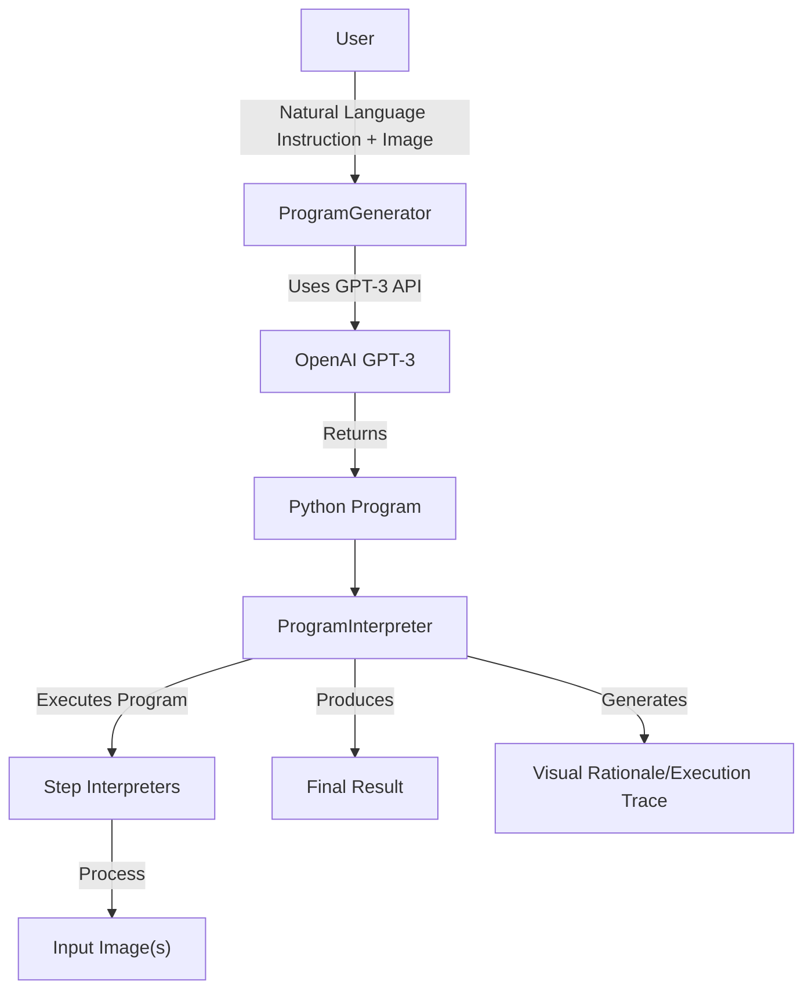
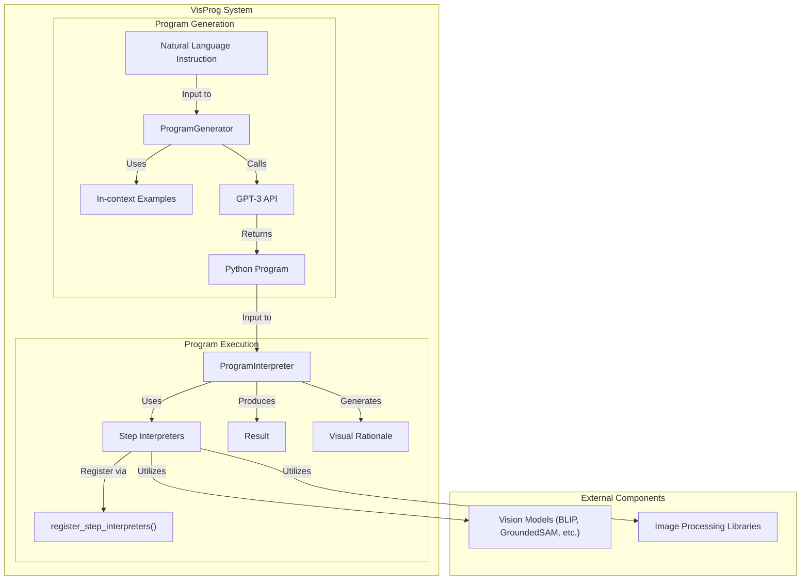
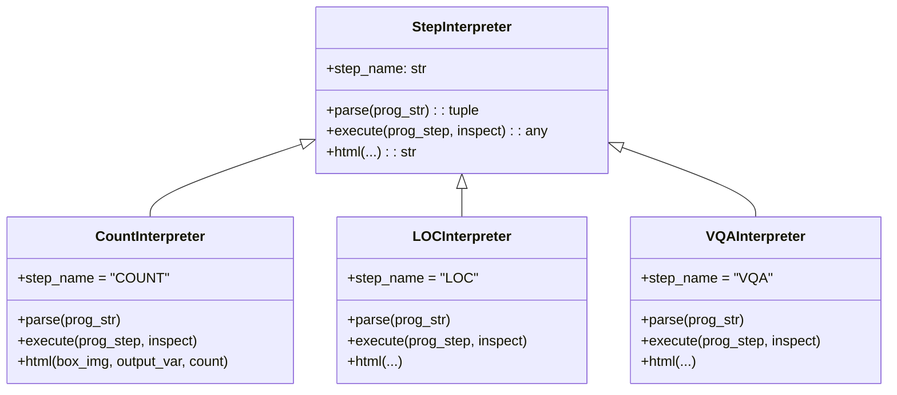
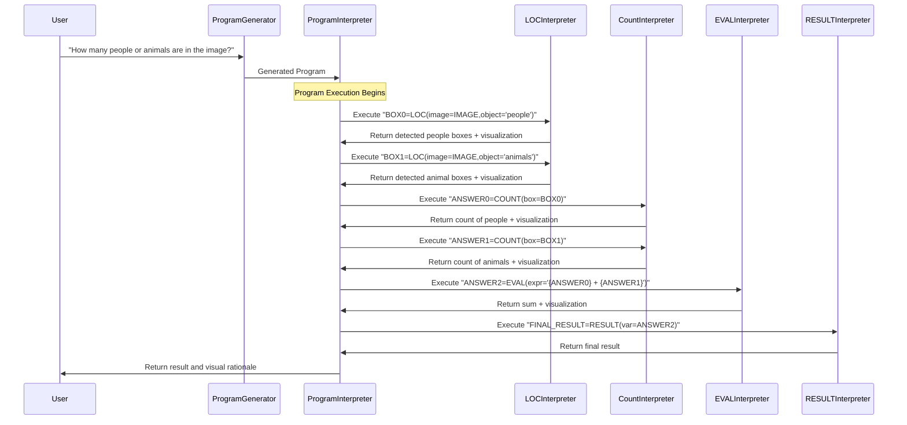
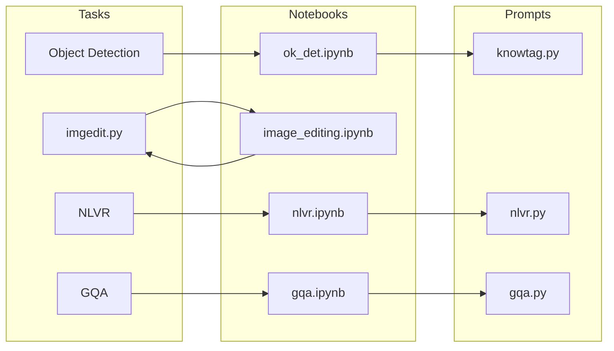

<!-- source: DeepWiki mcp.deepwiki.com · repo allenai/visprog · page 1 VisProg Overview · fetched 2026-10-26 -->

# VisProg Overview

<details>
<summary>Relevant source files</summary>

The following files were used as context for generating this wiki page:

- [README.md](README.md)

</details>


## Purpose and Scope

This document provides a comprehensive overview of VisProg (Visual Programming), a neuro-symbolic system designed for solving complex and compositional visual tasks using natural language instructions. It explains the high-level architecture, core components, and fundamental workflow of the system. 

For detailed information about setting up and running VisProg, see [Getting Started](#1.2). For in-depth documentation of specific components, see [Core Components](#2).

## What is VisProg?

VisProg is a system that translates natural language instructions about visual content into executable Python programs. It leverages the in-context learning ability of GPT-3 to generate programs that invoke various computer vision models, image processing routines, and Python functions. When executed, these programs not only produce solutions but also generate comprehensive and interpretable rationales.



Sources: [README.md:11-18]()

## Key Features

- **Zero-shot Visual Reasoning**: Performs complex visual tasks without task-specific training
- **Interpretable Results**: Generates not just answers but complete visual rationales
- **Modular Architecture**: Easy to extend with new functionality and adapt to new tasks
- **Compositional Approach**: Breaks down complex tasks into simpler operations
- **Multi-task Capability**: Supports a variety of visual tasks with the same core system

Sources: [README.md:18-25]()

## System Architecture

VisProg follows a two-stage architecture:

1. **Program Generation**: Translates natural language instructions into Python programs
2. **Program Execution**: Executes the generated programs and produces results with visual rationales



Sources: [README.md:44-54]()

## Core Components

### Program Generator

The `ProgramGenerator` class is responsible for translating natural language instructions into executable Python programs. It:

1. Takes a natural language instruction and input image(s)
2. Combines this with in-context examples from task-specific prompts
3. Sends the combined prompt to GPT-3 API
4. Returns the generated program as a string

### Program Interpreter

The `ProgramInterpreter` class executes the programs generated by the `ProgramGenerator`. It:

1. Parses the program line by line
2. For each line, identifies the appropriate step interpreter
3. Executes the step using the interpreter
4. Updates the program state with intermediate results
5. Generates visual rationales for each step
6. Returns the final result and complete execution trace

### Step Interpreters

Step interpreters are specialized modules that implement specific functionalities. Each step interpreter has a common structure with three key methods:

- `parse()`: Extracts arguments and output variables from program lines
- `execute()`: Performs the actual computation
- `html()`: Generates HTML representation for the visual rationale



Sources: [README.md:80-116]()

## Program Execution Flow

The following diagram illustrates the execution flow of a sample VisProg program:



Sources: [README.md:62-69](), [README.md:71-72]()

## Available Modules

VisProg comes with a rich set of built-in modules that serve as building blocks for solving complex visual tasks:

| Module | Description | Function |
|--------|-------------|----------|
| `LOC` | Localization | Detects and locates objects in images |
| `COUNT` | Counting | Counts the number of elements in a set of boxes |
| `VQA` | Visual Question Answering | Answers questions about images using BLIP model |
| `CROP` | Cropping | Crops an image based on bounding boxes |
| `EDIT` | Image Editing | Performs various image editing operations |
| `INST_SEG` | Instance Segmentation | Segments objects in images |
| `FACE_DET` | Face Detection | Detects faces in images |
| `EVAL` | Expression Evaluation | Evaluates Python expressions |
| `RESULT` | Result | Sets the final result of the program |

Sources: [README.md:123-126]()

## Supported Tasks

VisProg currently supports multiple visual reasoning tasks:

1. **Outside Knowledge Object Tagging**: Detecting objects in images using external knowledge
2. **Natural Language Image Editing**: Editing images based on natural language instructions
3. **Natural Language Visual Reasoning (NLVR)**: Determining if a natural language statement is true about a pair of images
4. **General Question Answering (GQA)**: Answering questions about images

Each task has a dedicated notebook and prompt file:



Sources: [README.md:36-40]()

## Example Use Case

Below is a sample workflow showing how VisProg solves a visual question:

1. **Natural Language Instruction**: "How many people or animals are in the image?"
2. **Generated Program**:
   ```python
   BOX0=LOC(image=IMAGE,object='people')
   BOX1=LOC(image=IMAGE,object='animals')
   ANSWER0=COUNT(box=BOX0)
   ANSWER1=COUNT(box=BOX1)
   ANSWER2=EVAL(expr="{ANSWER0} + {ANSWER1}")
   FINAL_RESULT=RESULT(var=ANSWER2)
   ```
3. **Execution**: Each line is executed, producing intermediate results
4. **Output**: The final count and a visual rationale showing each step

This example demonstrates how VisProg breaks down a complex task into simpler operations, executes them sequentially, and provides a comprehensive execution trace.

Sources: [README.md:62-72]()

## Extending VisProg

VisProg is designed to be easily extensible:

1. **Adding New Modules**: Create new step interpreters in `engine/step_interpreters.py` and register them
2. **Supporting New Tasks**: Add in-context examples in `prompts/` directory for the new task
3. **Upgrading Existing Modules**: Replace underlying models with newer/better alternatives

Sources: [README.md:74-118]()

## Summary

VisProg represents a novel approach to visual reasoning by combining large language models' program synthesis capabilities with specialized visual processing modules. This architecture enables solving complex visual tasks without task-specific training while providing interpretable rationales for its decisions.

For more detailed information about specific components, please refer to the corresponding pages in this wiki.

---

