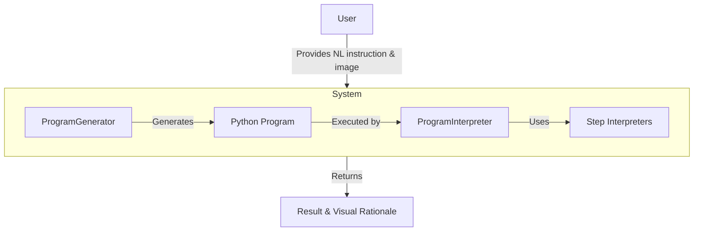
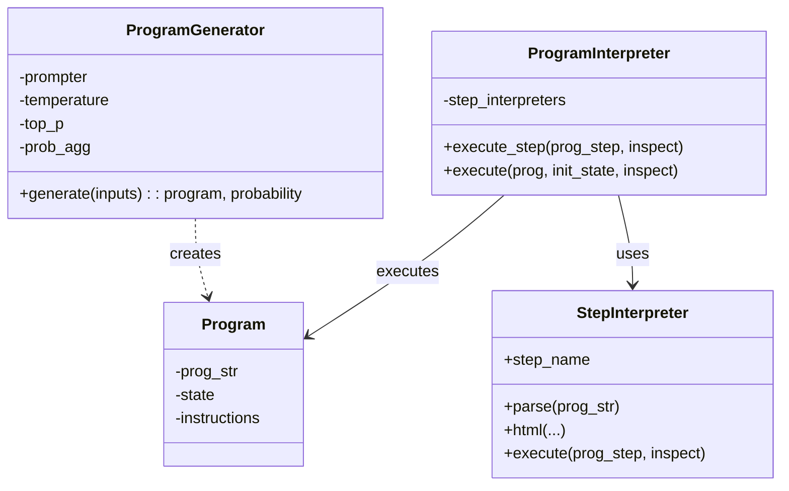
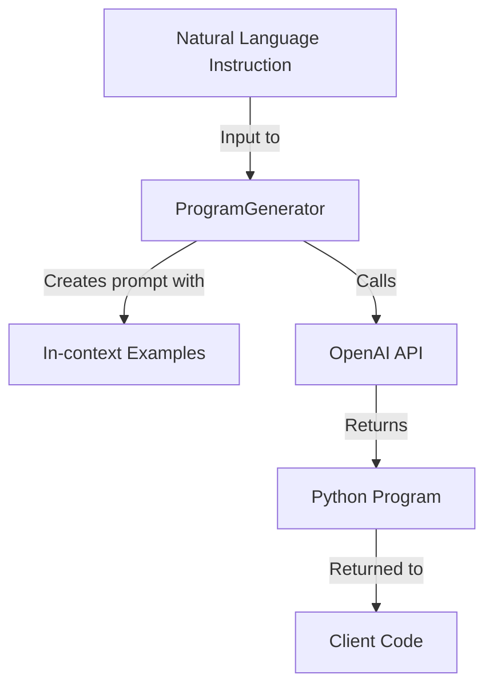
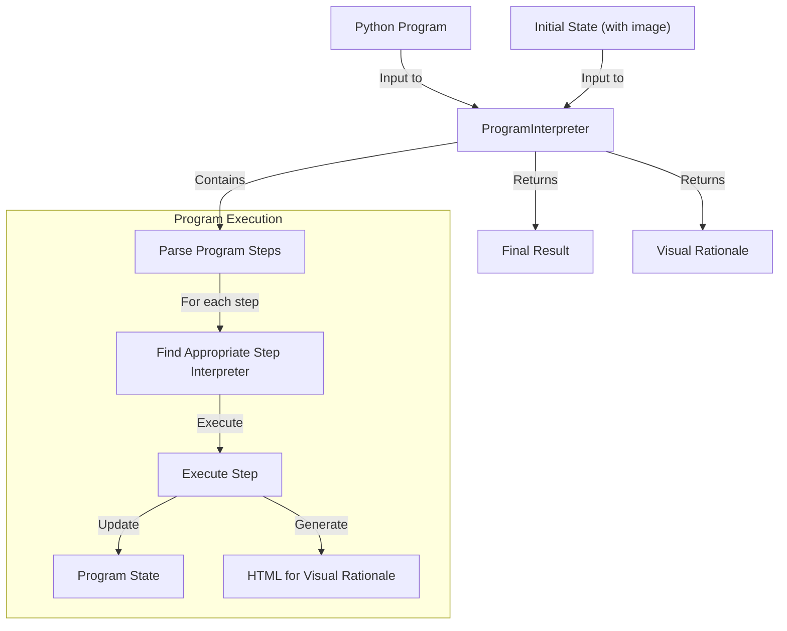
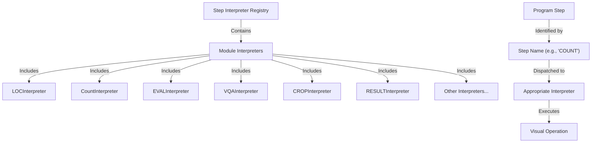
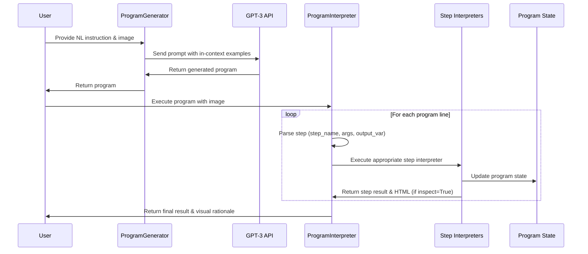
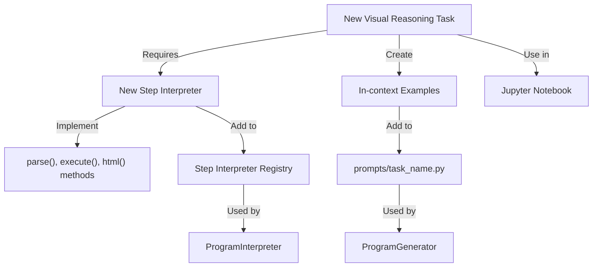

<!-- source: DeepWiki mcp.deepwiki.com · repo allenai/visprog · page 1.1 Architecture · fetched 2026-10-26 -->

# Architecture

<details>
<summary>Relevant source files</summary>

The following files were used as context for generating this wiki page:

- [README.md](README.md)
- [engine/utils.py](engine/utils.py)

</details>


This document describes the high-level architecture of VisProg, explaining the system's key components and how they interact to achieve compositional visual reasoning using natural language instructions. For getting started with running VisProg, see [Getting Started](#1.2).

## System Overview

VisProg is a neuro-symbolic system that combines large language models with modular computer vision components to solve complex visual tasks. The system takes natural language instructions and images as input, generates a Python program to solve the task, and executes the program to produce both a result and an interpretable visual rationale.



Sources: [README.md:11-18](), [engine/utils.py:10-14](), [engine/utils.py:17-46](), [engine/utils.py:49-88]()

## Core Components

VisProg's architecture consists of three main components:

1. **ProgramGenerator**: Generates a Python program from natural language instruction using GPT-3's in-context learning
2. **ProgramInterpreter**: Executes the generated program step by step
3. **Step Interpreters**: Specialized modules that execute individual operations in the program



Sources: [engine/utils.py:10-14](), [engine/utils.py:17-46](), [engine/utils.py:49-88]()

### ProgramGenerator

The `ProgramGenerator` class is responsible for converting natural language instructions into executable Python programs. It uses GPT-3's in-context learning capabilities by providing examples of instructions and corresponding programs.



Key implementation details:
- Implemented in [engine/utils.py:49-88]()
- Uses OpenAI's API to access GPT-3 (`text-davinci-003` model)
- Takes a prompter function that generates prompts with in-context examples
- Configurable parameters for temperature and top_p to control randomness
- Returns both the generated program and a probability score

Sources: [engine/utils.py:49-88](), [README.md:127-130]()

### ProgramInterpreter

The `ProgramInterpreter` class executes the generated program by interpreting each line as a step, finding the appropriate module to handle that step, and maintaining program state throughout execution.



Key implementation details:
- Implemented in [engine/utils.py:17-46]()
- Registers step interpreters at initialization based on the dataset
- Maintains program state across step executions
- Can run in inspection mode to generate visual rationales

Sources: [engine/utils.py:17-46](), [README.md:56-69]()

### Step Interpreters

Step interpreters are specialized modules that handle specific operations in the program. Each interpreter implements three main functions:
- `parse()`: Extracts arguments and output variable from the program step
- `execute()`: Performs the actual operation and updates program state
- `html()`: Generates HTML representation for the execution trace



Key implementation details:
- Step interpreters are registered in the `register_step_interpreters` function in [engine/step_interpreters.py:7]()
- Each interpreter class is responsible for a specific operation (e.g., `CountInterpreter` for counting objects)
- Interpreters follow a common interface with `parse()`, `html()`, and `execute()` methods
- New modules can be added by implementing new interpreter classes and registering them

Sources: [README.md:80-116](), [README.md:123-124]()

## Program Execution Flow

The following sequence diagram illustrates the complete flow of a VisProg execution, from user input to final output:



Sources: [README.md:45-54](), [engine/utils.py:26-46]()

## Example Program

Here's an example of a generated program for the question "How many people or animals are in the image?":

```python
BOX0=LOC(image=IMAGE,object='people')
BOX1=LOC(image=IMAGE,object='animals')
ANSWER0=COUNT(box=BOX0)
ANSWER1=COUNT(box=BOX1)
ANSWER2=EVAL(expr="{ANSWER0} + {ANSWER1}")
FINAL_RESULT=RESULT(var=ANSWER2)
```

This program:
1. Locates all people in the image and stores bounding boxes in `BOX0`
2. Locates all animals in the image and stores bounding boxes in `BOX1`
3. Counts the number of bounding boxes in `BOX0` and stores it in `ANSWER0`
4. Counts the number of bounding boxes in `BOX1` and stores it in `ANSWER1`
5. Evaluates the expression to add the two counts and stores it in `ANSWER2`
6. Sets the final result to be the value of `ANSWER2`

When executed with `inspect=True`, each step also generates HTML for the visual rationale, showing exactly what was detected and counted.

Sources: [README.md:61-69]()

## System Extension

VisProg is designed to be easily extensible. New visual reasoning capabilities can be added by:

1. Implementing new step interpreters in [engine/step_interpreters.py]()
2. Registering the new interpreters in the `register_step_interpreters` function
3. Adding in-context examples that demonstrate the new capabilities to prompt files



Sources: [README.md:79-118]()

## Summary

VisProg's architecture enables compositional visual reasoning without task-specific training by:

1. Using GPT-3's in-context learning to generate programs from natural language
2. Providing a modular interpreter framework for executing visual operations
3. Maintaining program state across execution steps
4. Generating detailed visual rationales that explain each execution step

This architecture makes it easy to:
- Add new visual reasoning capabilities
- Extend to new tasks with in-context examples
- Debug and understand the reasoning process through visual rationales

Sources: [README.md:18-25](), [README.md:120-126]()

---

