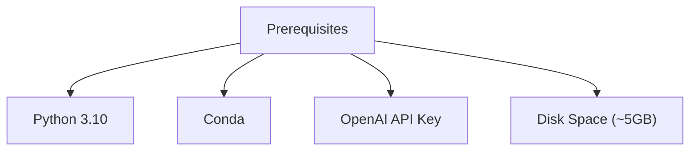
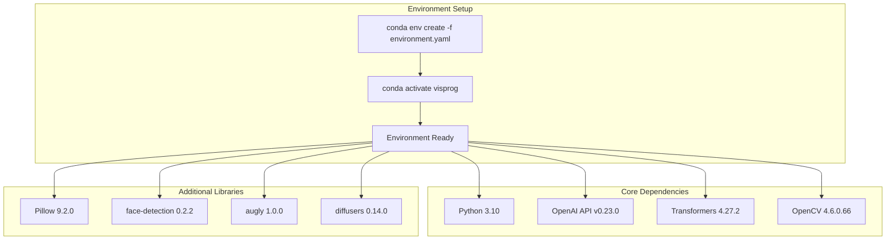
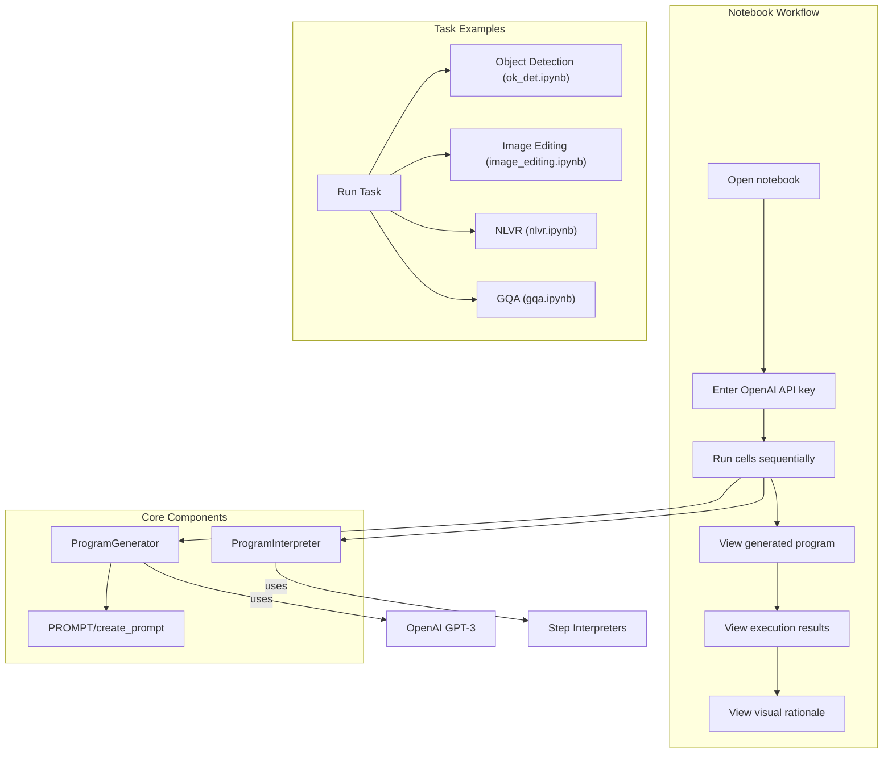
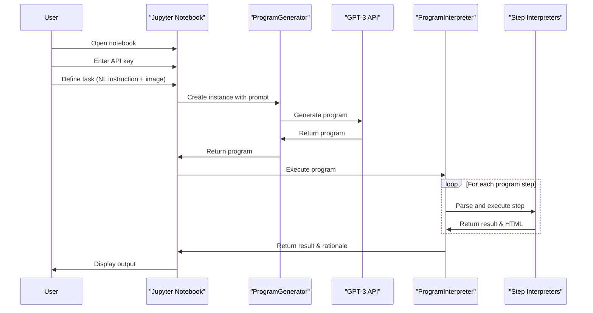
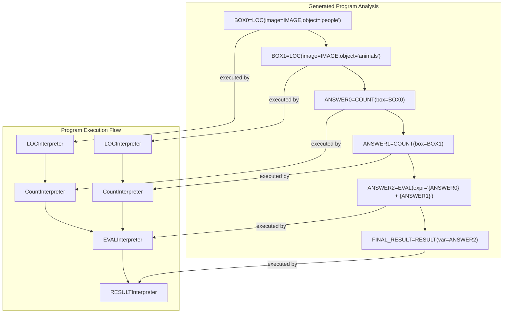
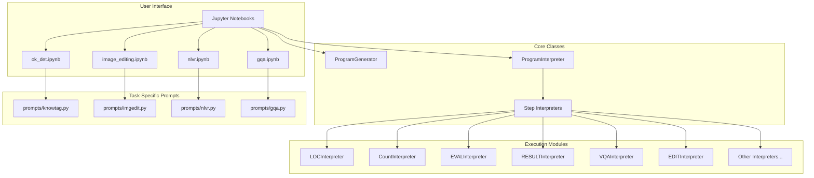

<!-- source: DeepWiki mcp.deepwiki.com · repo allenai/visprog · page 1.2 Getting Started · fetched 2026-10-26 -->

# Getting Started

<details>
<summary>Relevant source files</summary>

The following files were used as context for generating this wiki page:

- [LICENSE](LICENSE)
- [README.md](README.md)
- [environment.yaml](environment.yaml)

</details>


This guide provides step-by-step instructions for setting up and running the VisProg system. VisProg is a neuro-symbolic system designed for solving complex visual tasks using natural language instructions. For more information about the system architecture, please see [Architecture](#1.1).

## Prerequisites

Before using VisProg, ensure you have:

1. Python 3.10 installed on your system
2. Conda package manager
3. An OpenAI API key (for GPT-3 access)
4. Sufficient disk space (~5GB) for dependencies



Sources: [environment.yaml:1-5](), [README.md:27-31]()

## Installation

Follow these steps to install VisProg and its dependencies:

1. Clone the repository:
   ```bash
   git clone https://github.com/allenai/visprog.git
   cd visprog
   ```

2. Create and activate the conda environment:
   ```bash
   conda env create -f environment.yaml
   conda activate visprog
   ```

This will install all required dependencies including:
- OpenAI API (version 0.23.0)
- Transformers (version 4.27.2)
- OpenCV (version 4.6.0.66)
- Pillow (version 9.2.0)
- face-detection (version 0.2.2)
- augly (version 1.0.0)
- diffusers (version 0.14.0)
- Other supporting packages



Sources: [environment.yaml:1-17](), [README.md:27-31]()

## Running the Example Notebooks

VisProg includes several example notebooks to demonstrate its capabilities across different visual reasoning tasks:

| Notebook | Task | File Path |
|----------|------|-----------|
| Object Detection | Outside knowledge object tagging | `notebooks/ok_det.ipynb` |
| Image Editing | Natural language image editing | `notebooks/image_editing.ipynb` |
| NLVR | Natural Language Visual Reasoning | `notebooks/nlvr.ipynb` |
| GQA | General Question Answering | `notebooks/gqa.ipynb` |

To run a notebook:

1. Ensure your conda environment is activated (`conda activate visprog`)
2. Open the notebook using Jupyter or an IDE that supports .ipynb files (e.g., VSCode)
3. Enter your OpenAI API key where indicated (look for `<Enter your key here>`)
4. Run the notebook cells sequentially



Sources: [README.md:34-41](), [README.md:44-54]()

## Understanding the Basic Workflow

All VisProg notebooks follow a similar structure and workflow:

1. **Setup**: Import necessary modules and set environment variables
2. **Initialization**: Create `ProgramGenerator` and `ProgramInterpreter` instances
3. **Task Definition**: Load image(s) and define natural language instruction
4. **Program Generation**: Using GPT-3 to generate a Python program for the task
5. **Program Execution**: Execute the generated program to solve the task
6. **Result Visualization**: View the result and visual rationale



Sources: [README.md:44-54](), [README.md:55-72]()

## Example VisProg Output

When you run a VisProg notebook, you will get two main outputs:

1. **Generated Program**: A Python-like program with specialized function calls specific to visual reasoning
2. **Visual Rationale**: A step-by-step visualization of the program execution

For example, running the GQA notebook with the instruction "How many people or animals are in the image?" will generate:

```python
BOX0=LOC(image=IMAGE,object='people')
BOX1=LOC(image=IMAGE,object='animals')
ANSWER0=COUNT(box=BOX0)
ANSWER1=COUNT(box=BOX1)
ANSWER2=EVAL(expr="{ANSWER0} + {ANSWER1}")
FINAL_RESULT=RESULT(var=ANSWER2)
```

The visual rationale will show each step's execution, including intermediate results and the final output.



Sources: [README.md:61-72]()

## System Component Map

The following diagram maps the high-level components to their code implementations:



Sources: [README.md:34-41](), [README.md:79-116]()

## Troubleshooting

If you encounter issues with VisProg, here are some common problems and solutions:

### 1. Incorrect Program Generation

If VisProg generates an incorrect program or fails to solve your task:

- Ensure the instruction is similar to the in-context examples
- Check if your instruction can be solved using the current modules
- Consider adding your working example to in-context examples

### 2. OpenAI API Issues

- Verify your API key is entered correctly
- Check your API key has sufficient quota/credits
- Ensure you have internet connectivity

### 3. Dependency Problems

- Make sure you've created and activated the conda environment correctly
- If experiencing import errors, try reinstalling the environment

### 4. Adding New Functionality

If the current set of modules doesn't meet your needs:

1. Add new modules to `engine/step_interpreters.py` 
2. Register your modules in the `register_step_interpreters` function
3. Add in-context examples to `prompts/your_task_name.py`

Sources: [README.md:74-78](), [README.md:79-118]()

## Next Steps

After getting familiar with running the example notebooks, you might want to:

1. Try your own images and instructions with the existing notebooks
2. Examine the [Core Components](#2) to understand the system architecture better
3. Learn how to [add new functionality](#4.1) to extend VisProg's capabilities
4. Explore the different [Tasks & Examples](#3) supported by VisProg

This completes the "Getting Started" guide for VisProg. You should now be able to run the system and understand its basic workflow.

---

