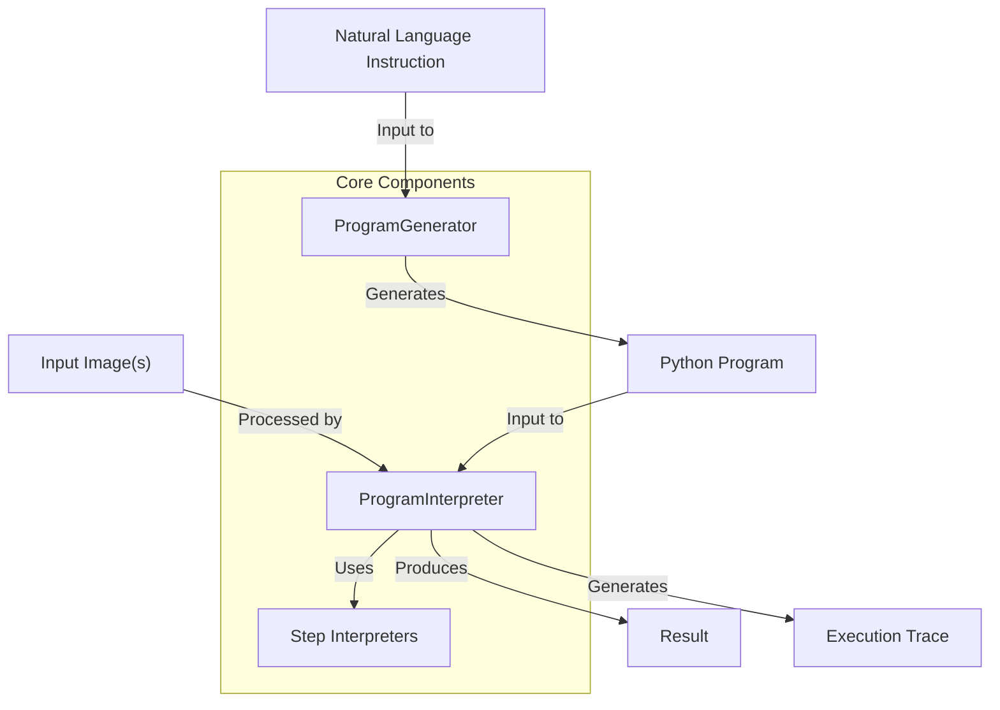
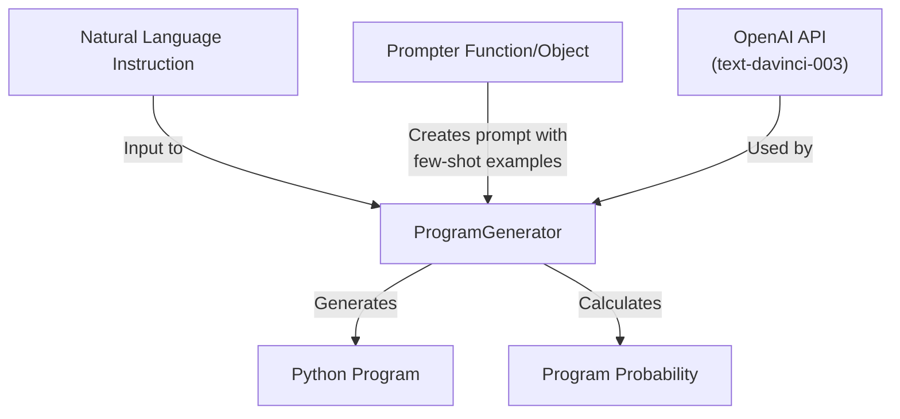
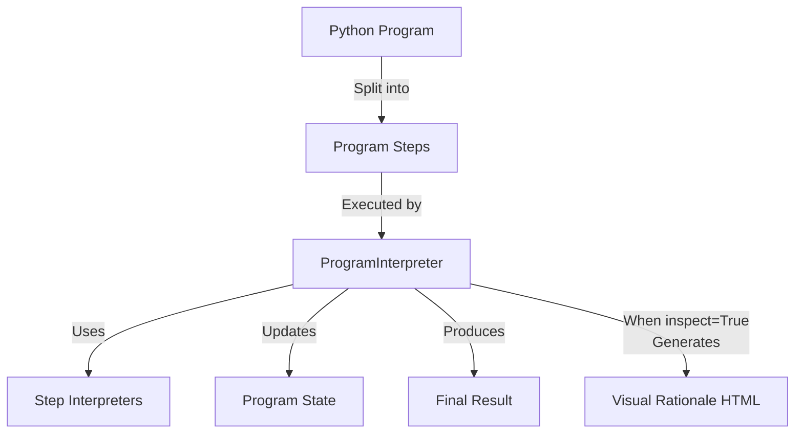
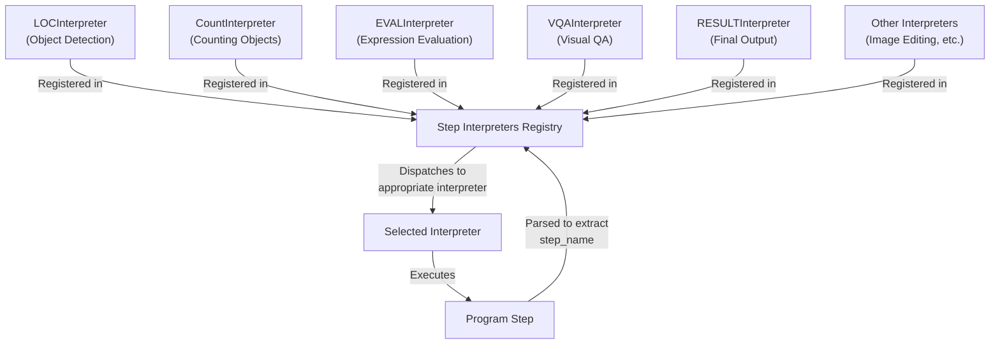
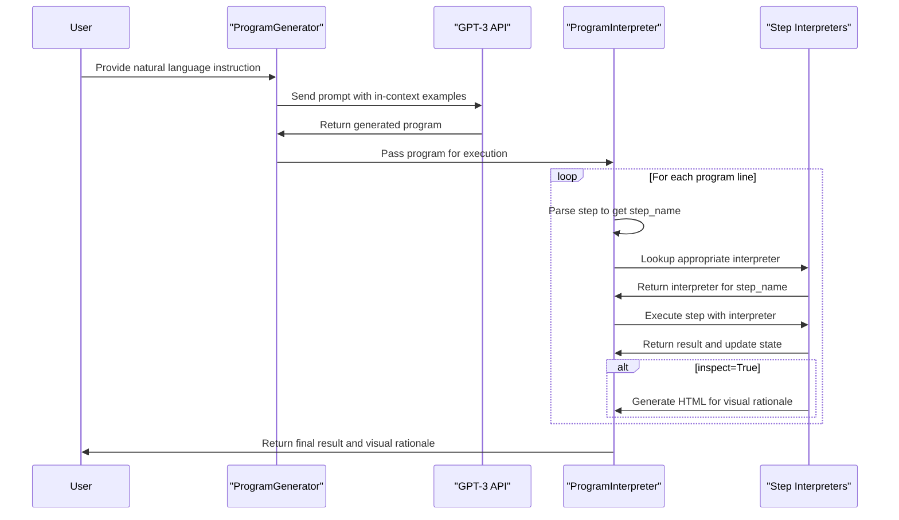
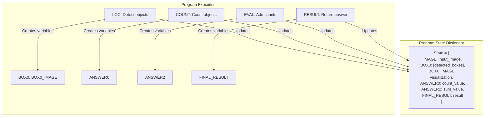
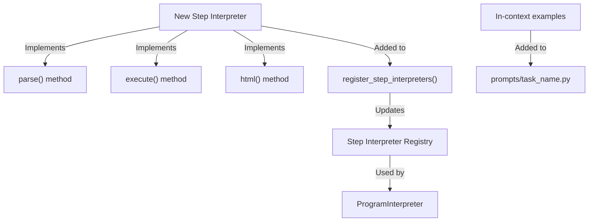

<!-- source: DeepWiki mcp.deepwiki.com · repo allenai/visprog · page 2 Core Components · fetched 2026-10-26 -->

# Core Components

Relevant source files

The following files were used as context for generating this wiki page:

- [README.md](README.md)
- [engine/utils.py](engine/utils.py)

This document provides a detailed overview of the primary components that constitute the VisProg system. VisProg is a neuro-symbolic system that solves complex visual tasks using natural language instructions without additional training. This page focuses on the core architectural components that enable program generation and execution. For specific tasks and applications, see [Tasks & Examples](#3).

## Overview

VisProg consists of three primary components that work together to translate natural language instructions into executable programs and then execute them to produce results:

Sources: [README.md:18-25](), [engine/utils.py:10-46]()

## Program Generator

The `ProgramGenerator` class is responsible for transforming natural language instructions into Python programs using OpenAI's GPT-3 model. It leverages in-context learning (few-shot prompting) to generate programs without requiring fine-tuning.

The `ProgramGenerator` initializes with:
- A prompter object/function that creates the prompt with in-context examples
- Temperature and top_p parameters for controlling generation diversity
- Probability aggregation method for calculating the confidence in generated programs

Program generation involves:
1. Constructing a prompt using the prompter with in-context examples
2. Sending the prompt to the OpenAI API (GPT-3)
3. Receiving and parsing the response
4. Computing a probability score for the program

Sources: [engine/utils.py:49-88](), [README.md:47-48]()

## Program Interpreter

The `ProgramInterpreter` class executes the Python programs generated by the `ProgramGenerator`. It maintains a program state dictionary and processes each program line sequentially.

Program execution involves:
1. Parsing the program into individual steps (lines)
2. For each step:
   - Determining the appropriate step interpreter based on the step name
   - Executing the step using the interpreter
   - Updating the program state with new variables
   - Optionally generating HTML for visual rationale
3. Returning the final result and execution trace

Sources: [engine/utils.py:17-46](), [README.md:53-54]()

## Step Interpreters

Step interpreters are specialized modules that implement different visual reasoning capabilities. Each step interpreter handles a specific type of operation (e.g., object detection, counting, evaluation).

Each step interpreter follows a standard structure with three key methods:
- `parse()`: Extracts arguments and output variable from the program step
- `execute()`: Performs the actual operation and updates program state
- `html()`: Generates HTML representation for the visual rationale

The system currently supports a diverse set of modules, including:
- Object detection (LOC)
- Counting objects (COUNT)
- Visual question answering (VQA)
- Expression evaluation (EVAL)
- Result display (RESULT)
- Image editing operations
- Many others (see [Step Interpreters](#2.3) for full details)

Sources: [README.md:79-116](), [engine/utils.py:19-24]()

## Component Interactions

The following sequence diagram illustrates how the core components interact during execution:

The execution flow demonstrates how VisProg transforms a natural language instruction into an executable program, executes it step-by-step, and produces both a result and an interpretable rationale.

Sources: [README.md:44-54](), [engine/utils.py:17-46]()

## Program State Management

During program execution, the `ProgramInterpreter` maintains a program state dictionary that stores variables created by each step. This enables steps to reference outputs from previous steps, allowing for compositional reasoning.

The state dictionary starts with initial values (e.g., input images) and is progressively updated as each step is executed. This mechanism allows for:
- Data flow between program steps
- Access to intermediate results
- Creation of visual rationales from step outputs

Sources: [engine/utils.py:10-14](), [engine/utils.py:25-46]()

## Extension Mechanism

VisProg is designed to be easily extensible with new functionalities. Adding new capabilities involves:

1. Implementing a new step interpreter class in `engine/step_interpreters.py`
2. Registering the interpreter in the `register_step_interpreters` function
3. Adding in-context examples to a prompt file to show GPT-3 how to use the new functionality

This modular architecture makes it straightforward to extend VisProg with new visual reasoning capabilities without modifying the core program generation and interpretation logic.

Sources: [README.md:79-118]()

## Summary

The core components of VisProg work together to enable solving complex visual tasks through generated programs:

1. **ProgramGenerator**: Translates natural language instructions to Python programs using GPT-3
2. **ProgramInterpreter**: Executes programs by dispatching to appropriate step interpreters
3. **Step Interpreters**: Implement specific visual reasoning operations

This architecture provides several advantages:
- Interpretability through step-by-step execution and visual rationales
- Compositionality by combining simple operations into complex programs
- Extensibility through the modular step interpreter system
- Zero-shot/few-shot capabilities without task-specific training

For detailed information about specific step interpreters and their capabilities, see [Step Interpreters](#2.3). For examples of how these components are used to solve different tasks, see [Tasks & Examples](#3).

Sources: [README.md:18-25](), [README.md:120-125]()

---

