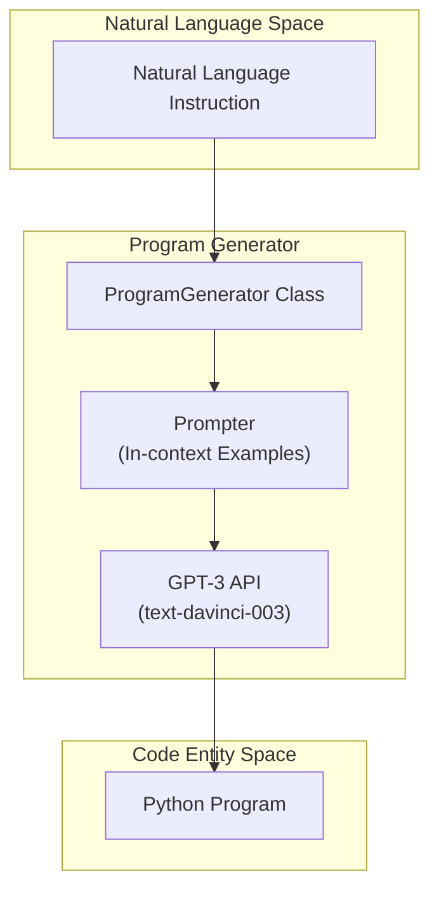
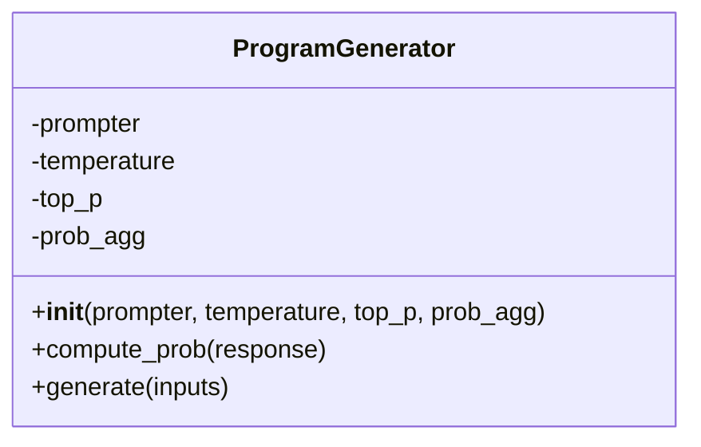
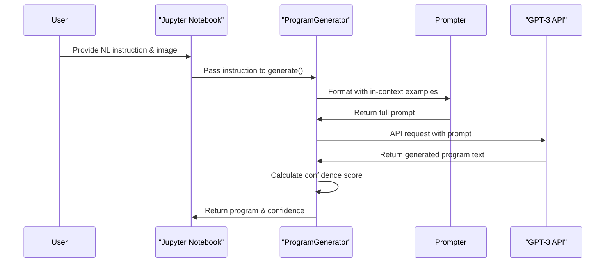
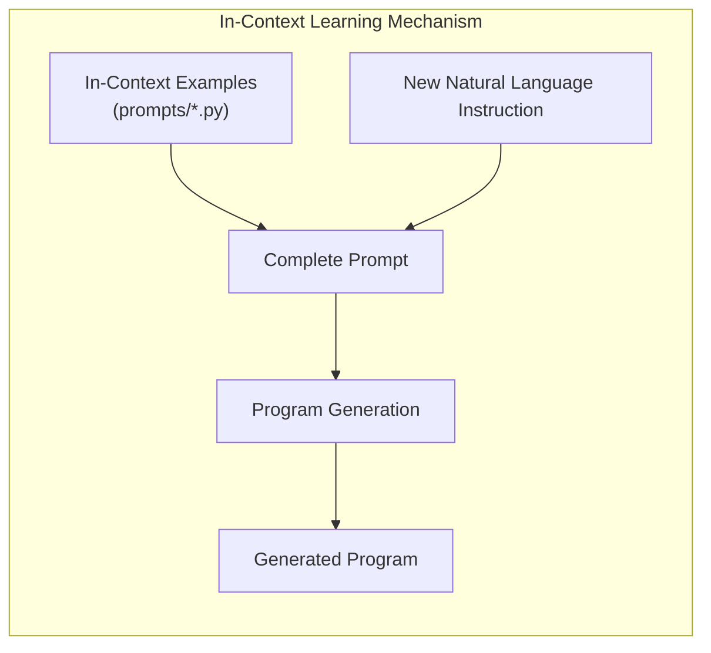

<!-- source: DeepWiki mcp.deepwiki.com · repo allenai/visprog · page 2.1 Program Generator · fetched 2026-10-26 -->

# Program Generator

<details>
<summary>Relevant source files</summary>

The following files were used as context for generating this wiki page:

- [README.md](README.md)
- [engine/utils.py](engine/utils.py)

</details>


## Purpose and Overview

The Program Generator is a core component of the VisProg system that transforms natural language instructions into executable Python programs. It leverages GPT-3's in-context learning capabilities to generate programs that utilize various visual reasoning modules when executed by the Program Interpreter (see [Program Interpreter](#2.2)).

This document covers the implementation details, working process, and customization options for the Program Generator component.

Sources: [README.md:18-19](), [engine/utils.py:49-88]()

## Architecture

The Program Generator sits between the user interface (typically a Jupyter notebook) and the Program Interpreter, serving as the translation layer that converts natural language into structured code.



The core of this component is the `ProgramGenerator` class defined in `engine/utils.py`. It handles the communication with the OpenAI API and processes the generated responses.

Sources: [engine/utils.py:49-88]()

## Implementation Details

The `ProgramGenerator` class is implemented with the following key components:



### Initialization Parameters

- **prompter**: A function that takes user inputs and returns a formatted prompt for GPT-3, including in-context examples
- **temperature**: Controls randomness in generation (default: 0.7)
- **top_p**: Controls diversity via nucleus sampling (default: 0.5)
- **prob_agg**: Method to aggregate token probabilities ('mean' or 'sum')

### Key Methods

- **generate(inputs)**: The main method that:
  1. Takes user inputs
  2. Uses the prompter to create a full prompt with in-context examples
  3. Sends the prompt to the GPT-3 API
  4. Returns the generated program and a confidence score

- **compute_prob(response)**: Calculates a confidence score for the generated program by aggregating token probabilities

Sources: [engine/utils.py:49-88]()

## Working Process

The generation process follows these steps:



### Example Transformation

For a natural language instruction like "How many people or animals are in the image?", the Program Generator produces a structured program:

```python
BOX0=LOC(image=IMAGE,object='people')
BOX1=LOC(image=IMAGE,object='animals')
ANSWER0=COUNT(box=BOX0)
ANSWER1=COUNT(box=BOX1)
ANSWER2=EVAL(expr="{ANSWER0} + {ANSWER1}")
FINAL_RESULT=RESULT(var=ANSWER2)
```

This program can then be executed by the Program Interpreter (see [Program Interpreter](#2.2)) to produce both the final answer and an interpretable visual rationale.

Sources: [README.md:62-68]()

## In-Context Learning

The Program Generator relies on in-context learning, where examples of natural language instructions paired with their corresponding programs are provided to GPT-3. These examples guide the model in generating correct programs for new instructions.



### Prompt Structure
Each task-specific prompt contains:
1. A general task description
2. Multiple examples of natural language instructions with corresponding programs
3. The new natural language instruction for which a program needs to be generated

Sources: [README.md:47-48](), [README.md:117-118]()

## Customization and Extension

The Program Generator can be customized in several ways:

### Adding New Tasks
To extend VisProg to handle new types of tasks:
1. Create a new prompt file in the `prompts/` directory
2. Add in-context examples specific to your task
3. Reference this prompt file in your notebook or script

### Adjusting Generation Parameters
You can tune the generation behavior by adjusting:
- **temperature**: Higher values (e.g., 0.9) produce more creative outputs; lower values (e.g., 0.2) produce more deterministic outputs
- **top_p**: Controls the diversity of generated tokens
- **prob_agg**: Changes how token probabilities are aggregated to compute the overall confidence

Sources: [README.md:117-118](), [engine/utils.py:50-55]()

## Usage in Notebooks

The Program Generator is typically used in Jupyter notebooks as follows:

1. Import necessary components and prompts
2. Create a ProgramGenerator instance with the appropriate prompter
3. Load the input image
4. Define the natural language instruction
5. Generate a program from the instruction
6. Pass the generated program to the Program Interpreter for execution

A simplified example:

```python
from engine.utils import ProgramGenerator, ProgramInterpreter
from prompts.gqa import PROMPT  # or create_prompt function

# Create program generator and interpreter
program_generator = ProgramGenerator(prompter=lambda x: PROMPT.format(instruction=x))
program_interpreter = ProgramInterpreter(dataset='gqa')

# Generate program from natural language instruction
instruction = "How many people or animals are in the image?"
program, confidence = program_generator.generate(instruction)

# Execute the generated program
result, state, html_trace = program_interpreter.execute(program, {'IMAGE': image}, inspect=True)
```

Sources: [README.md:44-54]()

---

