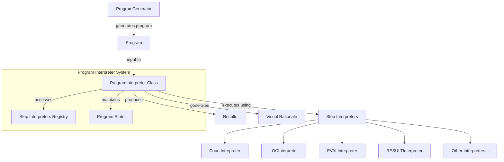
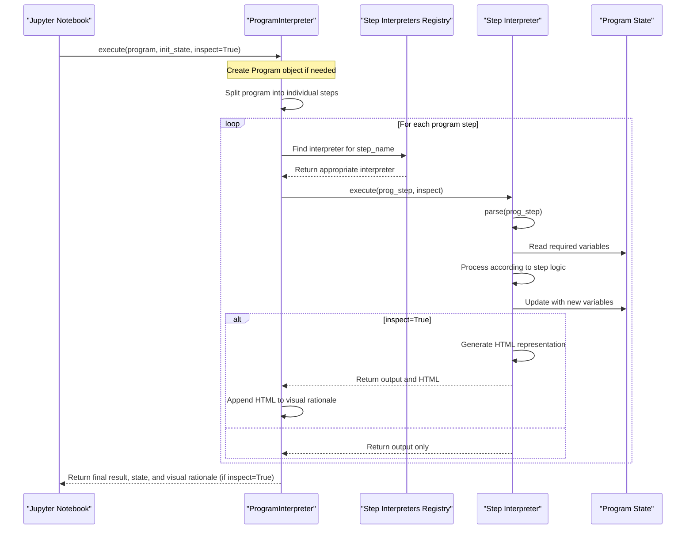
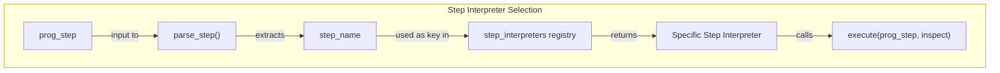
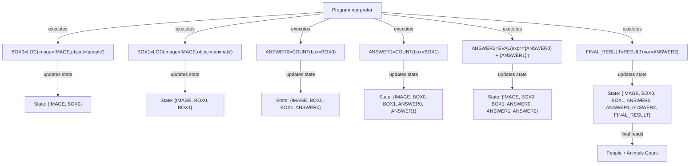
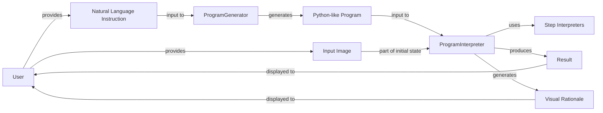

<!-- source: DeepWiki mcp.deepwiki.com · repo allenai/visprog · page 2.2 Program Interpreter · fetched 2026-10-26 -->

# Program Interpreter

<details>
<summary>Relevant source files</summary>

The following files were used as context for generating this wiki page:

- [README.md](README.md)
- [engine/utils.py](engine/utils.py)

</details>


## 1. Purpose and Overview

The Program Interpreter is a core component of the VisProg system responsible for executing programs generated by the Program Generator and producing both results and visual rationales. It acts as the execution engine that brings the generated Python-like programs to life by systematically executing each program step using specialized interpreters for different visual reasoning operations.

For information about how programs are generated from natural language instructions, see [Program Generator](#2.1).

Sources: [README.md:43-54](), [engine/utils.py:17-46]()

## 2. Core Functionality

The Program Interpreter takes generated programs and executes them by:

1. Parsing programs into individual execution steps
2. Identifying the appropriate Step Interpreter for each program step
3. Executing each step in sequence while maintaining program state
4. Generating visual rationales (when inspection is enabled)
5. Returning final results and the updated program state

Sources: [engine/utils.py:17-46]()

## 3. Architecture and Components



Sources: [engine/utils.py:17-46](), [README.md:43-54]()

## 4. Implementation Details

### 4.1 ProgramInterpreter Class

The `ProgramInterpreter` class is implemented in [engine/utils.py:17-46]() and consists of:

- Constructor that initializes step interpreters based on dataset type
- `execute_step` method to execute a single program step
- `execute` method to run a complete program

```python
class ProgramInterpreter:
    def __init__(self, dataset='nlvr'):
        self.step_interpreters = register_step_interpreters(dataset)
        
    def execute_step(self, prog_step, inspect):
        # Parse step and execute with appropriate interpreter
        
    def execute(self, prog, init_state, inspect=False):
        # Process the full program and return results
```

Sources: [engine/utils.py:17-46]()

### 4.2 Program State Management

The Program Interpreter maintains a state dictionary that:
- Is initialized with input variables (e.g., images)
- Gets updated after each step execution
- Contains all intermediate results
- Passes information between program steps

Sources: [engine/utils.py:26-43]()

## 5. Program Execution Flow



Sources: [engine/utils.py:26-46]()

## 6. Step Interpreter Selection Mechanism

The Program Interpreter uses the following process to select and execute the appropriate step interpreter:

1. Parse the program step string to extract the step name using `parse_step`
2. Look up the appropriate step interpreter in the registry using the step name as key
3. Call the interpreter's `execute` method with the current program step and inspect flag



Sources: [engine/utils.py:21-24]()

## 7. Visual Rationale Generation

When `inspect=True` is passed to the execute method, the Program Interpreter builds a visual rationale:

- Each step interpreter provides both results and HTML representation
- HTML strings are concatenated to create a comprehensive execution trace
- The visual rationale shows intermediate outputs, visualized operations, and execution flow

The visual rationale helps users understand how the program solved the task and provides transparency into the reasoning process.

Sources: [engine/utils.py:35-44](), [README.md:56-72]()

## 8. Example Program Execution

Here's an example of how the Program Interpreter executes a program for the question "How many people or animals are in the image?":



Sources: [README.md:59-72]()

## 9. Integration with VisProg System



Sources: [README.md:43-54]()

## 10. Usage in Notebooks

The Program Interpreter is typically used in notebooks with the following pattern:

1. Create the ProgramInterpreter instance: `interpreter = ProgramInterpreter()`
2. Initialize the state with images: `init_state = {'IMAGE': image}`
3. Execute the program: `result, state, rationale = interpreter.execute(program, init_state, inspect=True)`
4. Display the results and visual rationale

This pattern is consistent across all task-specific notebooks (object detection, image editing, NLVR, GQA).

Sources: [README.md:43-54]()

## 11. Extending the Program Interpreter

The Program Interpreter is designed to be extensible:

1. New step interpreters can be added to `engine/step_interpreters.py`
2. Each step interpreter must implement:
   - `parse()` - to extract arguments from program strings
   - `execute()` - to perform the operation
   - `html()` - to generate visual rationale (when inspection is enabled)
3. New interpreters must be registered in the `register_step_interpreters` function

This extensible design allows VisProg to be adapted to new visual reasoning tasks by adding new modules.

Sources: [README.md:80-116]()

---

