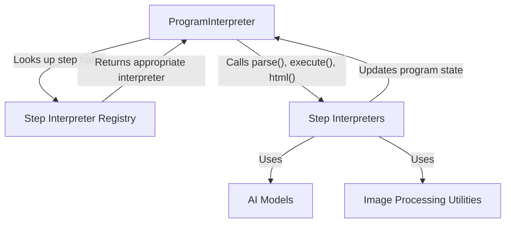
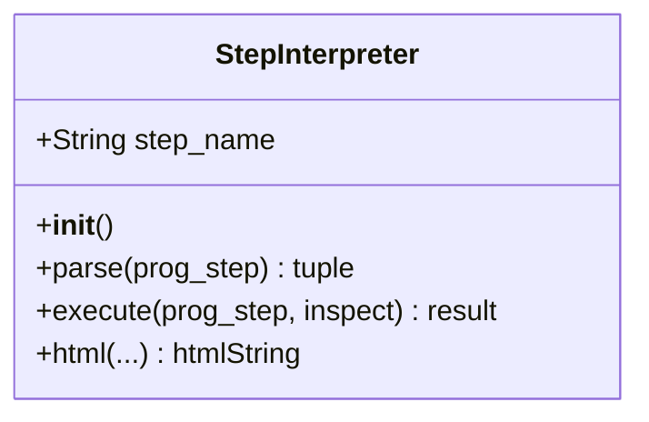
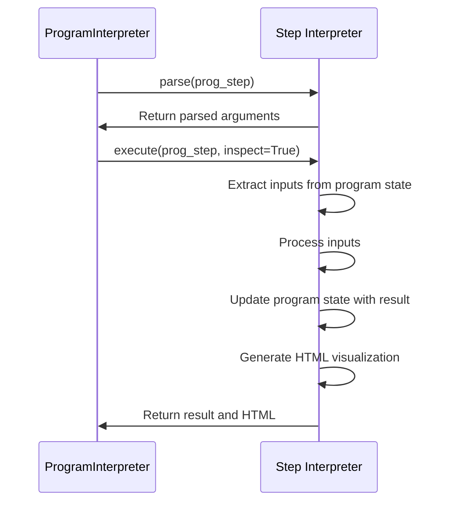
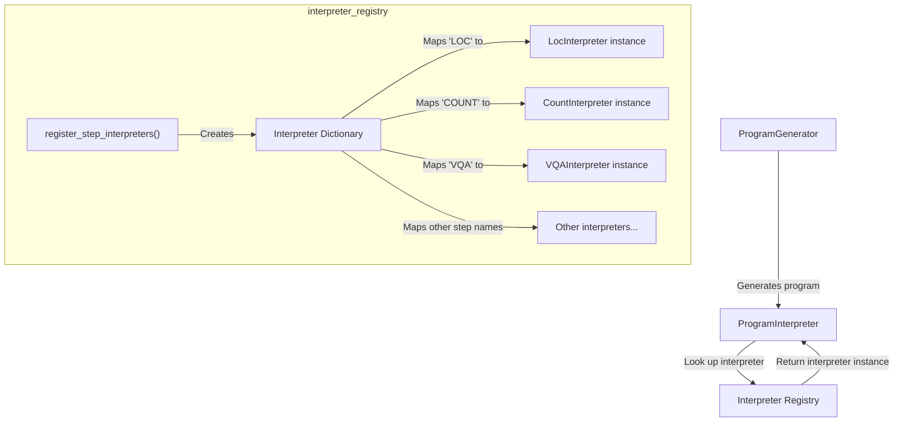
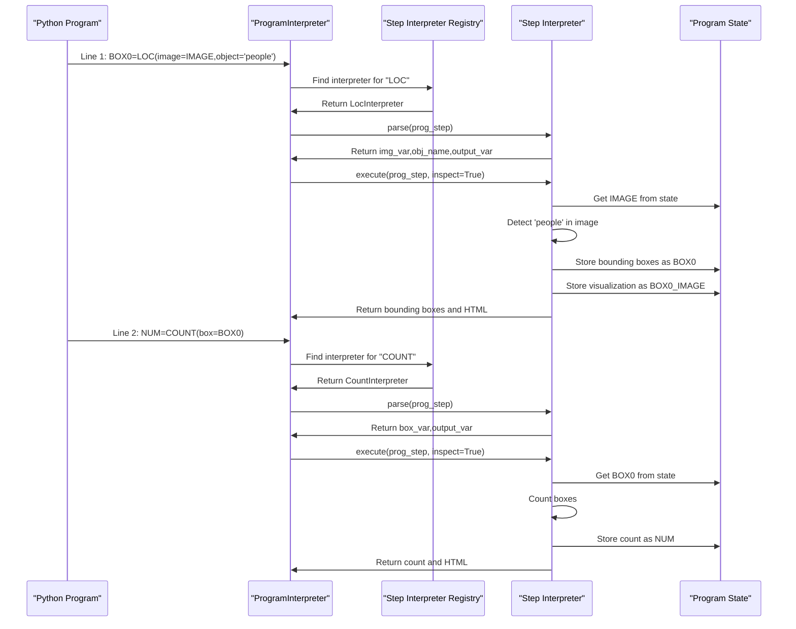
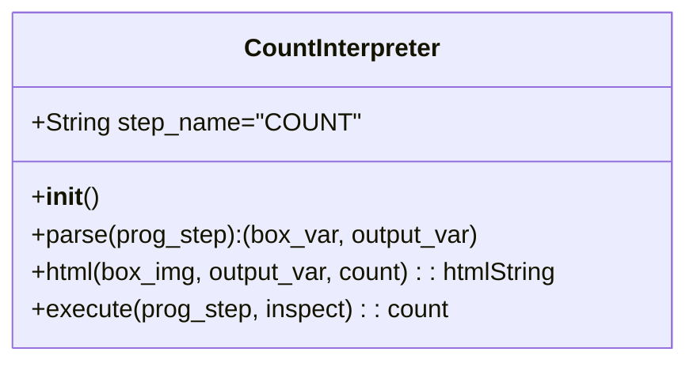
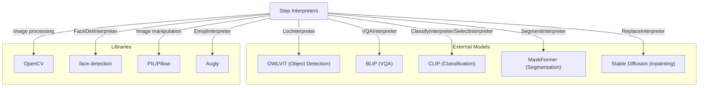
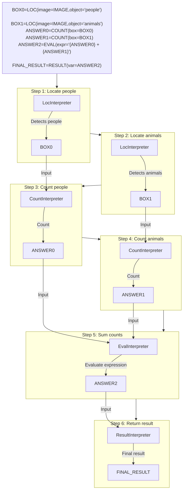

<!-- source: DeepWiki mcp.deepwiki.com · repo allenai/visprog · page 2.3 Step Interpreters · fetched 2026-10-26 -->

# Step Interpreters

<details>
<summary>Relevant source files</summary>

The following files were used as context for generating this wiki page:

- [README.md](README.md)
- [engine/nms.py](engine/nms.py)
- [engine/step_interpreters.py](engine/step_interpreters.py)

</details>


Step Interpreters are the fundamental building blocks that execute individual operations within VisProg programs. They form a modular and extensible architecture that enables a wide range of visual reasoning capabilities without requiring training. This page documents the purpose, structure, and functionality of Step Interpreters within the VisProg system.

For information about how programs are generated from natural language instructions, see [Program Generator](#2.1). For details on how complete programs are executed, see [Program Interpreter](#2.2).

## Overview and Purpose

Step Interpreters implement specific visual reasoning or image manipulation operations that can be composed to solve complex visual tasks. Each Step Interpreter is responsible for:

1. Parsing its specific operation from program text
2. Executing the operation on the current program state
3. Generating visual explanations for the execution trace



Sources: [engine/step_interpreters.py]()

## Step Interpreter Structure

All Step Interpreters follow a common interface with three primary methods:



### Core Methods

1. **`parse(prog_step)`**: Extracts arguments and output variable from the program text
2. **`execute(prog_step, inspect)`**: Performs the operation and updates program state
3. **`html(...)`**: Generates HTML visualization for the execution step

Here's an example of a typical Step Interpreter implementation pattern:



Sources: [engine/step_interpreters.py:345-378]()

## Available Step Interpreters

VisProg includes a variety of Step Interpreters grouped by their functionality:

### Core Interpreters

| Interpreter | Purpose | Example Usage |
|-------------|---------|---------------|
| `ResultInterpreter` | Returns the final result of a program | `FINAL_RESULT=RESULT(var=ANSWER)` |
| `EvalInterpreter` | Evaluates expressions | `ANSWER=EVAL(expr="{NUM1} + {NUM2}")` |

### Object Detection and Visual Recognition

| Interpreter | Purpose | Example Usage |
|-------------|---------|---------------|
| `LocInterpreter` | Locates objects in images | `BOX0=LOC(image=IMAGE,object='people')` |
| `VQAInterpreter` | Answers visual questions | `ANSWER=VQA(image=IMAGE,question='What color is the car?')` |
| `SegInterpreter` | Segments objects in images | `SEGMENTS=SEG(image=IMAGE)` |
| `FaceDetInterpreter` | Detects faces in images | `FACES=FACEDET(image=IMAGE)` |
| `ClassifyInterpreter` | Classifies objects | `CLASSES=CLASSIFY(image=IMAGE,object=OBJECTS,categories=CATEGORIES)` |

### Image Manipulation

| Interpreter | Purpose | Example Usage |
|-------------|---------|---------------|
| `CropInterpreter` | Crops image to object | `CROP0=CROP(image=IMAGE,box=BOX0)` |
| `ColorpopInterpreter` | Highlights objects in color | `HIGHLIGHT=COLORPOP(image=IMAGE,object=OBJECTS)` |
| `BgBlurInterpreter` | Blurs background | `BLURRED=BGBLUR(image=IMAGE,object=OBJECTS)` |
| `EmojiInterpreter` | Adds emojis to images | `EMOJI_IMG=EMOJI(image=IMAGE,object=OBJECTS,emoji='smile')` |
| `ReplaceInterpreter` | Replaces objects with generated content | `REPLACED=REPLACE(image=IMAGE,object=OBJECTS,prompt='a cute cat')` |

### Spatial Operators

| Interpreter | Purpose | Example Usage |
|-------------|---------|---------------|
| `CropRightOfInterpreter` | Crops right of object | `RIGHT=CROP_RIGHTOF(image=IMAGE,box=BOX0)` |
| `CropLeftOfInterpreter` | Crops left of object | `LEFT=CROP_LEFTOF(image=IMAGE,box=BOX0)` |
| `CropAboveInterpreter` | Crops above object | `ABOVE=CROP_ABOVE(image=IMAGE,box=BOX0)` |
| `CropBelowInterpreter` | Crops below object | `BELOW=CROP_BELOW(image=IMAGE,box=BOX0)` |

### Utility Interpreters

| Interpreter | Purpose | Example Usage |
|-------------|---------|---------------|
| `CountInterpreter` | Counts objects | `NUM=COUNT(box=BOXES)` |
| `SelectInterpreter` | Selects objects by criteria | `SELECTED=SELECT(image=IMAGE,object=OBJECTS,query='red',category='car')` |
| `ListInterpreter` | Generates lists via LLM | `ITEMS=LIST(query='types of dogs',max=5)` |
| `TagInterpreter` | Adds visual labels to objects | `TAGGED=TAG(image=IMAGE,object=OBJECTS)` |

Sources: [engine/step_interpreters.py:61-1247]()

## Interpreter Registry

The Step Interpreters are registered using the `register_step_interpreters` function, which returns a dictionary mapping step names to their corresponding interpreter instances:



The registry is configured differently based on the task/dataset:

```python
def register_step_interpreters(dataset='nlvr'):
    if dataset=='nlvr':
        return dict(
            VQA=VQAInterpreter(),
            EVAL=EvalInterpreter(),
            RESULT=ResultInterpreter()
        )
    elif dataset=='gqa':
        return dict(
            LOC=LocInterpreter(),
            COUNT=CountInterpreter(),
            CROP=CropInterpreter(),
            # Additional GQA interpreters...
            RESULT=ResultInterpreter()
        )
    # Additional dataset configurations...
```

Sources: [engine/step_interpreters.py:1336-1380]()

## Execution Process

When a program is executed, the Program Interpreter processes each step by:

1. Finding the appropriate Step Interpreter
2. Parsing the program step
3. Executing the operation
4. Updating the program state
5. Optionally generating a visual explanation



Sources: [engine/step_interpreters.py:345-378](), [engine/step_interpreters.py:195-320]()

## Example: Anatomy of the CountInterpreter

Let's examine the `CountInterpreter` as a concrete example:



1. **Initialization**: Sets up the interpreter and registers it
2. **Parse Method**: Extracts `box_var` (input) and `output_var` (where to store result)
3. **Execute Method**: Retrieves boxes from program state, counts them, updates state
4. **HTML Method**: Generates visual explanation showing boxes and count

Sources: [engine/step_interpreters.py:346-378]()

## Creating Custom Step Interpreters

To extend VisProg with new functionality, you can create custom Step Interpreters:

1. Define a new class with `step_name` attribute
2. Implement the three core methods: `parse()`, `execute()`, and `html()`
3. Register the interpreter in `register_step_interpreters()`

```python
class MyCustomInterpreter():
    step_name = 'CUSTOM'
    
    def __init__(self):
        print(f'Registering {self.step_name} step')
        # Initialize any models or resources
        
    def parse(self, prog_step):
        # Extract arguments from program text
        parse_result = parse_step(prog_step.prog_str)
        # Return parsed arguments
        
    def execute(self, prog_step, inspect=False):
        # Extract inputs from program state
        # Perform operation
        # Update program state
        # Return result and HTML if inspect=True
        
    def html(self, ...):
        # Generate HTML visualization
```

After adding your interpreter, you need to register it:

```python
def register_step_interpreters(dataset='custom'):
    # Add your custom configuration
    if dataset=='custom':
        return dict(
            CUSTOM=MyCustomInterpreter(),
            # Add other required interpreters
            RESULT=ResultInterpreter()
        )
```

Sources: [engine/step_interpreters.py:1336-1380](), [README.md:79-117]()

## Step Interpreter Dependencies

Many Step Interpreters rely on external AI models and libraries:



Sources: [engine/step_interpreters.py:1-17]()

## Case Study: Executing a Multi-Step Program

Here's an example of how multiple Step Interpreters work together to solve a task:



Sources: [README.md:62-68]()

## Conclusion

Step Interpreters provide the modular building blocks that enable VisProg to perform a wide range of visual reasoning tasks without requiring training. By composing different interpreters, the system can solve complex visual problems while providing interpretable execution traces.

To extend VisProg with new capabilities, you can create and register new Step Interpreters. For task-specific implementations that use these interpreters, see [Tasks & Examples](#3).

---

