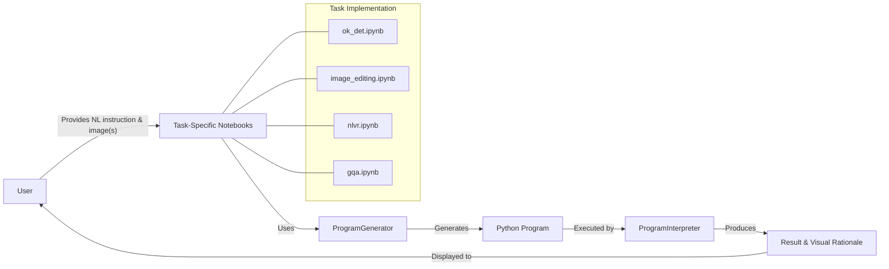
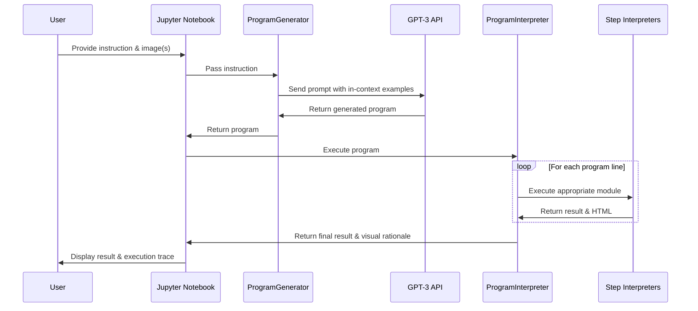
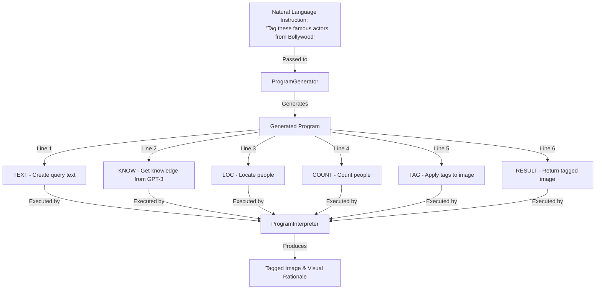
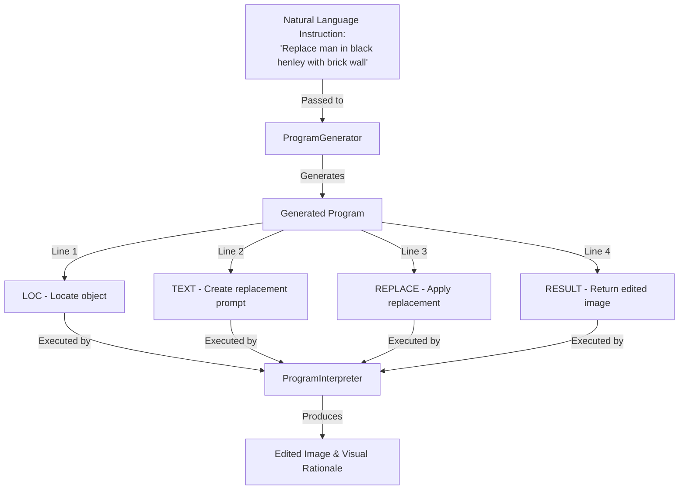
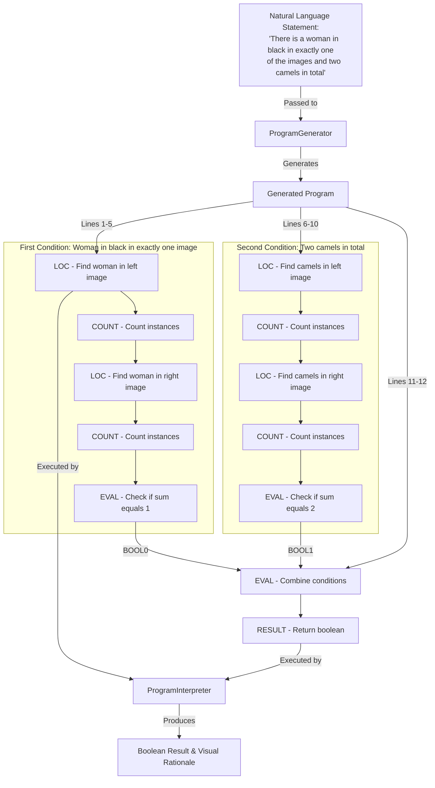
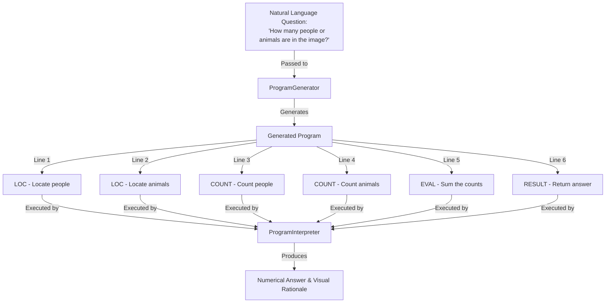
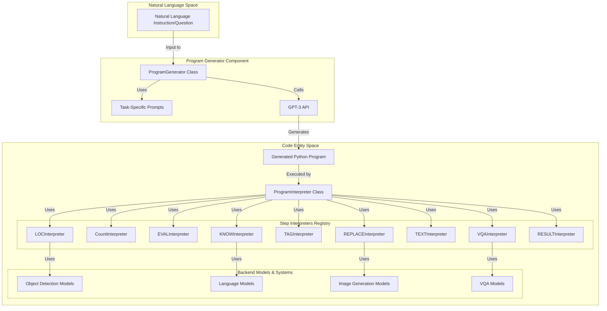
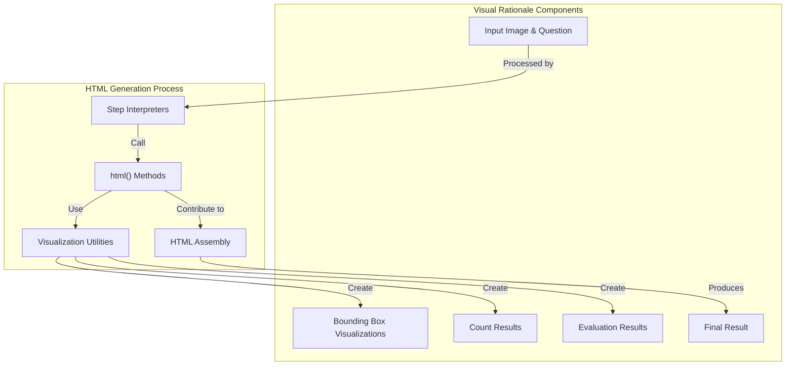

<!-- source: DeepWiki mcp.deepwiki.com · repo allenai/visprog · page 3 Tasks & Examples · fetched 2026-10-26 -->

# Tasks & Examples

<details>
<summary>Relevant source files</summary>

The following files were used as context for generating this wiki page:

- [README.md](README.md)
- [notebooks/gqa.ipynb](notebooks/gqa.ipynb)
- [notebooks/image_editing.ipynb](notebooks/image_editing.ipynb)
- [notebooks/nlvr.ipynb](notebooks/nlvr.ipynb)
- [notebooks/ok_det.ipynb](notebooks/ok_det.ipynb)

</details>


This page provides an overview of the visual reasoning tasks supported by the VisProg system, including implementation details and specific examples for each task. For information on core system components and architecture, see [VisProg Overview](#1) and [Core Components](#2).

## Overview of Supported Tasks

VisProg currently supports four primary visual reasoning tasks, each implemented through a dedicated Jupyter notebook and specialized prompt templates:

1. **Outside Knowledge Object Tagging**: Detect and tag objects in images based on external knowledge
2. **Natural Language Image Editing**: Edit images according to natural language instructions
3. **Natural Language Visual Reasoning (NLVR)**: Determine if a natural language statement about two images is true or false
4. **General Question Answering (GQA)**: Answer questions about images using visual reasoning



Sources: [README.md:36-40]()

## Task Implementation Pattern

All tasks in VisProg follow a similar execution pattern, implemented as Jupyter notebooks:



Sources: [README.md:44-54]()

## Task 1: Outside Knowledge Object Tagging

This task detects and tags objects in images based on external knowledge retrieved from GPT-3. It's particularly useful for identifying named entities like celebrities or landmarks that require domain-specific knowledge.

### Implementation

The task is implemented in the `notebooks/ok_det.ipynb` notebook using the prompt template defined in `prompts/knowtag.py`.

### Example Usage

**Input:**
- Image: `assets/bollywood.png`
- Instruction: "Tag these famous actors from Bollywood"

**Generated Program:**
```python
QUERY0=TEXT(text='Famous actors from Bollywood')
ANSWER0=KNOW(query=QUERY0)
LOC0=LOC(image=IMAGE,object='person')
NUM0=COUNT(box=LOC0)
TAG0=TAG(image=IMAGE,box=LOC0,list=ANSWER0)
FINAL_RESULT=RESULT(var=TAG0)
```

**Execution Flow:**
1. Create a text query about Bollywood actors
2. Retrieve knowledge about Bollywood actors using GPT-3
3. Locate people in the image
4. Count the number of people found
5. Tag each person with names from the knowledge list
6. Return the tagged image as the final result



Sources: [notebooks/ok_det.ipynb:78-82](), [README.md:56-72]()

## Task 2: Natural Language Image Editing

This task allows users to edit images using natural language instructions, leveraging generative AI for image manipulation tasks such as replacements, colorization, and blurring.

### Implementation

The task is implemented in the `notebooks/image_editing.ipynb` notebook using the prompt template defined in `prompts/imgedit.py`.

### Example Usage

**Input:**
- Image: `assets/bollywood.png`
- Instruction: "Replace man in black henley (person) with brick wall"

**Generated Program:**
```python
LOC0=LOC(image=IMAGE,object='man in black henley')
PROMPT0=TEXT(text='a brick wall')
EDIT0=REPLACE(image=IMAGE,box=LOC0,prompt=PROMPT0)
FINAL_RESULT=RESULT(var=EDIT0)
```

**Execution Flow:**
1. Locate the "man in black henley" in the image
2. Create a text prompt for generating a brick wall
3. Replace the located region with the generated brick wall
4. Return the edited image as the final result



Sources: [notebooks/image_editing.ipynb:79-83](), [README.md:56-72]()

## Task 3: Natural Language Visual Reasoning (NLVR)

This task involves determining whether a natural language statement about a pair of images is true or false. It requires complex visual reasoning across multiple images.

### Implementation

The task is implemented in the `notebooks/nlvr.ipynb` notebook using the prompt templates defined in `prompts/nlvr.py`.

### Example Usage

**Input:**
- Left Image: `assets/camel1.png`
- Right Image: `assets/camel2.png`
- Statement: "There is a woman in black in exactly one of the images and two camels in total."

**Generated Program:**
```python
LOC0=LOC(image=LEFT,object='woman in black')
NUM0=COUNT(box=LOC0)
LOC1=LOC(image=RIGHT,object='woman in black')
NUM1=COUNT(box=LOC1)
BOOL0=EVAL(expr="{NUM0} + {NUM1} == 1")
LOC2=LOC(image=LEFT,object='camel')
NUM2=COUNT(box=LOC2)
LOC3=LOC(image=RIGHT,object='camel')
NUM3=COUNT(box=LOC3)
BOOL1=EVAL(expr="{NUM2} + {NUM3} == 2")
BOOL2=EVAL(expr="{BOOL0} and {BOOL1}")
FINAL_RESULT=RESULT(var=BOOL2)
```

**Execution Flow:**
1. Locate "woman in black" in the left image and count occurrences
2. Locate "woman in black" in the right image and count occurrences
3. Check if there's exactly one woman in black across both images
4. Locate camels in the left image and count them
5. Locate camels in the right image and count them
6. Check if there are exactly two camels in total
7. Combine both conditions with a logical AND
8. Return the boolean result



Sources: [notebooks/nlvr.ipynb:80-85](), [README.md:56-72]()

## Task 4: General Question Answering (GQA)

This task enables answering natural language questions about images, requiring visual reasoning, object detection, and compositional understanding.

### Implementation

The task is implemented in the `notebooks/gqa.ipynb` notebook using the prompt templates defined in `prompts/gqa.py`.

### Example Usage

**Input:**
- Image: `assets/camel1.png`
- Question: "How many people or animals are in the image?"

**Generated Program:**
```python
BOX0=LOC(image=IMAGE,object='people')
BOX1=LOC(image=IMAGE,object='animals')
ANSWER0=COUNT(box=BOX0)
ANSWER1=COUNT(box=BOX1)
ANSWER2=EVAL(expr="{ANSWER0} + {ANSWER1}")
FINAL_RESULT=RESULT(var=ANSWER2)
```

**Execution Flow:**
1. Locate all people in the image
2. Locate all animals in the image
3. Count the number of people found
4. Count the number of animals found
5. Add the two counts together
6. Return the sum as the final result



Sources: [notebooks/gqa.ipynb:78-83](), [README.md:56-72]()

## VisProg Module Ecosystem

VisProg tasks utilize a common set of functional modules that serve as building blocks for the generated programs. These modules are implemented as Step Interpreters in the system.

### Core Modules and Their Functions

| Module  | Description                                | Example Usage                                      |
|---------|--------------------------------------------|---------------------------------------------------|
| LOC     | Locates objects in an image                | `LOC(image=IMAGE,object='person')`                 |
| COUNT   | Counts the number of objects               | `COUNT(box=BOX0)`                                  |
| EVAL    | Evaluates Python expressions               | `EVAL(expr="{NUM0} + {NUM1}")`                     |
| KNOW    | Retrieves outside knowledge using GPT-3    | `KNOW(query=QUERY0)`                               |
| TAG     | Tags objects with labels                   | `TAG(image=IMAGE,box=LOC0,list=ANSWER0)`           |
| TEXT    | Creates text strings                       | `TEXT(text='a brick wall')`                        |
| REPLACE | Replaces regions in an image               | `REPLACE(image=IMAGE,box=LOC0,prompt=PROMPT0)`     |
| VQA     | Performs visual question answering         | `VQA(image=IMAGE,question='What color is the car?')`|
| RESULT  | Returns the final result                   | `RESULT(var=ANSWER0)`                              |



Sources: [README.md:123-126]()

## Visual Rationales

A key feature of VisProg is its ability to generate visual rationales that explain the step-by-step execution of the program. These rationales provide interpretability and help debug the system's reasoning.

### Example Visual Rationale

For the GQA question "How many people or animals are in the image?", VisProg produces a visual rationale showing:

1. Bounding boxes around detected people
2. Bounding boxes around detected animals
3. The count of people (ANSWER0)
4. The count of animals (ANSWER1)
5. The final sum (ANSWER2)

This visual trace helps users understand how VisProg arrived at its answer and verify each step of the reasoning process.



Sources: [README.md:56-72]()

## Extending VisProg with New Tasks

VisProg is designed to be easily extensible with new tasks and functionalities. To add a new task:

1. Create a new prompt template file in the `prompts/` directory with in-context examples for your task
2. Create a new notebook similar to the existing ones, importing your prompt template
3. If needed, add new modules by implementing Step Interpreters in `engine/step_interpreters.py`

For more details on extending VisProg, see [Adding New Functionality](#4.1).

Sources: [README.md:74-117]()

---

