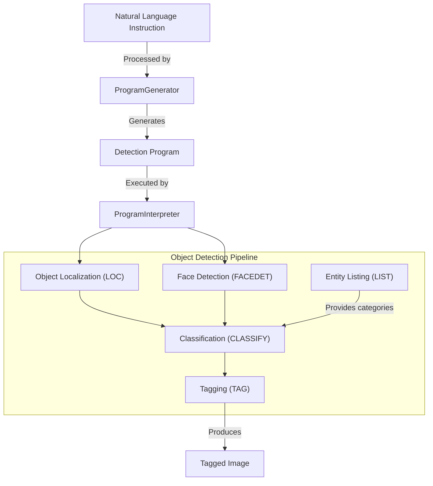
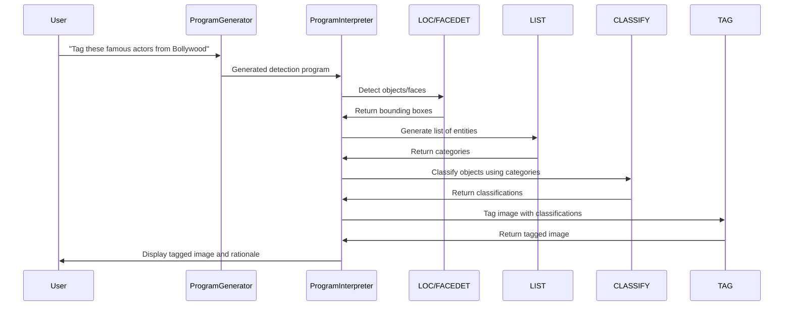
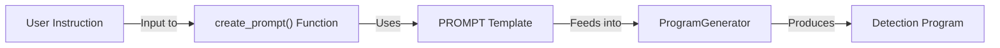
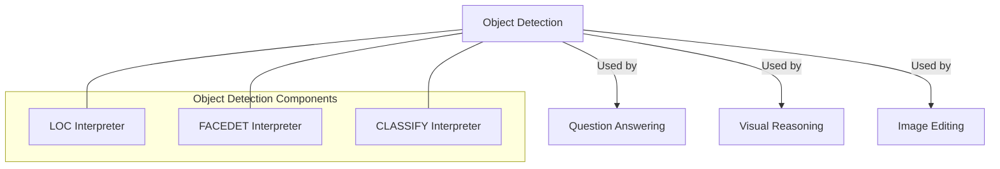

<!-- source: DeepWiki mcp.deepwiki.com · repo allenai/visprog · page 3.1 Object Detection · fetched 2026-10-26 -->

# Object Detection

<details>
<summary>Relevant source files</summary>

The following files were used as context for generating this wiki page:

- [notebooks/ok_det.ipynb](notebooks/ok_det.ipynb)
- [prompts/knowtag.py](prompts/knowtag.py)

</details>


## Purpose and Scope

This document details the object detection capabilities in VisProg, a neuro-symbolic visual reasoning system. It covers how VisProg detects, localizes, and classifies objects within images using natural language instructions. For related visual reasoning tasks such as image editing or question answering, see [Image Editing](#3.2), [NLVR](#3.3), and [GQA](#3.4).

## Overview

VisProg's object detection system allows users to identify and tag specific objects, people, or entities in images using natural language instructions. The system employs a multi-step approach that combines object localization, face detection, entity listing, and classification to produce tagged images with visual rationales.



Sources: [notebooks/ok_det.ipynb:31-36](), [prompts/knowtag.py:1-109]()

## Detection Components

### Object Detection Step Interpreters

VisProg's object detection capabilities rely on several specialized step interpreters:

| Step Interpreter | Function | Description |
|-----------------|----------|-------------|
| LOC | Object Localization | Identifies bounding boxes for specified objects in the image |
| FACEDET | Face Detection | Detects and localizes human faces in the image |
| LIST | Entity Listing | Generates a list of entities based on a query |
| CLASSIFY | Classification | Classifies detected objects into categories |
| TAG | Image Tagging | Annotates the image with classification results |

Sources: [prompts/knowtag.py:5-105]()

### Detection Workflow



Sources: [notebooks/ok_det.ipynb:77-93](), [prompts/knowtag.py:43-49]()

## Implementation Details

### Program Generation

The object detection system uses a ProgramGenerator with predefined prompts to create executable programs from natural language instructions. The prompt template in `knowtag.py` contains examples for various detection scenarios, enabling GPT-3 to generate appropriate programs for new instructions.



Sources: [notebooks/ok_det.ipynb:53-56](), [prompts/knowtag.py:1-109]()

### Detection Program Structure

A typical object detection program follows this structure:

1. **Object/Face Detection**: Locates objects or faces in the image
2. **Entity Listing**: Generates relevant categories for classification
3. **Classification**: Assigns categories to detected objects
4. **Tagging**: Annotates the image with classification results
5. **Result**: Returns the final tagged image

Example program for tagging Bollywood actors:
```
OBJ0=FACEDET(image=IMAGE)
LIST0=LIST(query='famous actors from Bollywood',max=20)
OBJ1=CLASSIFY(image=IMAGE,object=OBJ0,categories=LIST0)
IMAGE0=TAG(image=IMAGE,object=OBJ1)
FINAL_RESULT=RESULT(var=IMAGE0)
```

Sources: [notebooks/ok_det.ipynb:77-84](), [prompts/knowtag.py:43-49]()

## Usage Examples

The object detection system supports various detection and tagging scenarios:

### Face Detection and Recognition

```
# Tag the presidents of US
OBJ0=FACEDET(image=IMAGE)
LIST0=LIST(query='presidents of the US',max=20)
OBJ1=CLASSIFY(image=IMAGE,object=OBJ0,categories=LIST0)
IMAGE0=TAG(image=IMAGE,object=OBJ1)
FINAL_RESULT=RESULT(var=IMAGE0)
```

### Object Localization and Classification

```
# Tag the wild animals
OBJ0=LOC(image=IMAGE,object='wild animal')
LIST0=LIST(query='wild animals',max=20)
OBJ1=CLASSIFY(image=IMAGE,object=OBJ0,categories=LIST0)
IMAGE0=TAG(image=IMAGE,object=OBJ1)
FINAL_RESULT=RESULT(var=IMAGE0)
```

### Attribute Classification

```
# Tag the shoes with their colors
OBJ0=LOC(image=IMAGE,object='shoe')
LIST0=LIST(query='colors',max=20)
OBJ1=CLASSIFY(image=IMAGE,object=OBJ0,categories=LIST0)
IMAGE0=TAG(image=IMAGE,object=OBJ1)
FINAL_RESULT=RESULT(var=IMAGE0)
```

Sources: [prompts/knowtag.py:3-105]()

## Using the Object Detection System

### Setting Up

To use the object detection capabilities:

1. Initialize the ProgramInterpreter with the 'okDet' dataset
2. Create a ProgramGenerator with the knowtag prompt
3. Load an image and set it as the initial state
4. Provide a detection instruction

```python
interpreter = ProgramInterpreter(dataset='okDet')
generator = ProgramGenerator(prompter=create_prompt)
init_state = dict(IMAGE=image.convert('RGB'))
instruction = "Tag these famous actors from Bollywood"
```

### Execution

Generate and execute the program:

```python
prog, _ = generator.generate(instruction)
result, prog_state, html_str = interpreter.execute(prog, init_state, inspect=True)
```

The execution produces:
- `result`: The final result (tagged image)
- `prog_state`: The final program state
- `html_str`: A visual rationale showing execution steps

Sources: [notebooks/ok_det.ipynb:44-93]()

## Integration with VisProg

Object detection is a foundational capability in VisProg that's leveraged by many other tasks:



Sources: [notebooks/ok_det.ipynb:31-36]()

---

