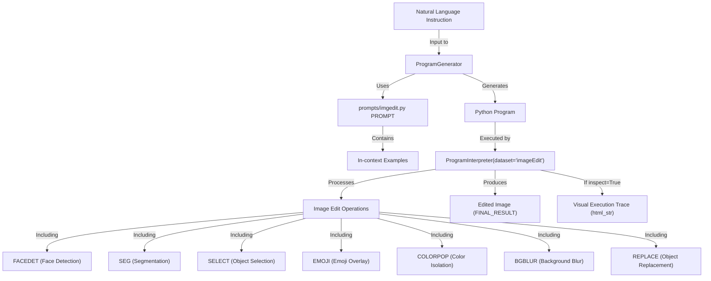
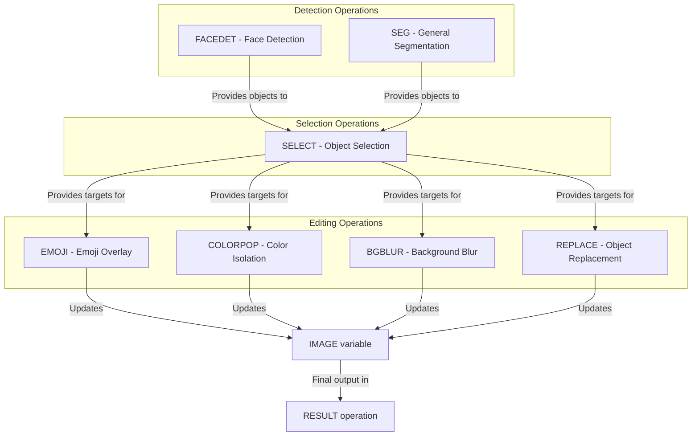
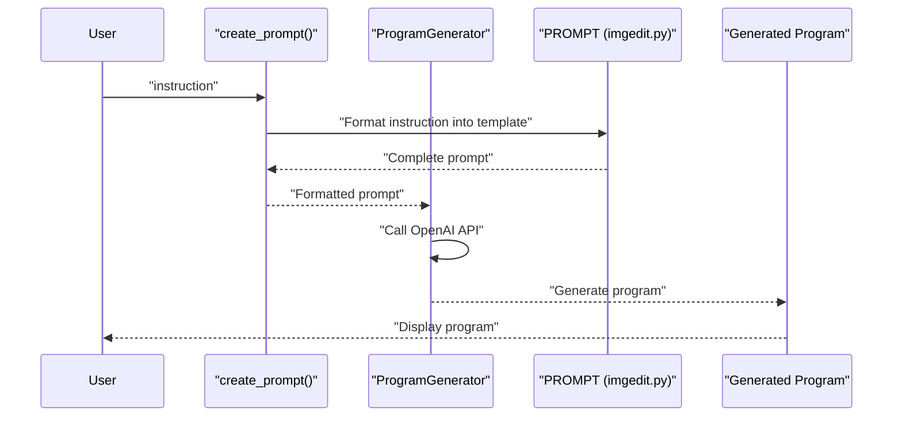
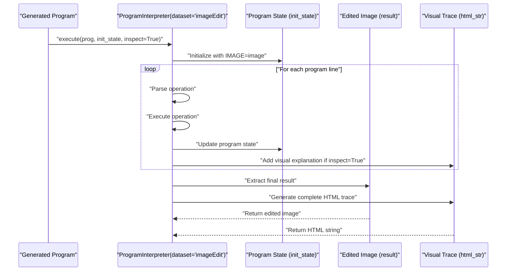
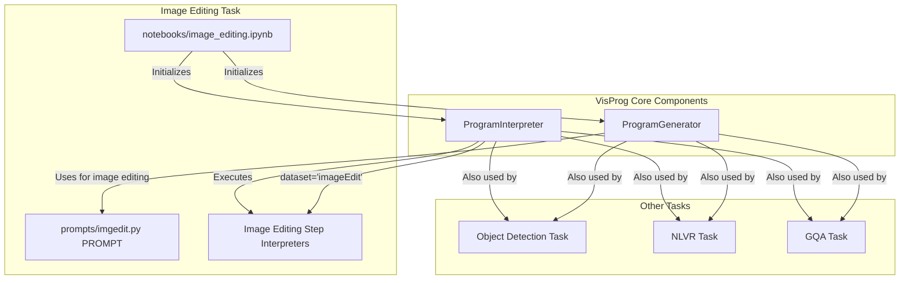

<!-- source: DeepWiki mcp.deepwiki.com · repo allenai/visprog · page 3.2 Image Editing · fetched 2026-10-26 -->

# Image Editing

<details>
<summary>Relevant source files</summary>

The following files were used as context for generating this wiki page:

- [assets/bollywood.png](assets/bollywood.png)
- [notebooks/image_editing.ipynb](notebooks/image_editing.ipynb)
- [prompts/imgedit.py](prompts/imgedit.py)

</details>


This document describes the Image Editing functionality within VisProg, which enables users to perform complex image manipulation operations using natural language instructions. The system supports tasks such as adding emojis to faces, creating color pop effects, blurring backgrounds, and replacing objects in images.

For information about other visual reasoning capabilities in VisProg, see [Object Detection](#3.1), [Natural Language Visual Reasoning (NLVR)](#3.3), and [General Question Answering (GQA)](#3.4).

## 1. Overview

The Image Editing module transforms natural language instructions into executable programs that perform precise image editing operations. It utilizes the core VisProg architecture, including the ProgramGenerator to create programs from instructions and the ProgramInterpreter to execute these programs.

### Image Editing Workflow



Sources: [notebooks/image_editing.ipynb:34-35, 44, 53-56, 78-93](), [prompts/imgedit.py]()

## 2. Supported Editing Operations

The Image Editing module supports several specialized operations that can be combined to create complex editing workflows.

### Operation Dependencies



Sources: [prompts/imgedit.py:9-82]()

### 2.1 Detection Operations

#### FACEDET
The `FACEDET` operation detects faces in an image and returns bounding boxes for those faces.

Example:
```
OBJ0=FACEDET(image=IMAGE)
```

#### SEG
The `SEG` operation performs general object segmentation, identifying and segmenting various objects in the image.

Example:
```
OBJ0=SEG(image=IMAGE)
```

### 2.2 Selection Operations

#### SELECT
The `SELECT` operation identifies specific objects from a set of detected objects based on a query and optional category.

Example:
```
OBJ1=SELECT(image=IMAGE,object=OBJ0,query='red bus',category='bus')
```

### 2.3 Editing Operations

#### EMOJI
The `EMOJI` operation overlays emoji graphics on selected faces or objects.

Example:
```
IMAGE0=EMOJI(image=IMAGE,object=OBJ1,emoji='face_with_tongue')
```

Available emoji options as defined in the prompt template:
- face_with_tongue (`:p`)
- smiling_face_with_sunglasses (`8)`)
- smiling_face (`:)`)
- winking_face (`;)`)

#### COLORPOP
The `COLORPOP` operation creates a visual effect where selected objects retain their color while the rest of the image is converted to grayscale.

Example:
```
IMAGE0=COLORPOP(image=IMAGE,object=OBJ1)
```

#### BGBLUR
The `BGBLUR` operation applies a blur effect to the background while keeping selected objects in focus.

Example:
```
IMAGE0=BGBLUR(image=IMAGE,object=OBJ1)
```

#### REPLACE
The `REPLACE` operation substitutes selected objects in the image with new objects specified in a text prompt.

Example:
```
IMAGE0=REPLACE(image=IMAGE,object=OBJ1,prompt='blue bus')
```

Sources: [prompts/imgedit.py:4-8, 9-82]()

## 3. Implementation Details

### 3.1 Program Generation

The image editing system uses a prompt template defined in `prompts/imgedit.py` that contains several examples of different editing operations. This template is provided to the `ProgramGenerator` along with the user's instruction to generate a Python program.



The prompt template includes examples of various editing operations to help the language model understand the expected output format and available operations.

Sources: [notebooks/image_editing.ipynb:52-56](), [prompts/imgedit.py]()

### 3.2 Execution Flow

The generated program is executed by the `ProgramInterpreter`, which processes each step sequentially, updating the program state after each operation.



The interpreter can also generate a visual execution trace for debugging and explanation purposes when the `inspect` parameter is set to `True`.

Sources: [notebooks/image_editing.ipynb:67-69, 92-93]()

## 4. Example Usage

Here's an example of how to use the image editing functionality in VisProg, based on the provided notebook:

1. Initialize the program interpreter and generator:
```python
interpreter = ProgramInterpreter(dataset='imageEdit')
def create_prompt(instruction):
    return PROMPT.format(instruction=instruction)
generator = ProgramGenerator(prompter=create_prompt)
```

2. Load and prepare an image:
```python
image = Image.open('path/to/image.png')
image.thumbnail((512, 512), Image.Resampling.LANCZOS)
init_state = dict(IMAGE=image.convert('RGB'))
```

3. Define a natural language instruction:
```python
instruction = "Replace man in black henley with brick wall"
```

4. Generate a program using the instruction:
```python
prog, _ = generator.generate(instruction)
print(prog)
```

5. Execute the program using the interpreter:
```python
result, prog_state, html_str = interpreter.execute(prog, init_state, inspect=True)
```

6. View the result and execution trace:
```python
result  # Display the edited image
HTML(html_str)  # Display the visual execution trace
```

Sources: [notebooks/image_editing.ipynb:44-111]()

## 5. Example Programs

Below are examples of programs generated for different image editing instructions, demonstrating the range of capabilities.

### 5.1 Emoji Replacement

For the instruction: "Hide the face of Nicole Kidman with :p"
```
OBJ0=FACEDET(image=IMAGE)
OBJ1=SELECT(image=IMAGE,object=OBJ0,query='Nicole Kidman',category=None)
IMAGE0=EMOJI(image=IMAGE,object=OBJ1,emoji='face_with_tongue')
FINAL_RESULT=RESULT(var=IMAGE0)
```

### 5.2 Multiple Emoji Replacement

For the instruction: "Hide the faces of Nicole Kidman and Brad Pitt with ;) and 8)"
```
OBJ0=FACEDET(image=IMAGE)
OBJ1=SELECT(image=IMAGE,object=OBJ0,query='Nicole Kidman',category=None)
IMAGE0=EMOJI(image=IMAGE,object=OBJ1,emoji='winking_face')
OBJ2=SELECT(image=IMAGE,object=OBJ0,query='Brad Pitt',category=None)
IMAGE1=EMOJI(image=IMAGE0,object=OBJ1,emoji='smiling_face_with_sunglasses')
FINAL_RESULT=RESULT(var=IMAGE1)
```

### 5.3 Color Pop Effect

For the instruction: "Create a color pop of the girl and the umbrella"
```
OBJ0=SEG(image=IMAGE)
OBJ1=SELECT(image=IMAGE,object=OBJ0,query='girl,umbrella',category=None)
IMAGE0=COLORPOP(image=IMAGE,object=OBJ1)
FINAL_RESULT=RESULT(var=IMAGE0)
```

### 5.4 Background Blur

For the instruction: "Select the red bus and blur the background"
```
OBJ0=SEG(image=IMAGE)
OBJ1=SELECT(image=IMAGE,object=OBJ0,query='red bus',category=None)
IMAGE0=BGBLUR(image=IMAGE,object=OBJ1)
FINAL_RESULT=RESULT(var=IMAGE0)
```

### 5.5 Object Replacement

For the instruction: "Replace the red bus with a blue bus"
```
OBJ0=SEG(image=IMAGE)
OBJ1=SELECT(image=IMAGE,object=OBJ0,query='red bus',category=None)
IMAGE0=REPLACE(image=IMAGE,object=OBJ1,prompt='blue bus')
FINAL_RESULT=RESULT(var=IMAGE0)
```

### 5.6 Multiple Object Replacement

For the instruction: "Replace the red bus with blue bus and the road with dirt road"
```
OBJ0=SEG(image=IMAGE)
OBJ1=SELECT(image=IMAGE,object=OBJ0,query='red bus',category=None)
IMAGE0=REPLACE(image=IMAGE,object=OBJ1,prompt='blue bus')
OBJ2=SEG(image=IMAGE0)
OBJ3=SELECT(image=IMAGE0,object=OBJ2,query='road',category=None)
IMAGE1=REPLACE(image=IMAGE0,object=OBJ3,prompt='dirt road')
FINAL_RESULT=RESULT(var=IMAGE1)
```

Sources: [prompts/imgedit.py:9-82]()

## 6. Integration with VisProg System

The image editing module integrates with the core VisProg system through the `ProgramGenerator` and `ProgramInterpreter` components. It follows the same pattern as other VisProg tasks but with specialized operations for image manipulation.



Sources: [notebooks/image_editing.ipynb:34-35, 44](), [prompts/imgedit.py]()

---

