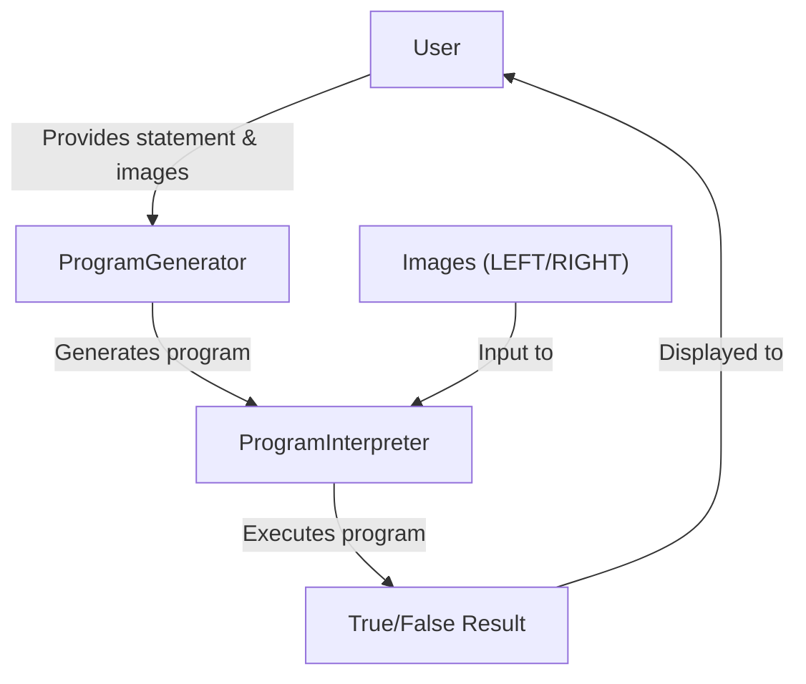
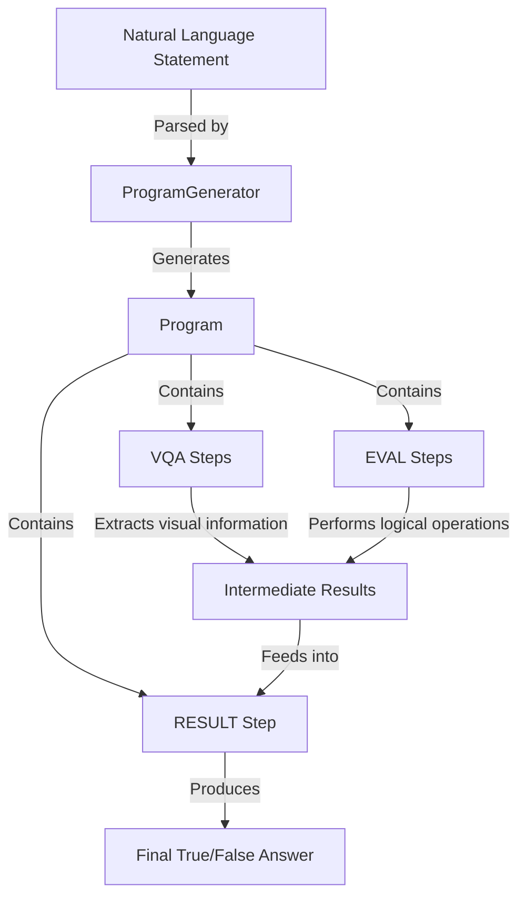
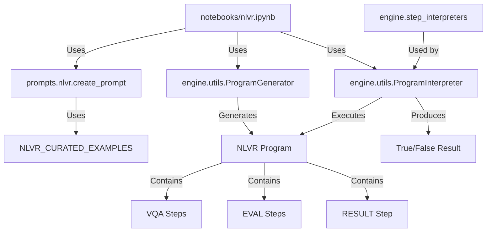
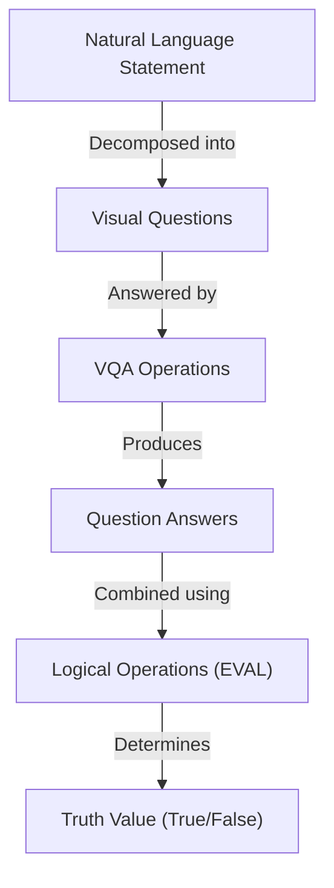
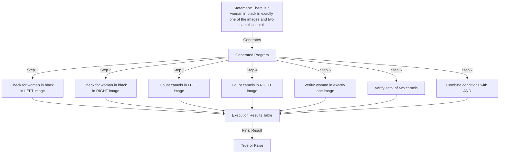

<!-- source: DeepWiki mcp.deepwiki.com · repo allenai/visprog · page 3.3 Natural Language Visual Reasoning (NLVR) · fetched 2026-10-26 -->

# Natural Language Visual Reasoning (NLVR)

<details>
<summary>Relevant source files</summary>

The following files were used as context for generating this wiki page:

- [assets/camel1.png](assets/camel1.png)
- [assets/camel2.png](assets/camel2.png)
- [notebooks/nlvr.ipynb](notebooks/nlvr.ipynb)
- [prompts/nlvr.py](prompts/nlvr.py)

</details>


Natural Language Visual Reasoning (NLVR) in VisProg is a system that determines whether natural language statements about images are true or false. It's specifically designed for analyzing pairs of images (LEFT and RIGHT) and evaluating statements that describe relationships, counts, or properties of objects within these images.

NLVR differs from general Visual Question Answering (VQA) in that it focuses specifically on binary truth evaluation rather than open-ended questions. For more general question answering about images, see the [General Question Answering (GQA)](#3.4) component.

## Architecture

NLVR in VisProg follows a two-stage architecture that transforms natural language statements into executable programs that determine their truth value.

NLVR Processing Workflow


Sources: `notebooks/nlvr.ipynb`, `prompts/nlvr.py`

### Program Generation

The Program Generator uses GPT-3 with in-context learning from curated examples to translate natural language statements into executable programs. These programs systematically break down the reasoning into steps.

### Program Structure

NLVR programs typically consist of three types of operations:

NLVR Program Execution Flow


Sources: `notebooks/nlvr.ipynb`, `prompts/nlvr.py`

## Implementation Details

The NLVR implementation in VisProg comprises several interconnected components:

NLVR Code Entity Relationships


Sources: `notebooks/nlvr.ipynb`, `prompts/nlvr.py`

### Prompt Creation

The `create_prompt` function in `prompts/nlvr.py` generates prompts for the Program Generator by selecting examples from a set of curated NLVR examples. These examples guide the generation of programs for new statements.

```python
def create_prompt(inputs, num_prompts=8, method='random', seed=42, group=0):
    if method=='random':
        random.seed(seed)
        prompt_examples = random.sample(NLVR_CURATED_EXAMPLES, num_prompts)
    elif method=='all':
        prompt_examples = NLVR_CURATED_EXAMPLES
    else:
        raise NotImplementedError
```

Source: `prompts/nlvr.py:107-114`

### Program Execution

The Program Interpreter executes the generated program, running each step in sequence and tracking the program state. It uses the appropriate interpreters for each operation (VQA, EVAL, RESULT) to produce the final result.

## Examples

NLVR can handle a variety of statement types. Here are some examples:

| Statement | Generated Program |
|-----------|------------------|
| There is a red convertible in one image. | ```ANSWER0=VQA(image=LEFT,question='Is there a red convertible in the image?')\nANSWER1=VQA(image=RIGHT,question='Is there a red convertible in the image?')\nANSWER2=EVAL(expr='{ANSWER0} xor {ANSWER1}')\nFINAL_ANSWER=RESULT(var=ANSWER2)``` |
| One dog is laying down. | ```ANSWER0=VQA(image=LEFT,question='How many dogs are laying down?')\nANSWER1=VQA(image=RIGHT,question='How many dogs are laying down?')\nANSWER2=EVAL(expr='{ANSWER0} + {ANSWER1} == 1')\nFINAL_ANSWER=RESULT(var=ANSWER2)``` |
| There are two blue and yellow birds | ```ANSWER0=VQA(image=LEFT,question='How many blue and yellow birds are in the image?')\nANSWER1=VQA(image=RIGHT,question='How many blue and yellow birds are in the image?')\nANSWER2=EVAL(expr='{ANSWER0} + {ANSWER1} == 2')\nFINAL_ANSWER=RESULT(var=ANSWER2)``` |

Sources: `prompts/nlvr.py:3-104`

### Common Patterns

NLVR statements generally follow these patterns:

1. **Counting Objects**: Asking how many objects of a specific type are in each image
2. **Checking Properties**: Verifying if objects have certain properties
3. **Comparing Images**: Finding differences or similarities between images
4. **Logical Combinations**: Using AND, OR, XOR to combine multiple conditions

NLVR Program Pattern Analysis


Sources: `prompts/nlvr.py:3-104`

## Usage Guide

To use VisProg for NLVR tasks:

```python
# Set up the interpreter and generator
interpreter = ProgramInterpreter(dataset='nlvr')
prompter = partial(create_prompt, method='all')
generator = ProgramGenerator(prompter=prompter)

# Load images
left_image = Image.open('../assets/camel1.png')
left_image.thumbnail((640,640), Image.Resampling.LANCZOS)
right_image = Image.open('../assets/camel2.png')
right_image.thumbnail((640,640), Image.Resampling.LANCZOS)
init_state = dict(
    LEFT=left_image.convert('RGB'),
    RIGHT=right_image.convert('RGB'),
)

# Define statement and generate program
statement = "There is a woman in black in exactly one of the images and two camels in total."
prog, _ = generator.generate(dict(statement=statement))

# Execute program
result, prog_state, html_str = interpreter.execute(prog, init_state, inspect=True)
```

Source: `notebooks/nlvr.ipynb:31-104`

### Execution Trace

When running with `inspect=True`, the interpreter generates an HTML execution trace that shows each step's execution, including visualizations of intermediate results:

```python
# Display the execution trace
HTML(html_str)
```

This is useful for understanding and debugging the reasoning process.

Source: `notebooks/nlvr.ipynb:111-113`

## Example Execution Flow

NLVR Execution Example


Sources: `notebooks/nlvr.ipynb:74-103`

## Best Practices

### Effective Statements

- Be specific and unambiguous in your statements
- Focus on observable visual properties
- Break down complex reasoning into simpler components

### Limitations

- Complex spatial relationships may be challenging
- Very subtle visual differences might not be reliably detected
- Performance depends on the quality of the underlying VQA model

## Integration with VisProg

NLVR is one of several visual reasoning capabilities in VisProg:
- For object detection, see [Object Detection](#3.1)
- For image editing, see [Image Editing](#3.2)
- For general question answering, see [General Question Answering (GQA)](#3.4)

NLVR leverages the same core infrastructure as these other capabilities but focuses specifically on binary (true/false) evaluation of statements about pairs of images.

---

