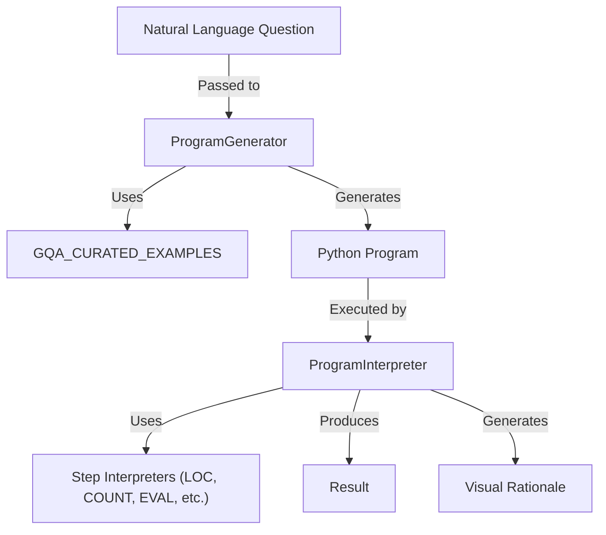
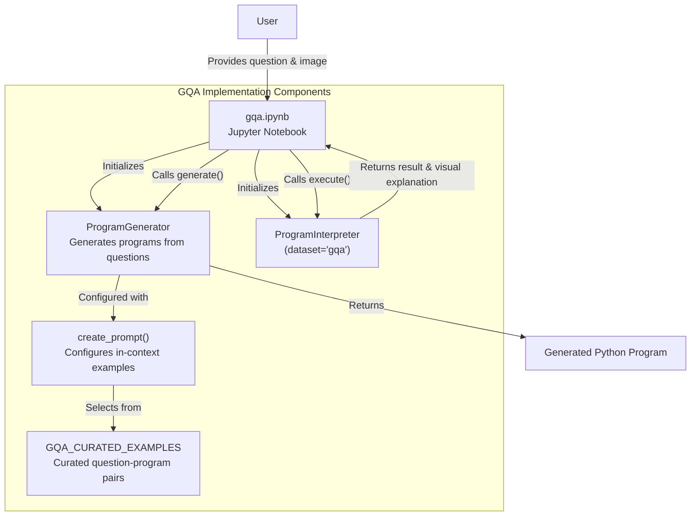

<!-- source: DeepWiki mcp.deepwiki.com · repo allenai/visprog · page 3.4 General Question Answering (GQA) · fetched 2026-10-26 -->

# General Question Answering (GQA)

<details>
<summary>Relevant source files</summary>

The following files were used as context for generating this wiki page:

- [notebooks/gqa.ipynb](notebooks/gqa.ipynb)
- [prompts/gqa.py](prompts/gqa.py)

</details>


## Purpose and Scope

This document details the General Question Answering (GQA) functionality within the VisProg system. GQA enables users to ask natural language questions about visual content and receive answers based on the system's analysis of images. The module leverages VisProg's neuro-symbolic architecture to translate natural language questions into executable programs that analyze images and produce answers with visual explanations.

For information about other visual reasoning tasks supported by VisProg, see [Object Detection](#3.1), [Image Editing](#3.2), and [Natural Language Visual Reasoning](#3.3).

## System Architecture

The GQA task follows VisProg's general program generation and execution flow, with specializations for visual question answering:



**Diagram: GQA Processing Pipeline**

Sources: [notebooks/gqa.ipynb:31-37](), [notebooks/gqa.ipynb:86-87](), [notebooks/gqa.ipynb:96-97]()

The GQA implementation consists of the following components:



**Diagram: GQA System Components**

Sources: [notebooks/gqa.ipynb:45](), [notebooks/gqa.ipynb:54-56](), [prompts/gqa.py:3-173](), [prompts/gqa.py:175-188]()

## Usage

Using the GQA functionality in VisProg involves the following steps:

1. Initialize the required components:
   ```python
   # Initialize interpreter for GQA dataset
   interpreter = ProgramInterpreter(dataset='gqa')
   
   # Configure program generator with GQA prompts
   prompter = partial(create_prompt, method='all')
   generator = ProgramGenerator(prompter=prompter)
   ```

2. Prepare the input image:
   ```python
   image = Image.open('path/to/image.png')
   image.thumbnail((640,640), Image.Resampling.LANCZOS)
   init_state = dict(IMAGE=image.convert('RGB'))
   ```

3. Define a question and generate a program:
   ```python
   question = "How many people or animals are in the image?"
   prog, _ = generator.generate(dict(question=question))
   ```

4. Execute the program and visualize results:
   ```python
   result, prog_state, html_str = interpreter.execute(prog, init_state, inspect=True)
   print(result)  # Display answer
   HTML(html_str)  # Display visual rationale
   ```

Sources: [notebooks/gqa.ipynb:31-37](), [notebooks/gqa.ipynb:45](), [notebooks/gqa.ipynb:54-56](), [notebooks/gqa.ipynb:64-69](), [notebooks/gqa.ipynb:78-87](), [notebooks/gqa.ipynb:96-97](), [notebooks/gqa.ipynb:105](), [notebooks/gqa.ipynb:114]()

## Question Types

The GQA module can handle various types of questions, including:

| Question Type | Example | Reasoning Required |
|---------------|---------|-------------------|
| Presence detection | "Are there trains or fences in this scene?" | Detect objects and determine presence |
| Spatial relationships | "Is the vehicle in the top of the image?" | Understand spatial concepts (top, bottom, left, right) |
| Position queries | "Which side is the food on?" | Determine object locations relative to image regions |
| Attribute questions | "What color is the curtain?" | Identify object properties |
| Counting | "How many people or animals are in the image?" | Count instances of object types |
| Comparison | "Do the post and sign have different colors?" | Compare properties of multiple objects |
| Complex reasoning | "What do the wetsuit and sky have in common?" | Analyze relationships between objects |

Sources: [prompts/gqa.py:3-173]()

## Example Programs

When the GQA system processes a question, it generates a program that breaks down the reasoning process into discrete steps. Below are examples of questions and their corresponding generated programs:

### Example 1: Basic Counting

**Question:** "How many people or animals are in the image?"

**Generated Program:**
```
BOX0=LOC(image=IMAGE,object='people')
BOX1=LOC(image=IMAGE,object='animals')
ANSWER0=COUNT(box=BOX0)
ANSWER1=COUNT(box=BOX1)
ANSWER2=EVAL(expr="{ANSWER0} + {ANSWER1}")
FINAL_RESULT=RESULT(var=ANSWER2)
```

This program:
1. Locates all people in the image
2. Locates all animals in the image
3. Counts each group
4. Adds the counts
5. Returns the total

### Example 2: Spatial Relationships

**Question:** "Is the street light standing behind a truck?"

**Generated Program:**
```
BOX0=LOC(image=IMAGE,object='truck')
IMAGE0=CROP_BEHIND(image=IMAGE,box=BOX0)
BOX1=LOC(image=IMAGE0,object='street light')
ANSWER0=COUNT(box=BOX1)
ANSWER1=EVAL(expr="'yes' if {ANSWER0} > 0 else 'no'")
FINAL_RESULT=RESULT(var=ANSWER1)
```

This program:
1. Locates trucks in the image
2. Crops the region behind the truck
3. Searches for street lights in the cropped region
4. Returns "yes" if found, "no" otherwise

Sources: [prompts/gqa.py:3-173](), [notebooks/gqa.ipynb:78-87]()

## Supported Operations

The GQA module uses the following operations (implemented as Step Interpreters, see [Step Interpreters](#2.3)) to build its visual reasoning programs:

| Operation | Description | Example Usage |
|-----------|-------------|---------------|
| LOC | Locates objects or regions in an image | `BOX0=LOC(image=IMAGE,object='people')` |
| CROP | Crops a region of an image | `IMAGE0=CROP(image=IMAGE,box=BOX0)` |
| CROP_LEFTOF | Crops the area to the left of a region | `IMAGE0=CROP_LEFTOF(image=IMAGE,box=BOX0)` |
| CROP_RIGHTOF | Crops the area to the right of a region | `IMAGE0=CROP_RIGHTOF(image=IMAGE,box=BOX0)` |
| CROP_ABOVE | Crops the area above a region | `IMAGE0=CROP_ABOVE(image=IMAGE,box=BOX0)` |
| CROP_BELOW | Crops the area below a region | `IMAGE0=CROP_BELOW(image=IMAGE,box=BOX0)` |
| CROP_BEHIND | Crops the area behind a region | `IMAGE0=CROP_BEHIND(image=IMAGE,box=BOX0)` |
| COUNT | Counts the number of detected objects | `ANSWER0=COUNT(box=BOX0)` |
| EVAL | Evaluates a Python expression | `ANSWER1=EVAL(expr="'yes' if {ANSWER0} > 0 else 'no'")` |
| VQA | Answers a question about a specific region | `ANSWER0=VQA(image=IMAGE0,question='What color is the post?')` |
| RESULT | Returns the final result of the program | `FINAL_RESULT=RESULT(var=ANSWER2)` |

Sources: [prompts/gqa.py:3-173]()

## Prompt Design

The GQA system uses in-context learning with a set of curated examples defined in `GQA_CURATED_EXAMPLES`. These examples demonstrate how to translate different types of questions into programs. The `create_prompt()` function can use either all available examples or a random subset:

```python
# Use all examples
prompter = partial(create_prompt, method='all')

# Or use a random subset
prompter = partial(create_prompt, method='random', num_prompts=8)
```

The prompt begins with the instruction "Think step by step to answer the question" followed by example question-program pairs, before presenting the new question to be answered.

Sources: [prompts/gqa.py:175-188]()

## Execution and Visualization

When executing a GQA program with `inspect=True`, the interpreter generates a visual rationale showing each step's execution and intermediate results. This visual trace helps users understand how the system arrived at its answer.

The execution trace typically includes:
- Visualization of detected objects
- Cropped image regions
- Counting results
- Evaluation of expressions
- Final answer derivation

This execution trace is returned as HTML that can be displayed in a Jupyter notebook.

Sources: [notebooks/gqa.ipynb:96-97](), [notebooks/gqa.ipynb:114]()

---

