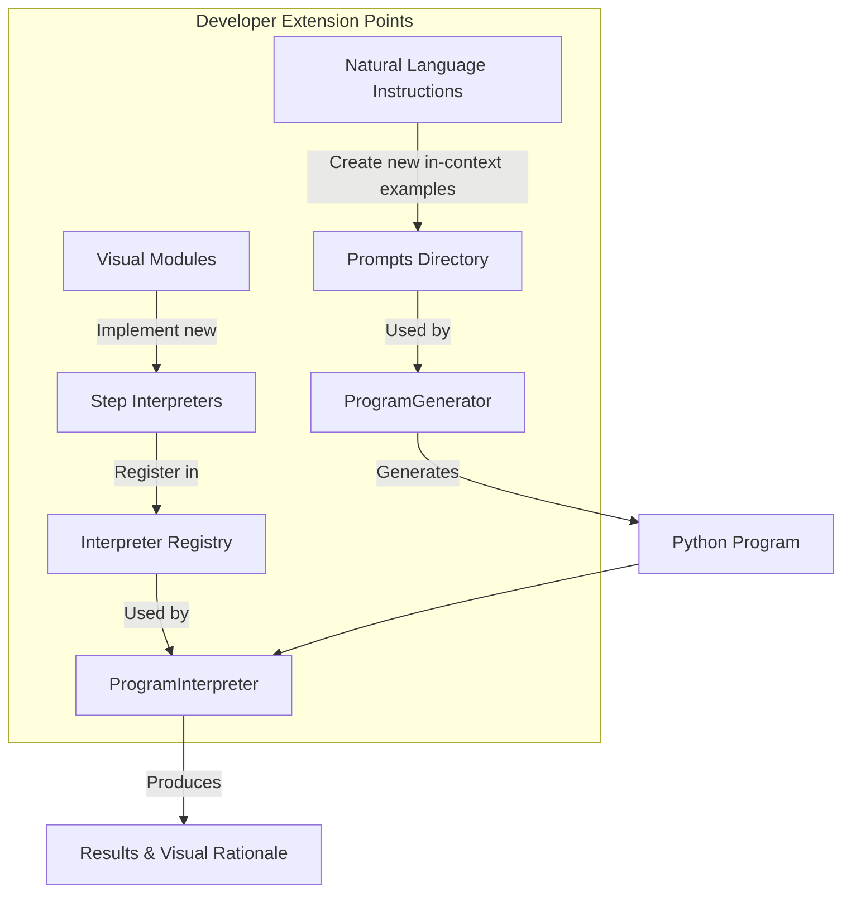
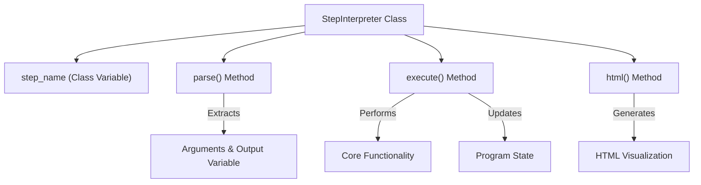
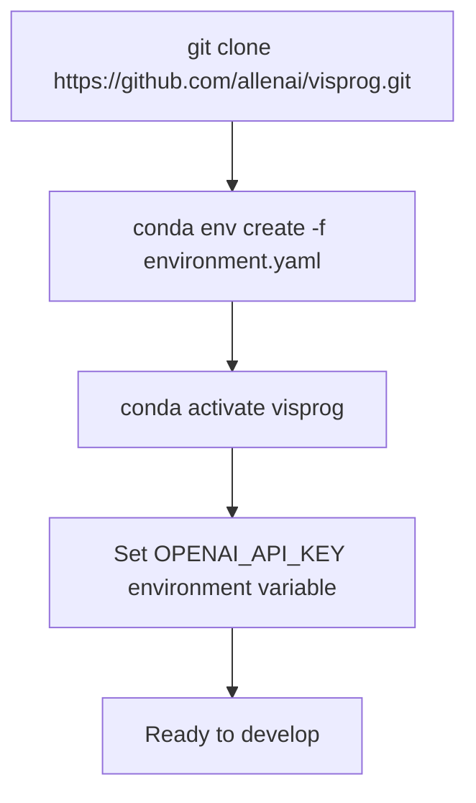

<!-- source: DeepWiki mcp.deepwiki.com · repo allenai/visprog · page 4 Developer Guide · fetched 2026-10-26 -->

# Developer Guide

<details>
<summary>Relevant source files</summary>

The following files were used as context for generating this wiki page:

- [README.md](README.md)
- [engine/step_interpreters.py](engine/step_interpreters.py)

</details>


This guide provides comprehensive information for developers who want to extend or modify the VisProg system. It covers how to add new visual reasoning capabilities, extend the system to new tasks, and utilize the visualization utilities for debugging and presentation. For general usage information, see [VisProg Overview](#1), and for the core architecture details, see [Architecture](#1.1).

## Extension Mechanisms Overview

VisProg is designed to be easily extensible through its modular architecture. Developers can extend the system in two primary ways:

1. Adding new Step Interpreters (modules that implement specific visual capabilities)
2. Creating new task-specific prompts to enable new visual reasoning tasks



Sources: [README.md:18-25](), [engine/step_interpreters.py:1336-1380]()

## Adding New Step Interpreters

Step Interpreters are the building blocks of VisProg's functionality. Each interpreter implements a specific visual capability and follows a consistent structure.

### Step Interpreter Structure

Every Step Interpreter must implement three key methods:



1. **`parse()`**: Extracts arguments and output variable from the program string
2. **`execute()`**: Performs the core functionality and updates program state
3. **`html()`**: Generates HTML visualization for the execution trace

Sources: [engine/step_interpreters.py:346-378]()

### Example Implementation

Here's a simplified example showing the essential structure of a Step Interpreter:

| Method | Purpose | Key Aspects |
|--------|---------|------------|
| `__init__()` | Initialize resources | Load models, set thresholds |
| `parse()` | Parse program string | Extract arguments using `parse_step()` |
| `execute()` | Perform main functionality | Process inputs, store results in `prog_step.state` |
| `html()` | Create visual representation | Use visualization utilities to format output |

Sources: [engine/step_interpreters.py:61-108](), [engine/step_interpreters.py:346-378]()

### Registering New Step Interpreters

After creating a new Step Interpreter, you must register it in the `register_step_interpreters` function:

1. Add your new class to [engine/step_interpreters.py]()
2. Update the `register_step_interpreters` function to include your interpreter in the appropriate task dictionary
3. If necessary, create a new task category in the function

Sources: [engine/step_interpreters.py:1336-1380](), [README.md:80-81]()

## Creating New Task Prompts

To extend VisProg to new tasks, you need to create appropriate in-context examples that demonstrate how to solve your task using VisProg's modules.

### Prompt Structure

```mermaid
flowchart LR
    subgraph "Prompt File Structure"
        direction TB
        TD["Task Description"] --> IC["In-Context Examples"]
        IC --> NI["Natural Language Instruction"]
        IC --> IP["Image Placeholder"]
        IC --> PS["Program Solution"]
        IC --> ...[More Examples]
    end
    
    subgraph "Program Generator"
        direction TB
        P["Prompt"] --> GPT["GPT-3 API"]
        GPT --> PP["Python Program"]
    end
    
    "Prompt File Structure" --> P
```

Sources: [README.md:43-50]()

### Steps to Create a New Task:

1. Create a new file in the `prompts/` directory (e.g., `prompts/your_task.py`)
2. Define a `PROMPT` variable or a `create_prompt` function containing:
   - Task description
   - Several in-context examples with:
     - Natural language instruction
     - Image description
     - Step-by-step program solution using VisProg modules
3. Create a notebook in the `notebooks/` directory that:
   - Imports your prompt
   - Initializes `ProgramGenerator` and `ProgramInterpreter`
   - Sets up sample inference examples

Sources: [README.md:35-42](), [README.md:117-118]()

## Visualization Utilities

VisProg provides several visualization utilities for debugging and presenting results.

### Key Visualization Functions

| Function | Purpose | Usage Context |
|----------|---------|---------------|
| `html_embed_image()` | Embed image in HTML | `html()` methods |
| `html_colored_span()` | Create colored text span | Syntax highlighting |
| `mask_image()` | Apply mask to image | Object masking |
| `image_grid()` | Create grid of images | Multi-image display |
| `vis_masks()` | Visualize detection masks | Object detection |

These utilities are typically used in the `html()` method of Step Interpreters to create the visual execution trace.

Sources: [engine/step_interpreters.py:42-58]()

## Development Workflow

### Environment Setup



Sources: [README.md:27-31]()

### Testing Process

1. Create a test notebook or modify an existing one
2. Register your new Step Interpreter
3. Write a test program that uses your interpreter
4. Execute and inspect the results
5. Iterate on your implementation based on results

### Debugging Tips

- Use `inspect=True` in the `interpret()` method to generate the visual execution trace
- Print intermediate values in your Step Interpreter
- Add helpful assertion statements to catch common errors early
- Thoroughly test your interpreter with different inputs and edge cases

## Complete Example: Adding a New Step Interpreter

Let's walk through a complete example of adding a new "BRIGHTEN" interpreter that increases an image's brightness.

1. Create the Step Interpreter class in [engine/step_interpreters.py]():

```python
class BrightenInterpreter():
    step_name = 'BRIGHTEN'

    def __init__(self):
        print(f'Registering {self.step_name} step')

    def parse(self, prog_step):
        parse_result = parse_step(prog_step.prog_str)
        step_name = parse_result['step_name']
        img_var = parse_result['args']['image']
        factor = float(eval(parse_result['args']['factor']))
        output_var = parse_result['output_var']
        assert(step_name==self.step_name)
        return img_var, factor, output_var

    def html(self, original_img, brightened_img, factor, output_var):
        step_name = html_step_name(self.step_name)
        output_var = html_var_name(output_var)
        img_arg = html_arg_name('image')
        factor_arg = html_arg_name('factor')
        orig_img = html_embed_image(original_img)
        bright_img = html_embed_image(brightened_img, 300)
        return f"""<div>{output_var}={step_name}({img_arg}={orig_img}, {factor_arg}={factor})={bright_img}</div>"""

    def execute(self, prog_step, inspect=False):
        img_var, factor, output_var = self.parse(prog_step)
        img = prog_step.state[img_var]
        
        # Increase brightness
        brightened = Image.eval(img, lambda x: min(255, int(x * factor)))
        
        prog_step.state[output_var] = brightened
        if inspect:
            html_str = self.html(img, brightened, factor, output_var)
            return brightened, html_str

        return brightened
```

2. Register the interpreter in the `register_step_interpreters` function:

```python
def register_step_interpreters(dataset='nlvr'):
    if dataset=='imageEdit':
        return dict(
            FACEDET=FaceDetInterpreter(),
            SEG=SegmentInterpreter(),
            SELECT=SelectInterpreter(),
            COLORPOP=ColorpopInterpreter(),
            BGBLUR=BgBlurInterpreter(),
            REPLACE=ReplaceInterpreter(),
            EMOJI=EmojiInterpreter(),
            BRIGHTEN=BrightenInterpreter(),  # Add our new interpreter
            RESULT=ResultInterpreter()
        )
    # ... rest of the function
```

3. Add in-context examples to your task prompt in `prompts/image_editing.py`:

```
Example 4:
Input: Make the image brighter
Image: [image4.jpg]
Program:
BRIGHT_IMG=BRIGHTEN(image=IMAGE,factor=1.5)
FINAL_RESULT=RESULT(var=BRIGHT_IMG)
```

4. Test the new functionality in a notebook:

```python
# Import required modules
from engine.program_generator import ProgramGenerator
from engine.program_interpreter import ProgramInterpreter
from prompts.image_editing import PROMPT

# Initialize program generator and interpreter
program_generator = ProgramGenerator(PROMPT)
program_interpreter = ProgramInterpreter(dataset='imageEdit')  # Use imageEdit to register our new interpreter

# Load an image
image = Image.open("path/to/image.jpg")

# Test with a natural language instruction
instruction = "Make the image brighter"
program = program_generator.generate(instruction)
result, html_output = program_interpreter.interpret(program, {'IMAGE': image}, inspect=True)

# Display the result
display(result)
display(HTML(html_output))
```

Sources: [README.md:80-118]()

## Conclusion

By following this guide, you can extend VisProg with new capabilities and adapt it to new tasks. The modular architecture allows for easy integration of new visual reasoning modules, while the in-context learning approach enables adaptation to a wide range of tasks without retraining.

For more information on the core components of VisProg, see [Core Components](#2), and for examples of existing tasks, see [Tasks & Examples](#3).

---

