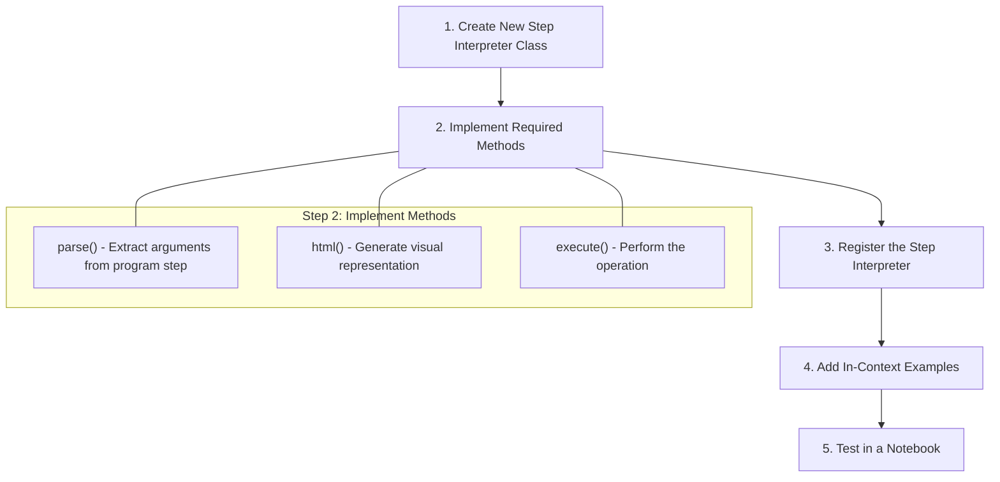
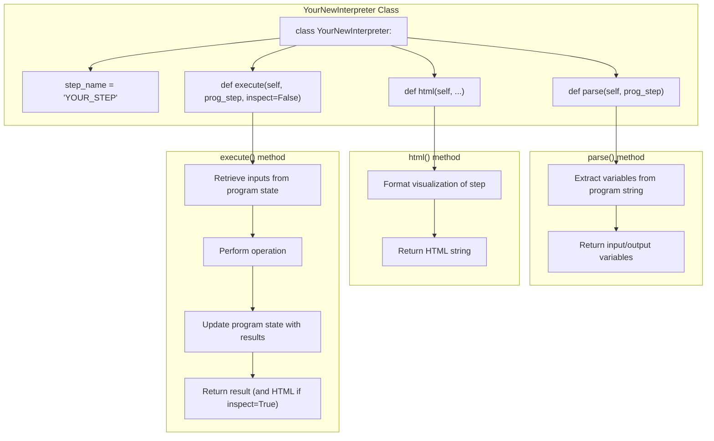
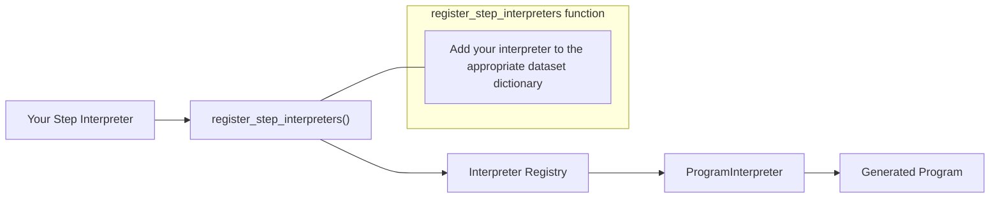
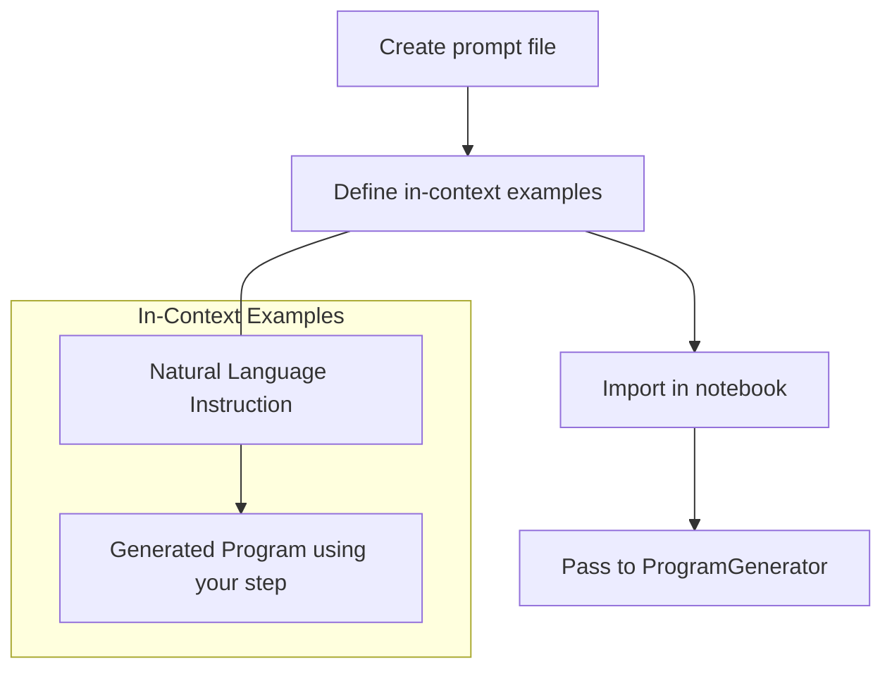
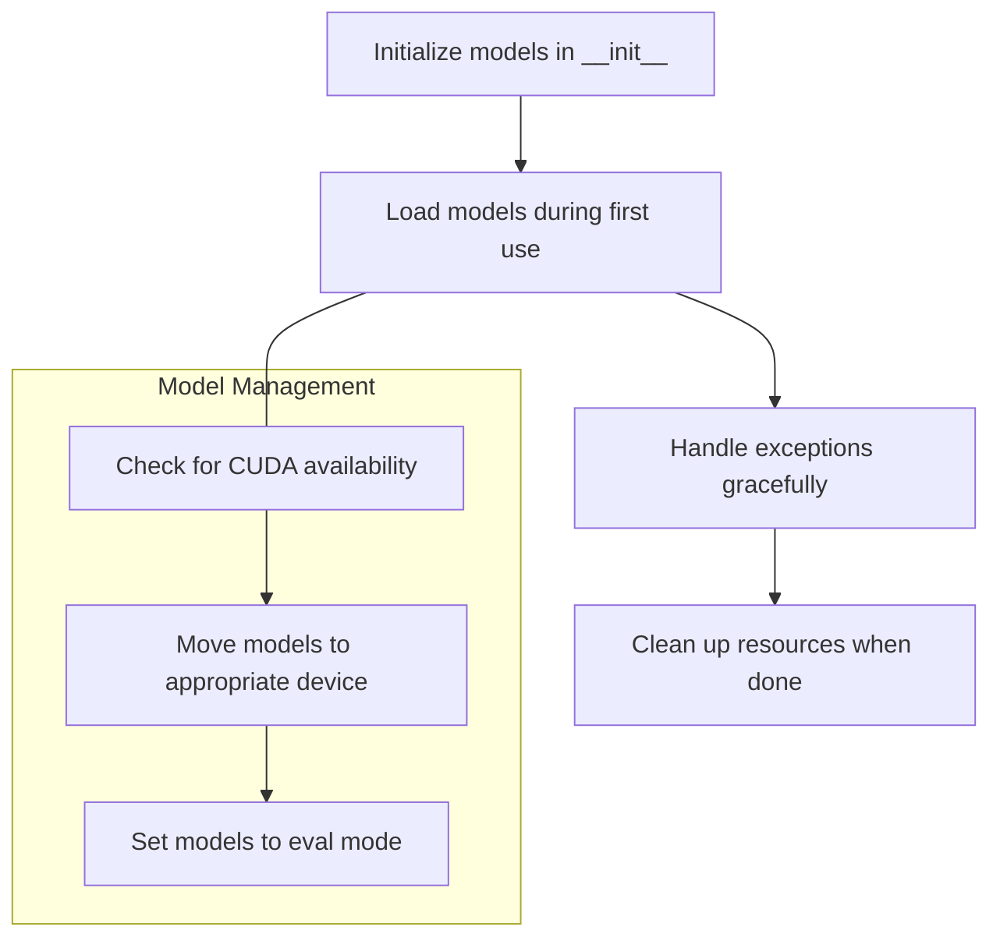

<!-- source: DeepWiki mcp.deepwiki.com · repo allenai/visprog · page 4.1 Adding New Functionality · fetched 2026-10-26 -->

# Adding New Functionality

<details>
<summary>Relevant source files</summary>

The following files were used as context for generating this wiki page:

- [README.md](README.md)
- [engine/step_interpreters.py](engine/step_interpreters.py)

</details>


This guide explains how to extend VisProg's capabilities by adding new step interpreters (modules). You'll learn how to create new visual reasoning operations that can be used in generated programs. For information about using existing functionality, see [Core Components](#2) and [Tasks & Examples](#3).

## 1. Overview of Extension Process

Extending VisProg involves adding new step interpreters, registering them, and adding examples to prompts so GPT-3 can learn to use them. The extension process follows these steps:



Sources: [README.md:78-118]()

## 2. Step Interpreter Interface

Step interpreters are the building blocks of VisProg's visual reasoning capabilities. Each step interpreter implements a specific operation that can be performed on images or intermediate results.

```mermaid
classDiagram
    class "StepInterpreter" {
        +String step_name
        +parse(prog_step)
        +html(args...)
        +execute(prog_step, inspect)
    }
    
    class "ProgramInterpreter" {
        +Dict step_interpreters
        +execute_program(program)
    }
    
    class "YourNewInterpreter" {
        +String step_name
        +parse(prog_step)
        +html(args...)
        +execute(prog_step, inspect)
    }
    
    ProgramInterpreter --> "StepInterpreter"
    YourNewInterpreter --|> "StepInterpreter"
```

Every step interpreter must implement:

1. A unique `step_name` class variable that identifies the operation
2. `parse()` - Extracts arguments from the program string
3. `html()` - Generates HTML visualization for the execution trace
4. `execute()` - Performs the actual operation and updates program state

Sources: [engine/step_interpreters.py:62-143]()

## 3. Creating a New Step Interpreter

Let's examine the anatomy of a step interpreter by looking at the structure of a simple one.



### 3.1 The `parse()` Method

The `parse()` method extracts input and output variables from the program string:

```
def parse(self, prog_step):
    parse_result = parse_step(prog_step.prog_str)
    step_name = parse_result['step_name']
    # Extract arguments specific to your step
    output_var = parse_result['output_var']
    assert(step_name==self.step_name)
    return input_vars, output_var
```

The `parse_step()` function handles the initial parsing, giving you:
- `output_var`: The variable that will store the result
- `step_name`: The name of the step (should match `self.step_name`)
- `args`: A dictionary of arguments passed to the step

Sources: [engine/step_interpreters.py:22-38](), [engine/step_interpreters.py:346-358]()

### 3.2 The `html()` Method

The `html()` method creates a visual representation of the step for the execution trace:

```
def html(self, ...):
    step_name = html_step_name(self.step_name)
    output_var = html_var_name(output_var)
    # Format your visualization
    return f"""<div>...</div>"""
```

Utility functions for HTML formatting:
- `html_step_name()` - Formats step name (in red)
- `html_var_name()` - Formats variable name (in blue)
- `html_arg_name()` - Formats argument name (in orange)
- `html_output()` - Formats output value (in green)
- `html_embed_image()` - Embeds image in HTML

Sources: [engine/step_interpreters.py:41-58](), [engine/step_interpreters.py:360-366]()

### 3.3 The `execute()` Method

The `execute()` method performs the actual operation:

```
def execute(self, prog_step, inspect=False):
    input_vars, output_var = self.parse(prog_step)
    # Retrieve inputs from program state
    # Perform operation
    # Update program state with result
    prog_step.state[output_var] = result
    if inspect:
        html_str = self.html(...)
        return result, html_str
    return result
```

The `inspect` parameter determines whether to generate the HTML visualization.

Sources: [engine/step_interpreters.py:368-378]()

## 4. Example: Creating a Simple Step Interpreter

Here's a walkthrough of creating a hypothetical `ROTATE` step interpreter that rotates an image by a specified angle:

### 4.1 Define the Step Interpreter Class

```
class RotateInterpreter():
    step_name = 'ROTATE'
    
    def __init__(self):
        print(f'Registering {self.step_name} step')
        
    def parse(self, prog_step):
        parse_result = parse_step(prog_step.prog_str)
        step_name = parse_result['step_name']
        img_var = parse_result['args']['image']
        angle = eval(parse_result['args']['angle'])
        output_var = parse_result['output_var']
        assert(step_name==self.step_name)
        return img_var, angle, output_var
        
    def html(self, img, rotated_img, angle, output_var):
        step_name = html_step_name(self.step_name)
        img = html_embed_image(img)
        rotated_img = html_embed_image(rotated_img, 300)
        output_var = html_var_name(output_var)
        img_arg = html_arg_name('image')
        angle_arg = html_arg_name('angle')
        return f"""<div>{output_var}={step_name}({img_arg}={img}, {angle_arg}={angle})={rotated_img}</div>"""
        
    def execute(self, prog_step, inspect=False):
        img_var, angle, output_var = self.parse(prog_step)
        img = prog_step.state[img_var]
        rotated_img = img.rotate(angle)
        prog_step.state[output_var] = rotated_img
        if inspect:
            html_str = self.html(img, rotated_img, angle, output_var)
            return rotated_img, html_str
        return rotated_img
```

Sources: [engine/step_interpreters.py:346-378](), [engine/step_interpreters.py:381-436]()

## 5. Registering Your Step Interpreter

After creating your step interpreter, you must register it in the `register_step_interpreters` function:



To register your interpreter, add it to the appropriate dataset dictionary in the `register_step_interpreters` function in `engine/step_interpreters.py`:

```
def register_step_interpreters(dataset='nlvr'):
    if dataset=='nlvr':
        return dict(
            VQA=VQAInterpreter(),
            EVAL=EvalInterpreter(),
            RESULT=ResultInterpreter(),
            ROTATE=RotateInterpreter()  # Your new interpreter
        )
    # other datasets...
```

If you're creating a new dataset/task, add a new condition:

```
elif dataset=='your_dataset':
    return dict(
        ROTATE=RotateInterpreter(),
        # Other interpreters for your dataset
        RESULT=ResultInterpreter()  # Always include RESULT
    )
```

The `RESULT` interpreter is usually included for all datasets as it's used to return the final result.

Sources: [engine/step_interpreters.py:1336-1379]()

## 6. Adding In-Context Examples

To teach GPT-3 how to use your new step interpreter, you need to add examples to a prompt file:



1. Create a new file `prompts/your_task_name.py` or add to an existing one
2. Define a string variable `PROMPT` containing in-context examples
3. Each example should include:
   - A natural language instruction
   - A program using your new step interpreter

Example format:

```
PROMPT = """
Instruction: Rotate the image by 90 degrees.
Program:
ROTATED_IMAGE=ROTATE(image=IMAGE,angle=90)
FINAL_RESULT=RESULT(var=ROTATED_IMAGE)

Instruction: Flip the image upside down.
Program:
ROTATED_IMAGE=ROTATE(image=IMAGE,angle=180)
FINAL_RESULT=RESULT(var=ROTATED_IMAGE)

Instruction: {your instruction here}
Program:
"""
```

Sources: [README.md:117](), [README.md:45-48]()

## 7. Testing Your New Functionality

Create a Jupyter notebook to test your new step interpreter:

```mermaid
flowchart LR
    A["Create Jupyter Notebook"] --> B["Import Components"]
    B --> C["Load Prompt"]
    C --> D["Create ProgramGenerator"]
    D --> E["Create ProgramInterpreter"]
    E --> F["Load Test Image"]
    F --> G["Define Instruction"]
    G --> H["Generate Program"]
    H --> I["Execute Program"]
    I --> J["Visualize Results"]
```



Basic structure of the notebook:

1. Import necessary components:
   ```python
   from engine.program_generator import ProgramGenerator
   from engine.program_interpreter import ProgramInterpreter
   from prompts.your_task_name import PROMPT
   ```

2. Create ProgramGenerator and ProgramInterpreter instances:
   ```python
   prog_gen = ProgramGenerator(API_KEY)
   prog_int = ProgramInterpreter(dataset='your_dataset')
   ```

3. Load an image and define an instruction:
   ```python
   image = Image.open('path/to/image.jpg')
   instruction = "Rotate the image by 45 degrees"
   ```

4. Generate and execute the program:
   ```python
   program = prog_gen.generate_program(instruction, PROMPT)
   result, rationale = prog_int.execute_program(program, {
       'IMAGE': image
   }, inspect=True)
   ```

5. Display the result and rationale:
   ```python
   display(result)
   display(HTML(rationale))
   ```

Sources: [README.md:43-54]()

## 8. Integrating with External Models or APIs

If your step interpreter requires external models or APIs, follow these best practices:



1. Initialize models in the `__init__` method:
   ```python
   def __init__(self):
       print(f'Registering {self.step_name} step')
       self.device = "cuda:0" if torch.cuda.is_available() else "cpu"
       self.model = YourModel.from_pretrained("model_name").to(self.device)
       self.model.eval()
   ```

2. Use `with torch.no_grad()` for inference:
   ```python
   with torch.no_grad():
       outputs = self.model(**inputs)
   ```

3. Handle device management:
   ```python
   inputs = {k: v.to(self.device) for k, v in inputs.items()}
   ```

Sources: [engine/step_interpreters.py:148-154](), [engine/step_interpreters.py:656-664]()

## 9. Best Practices

When extending VisProg with new functionality, follow these best practices:

1. **Unique Step Names**: Ensure your `step_name` doesn't conflict with existing ones
2. **Error Handling**: Add robust error handling in your `execute()` method
3. **Documentation**: Add clear docstrings to explain your step's purpose and arguments
4. **State Management**: Be careful not to modify state variables you don't own
5. **Visual Feedback**: Create informative visual outputs in your `html()` method
6. **Performance**: Initialize expensive models once in `__init__`
7. **Compatibility**: Consider backward compatibility with existing programs
8. **Testing**: Test your step with various inputs to ensure robustness

Sources: [README.md:22-25]()

## 10. Conclusion

By following this guide, you can extend VisProg with new visual reasoning capabilities by adding step interpreters, registering them, and providing examples for GPT-3 to learn from. The modular architecture makes it easy to build on top of existing functionality to solve complex visual reasoning tasks.

---

