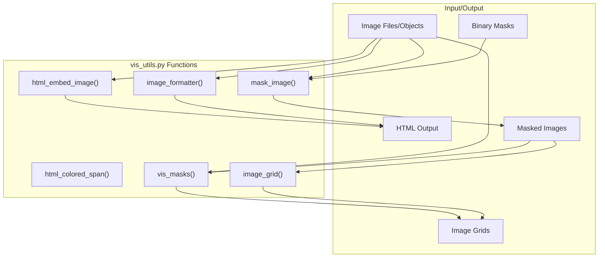
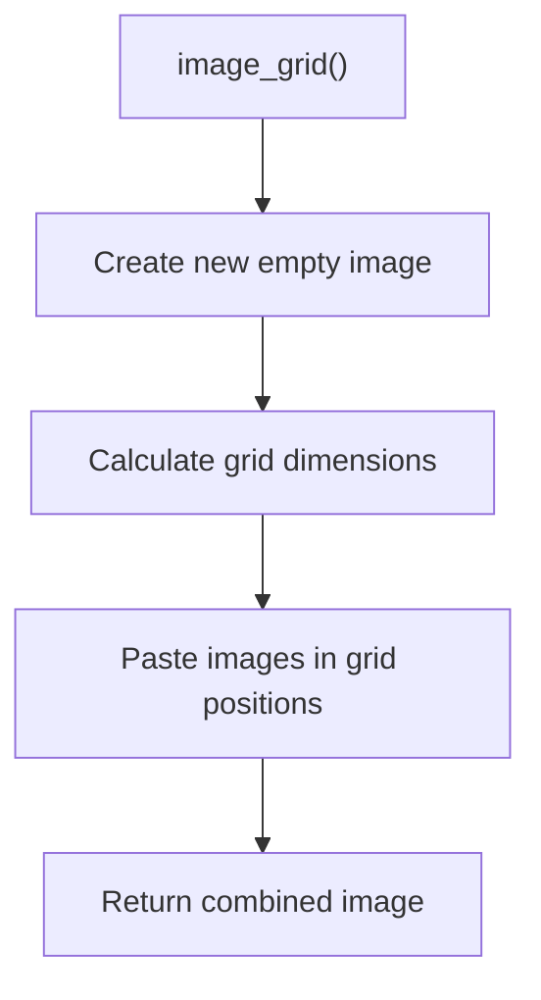
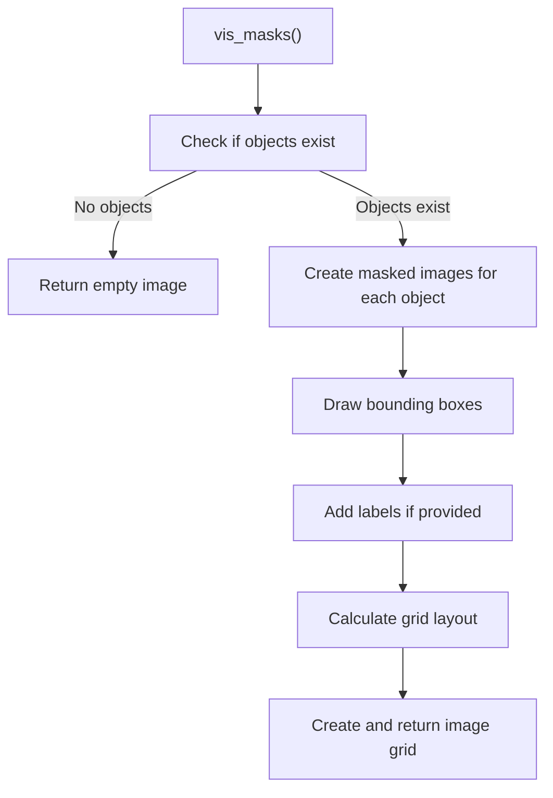
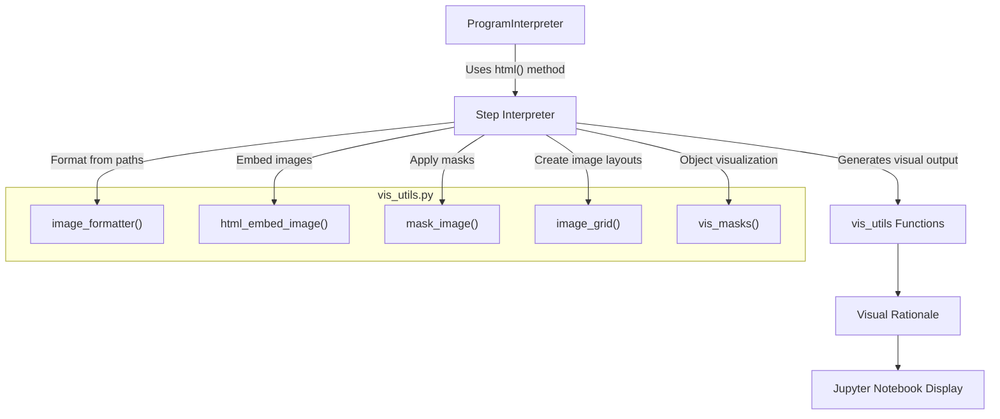
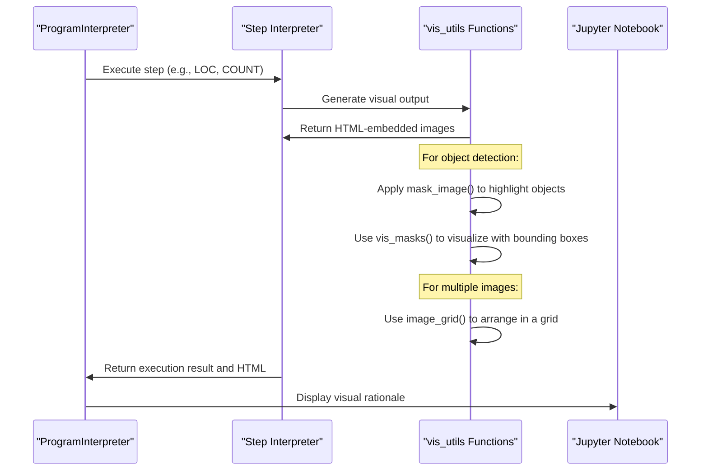

<!-- source: DeepWiki mcp.deepwiki.com · repo allenai/visprog · page 4.2 Visualization Utilities · fetched 2026-10-26 -->

# Visualization Utilities

Relevant source files

The following files were used as context for generating this wiki page:

- [assets/modules.png](assets/modules.png)
- [assets/rationale.png](assets/rationale.png)
- [vis_utils.py](vis_utils.py)

This document details the visualization utilities found in the VisProg system, which are essential for generating visual outputs, debugging execution states, and creating interpretable rationales for the program execution. These utilities convert raw data and images into HTML-embeddable visualizations that can be displayed in Jupyter notebooks.

For information about the Program Interpreter that uses these utilities, see [Program Interpreter](#2.2).

## Overview of Visualization Utilities

VisProg includes a set of visualization functions in the `vis_utils.py` module. These utilities serve several critical purposes:

1. Converting images to HTML-embeddable formats
2. Creating visualization masks for object detection
3. Arranging multiple images in grids
4. Generating visual execution traces
5. Supporting the display of program execution steps

Sources: [vis_utils.py:1-65]()

## Image Formatting Functions

The module provides two primary functions for converting images to HTML-embeddable formats:

### `image_formatter`

This function takes an image file path, resizes it, and converts it to a base64-encoded image for HTML embedding:

**Function Signature:**
- `image_formatter(img_path, size=224, vertical_align='middle')`

**Parameters:**
- `img_path`: Path to the image file
- `size`: Maximum size (width or height) in pixels (default: 224)
- `vertical_align`: CSS vertical alignment (default: 'middle')

Sources: [vis_utils.py:7-13]()

### `html_embed_image`

This function takes a PIL Image object, resizes it, and converts it to a base64-encoded image for HTML embedding:

**Function Signature:**
- `html_embed_image(img, size=100)`

**Parameters:**
- `img`: A PIL Image object
- `size`: Maximum size (width or height) in pixels (default: 100)

Sources: [vis_utils.py:16-22]()

### `html_colored_span`

A utility function for creating HTML spans with colored text:

**Function Signature:**
- `html_colored_span(content, color)`

**Parameters:**
- `content`: The text content to display
- `color`: CSS color value for the text

Sources: [vis_utils.py:24-25]()

## Image Manipulation Functions

### `mask_image`

This function applies a binary mask to an image, showing only the masked regions:

**Function Signature:**
- `mask_image(img, mask)`

**Parameters:**
- `img`: The input PIL Image
- `mask`: A binary mask (numpy array)

Sources: [vis_utils.py:28-32]()

### `image_grid`

Creates a grid of images with specified number of rows and columns:

**Function Signature:**
- `image_grid(imgs, rows, cols)`

**Parameters:**
- `imgs`: List of PIL Image objects
- `rows`: Number of rows in the grid
- `cols`: Number of columns in the grid

Sources: [vis_utils.py:34-41]()

## Object Visualization

### `vis_masks`

This function visualizes object detection results by displaying the masked objects with bounding boxes and optional labels:

**Function Signature:**
- `vis_masks(img, objs, labels=None)`

**Parameters:**
- `img`: The original PIL Image
- `objs`: List of objects with 'mask' and 'box' attributes
- `labels`: Optional list of labels for each object

Sources: [vis_utils.py:43-64]()

## Integration with Program Interpreter

The visualization utilities work closely with the Program Interpreter to generate visual rationales during program execution:

The step interpreters use these visualization utilities to create HTML outputs for each execution step, which are then combined to form the complete visual rationale.

Sources: [vis_utils.py:1-65]()

## Usage Examples

Here's how visualization utilities are typically used in the VisProg system workflow:

## Best Practices for Extending Visualization Utilities

When adding new visualization capabilities to VisProg:

1. **Consistency**: Follow the pattern of returning HTML-embeddable content
2. **Image Handling**: Always use the PIL library for image manipulation
3. **Performance**: Resize images appropriately before embedding them
4. **Modularity**: Create focused functions that can be composed together
5. **Integration**: Ensure new visualization functions integrate with the Step Interpreter's HTML output mechanism

Sources: [vis_utils.py:1-65]()

## Limitations

The current visualization utilities have some limitations:

1. The font path for text rendering is hardcoded to a specific Linux path: `/usr/share/fonts/truetype/dejavu/DejaVuSansMono-Bold.ttf`
2. There's limited support for customizing the appearance of visualizations
3. The system assumes JPEG format for embedded images

Sources: [vis_utils.py:56]()

---

