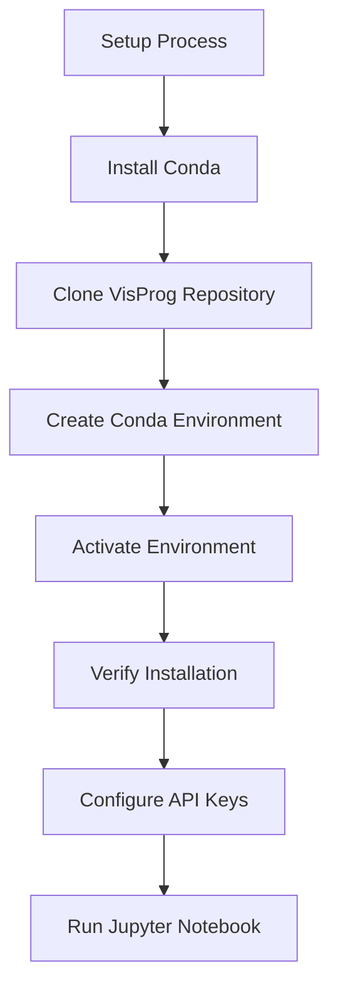
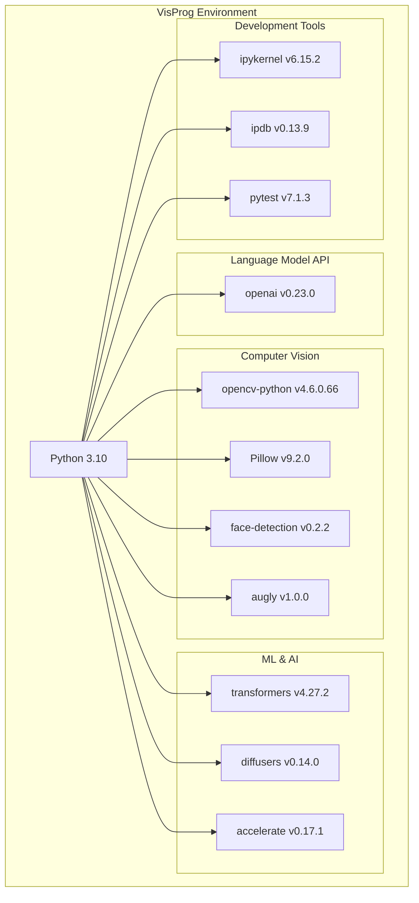
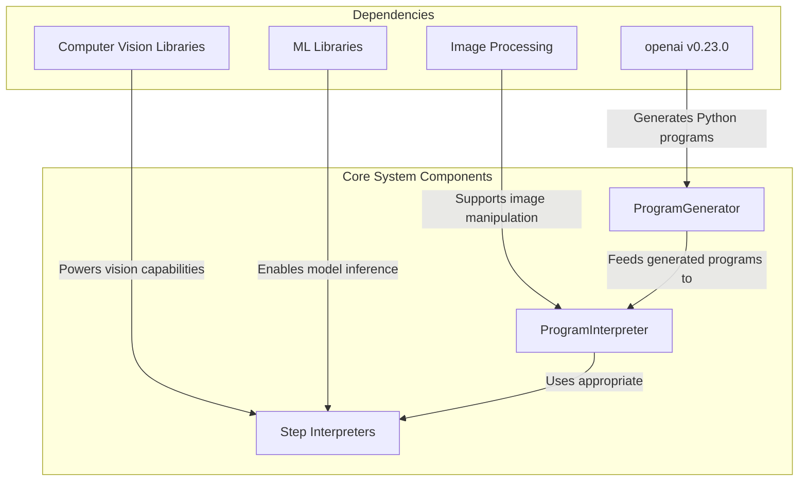

<!-- source: DeepWiki mcp.deepwiki.com · repo allenai/visprog · page 4.3 Environment Setup · fetched 2026-10-26 -->

# Environment Setup

<details>
<summary>Relevant source files</summary>

The following files were used as context for generating this wiki page:

- [.gitignore](.gitignore)
- [environment.yaml](environment.yaml)

</details>


This document provides a detailed guide for setting up the development environment for VisProg. It covers the installation of all necessary dependencies and configuration steps required to run and extend the VisProg system. For information about using VisProg after setup, see [Getting Started](#1.2).

## System Requirements

VisProg has the following base requirements:

- Python 3.10
- Conda package manager (recommended)
- Internet connection for downloading packages
- Sufficient disk space (~2GB) for dependencies

### Hardware Considerations

For optimal performance, especially when working with image processing and large language models:

- 8GB+ RAM
- CPU with 4+ cores
- GPU with CUDA support (recommended for faster inference)

## Conda Environment Setup

VisProg uses Conda for environment management, with all dependencies specified in the `environment.yaml` file.



### Step-by-Step Installation

1. **Install Conda**
   - Download and install Miniconda or Anaconda from their official website
   - Verify installation with `conda --version`

2. **Clone the VisProg repository**
   ```bash
   git clone https://github.com/allenai/visprog.git
   cd visprog
   ```

3. **Create the Conda environment**
   ```bash
   conda env create -f environment.yaml
   ```

4. **Activate the environment**
   ```bash
   conda activate visprog
   ```

Sources: [environment.yaml:1-17]()

## Dependencies Overview

The VisProg system requires specific versions of several Python packages to function correctly.

### Core Dependencies



The following table details the key dependencies and their purposes:

| Package | Version | Purpose |
|---------|---------|---------|
| openai | 0.23.0 | Interface with GPT-3 for program generation |
| transformers | 4.27.2 | Access to pre-trained vision and language models |
| opencv-python | 4.6.0.66 | Image processing and computer vision operations |
| Pillow | 9.2.0 | Core image manipulation functionality |
| face-detection | 0.2.2 | Face detection capabilities |
| augly | 1.0.0 | Image augmentation functionality |
| diffusers | 0.14.0 | Interface with diffusion models for image editing |
| accelerate | 0.17.1 | Optimization for ML model execution |
| ipykernel | 6.15.2 | Required for Jupyter notebook integration |

Sources: [environment.yaml:3-17]()

## Dependency Relationship to System Components

This diagram illustrates how the dependencies relate to the core components of the VisProg system:



Sources: [environment.yaml:3-17]()

## Configuring API Keys

After installing dependencies, you need to configure API keys:

1. **OpenAI API Key**
   - Required for the ProgramGenerator component
   - Create an account at [https://openai.com](https://openai.com)
   - Set up as environment variable:
     ```bash
     export OPENAI_API_KEY="your-api-key-here"
     ```
   - Alternatively, add to your `.bashrc` or `.zshrc` for persistence

## Verification and Testing

To verify your installation is working correctly:

1. **Activate the environment**
   ```bash
   conda activate visprog
   ```

2. **Run basic tests**
   ```bash
   pytest
   ```

3. **Launch a notebook**
   ```bash
   jupyter notebook notebooks/
   ```

## Troubleshooting Common Issues

### Package Version Conflicts

If you encounter package version conflicts:

```bash
conda deactivate
conda env remove -n visprog
conda env create -f environment.yaml
```

### GPU Support Issues

For CUDA-related errors:

1. Verify your CUDA installation
2. Check compatibility between your GPU drivers and the installed packages
3. Consider using CPU-only mode if GPU support is unavailable

### API Connection Issues

If facing problems with the OpenAI API:
1. Verify your API key is correctly set
2. Check your internet connection
3. Ensure you have sufficient API credits in your OpenAI account

## Environment Maintenance

To update the environment when dependencies change:

```bash
conda env update -f environment.yaml
```

Sources: [environment.yaml:1-17]()