# Page: VisProg Overview

# VisProg Overview

<details>
<summary>Relevant source files</summary>

The following files were used as context for generating this wiki page:

- [README.md](README.md)

</details>


## Purpose and Scope

This document provides a comprehensive overview of VisProg (Visual Programming), a neuro-symbolic system designed for solving complex and compositional visual tasks using natural language instructions. It explains the high-level architecture, core components, and fundamental workflow of the system. 

For detailed information about setting up and running VisProg, see [Getting Started](#1.2). For in-depth documentation of specific components, see [Core Components](#2).

## What is VisProg?

VisProg is a system that translates natural language instructions about visual content into executable Python programs. It leverages the in-context learning ability of GPT-3 to generate programs that invoke various computer vision models, image processing routines, and Python functions. When executed, these programs not only produce solutions but also generate comprehensive and interpretable rationales.

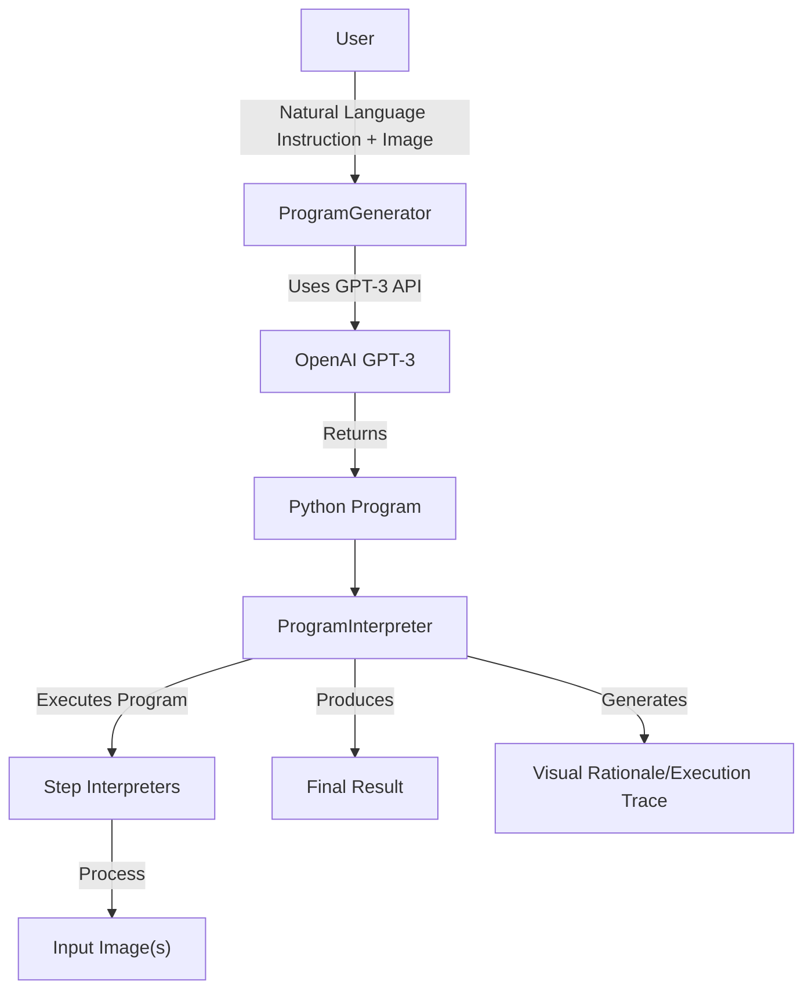

Sources: [README.md:11-18]()

## Key Features

- **Zero-shot Visual Reasoning**: Performs complex visual tasks without task-specific training
- **Interpretable Results**: Generates not just answers but complete visual rationales
- **Modular Architecture**: Easy to extend with new functionality and adapt to new tasks
- **Compositional Approach**: Breaks down complex tasks into simpler operations
- **Multi-task Capability**: Supports a variety of visual tasks with the same core system

Sources: [README.md:18-25]()

## System Architecture

VisProg follows a two-stage architecture:

1. **Program Generation**: Translates natural language instructions into Python programs
2. **Program Execution**: Executes the generated programs and produces results with visual rationales

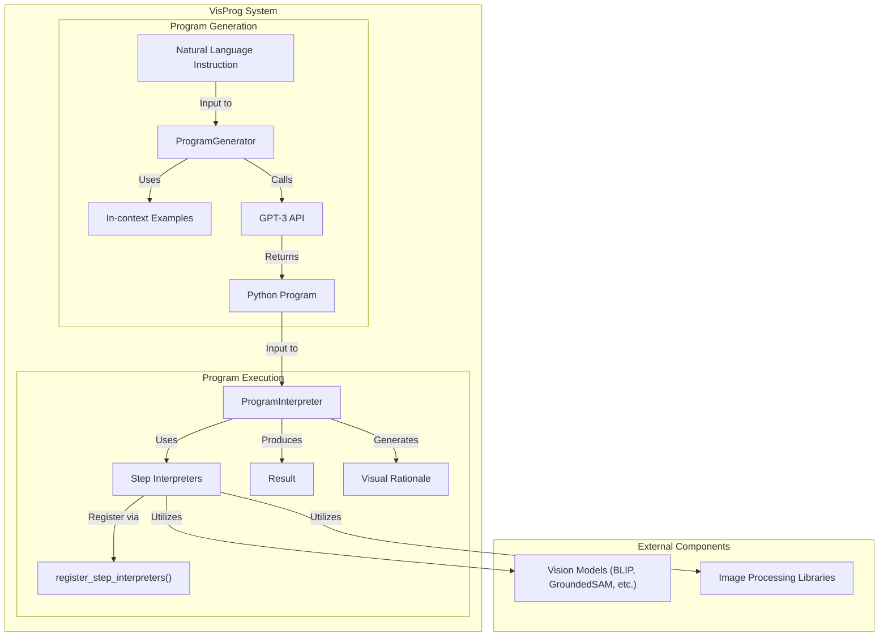

Sources: [README.md:44-54]()

## Core Components

### Program Generator

The `ProgramGenerator` class is responsible for translating natural language instructions into executable Python programs. It:

1. Takes a natural language instruction and input image(s)
2. Combines this with in-context examples from task-specific prompts
3. Sends the combined prompt to GPT-3 API
4. Returns the generated program as a string

### Program Interpreter

The `ProgramInterpreter` class executes the programs generated by the `ProgramGenerator`. It:

1. Parses the program line by line
2. For each line, identifies the appropriate step interpreter
3. Executes the step using the interpreter
4. Updates the program state with intermediate results
5. Generates visual rationales for each step
6. Returns the final result and complete execution trace

### Step Interpreters

Step interpreters are specialized modules that implement specific functionalities. Each step interpreter has a common structure with three key methods:

- `parse()`: Extracts arguments and output variables from program lines
- `execute()`: Performs the actual computation
- `html()`: Generates HTML representation for the visual rationale

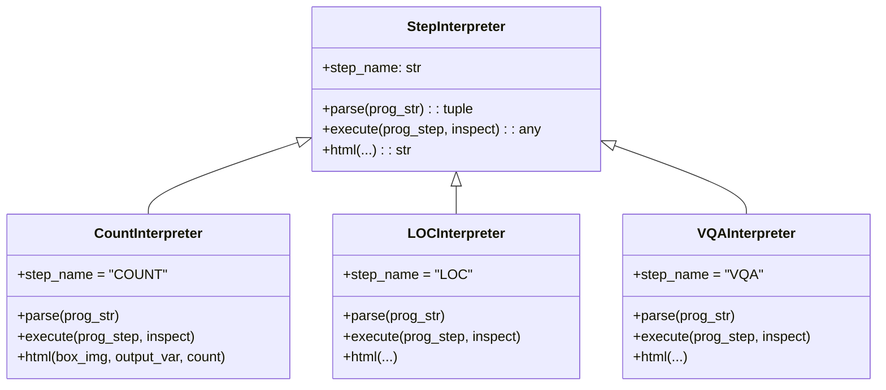

Sources: [README.md:80-116]()

## Program Execution Flow

The following diagram illustrates the execution flow of a sample VisProg program:

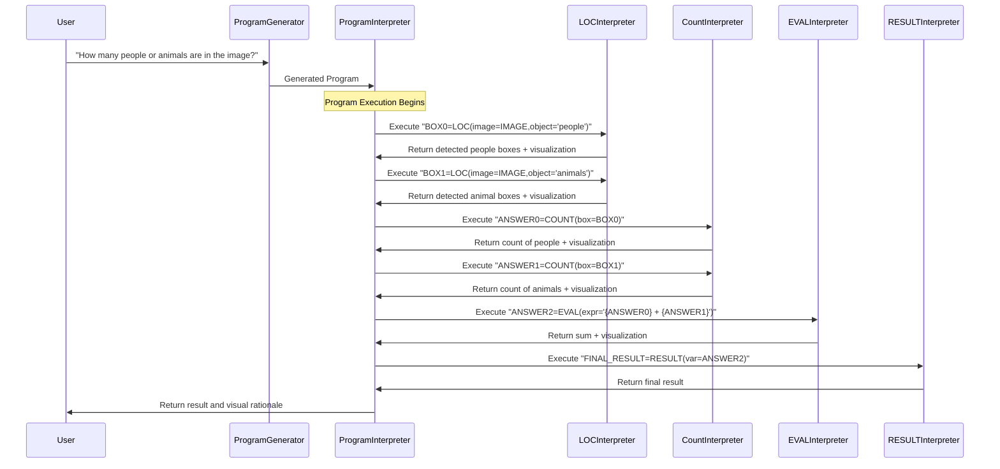

Sources: [README.md:62-69](), [README.md:71-72]()

## Available Modules

VisProg comes with a rich set of built-in modules that serve as building blocks for solving complex visual tasks:

| Module | Description | Function |
|--------|-------------|----------|
| `LOC` | Localization | Detects and locates objects in images |
| `COUNT` | Counting | Counts the number of elements in a set of boxes |
| `VQA` | Visual Question Answering | Answers questions about images using BLIP model |
| `CROP` | Cropping | Crops an image based on bounding boxes |
| `EDIT` | Image Editing | Performs various image editing operations |
| `INST_SEG` | Instance Segmentation | Segments objects in images |
| `FACE_DET` | Face Detection | Detects faces in images |
| `EVAL` | Expression Evaluation | Evaluates Python expressions |
| `RESULT` | Result | Sets the final result of the program |

Sources: [README.md:123-126]()

## Supported Tasks

VisProg currently supports multiple visual reasoning tasks:

1. **Outside Knowledge Object Tagging**: Detecting objects in images using external knowledge
2. **Natural Language Image Editing**: Editing images based on natural language instructions
3. **Natural Language Visual Reasoning (NLVR)**: Determining if a natural language statement is true about a pair of images
4. **General Question Answering (GQA)**: Answering questions about images

Each task has a dedicated notebook and prompt file:

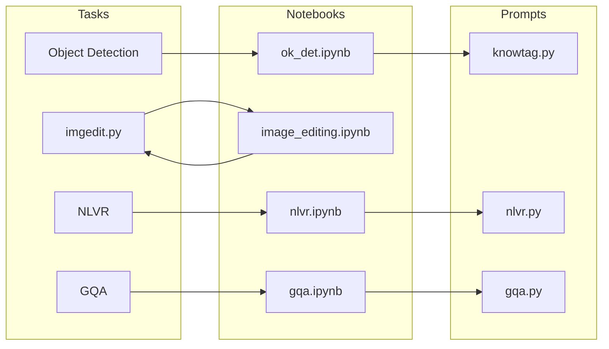

Sources: [README.md:36-40]()

## Example Use Case

Below is a sample workflow showing how VisProg solves a visual question:

1. **Natural Language Instruction**: "How many people or animals are in the image?"
2. **Generated Program**:
   ```python
   BOX0=LOC(image=IMAGE,object='people')
   BOX1=LOC(image=IMAGE,object='animals')
   ANSWER0=COUNT(box=BOX0)
   ANSWER1=COUNT(box=BOX1)
   ANSWER2=EVAL(expr="{ANSWER0} + {ANSWER1}")
   FINAL_RESULT=RESULT(var=ANSWER2)
   ```
3. **Execution**: Each line is executed, producing intermediate results
4. **Output**: The final count and a visual rationale showing each step

This example demonstrates how VisProg breaks down a complex task into simpler operations, executes them sequentially, and provides a comprehensive execution trace.

Sources: [README.md:62-72]()

## Extending VisProg

VisProg is designed to be easily extensible:

1. **Adding New Modules**: Create new step interpreters in `engine/step_interpreters.py` and register them
2. **Supporting New Tasks**: Add in-context examples in `prompts/` directory for the new task
3. **Upgrading Existing Modules**: Replace underlying models with newer/better alternatives

Sources: [README.md:74-118]()

## Summary

VisProg represents a novel approach to visual reasoning by combining large language models' program synthesis capabilities with specialized visual processing modules. This architecture enables solving complex visual tasks without task-specific training while providing interpretable rationales for its decisions.

For more detailed information about specific components, please refer to the corresponding pages in this wiki.

---

# Page: Architecture

# Architecture

<details>
<summary>Relevant source files</summary>

The following files were used as context for generating this wiki page:

- [README.md](README.md)
- [engine/utils.py](engine/utils.py)

</details>


This document describes the high-level architecture of VisProg, explaining the system's key components and how they interact to achieve compositional visual reasoning using natural language instructions. For getting started with running VisProg, see [Getting Started](#1.2).

## System Overview

VisProg is a neuro-symbolic system that combines large language models with modular computer vision components to solve complex visual tasks. The system takes natural language instructions and images as input, generates a Python program to solve the task, and executes the program to produce both a result and an interpretable visual rationale.

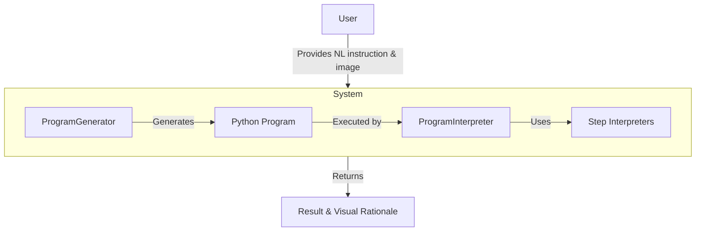

Sources: [README.md:11-18](), [engine/utils.py:10-14](), [engine/utils.py:17-46](), [engine/utils.py:49-88]()

## Core Components

VisProg's architecture consists of three main components:

1. **ProgramGenerator**: Generates a Python program from natural language instruction using GPT-3's in-context learning
2. **ProgramInterpreter**: Executes the generated program step by step
3. **Step Interpreters**: Specialized modules that execute individual operations in the program

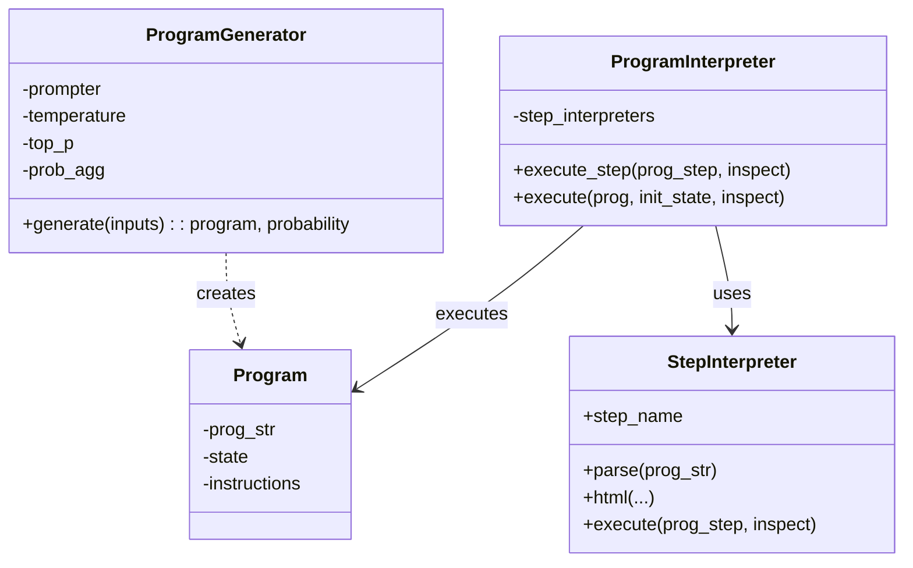

Sources: [engine/utils.py:10-14](), [engine/utils.py:17-46](), [engine/utils.py:49-88]()

### ProgramGenerator

The `ProgramGenerator` class is responsible for converting natural language instructions into executable Python programs. It uses GPT-3's in-context learning capabilities by providing examples of instructions and corresponding programs.

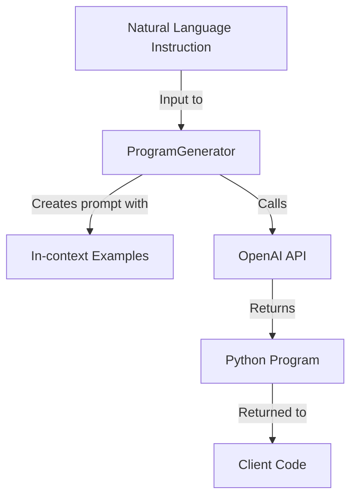

Key implementation details:
- Implemented in [engine/utils.py:49-88]()
- Uses OpenAI's API to access GPT-3 (`text-davinci-003` model)
- Takes a prompter function that generates prompts with in-context examples
- Configurable parameters for temperature and top_p to control randomness
- Returns both the generated program and a probability score

Sources: [engine/utils.py:49-88](), [README.md:127-130]()

### ProgramInterpreter

The `ProgramInterpreter` class executes the generated program by interpreting each line as a step, finding the appropriate module to handle that step, and maintaining program state throughout execution.

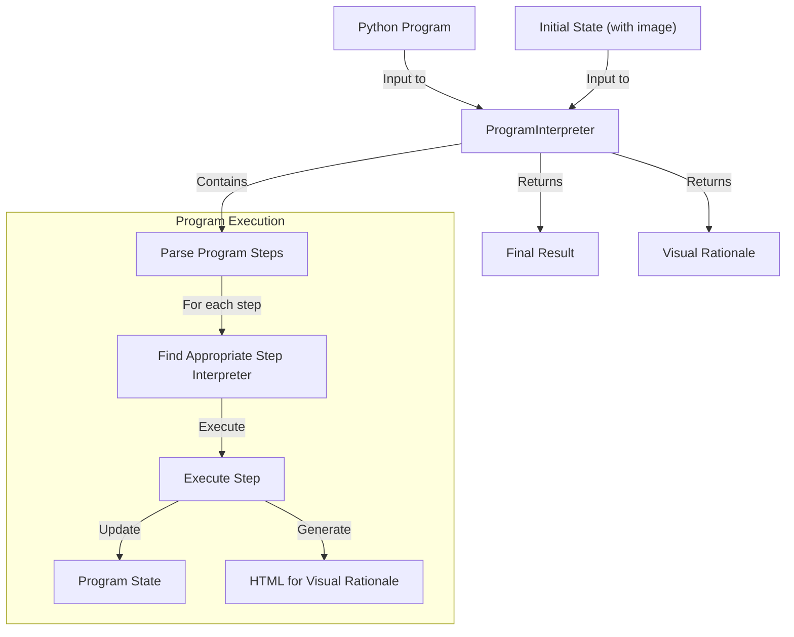

Key implementation details:
- Implemented in [engine/utils.py:17-46]()
- Registers step interpreters at initialization based on the dataset
- Maintains program state across step executions
- Can run in inspection mode to generate visual rationales

Sources: [engine/utils.py:17-46](), [README.md:56-69]()

### Step Interpreters

Step interpreters are specialized modules that handle specific operations in the program. Each interpreter implements three main functions:
- `parse()`: Extracts arguments and output variable from the program step
- `execute()`: Performs the actual operation and updates program state
- `html()`: Generates HTML representation for the execution trace

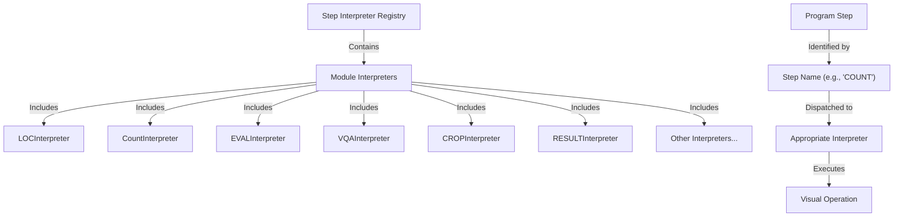

Key implementation details:
- Step interpreters are registered in the `register_step_interpreters` function in [engine/step_interpreters.py:7]()
- Each interpreter class is responsible for a specific operation (e.g., `CountInterpreter` for counting objects)
- Interpreters follow a common interface with `parse()`, `html()`, and `execute()` methods
- New modules can be added by implementing new interpreter classes and registering them

Sources: [README.md:80-116](), [README.md:123-124]()

## Program Execution Flow

The following sequence diagram illustrates the complete flow of a VisProg execution, from user input to final output:

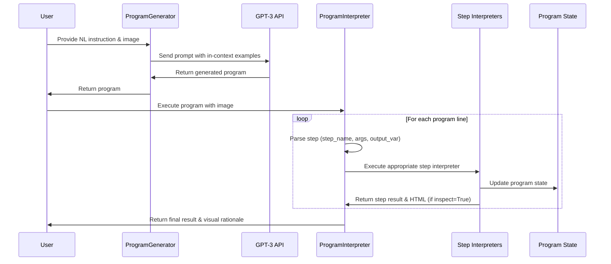

Sources: [README.md:45-54](), [engine/utils.py:26-46]()

## Example Program

Here's an example of a generated program for the question "How many people or animals are in the image?":

```python
BOX0=LOC(image=IMAGE,object='people')
BOX1=LOC(image=IMAGE,object='animals')
ANSWER0=COUNT(box=BOX0)
ANSWER1=COUNT(box=BOX1)
ANSWER2=EVAL(expr="{ANSWER0} + {ANSWER1}")
FINAL_RESULT=RESULT(var=ANSWER2)
```

This program:
1. Locates all people in the image and stores bounding boxes in `BOX0`
2. Locates all animals in the image and stores bounding boxes in `BOX1`
3. Counts the number of bounding boxes in `BOX0` and stores it in `ANSWER0`
4. Counts the number of bounding boxes in `BOX1` and stores it in `ANSWER1`
5. Evaluates the expression to add the two counts and stores it in `ANSWER2`
6. Sets the final result to be the value of `ANSWER2`

When executed with `inspect=True`, each step also generates HTML for the visual rationale, showing exactly what was detected and counted.

Sources: [README.md:61-69]()

## System Extension

VisProg is designed to be easily extensible. New visual reasoning capabilities can be added by:

1. Implementing new step interpreters in [engine/step_interpreters.py]()
2. Registering the new interpreters in the `register_step_interpreters` function
3. Adding in-context examples that demonstrate the new capabilities to prompt files

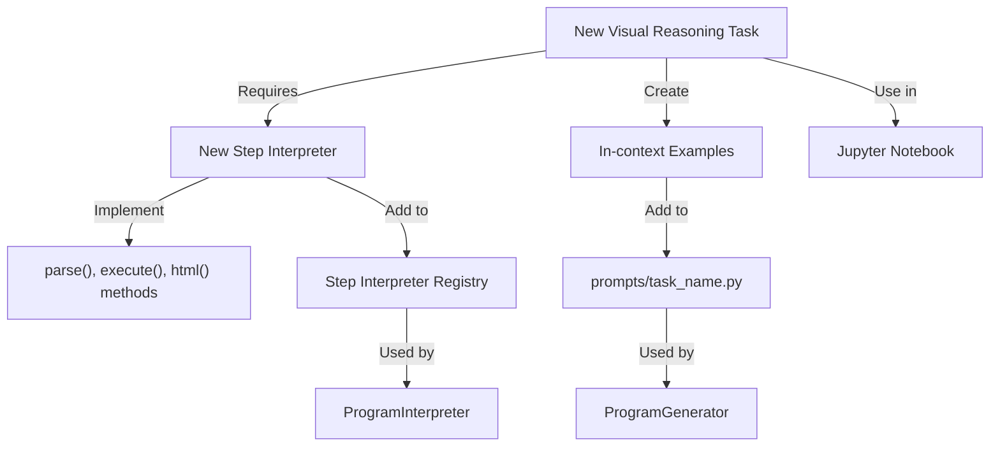

Sources: [README.md:79-118]()

## Summary

VisProg's architecture enables compositional visual reasoning without task-specific training by:

1. Using GPT-3's in-context learning to generate programs from natural language
2. Providing a modular interpreter framework for executing visual operations
3. Maintaining program state across execution steps
4. Generating detailed visual rationales that explain each execution step

This architecture makes it easy to:
- Add new visual reasoning capabilities
- Extend to new tasks with in-context examples
- Debug and understand the reasoning process through visual rationales

Sources: [README.md:18-25](), [README.md:120-126]()

---

# Page: Getting Started

# Getting Started

<details>
<summary>Relevant source files</summary>

The following files were used as context for generating this wiki page:

- [LICENSE](LICENSE)
- [README.md](README.md)
- [environment.yaml](environment.yaml)

</details>


This guide provides step-by-step instructions for setting up and running the VisProg system. VisProg is a neuro-symbolic system designed for solving complex visual tasks using natural language instructions. For more information about the system architecture, please see [Architecture](#1.1).

## Prerequisites

Before using VisProg, ensure you have:

1. Python 3.10 installed on your system
2. Conda package manager
3. An OpenAI API key (for GPT-3 access)
4. Sufficient disk space (~5GB) for dependencies

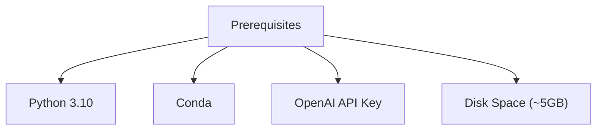

Sources: [environment.yaml:1-5](), [README.md:27-31]()

## Installation

Follow these steps to install VisProg and its dependencies:

1. Clone the repository:
   ```bash
   git clone https://github.com/allenai/visprog.git
   cd visprog
   ```

2. Create and activate the conda environment:
   ```bash
   conda env create -f environment.yaml
   conda activate visprog
   ```

This will install all required dependencies including:
- OpenAI API (version 0.23.0)
- Transformers (version 4.27.2)
- OpenCV (version 4.6.0.66)
- Pillow (version 9.2.0)
- face-detection (version 0.2.2)
- augly (version 1.0.0)
- diffusers (version 0.14.0)
- Other supporting packages

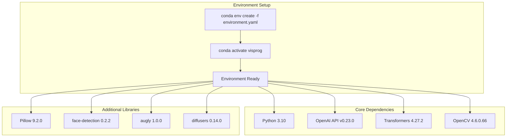

Sources: [environment.yaml:1-17](), [README.md:27-31]()

## Running the Example Notebooks

VisProg includes several example notebooks to demonstrate its capabilities across different visual reasoning tasks:

| Notebook | Task | File Path |
|----------|------|-----------|
| Object Detection | Outside knowledge object tagging | `notebooks/ok_det.ipynb` |
| Image Editing | Natural language image editing | `notebooks/image_editing.ipynb` |
| NLVR | Natural Language Visual Reasoning | `notebooks/nlvr.ipynb` |
| GQA | General Question Answering | `notebooks/gqa.ipynb` |

To run a notebook:

1. Ensure your conda environment is activated (`conda activate visprog`)
2. Open the notebook using Jupyter or an IDE that supports .ipynb files (e.g., VSCode)
3. Enter your OpenAI API key where indicated (look for `<Enter your key here>`)
4. Run the notebook cells sequentially

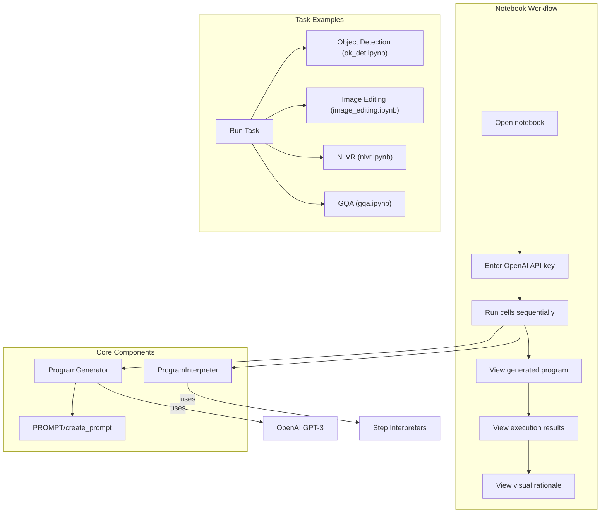

Sources: [README.md:34-41](), [README.md:44-54]()

## Understanding the Basic Workflow

All VisProg notebooks follow a similar structure and workflow:

1. **Setup**: Import necessary modules and set environment variables
2. **Initialization**: Create `ProgramGenerator` and `ProgramInterpreter` instances
3. **Task Definition**: Load image(s) and define natural language instruction
4. **Program Generation**: Using GPT-3 to generate a Python program for the task
5. **Program Execution**: Execute the generated program to solve the task
6. **Result Visualization**: View the result and visual rationale

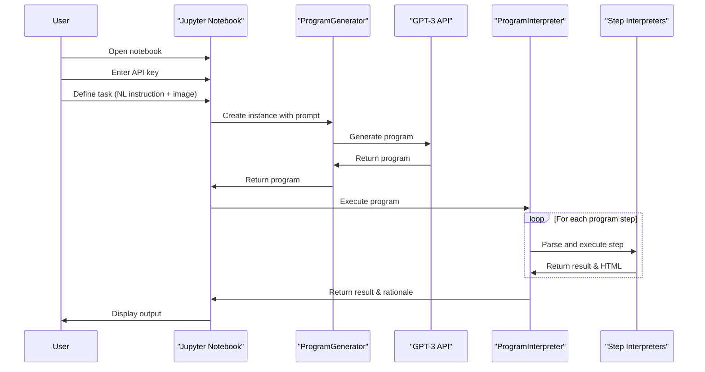

Sources: [README.md:44-54](), [README.md:55-72]()

## Example VisProg Output

When you run a VisProg notebook, you will get two main outputs:

1. **Generated Program**: A Python-like program with specialized function calls specific to visual reasoning
2. **Visual Rationale**: A step-by-step visualization of the program execution

For example, running the GQA notebook with the instruction "How many people or animals are in the image?" will generate:

```python
BOX0=LOC(image=IMAGE,object='people')
BOX1=LOC(image=IMAGE,object='animals')
ANSWER0=COUNT(box=BOX0)
ANSWER1=COUNT(box=BOX1)
ANSWER2=EVAL(expr="{ANSWER0} + {ANSWER1}")
FINAL_RESULT=RESULT(var=ANSWER2)
```

The visual rationale will show each step's execution, including intermediate results and the final output.

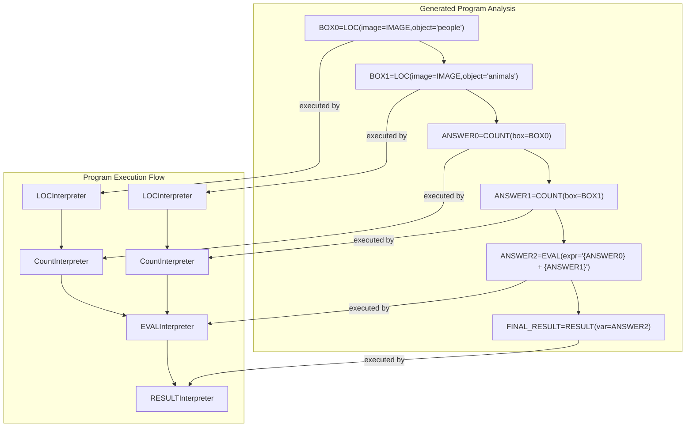

Sources: [README.md:61-72]()

## System Component Map

The following diagram maps the high-level components to their code implementations:

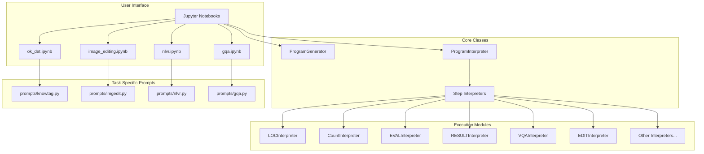

Sources: [README.md:34-41](), [README.md:79-116]()

## Troubleshooting

If you encounter issues with VisProg, here are some common problems and solutions:

### 1. Incorrect Program Generation

If VisProg generates an incorrect program or fails to solve your task:

- Ensure the instruction is similar to the in-context examples
- Check if your instruction can be solved using the current modules
- Consider adding your working example to in-context examples

### 2. OpenAI API Issues

- Verify your API key is entered correctly
- Check your API key has sufficient quota/credits
- Ensure you have internet connectivity

### 3. Dependency Problems

- Make sure you've created and activated the conda environment correctly
- If experiencing import errors, try reinstalling the environment

### 4. Adding New Functionality

If the current set of modules doesn't meet your needs:

1. Add new modules to `engine/step_interpreters.py` 
2. Register your modules in the `register_step_interpreters` function
3. Add in-context examples to `prompts/your_task_name.py`

Sources: [README.md:74-78](), [README.md:79-118]()

## Next Steps

After getting familiar with running the example notebooks, you might want to:

1. Try your own images and instructions with the existing notebooks
2. Examine the [Core Components](#2) to understand the system architecture better
3. Learn how to [add new functionality](#4.1) to extend VisProg's capabilities
4. Explore the different [Tasks & Examples](#3) supported by VisProg

This completes the "Getting Started" guide for VisProg. You should now be able to run the system and understand its basic workflow.

---

# Page: Core Components

# Core Components

<details>
<summary>Relevant source files</summary>

The following files were used as context for generating this wiki page:

- [README.md](README.md)
- [engine/utils.py](engine/utils.py)

</details>


This document provides a detailed overview of the primary components that constitute the VisProg system. VisProg is a neuro-symbolic system that solves complex visual tasks using natural language instructions without additional training. This page focuses on the core architectural components that enable program generation and execution. For specific tasks and applications, see [Tasks & Examples](#3).

## Overview

VisProg consists of three primary components that work together to translate natural language instructions into executable programs and then execute them to produce results:

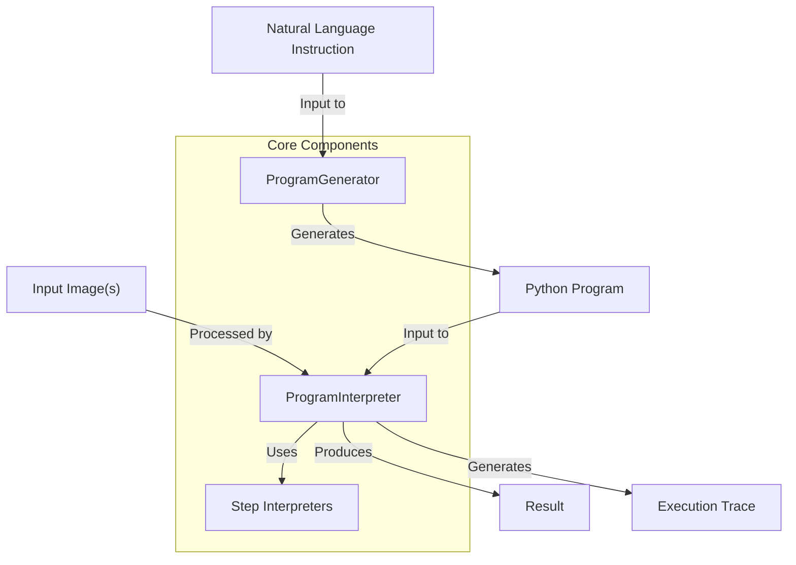

Sources: [README.md:18-25](), [engine/utils.py:10-46]()

## Program Generator

The `ProgramGenerator` class is responsible for transforming natural language instructions into Python programs using OpenAI's GPT-3 model. It leverages in-context learning (few-shot prompting) to generate programs without requiring fine-tuning.

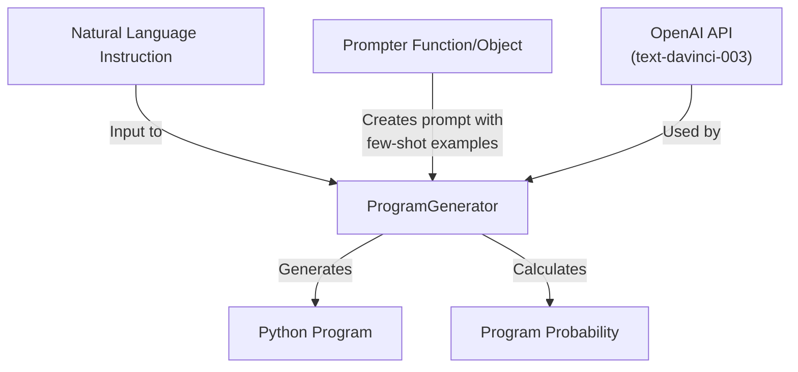

The `ProgramGenerator` initializes with:
- A prompter object/function that creates the prompt with in-context examples
- Temperature and top_p parameters for controlling generation diversity
- Probability aggregation method for calculating the confidence in generated programs

Program generation involves:
1. Constructing a prompt using the prompter with in-context examples
2. Sending the prompt to the OpenAI API (GPT-3)
3. Receiving and parsing the response
4. Computing a probability score for the program

Sources: [engine/utils.py:49-88](), [README.md:47-48]()

## Program Interpreter

The `ProgramInterpreter` class executes the Python programs generated by the `ProgramGenerator`. It maintains a program state dictionary and processes each program line sequentially.

```mermaid
graph TD
    PI["ProgramInterpreter"]
    
    PROG["Python Program"] -->|"Split into"| STEPS["Program Steps"]
    STEPS -->|"Executed by"| PI
    PI -->|"Uses"| INTERP["Step Interpreters"]
    
    PI -->|"Updates"| STATE["Program State"]
    PI -->|"Produces"| RESULT["Final Result"]
    PI -->|"When inspect=True\nGenerates"| HTML["Visual Rationale HTML"]
```

Program execution involves:
1. Parsing the program into individual steps (lines)
2. For each step:
   - Determining the appropriate step interpreter based on the step name
   - Executing the step using the interpreter
   - Updating the program state with new variables
   - Optionally generating HTML for visual rationale
3. Returning the final result and execution trace

Sources: [engine/utils.py:17-46](), [README.md:53-54]()

## Step Interpreters

Step interpreters are specialized modules that implement different visual reasoning capabilities. Each step interpreter handles a specific type of operation (e.g., object detection, counting, evaluation).

```mermaid
graph TD
    SI["Step Interpreters Registry"]
    
    LOC["LOCInterpreter\n(Object Detection)"] -->|"Registered in"| SI
    COUNT["CountInterpreter\n(Counting Objects)"] -->|"Registered in"| SI
    EVAL["EVALInterpreter\n(Expression Evaluation)"] -->|"Registered in"| SI
    VQA["VQAInterpreter\n(Visual QA)"] -->|"Registered in"| SI
    RESULT["RESULTInterpreter\n(Final Output)"] -->|"Registered in"| SI
    OTHER["Other Interpreters\n(Image Editing, etc.)"] -->|"Registered in"| SI
    
    STEP["Program Step"] -->|"Parsed to extract\nstep_name"| SI
    SI -->|"Dispatches to\nappropriate interpreter"| INTERP["Selected Interpreter"]
    INTERP -->|"Executes"| STEP
```

Each step interpreter follows a standard structure with three key methods:
- `parse()`: Extracts arguments and output variable from the program step
- `execute()`: Performs the actual operation and updates program state
- `html()`: Generates HTML representation for the visual rationale

The system currently supports a diverse set of modules, including:
- Object detection (LOC)
- Counting objects (COUNT)
- Visual question answering (VQA)
- Expression evaluation (EVAL)
- Result display (RESULT)
- Image editing operations
- Many others (see [Step Interpreters](#2.3) for full details)

Sources: [README.md:79-116](), [engine/utils.py:19-24]()

## Component Interactions

The following sequence diagram illustrates how the core components interact during execution:

```mermaid
sequenceDiagram
    participant User
    participant PG as "ProgramGenerator"
    participant GPT3 as "GPT-3 API"
    participant PI as "ProgramInterpreter"
    participant SI as "Step Interpreters"
    
    User->>PG: Provide natural language instruction
    PG->>GPT3: Send prompt with in-context examples
    GPT3->>PG: Return generated program
    PG->>PI: Pass program for execution
    
    loop For each program line
        PI->>PI: Parse step to get step_name
        PI->>SI: Lookup appropriate interpreter
        SI->>PI: Return interpreter for step_name
        PI->>SI: Execute step with interpreter
        SI->>PI: Return result and update state
        
        alt inspect=True
            SI->>PI: Generate HTML for visual rationale
        end
    end
    
    PI->>User: Return final result and visual rationale
```

The execution flow demonstrates how VisProg transforms a natural language instruction into an executable program, executes it step-by-step, and produces both a result and an interpretable rationale.

Sources: [README.md:44-54](), [engine/utils.py:17-46]()

## Program State Management

During program execution, the `ProgramInterpreter` maintains a program state dictionary that stores variables created by each step. This enables steps to reference outputs from previous steps, allowing for compositional reasoning.

```mermaid
graph TD
    subgraph "Program Execution"
        STEP1["LOC: Detect objects"] -->|"Creates variables"| VAR1["BOX0, BOX0_IMAGE"]
        STEP2["COUNT: Count objects"] -->|"Creates variables"| VAR2["ANSWER0"]
        STEP3["EVAL: Add counts"] -->|"Creates variables"| VAR3["ANSWER2"]
        STEP4["RESULT: Return answer"] -->|"Creates variables"| VAR4["FINAL_RESULT"]
    end
    
    subgraph "Program State Dictionary"
        STATE["State = {\n  IMAGE: input_image,\n  BOX0: [detected_boxes],\n  BOX0_IMAGE: visualization,\n  ANSWER0: count_value,\n  ANSWER2: sum_value,\n  FINAL_RESULT: result\n}"]
    end
    
    STEP1 -->|"Updates"| STATE
    STEP2 -->|"Updates"| STATE
    STEP3 -->|"Updates"| STATE
    STEP4 -->|"Updates"| STATE
```

The state dictionary starts with initial values (e.g., input images) and is progressively updated as each step is executed. This mechanism allows for:
- Data flow between program steps
- Access to intermediate results
- Creation of visual rationales from step outputs

Sources: [engine/utils.py:10-14](), [engine/utils.py:25-46]()

## Extension Mechanism

VisProg is designed to be easily extensible with new functionalities. Adding new capabilities involves:

1. Implementing a new step interpreter class in `engine/step_interpreters.py`
2. Registering the interpreter in the `register_step_interpreters` function
3. Adding in-context examples to a prompt file to show GPT-3 how to use the new functionality

```mermaid
graph TD
    NEW["New Step Interpreter"] -->|"Implements"| PARSE["parse() method"]
    NEW -->|"Implements"| EXEC["execute() method"]
    NEW -->|"Implements"| HTML["html() method"]
    
    NEW -->|"Added to"| REG["register_step_interpreters()"]
    EXAMPLES["In-context examples"] -->|"Added to"| PROMPT["prompts/task_name.py"]
    
    REG -->|"Updates"| REGISTRY["Step Interpreter Registry"]
    REGISTRY -->|"Used by"| PI["ProgramInterpreter"]
```

This modular architecture makes it straightforward to extend VisProg with new visual reasoning capabilities without modifying the core program generation and interpretation logic.

Sources: [README.md:79-118]()

## Summary

The core components of VisProg work together to enable solving complex visual tasks through generated programs:

1. **ProgramGenerator**: Translates natural language instructions to Python programs using GPT-3
2. **ProgramInterpreter**: Executes programs by dispatching to appropriate step interpreters
3. **Step Interpreters**: Implement specific visual reasoning operations

This architecture provides several advantages:
- Interpretability through step-by-step execution and visual rationales
- Compositionality by combining simple operations into complex programs
- Extensibility through the modular step interpreter system
- Zero-shot/few-shot capabilities without task-specific training

For detailed information about specific step interpreters and their capabilities, see [Step Interpreters](#2.3). For examples of how these components are used to solve different tasks, see [Tasks & Examples](#3).

Sources: [README.md:18-25](), [README.md:120-125]()

---

# Page: Program Generator

# Program Generator

<details>
<summary>Relevant source files</summary>

The following files were used as context for generating this wiki page:

- [README.md](README.md)
- [engine/utils.py](engine/utils.py)

</details>


## Purpose and Overview

The Program Generator is a core component of the VisProg system that transforms natural language instructions into executable Python programs. It leverages GPT-3's in-context learning capabilities to generate programs that utilize various visual reasoning modules when executed by the Program Interpreter (see [Program Interpreter](#2.2)).

This document covers the implementation details, working process, and customization options for the Program Generator component.

Sources: [README.md:18-19](), [engine/utils.py:49-88]()

## Architecture

The Program Generator sits between the user interface (typically a Jupyter notebook) and the Program Interpreter, serving as the translation layer that converts natural language into structured code.

```mermaid
flowchart TD
    subgraph "Natural Language Space"
        NLI["Natural Language Instruction"]
    end
    
    subgraph "Program Generator"
        PG["ProgramGenerator Class"]
        Prompter["Prompter\n(In-context Examples)"]
        GPT["GPT-3 API\n(text-davinci-003)"]
    end
    
    subgraph "Code Entity Space"
        Program["Python Program"]
    end
    
    NLI --> PG
    PG --> Prompter
    Prompter --> GPT
    GPT --> Program
```

The core of this component is the `ProgramGenerator` class defined in `engine/utils.py`. It handles the communication with the OpenAI API and processes the generated responses.

Sources: [engine/utils.py:49-88]()

## Implementation Details

The `ProgramGenerator` class is implemented with the following key components:

```mermaid
classDiagram
    class ProgramGenerator {
        -prompter
        -temperature
        -top_p
        -prob_agg
        +__init__(prompter, temperature, top_p, prob_agg)
        +compute_prob(response)
        +generate(inputs)
    }
```

### Initialization Parameters

- **prompter**: A function that takes user inputs and returns a formatted prompt for GPT-3, including in-context examples
- **temperature**: Controls randomness in generation (default: 0.7)
- **top_p**: Controls diversity via nucleus sampling (default: 0.5)
- **prob_agg**: Method to aggregate token probabilities ('mean' or 'sum')

### Key Methods

- **generate(inputs)**: The main method that:
  1. Takes user inputs
  2. Uses the prompter to create a full prompt with in-context examples
  3. Sends the prompt to the GPT-3 API
  4. Returns the generated program and a confidence score

- **compute_prob(response)**: Calculates a confidence score for the generated program by aggregating token probabilities

Sources: [engine/utils.py:49-88]()

## Working Process

The generation process follows these steps:

```mermaid
sequenceDiagram
    participant User
    participant Notebook as "Jupyter Notebook"
    participant PG as "ProgramGenerator"
    participant Prompter
    participant GPT3 as "GPT-3 API"
    
    User->>Notebook: Provide NL instruction & image
    Notebook->>PG: Pass instruction to generate()
    PG->>Prompter: Format with in-context examples
    Prompter->>PG: Return full prompt
    PG->>GPT3: API request with prompt
    GPT3->>PG: Return generated program text
    PG->>PG: Calculate confidence score
    PG->>Notebook: Return program & confidence
```

### Example Transformation

For a natural language instruction like "How many people or animals are in the image?", the Program Generator produces a structured program:

```python
BOX0=LOC(image=IMAGE,object='people')
BOX1=LOC(image=IMAGE,object='animals')
ANSWER0=COUNT(box=BOX0)
ANSWER1=COUNT(box=BOX1)
ANSWER2=EVAL(expr="{ANSWER0} + {ANSWER1}")
FINAL_RESULT=RESULT(var=ANSWER2)
```

This program can then be executed by the Program Interpreter (see [Program Interpreter](#2.2)) to produce both the final answer and an interpretable visual rationale.

Sources: [README.md:62-68]()

## In-Context Learning

The Program Generator relies on in-context learning, where examples of natural language instructions paired with their corresponding programs are provided to GPT-3. These examples guide the model in generating correct programs for new instructions.

```mermaid
flowchart LR
    subgraph "In-Context Learning Mechanism"
        ICE["In-Context Examples\n(prompts/*.py)"]
        NLI["New Natural Language Instruction"]
        Prompt["Complete Prompt"]
        PG["Program Generation"]
        Prog["Generated Program"]
    end
    
    ICE --> Prompt
    NLI --> Prompt
    Prompt --> PG
    PG --> Prog
```

### Prompt Structure
Each task-specific prompt contains:
1. A general task description
2. Multiple examples of natural language instructions with corresponding programs
3. The new natural language instruction for which a program needs to be generated

Sources: [README.md:47-48](), [README.md:117-118]()

## Customization and Extension

The Program Generator can be customized in several ways:

### Adding New Tasks
To extend VisProg to handle new types of tasks:
1. Create a new prompt file in the `prompts/` directory
2. Add in-context examples specific to your task
3. Reference this prompt file in your notebook or script

### Adjusting Generation Parameters
You can tune the generation behavior by adjusting:
- **temperature**: Higher values (e.g., 0.9) produce more creative outputs; lower values (e.g., 0.2) produce more deterministic outputs
- **top_p**: Controls the diversity of generated tokens
- **prob_agg**: Changes how token probabilities are aggregated to compute the overall confidence

Sources: [README.md:117-118](), [engine/utils.py:50-55]()

## Usage in Notebooks

The Program Generator is typically used in Jupyter notebooks as follows:

1. Import necessary components and prompts
2. Create a ProgramGenerator instance with the appropriate prompter
3. Load the input image
4. Define the natural language instruction
5. Generate a program from the instruction
6. Pass the generated program to the Program Interpreter for execution

A simplified example:

```python
from engine.utils import ProgramGenerator, ProgramInterpreter
from prompts.gqa import PROMPT  # or create_prompt function

# Create program generator and interpreter
program_generator = ProgramGenerator(prompter=lambda x: PROMPT.format(instruction=x))
program_interpreter = ProgramInterpreter(dataset='gqa')

# Generate program from natural language instruction
instruction = "How many people or animals are in the image?"
program, confidence = program_generator.generate(instruction)

# Execute the generated program
result, state, html_trace = program_interpreter.execute(program, {'IMAGE': image}, inspect=True)
```

Sources: [README.md:44-54]()

---

# Page: Program Interpreter

# Program Interpreter

<details>
<summary>Relevant source files</summary>

The following files were used as context for generating this wiki page:

- [README.md](README.md)
- [engine/utils.py](engine/utils.py)

</details>


## 1. Purpose and Overview

The Program Interpreter is a core component of the VisProg system responsible for executing programs generated by the Program Generator and producing both results and visual rationales. It acts as the execution engine that brings the generated Python-like programs to life by systematically executing each program step using specialized interpreters for different visual reasoning operations.

For information about how programs are generated from natural language instructions, see [Program Generator](#2.1).

Sources: [README.md:43-54](), [engine/utils.py:17-46]()

## 2. Core Functionality

The Program Interpreter takes generated programs and executes them by:

1. Parsing programs into individual execution steps
2. Identifying the appropriate Step Interpreter for each program step
3. Executing each step in sequence while maintaining program state
4. Generating visual rationales (when inspection is enabled)
5. Returning final results and the updated program state

Sources: [engine/utils.py:17-46]()

## 3. Architecture and Components

```mermaid
graph TD
    subgraph "Program Interpreter System"
        PI["ProgramInterpreter Class"]
        SI["Step Interpreters Registry"]
        PS["Program State"]
        
        PI -->|"accesses"| SI
        PI -->|"maintains"| PS
    end
    
    PG["ProgramGenerator"] -->|"generates program"| Program["Program"]
    Program -->|"input to"| PI
    
    PI -->|"executes using"| StepInt["Step Interpreters"]
    StepInt --> Count["CountInterpreter"]
    StepInt --> LOC["LOCInterpreter"]
    StepInt --> EVAL["EVALInterpreter"]
    StepInt --> RESULT["RESULTInterpreter"]
    StepInt --> Other["Other Interpreters..."]
    
    PI -->|"produces"| Results["Results"]
    PI -->|"generates"| VR["Visual Rationale"]
```

Sources: [engine/utils.py:17-46](), [README.md:43-54]()

## 4. Implementation Details

### 4.1 ProgramInterpreter Class

The `ProgramInterpreter` class is implemented in [engine/utils.py:17-46]() and consists of:

- Constructor that initializes step interpreters based on dataset type
- `execute_step` method to execute a single program step
- `execute` method to run a complete program

```python
class ProgramInterpreter:
    def __init__(self, dataset='nlvr'):
        self.step_interpreters = register_step_interpreters(dataset)
        
    def execute_step(self, prog_step, inspect):
        # Parse step and execute with appropriate interpreter
        
    def execute(self, prog, init_state, inspect=False):
        # Process the full program and return results
```

Sources: [engine/utils.py:17-46]()

### 4.2 Program State Management

The Program Interpreter maintains a state dictionary that:
- Is initialized with input variables (e.g., images)
- Gets updated after each step execution
- Contains all intermediate results
- Passes information between program steps

Sources: [engine/utils.py:26-43]()

## 5. Program Execution Flow

```mermaid
sequenceDiagram
    participant Client as "Jupyter Notebook"
    participant PI as "ProgramInterpreter"
    participant StepReg as "Step Interpreters Registry"
    participant StepInt as "Step Interpreter"
    participant State as "Program State"

    Client->>PI: execute(program, init_state, inspect=True)
    Note over PI: Create Program object if needed
    PI->>PI: Split program into individual steps
    
    loop For each program step
        PI->>StepReg: Find interpreter for step_name
        StepReg-->>PI: Return appropriate interpreter
        PI->>StepInt: execute(prog_step, inspect)
        StepInt->>StepInt: parse(prog_step) 
        StepInt->>State: Read required variables
        StepInt->>StepInt: Process according to step logic
        StepInt->>State: Update with new variables
        
        alt inspect=True
            StepInt->>StepInt: Generate HTML representation
            StepInt-->>PI: Return output and HTML
            PI->>PI: Append HTML to visual rationale
        else
            StepInt-->>PI: Return output only
        end
    end
    
    PI-->>Client: Return final result, state, and visual rationale (if inspect=True)
```

Sources: [engine/utils.py:26-46]()

## 6. Step Interpreter Selection Mechanism

The Program Interpreter uses the following process to select and execute the appropriate step interpreter:

1. Parse the program step string to extract the step name using `parse_step`
2. Look up the appropriate step interpreter in the registry using the step name as key
3. Call the interpreter's `execute` method with the current program step and inspect flag

```mermaid
graph TD
    subgraph "Step Interpreter Selection"
        PS["prog_step"] -->|"input to"| Parse["parse_step()"]
        Parse -->|"extracts"| SN["step_name"]
        SN -->|"used as key in"| Reg["step_interpreters registry"]
        Reg -->|"returns"| SI["Specific Step Interpreter"]
        SI -->|"calls"| Exec["execute(prog_step, inspect)"]
    end
```

Sources: [engine/utils.py:21-24]()

## 7. Visual Rationale Generation

When `inspect=True` is passed to the execute method, the Program Interpreter builds a visual rationale:

- Each step interpreter provides both results and HTML representation
- HTML strings are concatenated to create a comprehensive execution trace
- The visual rationale shows intermediate outputs, visualized operations, and execution flow

The visual rationale helps users understand how the program solved the task and provides transparency into the reasoning process.

Sources: [engine/utils.py:35-44](), [README.md:56-72]()

## 8. Example Program Execution

Here's an example of how the Program Interpreter executes a program for the question "How many people or animals are in the image?":

```mermaid
graph TD
    PI["ProgramInterpreter"] -->|"executes"| Step1["BOX0=LOC(image=IMAGE,object='people')"]
    PI -->|"executes"| Step2["BOX1=LOC(image=IMAGE,object='animals')"]
    PI -->|"executes"| Step3["ANSWER0=COUNT(box=BOX0)"]
    PI -->|"executes"| Step4["ANSWER1=COUNT(box=BOX1)"]
    PI -->|"executes"| Step5["ANSWER2=EVAL(expr='{ANSWER0} + {ANSWER1}')"]
    PI -->|"executes"| Step6["FINAL_RESULT=RESULT(var=ANSWER2)"]
    
    Step1 -->|"updates state"| State1["State: {IMAGE, BOX0}"]
    Step2 -->|"updates state"| State2["State: {IMAGE, BOX0, BOX1}"]
    Step3 -->|"updates state"| State3["State: {IMAGE, BOX0, BOX1, ANSWER0}"]
    Step4 -->|"updates state"| State4["State: {IMAGE, BOX0, BOX1, ANSWER0, ANSWER1}"]
    Step5 -->|"updates state"| State5["State: {IMAGE, BOX0, BOX1, ANSWER0, ANSWER1, ANSWER2}"]
    Step6 -->|"updates state"| State6["State: {IMAGE, BOX0, BOX1, ANSWER0, ANSWER1, ANSWER2, FINAL_RESULT}"]
    
    State6 -->|"final result"| Result["People + Animals Count"]
```

Sources: [README.md:59-72]()

## 9. Integration with VisProg System

```mermaid
graph LR
    User["User"] -->|"provides"| NLInstruction["Natural Language Instruction"]
    User -->|"provides"| Image["Input Image"]
    
    NLInstruction -->|"input to"| PG["ProgramGenerator"]
    PG -->|"generates"| Program["Python-like Program"]
    
    Program -->|"input to"| PI["ProgramInterpreter"]
    Image -->|"part of initial state"| PI
    
    PI -->|"uses"| StepInt["Step Interpreters"]
    PI -->|"produces"| Result["Result"]
    PI -->|"generates"| VR["Visual Rationale"]
    
    Result -->|"displayed to"| User
    VR -->|"displayed to"| User
```

Sources: [README.md:43-54]()

## 10. Usage in Notebooks

The Program Interpreter is typically used in notebooks with the following pattern:

1. Create the ProgramInterpreter instance: `interpreter = ProgramInterpreter()`
2. Initialize the state with images: `init_state = {'IMAGE': image}`
3. Execute the program: `result, state, rationale = interpreter.execute(program, init_state, inspect=True)`
4. Display the results and visual rationale

This pattern is consistent across all task-specific notebooks (object detection, image editing, NLVR, GQA).

Sources: [README.md:43-54]()

## 11. Extending the Program Interpreter

The Program Interpreter is designed to be extensible:

1. New step interpreters can be added to `engine/step_interpreters.py`
2. Each step interpreter must implement:
   - `parse()` - to extract arguments from program strings
   - `execute()` - to perform the operation
   - `html()` - to generate visual rationale (when inspection is enabled)
3. New interpreters must be registered in the `register_step_interpreters` function

This extensible design allows VisProg to be adapted to new visual reasoning tasks by adding new modules.

Sources: [README.md:80-116]()

---

# Page: Step Interpreters

# Step Interpreters

<details>
<summary>Relevant source files</summary>

The following files were used as context for generating this wiki page:

- [README.md](README.md)
- [engine/nms.py](engine/nms.py)
- [engine/step_interpreters.py](engine/step_interpreters.py)

</details>


Step Interpreters are the fundamental building blocks that execute individual operations within VisProg programs. They form a modular and extensible architecture that enables a wide range of visual reasoning capabilities without requiring training. This page documents the purpose, structure, and functionality of Step Interpreters within the VisProg system.

For information about how programs are generated from natural language instructions, see [Program Generator](#2.1). For details on how complete programs are executed, see [Program Interpreter](#2.2).

## Overview and Purpose

Step Interpreters implement specific visual reasoning or image manipulation operations that can be composed to solve complex visual tasks. Each Step Interpreter is responsible for:

1. Parsing its specific operation from program text
2. Executing the operation on the current program state
3. Generating visual explanations for the execution trace

```mermaid
graph TD
    ProgramInterpreter["ProgramInterpreter"]
    Registry["Step Interpreter Registry"]
    StepInterpreters["Step Interpreters"]
    AI["AI Models"]
    ImageProcessing["Image Processing Utilities"]
    
    ProgramInterpreter -->|"Looks up step name"| Registry
    Registry -->|"Returns appropriate interpreter"| ProgramInterpreter
    ProgramInterpreter -->|"Calls parse(), execute(), html()"| StepInterpreters
    StepInterpreters -->|"Uses"| AI
    StepInterpreters -->|"Uses"| ImageProcessing
    StepInterpreters -->|"Updates program state"| ProgramInterpreter
```

Sources: [engine/step_interpreters.py]()

## Step Interpreter Structure

All Step Interpreters follow a common interface with three primary methods:

```mermaid
classDiagram
    class StepInterpreter {
        +String step_name
        +__init__()
        +parse(prog_step) tuple
        +execute(prog_step, inspect) result
        +html(...) htmlString
    }
```

### Core Methods

1. **`parse(prog_step)`**: Extracts arguments and output variable from the program text
2. **`execute(prog_step, inspect)`**: Performs the operation and updates program state
3. **`html(...)`**: Generates HTML visualization for the execution step

Here's an example of a typical Step Interpreter implementation pattern:

```mermaid
sequenceDiagram
    participant PI as ProgramInterpreter
    participant SI as Step Interpreter
    
    PI->>SI: parse(prog_step)
    SI->>PI: Return parsed arguments
    PI->>SI: execute(prog_step, inspect=True)
    SI->>SI: Extract inputs from program state
    SI->>SI: Process inputs
    SI->>SI: Update program state with result
    SI->>SI: Generate HTML visualization
    SI->>PI: Return result and HTML
```

Sources: [engine/step_interpreters.py:345-378]()

## Available Step Interpreters

VisProg includes a variety of Step Interpreters grouped by their functionality:

### Core Interpreters

| Interpreter | Purpose | Example Usage |
|-------------|---------|---------------|
| `ResultInterpreter` | Returns the final result of a program | `FINAL_RESULT=RESULT(var=ANSWER)` |
| `EvalInterpreter` | Evaluates expressions | `ANSWER=EVAL(expr="{NUM1} + {NUM2}")` |

### Object Detection and Visual Recognition

| Interpreter | Purpose | Example Usage |
|-------------|---------|---------------|
| `LocInterpreter` | Locates objects in images | `BOX0=LOC(image=IMAGE,object='people')` |
| `VQAInterpreter` | Answers visual questions | `ANSWER=VQA(image=IMAGE,question='What color is the car?')` |
| `SegInterpreter` | Segments objects in images | `SEGMENTS=SEG(image=IMAGE)` |
| `FaceDetInterpreter` | Detects faces in images | `FACES=FACEDET(image=IMAGE)` |
| `ClassifyInterpreter` | Classifies objects | `CLASSES=CLASSIFY(image=IMAGE,object=OBJECTS,categories=CATEGORIES)` |

### Image Manipulation

| Interpreter | Purpose | Example Usage |
|-------------|---------|---------------|
| `CropInterpreter` | Crops image to object | `CROP0=CROP(image=IMAGE,box=BOX0)` |
| `ColorpopInterpreter` | Highlights objects in color | `HIGHLIGHT=COLORPOP(image=IMAGE,object=OBJECTS)` |
| `BgBlurInterpreter` | Blurs background | `BLURRED=BGBLUR(image=IMAGE,object=OBJECTS)` |
| `EmojiInterpreter` | Adds emojis to images | `EMOJI_IMG=EMOJI(image=IMAGE,object=OBJECTS,emoji='smile')` |
| `ReplaceInterpreter` | Replaces objects with generated content | `REPLACED=REPLACE(image=IMAGE,object=OBJECTS,prompt='a cute cat')` |

### Spatial Operators

| Interpreter | Purpose | Example Usage |
|-------------|---------|---------------|
| `CropRightOfInterpreter` | Crops right of object | `RIGHT=CROP_RIGHTOF(image=IMAGE,box=BOX0)` |
| `CropLeftOfInterpreter` | Crops left of object | `LEFT=CROP_LEFTOF(image=IMAGE,box=BOX0)` |
| `CropAboveInterpreter` | Crops above object | `ABOVE=CROP_ABOVE(image=IMAGE,box=BOX0)` |
| `CropBelowInterpreter` | Crops below object | `BELOW=CROP_BELOW(image=IMAGE,box=BOX0)` |

### Utility Interpreters

| Interpreter | Purpose | Example Usage |
|-------------|---------|---------------|
| `CountInterpreter` | Counts objects | `NUM=COUNT(box=BOXES)` |
| `SelectInterpreter` | Selects objects by criteria | `SELECTED=SELECT(image=IMAGE,object=OBJECTS,query='red',category='car')` |
| `ListInterpreter` | Generates lists via LLM | `ITEMS=LIST(query='types of dogs',max=5)` |
| `TagInterpreter` | Adds visual labels to objects | `TAGGED=TAG(image=IMAGE,object=OBJECTS)` |

Sources: [engine/step_interpreters.py:61-1247]()

## Interpreter Registry

The Step Interpreters are registered using the `register_step_interpreters` function, which returns a dictionary mapping step names to their corresponding interpreter instances:

```mermaid
graph TD
    ProgramGenerator["ProgramGenerator"] -->|"Generates program"| ProgramInterpreter["ProgramInterpreter"]
    ProgramInterpreter -->|"Look up interpreter"| InterpreterRegistry["Interpreter Registry"]
    InterpreterRegistry -->|"Return interpreter instance"| ProgramInterpreter
    
    subgraph "interpreter_registry"
        Register["register_step_interpreters()"]
        Register -->|"Creates"| Registry["Interpreter Dictionary"]
        Registry -->|"Maps 'LOC' to"| LocInterpreter["LocInterpreter instance"]
        Registry -->|"Maps 'COUNT' to"| CountInterpreter["CountInterpreter instance"]
        Registry -->|"Maps 'VQA' to"| VQAInterpreter["VQAInterpreter instance"]
        Registry -->|"Maps other step names"| OtherInterpreters["Other interpreters..."]
    end
```

The registry is configured differently based on the task/dataset:

```python
def register_step_interpreters(dataset='nlvr'):
    if dataset=='nlvr':
        return dict(
            VQA=VQAInterpreter(),
            EVAL=EvalInterpreter(),
            RESULT=ResultInterpreter()
        )
    elif dataset=='gqa':
        return dict(
            LOC=LocInterpreter(),
            COUNT=CountInterpreter(),
            CROP=CropInterpreter(),
            # Additional GQA interpreters...
            RESULT=ResultInterpreter()
        )
    # Additional dataset configurations...
```

Sources: [engine/step_interpreters.py:1336-1380]()

## Execution Process

When a program is executed, the Program Interpreter processes each step by:

1. Finding the appropriate Step Interpreter
2. Parsing the program step
3. Executing the operation
4. Updating the program state
5. Optionally generating a visual explanation

```mermaid
sequenceDiagram
    participant Program as "Python Program"
    participant PI as "ProgramInterpreter"
    participant SIR as "Step Interpreter Registry"
    participant SI as "Step Interpreter"
    participant State as "Program State"
    
    Program->>PI: Line 1: BOX0=LOC(image=IMAGE,object='people')
    PI->>SIR: Find interpreter for "LOC"
    SIR->>PI: Return LocInterpreter
    PI->>SI: parse(prog_step)
    SI->>PI: Return img_var,obj_name,output_var
    PI->>SI: execute(prog_step, inspect=True)
    SI->>State: Get IMAGE from state
    SI->>SI: Detect 'people' in image
    SI->>State: Store bounding boxes as BOX0
    SI->>State: Store visualization as BOX0_IMAGE
    SI->>PI: Return bounding boxes and HTML
    
    Program->>PI: Line 2: NUM=COUNT(box=BOX0)
    PI->>SIR: Find interpreter for "COUNT"
    SIR->>PI: Return CountInterpreter
    PI->>SI: parse(prog_step)
    SI->>PI: Return box_var,output_var
    PI->>SI: execute(prog_step, inspect=True)
    SI->>State: Get BOX0 from state
    SI->>SI: Count boxes
    SI->>State: Store count as NUM
    SI->>PI: Return count and HTML
```

Sources: [engine/step_interpreters.py:345-378](), [engine/step_interpreters.py:195-320]()

## Example: Anatomy of the CountInterpreter

Let's examine the `CountInterpreter` as a concrete example:

```mermaid
classDiagram
    class CountInterpreter {
        +String step_name="COUNT"
        +__init__()
        +parse(prog_step): (box_var, output_var)
        +html(box_img, output_var, count): htmlString
        +execute(prog_step, inspect): count
    }
```

1. **Initialization**: Sets up the interpreter and registers it
2. **Parse Method**: Extracts `box_var` (input) and `output_var` (where to store result)
3. **Execute Method**: Retrieves boxes from program state, counts them, updates state
4. **HTML Method**: Generates visual explanation showing boxes and count

Sources: [engine/step_interpreters.py:346-378]()

## Creating Custom Step Interpreters

To extend VisProg with new functionality, you can create custom Step Interpreters:

1. Define a new class with `step_name` attribute
2. Implement the three core methods: `parse()`, `execute()`, and `html()`
3. Register the interpreter in `register_step_interpreters()`

```python
class MyCustomInterpreter():
    step_name = 'CUSTOM'
    
    def __init__(self):
        print(f'Registering {self.step_name} step')
        # Initialize any models or resources
        
    def parse(self, prog_step):
        # Extract arguments from program text
        parse_result = parse_step(prog_step.prog_str)
        # Return parsed arguments
        
    def execute(self, prog_step, inspect=False):
        # Extract inputs from program state
        # Perform operation
        # Update program state
        # Return result and HTML if inspect=True
        
    def html(self, ...):
        # Generate HTML visualization
```

After adding your interpreter, you need to register it:

```python
def register_step_interpreters(dataset='custom'):
    # Add your custom configuration
    if dataset=='custom':
        return dict(
            CUSTOM=MyCustomInterpreter(),
            # Add other required interpreters
            RESULT=ResultInterpreter()
        )
```

Sources: [engine/step_interpreters.py:1336-1380](), [README.md:79-117]()

## Step Interpreter Dependencies

Many Step Interpreters rely on external AI models and libraries:

```mermaid
graph TD
    StepInterpreters["Step Interpreters"]
    
    subgraph "External Models"
        OWLVIT["OWLVIT (Object Detection)"]
        BLIP["BLIP (VQA)"]
        CLIP["CLIP (Classification)"]
        MaskFormer["MaskFormer (Segmentation)"]
        StableDiffusion["Stable Diffusion (Inpainting)"]
    end
    
    subgraph "Libraries"
        OpenCV["OpenCV"]
        FaceDetection["face-detection"]
        PIL["PIL/Pillow"]
        Augly["Augly"]
    end
    
    StepInterpreters -->|"LocInterpreter"| OWLVIT
    StepInterpreters -->|"VQAInterpreter"| BLIP
    StepInterpreters -->|"ClassifyInterpreter/SelectInterpreter"| CLIP
    StepInterpreters -->|"SegmentInterpreter"| MaskFormer
    StepInterpreters -->|"ReplaceInterpreter"| StableDiffusion
    StepInterpreters -->|"Image processing"| OpenCV
    StepInterpreters -->|"FaceDetInterpreter"| FaceDetection
    StepInterpreters -->|"Image manipulation"| PIL
    StepInterpreters -->|"EmojiInterpreter"| Augly
```

Sources: [engine/step_interpreters.py:1-17]()

## Case Study: Executing a Multi-Step Program

Here's an example of how multiple Step Interpreters work together to solve a task:

```mermaid
flowchart TD
    Program["""
    BOX0=LOC(image=IMAGE,object='people')
    BOX1=LOC(image=IMAGE,object='animals')
    ANSWER0=COUNT(box=BOX0)
    ANSWER1=COUNT(box=BOX1)
    ANSWER2=EVAL(expr='{ANSWER0} + {ANSWER1}')
    FINAL_RESULT=RESULT(var=ANSWER2)
    """]
    
    subgraph Step1["Step 1: Locate people"]
        LocInterpreter1["LocInterpreter"]
        LocInterpreter1 -->|"Detects people"| BoxesOfPeople["BOX0"]
    end
    
    subgraph Step2["Step 2: Locate animals"]
        LocInterpreter2["LocInterpreter"]
        LocInterpreter2 -->|"Detects animals"| BoxesOfAnimals["BOX1"]
    end
    
    subgraph Step3["Step 3: Count people"]
        CountInterpreter1["CountInterpreter"]
        BoxesOfPeople -->|"Input"| CountInterpreter1
        CountInterpreter1 -->|"Count"| PeopleCount["ANSWER0"]
    end
    
    subgraph Step4["Step 4: Count animals"]
        CountInterpreter2["CountInterpreter"]
        BoxesOfAnimals -->|"Input"| CountInterpreter2
        CountInterpreter2 -->|"Count"| AnimalCount["ANSWER1"]
    end
    
    subgraph Step5["Step 5: Sum counts"]
        EvalInterpreter["EvalInterpreter"]
        PeopleCount -->|"Input"| EvalInterpreter
        AnimalCount -->|"Input"| EvalInterpreter
        EvalInterpreter -->|"Evaluate expression"| TotalCount["ANSWER2"]
    end
    
    subgraph Step6["Step 6: Return result"]
        ResultInterpreter["ResultInterpreter"]
        TotalCount -->|"Input"| ResultInterpreter
        ResultInterpreter -->|"Final result"| FinalResult["FINAL_RESULT"]
    end
    
    Program --> Step1
    Step1 --> Step2
    Step2 --> Step3
    Step3 --> Step4
    Step4 --> Step5
    Step5 --> Step6
```

Sources: [README.md:62-68]()

## Conclusion

Step Interpreters provide the modular building blocks that enable VisProg to perform a wide range of visual reasoning tasks without requiring training. By composing different interpreters, the system can solve complex visual problems while providing interpretable execution traces.

To extend VisProg with new capabilities, you can create and register new Step Interpreters. For task-specific implementations that use these interpreters, see [Tasks & Examples](#3).

---

# Page: Tasks & Examples

# Tasks & Examples

<details>
<summary>Relevant source files</summary>

The following files were used as context for generating this wiki page:

- [README.md](README.md)
- [notebooks/gqa.ipynb](notebooks/gqa.ipynb)
- [notebooks/image_editing.ipynb](notebooks/image_editing.ipynb)
- [notebooks/nlvr.ipynb](notebooks/nlvr.ipynb)
- [notebooks/ok_det.ipynb](notebooks/ok_det.ipynb)

</details>


This page provides an overview of the visual reasoning tasks supported by the VisProg system, including implementation details and specific examples for each task. For information on core system components and architecture, see [VisProg Overview](#1) and [Core Components](#2).

## Overview of Supported Tasks

VisProg currently supports four primary visual reasoning tasks, each implemented through a dedicated Jupyter notebook and specialized prompt templates:

1. **Outside Knowledge Object Tagging**: Detect and tag objects in images based on external knowledge
2. **Natural Language Image Editing**: Edit images according to natural language instructions
3. **Natural Language Visual Reasoning (NLVR)**: Determine if a natural language statement about two images is true or false
4. **General Question Answering (GQA)**: Answer questions about images using visual reasoning

```mermaid
graph LR
    User["User"] -->|"Provides NL instruction & image(s)"| Notebooks["Task-Specific Notebooks"]
    Notebooks -->|"Uses"| PG["ProgramGenerator"]
    PG -->|"Generates"| Program["Python Program"]
    Program -->|"Executed by"| PI["ProgramInterpreter"]
    PI -->|"Produces"| Result["Result & Visual Rationale"]
    Result -->|"Displayed to"| User

    subgraph "Task Implementation"
        Notebook1["ok_det.ipynb"]
        Notebook2["image_editing.ipynb"]
        Notebook3["nlvr.ipynb"]
        Notebook4["gqa.ipynb"]
    end

    Notebooks --- Notebook1
    Notebooks --- Notebook2
    Notebooks --- Notebook3
    Notebooks --- Notebook4
```

Sources: [README.md:36-40]()

## Task Implementation Pattern

All tasks in VisProg follow a similar execution pattern, implemented as Jupyter notebooks:

```mermaid
sequenceDiagram
    participant User
    participant Notebook as Jupyter Notebook
    participant PG as ProgramGenerator
    participant GPT3 as GPT-3 API
    participant PI as ProgramInterpreter
    participant SI as Step Interpreters

    User->>Notebook: Provide instruction & image(s)
    Notebook->>PG: Pass instruction
    PG->>GPT3: Send prompt with in-context examples
    GPT3->>PG: Return generated program
    PG->>Notebook: Return program
    Notebook->>PI: Execute program
    
    loop For each program line
        PI->>SI: Execute appropriate module
        SI->>PI: Return result & HTML
    end
    
    PI->>Notebook: Return final result & visual rationale
    Notebook->>User: Display result & execution trace
```

Sources: [README.md:44-54]()

## Task 1: Outside Knowledge Object Tagging

This task detects and tags objects in images based on external knowledge retrieved from GPT-3. It's particularly useful for identifying named entities like celebrities or landmarks that require domain-specific knowledge.

### Implementation

The task is implemented in the `notebooks/ok_det.ipynb` notebook using the prompt template defined in `prompts/knowtag.py`.

### Example Usage

**Input:**
- Image: `assets/bollywood.png`
- Instruction: "Tag these famous actors from Bollywood"

**Generated Program:**
```python
QUERY0=TEXT(text='Famous actors from Bollywood')
ANSWER0=KNOW(query=QUERY0)
LOC0=LOC(image=IMAGE,object='person')
NUM0=COUNT(box=LOC0)
TAG0=TAG(image=IMAGE,box=LOC0,list=ANSWER0)
FINAL_RESULT=RESULT(var=TAG0)
```

**Execution Flow:**
1. Create a text query about Bollywood actors
2. Retrieve knowledge about Bollywood actors using GPT-3
3. Locate people in the image
4. Count the number of people found
5. Tag each person with names from the knowledge list
6. Return the tagged image as the final result

```mermaid
graph TD
    Input["Natural Language Instruction: 
    'Tag these famous actors from Bollywood'"] -->|"Passed to"| PG["ProgramGenerator"]
    
    PG -->|"Generates"| Program["Generated Program"]
    
    Program -->|"Line 1"| Step1["TEXT - Create query text"]
    Program -->|"Line 2"| Step2["KNOW - Get knowledge from GPT-3"]
    Program -->|"Line 3"| Step3["LOC - Locate people"]
    Program -->|"Line 4"| Step4["COUNT - Count people"]
    Program -->|"Line 5"| Step5["TAG - Apply tags to image"]
    Program -->|"Line 6"| Step6["RESULT - Return tagged image"]
    
    Step1 -->|"Executed by"| PI["ProgramInterpreter"]
    Step2 -->|"Executed by"| PI
    Step3 -->|"Executed by"| PI
    Step4 -->|"Executed by"| PI
    Step5 -->|"Executed by"| PI
    Step6 -->|"Executed by"| PI
    
    PI -->|"Produces"| TaggedImage["Tagged Image & Visual Rationale"]
```

Sources: [notebooks/ok_det.ipynb:78-82](), [README.md:56-72]()

## Task 2: Natural Language Image Editing

This task allows users to edit images using natural language instructions, leveraging generative AI for image manipulation tasks such as replacements, colorization, and blurring.

### Implementation

The task is implemented in the `notebooks/image_editing.ipynb` notebook using the prompt template defined in `prompts/imgedit.py`.

### Example Usage

**Input:**
- Image: `assets/bollywood.png`
- Instruction: "Replace man in black henley (person) with brick wall"

**Generated Program:**
```python
LOC0=LOC(image=IMAGE,object='man in black henley')
PROMPT0=TEXT(text='a brick wall')
EDIT0=REPLACE(image=IMAGE,box=LOC0,prompt=PROMPT0)
FINAL_RESULT=RESULT(var=EDIT0)
```

**Execution Flow:**
1. Locate the "man in black henley" in the image
2. Create a text prompt for generating a brick wall
3. Replace the located region with the generated brick wall
4. Return the edited image as the final result

```mermaid
graph TD
    Input["Natural Language Instruction:
    'Replace man in black henley with brick wall'"] -->|"Passed to"| PG["ProgramGenerator"]
    
    PG -->|"Generates"| Program["Generated Program"]
    
    Program -->|"Line 1"| Step1["LOC - Locate object"]
    Program -->|"Line 2"| Step2["TEXT - Create replacement prompt"]
    Program -->|"Line 3"| Step3["REPLACE - Apply replacement"]
    Program -->|"Line 4"| Step4["RESULT - Return edited image"]
    
    Step1 -->|"Executed by"| PI["ProgramInterpreter"]
    Step2 -->|"Executed by"| PI
    Step3 -->|"Executed by"| PI
    Step4 -->|"Executed by"| PI
    
    PI -->|"Produces"| EditedImage["Edited Image & Visual Rationale"]
```

Sources: [notebooks/image_editing.ipynb:79-83](), [README.md:56-72]()

## Task 3: Natural Language Visual Reasoning (NLVR)

This task involves determining whether a natural language statement about a pair of images is true or false. It requires complex visual reasoning across multiple images.

### Implementation

The task is implemented in the `notebooks/nlvr.ipynb` notebook using the prompt templates defined in `prompts/nlvr.py`.

### Example Usage

**Input:**
- Left Image: `assets/camel1.png`
- Right Image: `assets/camel2.png`
- Statement: "There is a woman in black in exactly one of the images and two camels in total."

**Generated Program:**
```python
LOC0=LOC(image=LEFT,object='woman in black')
NUM0=COUNT(box=LOC0)
LOC1=LOC(image=RIGHT,object='woman in black')
NUM1=COUNT(box=LOC1)
BOOL0=EVAL(expr="{NUM0} + {NUM1} == 1")
LOC2=LOC(image=LEFT,object='camel')
NUM2=COUNT(box=LOC2)
LOC3=LOC(image=RIGHT,object='camel')
NUM3=COUNT(box=LOC3)
BOOL1=EVAL(expr="{NUM2} + {NUM3} == 2")
BOOL2=EVAL(expr="{BOOL0} and {BOOL1}")
FINAL_RESULT=RESULT(var=BOOL2)
```

**Execution Flow:**
1. Locate "woman in black" in the left image and count occurrences
2. Locate "woman in black" in the right image and count occurrences
3. Check if there's exactly one woman in black across both images
4. Locate camels in the left image and count them
5. Locate camels in the right image and count them
6. Check if there are exactly two camels in total
7. Combine both conditions with a logical AND
8. Return the boolean result

```mermaid
graph TD
    Input["Natural Language Statement:
    'There is a woman in black in exactly one
    of the images and two camels in total'"] -->|"Passed to"| PG["ProgramGenerator"]
    
    PG -->|"Generates"| Program["Generated Program"]
    
    subgraph "First Condition: Woman in black in exactly one image"
        Step1["LOC - Find woman in left image"]
        Step2["COUNT - Count instances"]
        Step3["LOC - Find woman in right image"]
        Step4["COUNT - Count instances"]
        Step5["EVAL - Check if sum equals 1"]
    end
    
    subgraph "Second Condition: Two camels in total"
        Step6["LOC - Find camels in left image"]
        Step7["COUNT - Count instances"]
        Step8["LOC - Find camels in right image"]
        Step9["COUNT - Count instances"] 
        Step10["EVAL - Check if sum equals 2"]
    end
    
    Program -->|"Lines 1-5"| Step1
    Step1 --> Step2 --> Step3 --> Step4 --> Step5
    
    Program -->|"Lines 6-10"| Step6
    Step6 --> Step7 --> Step8 --> Step9 --> Step10
    
    Step5 -->|"BOOL0"| Step11["EVAL - Combine conditions"]
    Step10 -->|"BOOL1"| Step11
    
    Program -->|"Lines 11-12"| Step11
    Step11 --> Step12["RESULT - Return boolean"]
    
    Step1 -->|"Executed by"| PI["ProgramInterpreter"]
    Step12 -->|"Executed by"| PI
    
    PI -->|"Produces"| Result["Boolean Result & Visual Rationale"]
```

Sources: [notebooks/nlvr.ipynb:80-85](), [README.md:56-72]()

## Task 4: General Question Answering (GQA)

This task enables answering natural language questions about images, requiring visual reasoning, object detection, and compositional understanding.

### Implementation

The task is implemented in the `notebooks/gqa.ipynb` notebook using the prompt templates defined in `prompts/gqa.py`.

### Example Usage

**Input:**
- Image: `assets/camel1.png`
- Question: "How many people or animals are in the image?"

**Generated Program:**
```python
BOX0=LOC(image=IMAGE,object='people')
BOX1=LOC(image=IMAGE,object='animals')
ANSWER0=COUNT(box=BOX0)
ANSWER1=COUNT(box=BOX1)
ANSWER2=EVAL(expr="{ANSWER0} + {ANSWER1}")
FINAL_RESULT=RESULT(var=ANSWER2)
```

**Execution Flow:**
1. Locate all people in the image
2. Locate all animals in the image
3. Count the number of people found
4. Count the number of animals found
5. Add the two counts together
6. Return the sum as the final result

```mermaid
graph TD
    Input["Natural Language Question:
    'How many people or animals are in the image?'"] -->|"Passed to"| PG["ProgramGenerator"]
    
    PG -->|"Generates"| Program["Generated Program"]
    
    Program -->|"Line 1"| Step1["LOC - Locate people"]
    Program -->|"Line 2"| Step2["LOC - Locate animals"]
    Program -->|"Line 3"| Step3["COUNT - Count people"]
    Program -->|"Line 4"| Step4["COUNT - Count animals"]
    Program -->|"Line 5"| Step5["EVAL - Sum the counts"]
    Program -->|"Line 6"| Step6["RESULT - Return answer"]
    
    Step1 -->|"Executed by"| PI["ProgramInterpreter"]
    Step2 -->|"Executed by"| PI
    Step3 -->|"Executed by"| PI
    Step4 -->|"Executed by"| PI
    Step5 -->|"Executed by"| PI
    Step6 -->|"Executed by"| PI
    
    PI -->|"Produces"| Answer["Numerical Answer & Visual Rationale"]
```

Sources: [notebooks/gqa.ipynb:78-83](), [README.md:56-72]()

## VisProg Module Ecosystem

VisProg tasks utilize a common set of functional modules that serve as building blocks for the generated programs. These modules are implemented as Step Interpreters in the system.

### Core Modules and Their Functions

| Module  | Description                                | Example Usage                                      |
|---------|--------------------------------------------|---------------------------------------------------|
| LOC     | Locates objects in an image                | `LOC(image=IMAGE,object='person')`                 |
| COUNT   | Counts the number of objects               | `COUNT(box=BOX0)`                                  |
| EVAL    | Evaluates Python expressions               | `EVAL(expr="{NUM0} + {NUM1}")`                     |
| KNOW    | Retrieves outside knowledge using GPT-3    | `KNOW(query=QUERY0)`                               |
| TAG     | Tags objects with labels                   | `TAG(image=IMAGE,box=LOC0,list=ANSWER0)`           |
| TEXT    | Creates text strings                       | `TEXT(text='a brick wall')`                        |
| REPLACE | Replaces regions in an image               | `REPLACE(image=IMAGE,box=LOC0,prompt=PROMPT0)`     |
| VQA     | Performs visual question answering         | `VQA(image=IMAGE,question='What color is the car?')`|
| RESULT  | Returns the final result                   | `RESULT(var=ANSWER0)`                              |

```mermaid
graph TD
    subgraph "Natural Language Space"
        NL_Instruction["Natural Language Instruction/Question"]
    end
    
    subgraph "Program Generator Component"
        ProgramGenerator["ProgramGenerator Class"]
        Prompts["Task-Specific Prompts"]
        GPT3["GPT-3 API"]
    end
    
    subgraph "Code Entity Space"
        Program["Generated Python Program"]
        ProgramInterpreter["ProgramInterpreter Class"]
        
        subgraph "Step Interpreters Registry"
            LOC["LOCInterpreter"]
            COUNT["CountInterpreter"]
            EVAL["EVALInterpreter"]
            KNOW["KNOWInterpreter"]
            TAG["TAGInterpreter"]
            REPLACE["REPLACEInterpreter"]
            TEXT["TEXTInterpreter"]
            VQA["VQAInterpreter"]
            RESULT["RESULTInterpreter"]
        end
        
        subgraph "Backend Models & Systems"
            ObjectDetector["Object Detection Models"]
            LLM["Language Models"]
            ImageGenerator["Image Generation Models"]
            VQAModel["VQA Models"]
        end
    end
    
    NL_Instruction -->|"Input to"| ProgramGenerator
    ProgramGenerator -->|"Uses"| Prompts
    ProgramGenerator -->|"Calls"| GPT3
    GPT3 -->|"Generates"| Program
    
    Program -->|"Executed by"| ProgramInterpreter
    ProgramInterpreter -->|"Uses"| LOC
    ProgramInterpreter -->|"Uses"| COUNT
    ProgramInterpreter -->|"Uses"| EVAL
    ProgramInterpreter -->|"Uses"| KNOW
    ProgramInterpreter -->|"Uses"| TAG
    ProgramInterpreter -->|"Uses"| REPLACE
    ProgramInterpreter -->|"Uses"| TEXT
    ProgramInterpreter -->|"Uses"| VQA
    ProgramInterpreter -->|"Uses"| RESULT
    
    LOC -->|"Uses"| ObjectDetector
    KNOW -->|"Uses"| LLM
    REPLACE -->|"Uses"| ImageGenerator
    VQA -->|"Uses"| VQAModel
```

Sources: [README.md:123-126]()

## Visual Rationales

A key feature of VisProg is its ability to generate visual rationales that explain the step-by-step execution of the program. These rationales provide interpretability and help debug the system's reasoning.

### Example Visual Rationale

For the GQA question "How many people or animals are in the image?", VisProg produces a visual rationale showing:

1. Bounding boxes around detected people
2. Bounding boxes around detected animals
3. The count of people (ANSWER0)
4. The count of animals (ANSWER1)
5. The final sum (ANSWER2)

This visual trace helps users understand how VisProg arrived at its answer and verify each step of the reasoning process.

```mermaid
graph TD
    subgraph "Visual Rationale Components"
        Input["Input Image & Question"]
        BoxVis["Bounding Box Visualizations"]
        CountVis["Count Results"]
        EvalVis["Evaluation Results"]
        FinalVis["Final Result"]
    end
    
    subgraph "HTML Generation Process"
        StepInterpreters["Step Interpreters"]
        HTMLMethods["html() Methods"]
        VisUtils["Visualization Utilities"]
        RationaleAssembly["HTML Assembly"]
    end
    
    Input -->|"Processed by"| StepInterpreters
    StepInterpreters -->|"Call"| HTMLMethods
    HTMLMethods -->|"Use"| VisUtils
    VisUtils -->|"Create"| BoxVis
    VisUtils -->|"Create"| CountVis
    VisUtils -->|"Create"| EvalVis
    HTMLMethods -->|"Contribute to"| RationaleAssembly
    RationaleAssembly -->|"Produces"| FinalVis
```

Sources: [README.md:56-72]()

## Extending VisProg with New Tasks

VisProg is designed to be easily extensible with new tasks and functionalities. To add a new task:

1. Create a new prompt template file in the `prompts/` directory with in-context examples for your task
2. Create a new notebook similar to the existing ones, importing your prompt template
3. If needed, add new modules by implementing Step Interpreters in `engine/step_interpreters.py`

For more details on extending VisProg, see [Adding New Functionality](#4.1).

Sources: [README.md:74-117]()

---

# Page: Object Detection

# Object Detection

<details>
<summary>Relevant source files</summary>

The following files were used as context for generating this wiki page:

- [notebooks/ok_det.ipynb](notebooks/ok_det.ipynb)
- [prompts/knowtag.py](prompts/knowtag.py)

</details>


## Purpose and Scope

This document details the object detection capabilities in VisProg, a neuro-symbolic visual reasoning system. It covers how VisProg detects, localizes, and classifies objects within images using natural language instructions. For related visual reasoning tasks such as image editing or question answering, see [Image Editing](#3.2), [NLVR](#3.3), and [GQA](#3.4).

## Overview

VisProg's object detection system allows users to identify and tag specific objects, people, or entities in images using natural language instructions. The system employs a multi-step approach that combines object localization, face detection, entity listing, and classification to produce tagged images with visual rationales.

```mermaid
graph TD
    NL["Natural Language Instruction"] -->|Processed by| PG["ProgramGenerator"]
    PG -->|Generates| Program["Detection Program"]
    Program -->|Executed by| PI["ProgramInterpreter"]
    
    subgraph "Object Detection Pipeline"
        LOC["Object Localization (LOC)"]
        FACE["Face Detection (FACEDET)"]
        LIST["Entity Listing (LIST)"]
        CLASSIFY["Classification (CLASSIFY)"]
        TAG["Tagging (TAG)"]
    end
    
    PI --> LOC
    PI --> FACE
    
    LOC --> CLASSIFY
    FACE --> CLASSIFY
    
    LIST -->|Provides categories| CLASSIFY
    
    CLASSIFY --> TAG
    TAG -->|Produces| Result["Tagged Image"]
```

Sources: [notebooks/ok_det.ipynb:31-36](), [prompts/knowtag.py:1-109]()

## Detection Components

### Object Detection Step Interpreters

VisProg's object detection capabilities rely on several specialized step interpreters:

| Step Interpreter | Function | Description |
|-----------------|----------|-------------|
| LOC | Object Localization | Identifies bounding boxes for specified objects in the image |
| FACEDET | Face Detection | Detects and localizes human faces in the image |
| LIST | Entity Listing | Generates a list of entities based on a query |
| CLASSIFY | Classification | Classifies detected objects into categories |
| TAG | Image Tagging | Annotates the image with classification results |

Sources: [prompts/knowtag.py:5-105]()

### Detection Workflow

```mermaid
sequenceDiagram
    participant User
    participant PG as ProgramGenerator
    participant PI as ProgramInterpreter
    participant LOC as LOC/FACEDET
    participant LIST as LIST
    participant CLASSIFY as CLASSIFY
    participant TAG as TAG
    
    User->>PG: "Tag these famous actors from Bollywood"
    PG->>PI: Generated detection program
    
    PI->>LOC: Detect objects/faces
    LOC->>PI: Return bounding boxes
    
    PI->>LIST: Generate list of entities
    LIST->>PI: Return categories
    
    PI->>CLASSIFY: Classify objects using categories
    CLASSIFY->>PI: Return classifications
    
    PI->>TAG: Tag image with classifications
    TAG->>PI: Return tagged image
    
    PI->>User: Display tagged image and rationale
```

Sources: [notebooks/ok_det.ipynb:77-93](), [prompts/knowtag.py:43-49]()

## Implementation Details

### Program Generation

The object detection system uses a ProgramGenerator with predefined prompts to create executable programs from natural language instructions. The prompt template in `knowtag.py` contains examples for various detection scenarios, enabling GPT-3 to generate appropriate programs for new instructions.

```mermaid
graph LR
    Instruction["User Instruction"] -->|Input to| Prompter["create_prompt() Function"]
    Prompter -->|Uses| Template["PROMPT Template"]
    Template -->|Feeds into| Generator["ProgramGenerator"]
    Generator -->|Produces| Program["Detection Program"]
```

Sources: [notebooks/ok_det.ipynb:53-56](), [prompts/knowtag.py:1-109]()

### Detection Program Structure

A typical object detection program follows this structure:

1. **Object/Face Detection**: Locates objects or faces in the image
2. **Entity Listing**: Generates relevant categories for classification
3. **Classification**: Assigns categories to detected objects
4. **Tagging**: Annotates the image with classification results
5. **Result**: Returns the final tagged image

Example program for tagging Bollywood actors:
```
OBJ0=FACEDET(image=IMAGE)
LIST0=LIST(query='famous actors from Bollywood',max=20)
OBJ1=CLASSIFY(image=IMAGE,object=OBJ0,categories=LIST0)
IMAGE0=TAG(image=IMAGE,object=OBJ1)
FINAL_RESULT=RESULT(var=IMAGE0)
```

Sources: [notebooks/ok_det.ipynb:77-84](), [prompts/knowtag.py:43-49]()

## Usage Examples

The object detection system supports various detection and tagging scenarios:

### Face Detection and Recognition

```
# Tag the presidents of US
OBJ0=FACEDET(image=IMAGE)
LIST0=LIST(query='presidents of the US',max=20)
OBJ1=CLASSIFY(image=IMAGE,object=OBJ0,categories=LIST0)
IMAGE0=TAG(image=IMAGE,object=OBJ1)
FINAL_RESULT=RESULT(var=IMAGE0)
```

### Object Localization and Classification

```
# Tag the wild animals
OBJ0=LOC(image=IMAGE,object='wild animal')
LIST0=LIST(query='wild animals',max=20)
OBJ1=CLASSIFY(image=IMAGE,object=OBJ0,categories=LIST0)
IMAGE0=TAG(image=IMAGE,object=OBJ1)
FINAL_RESULT=RESULT(var=IMAGE0)
```

### Attribute Classification

```
# Tag the shoes with their colors
OBJ0=LOC(image=IMAGE,object='shoe')
LIST0=LIST(query='colors',max=20)
OBJ1=CLASSIFY(image=IMAGE,object=OBJ0,categories=LIST0)
IMAGE0=TAG(image=IMAGE,object=OBJ1)
FINAL_RESULT=RESULT(var=IMAGE0)
```

Sources: [prompts/knowtag.py:3-105]()

## Using the Object Detection System

### Setting Up

To use the object detection capabilities:

1. Initialize the ProgramInterpreter with the 'okDet' dataset
2. Create a ProgramGenerator with the knowtag prompt
3. Load an image and set it as the initial state
4. Provide a detection instruction

```python
interpreter = ProgramInterpreter(dataset='okDet')
generator = ProgramGenerator(prompter=create_prompt)
init_state = dict(IMAGE=image.convert('RGB'))
instruction = "Tag these famous actors from Bollywood"
```

### Execution

Generate and execute the program:

```python
prog, _ = generator.generate(instruction)
result, prog_state, html_str = interpreter.execute(prog, init_state, inspect=True)
```

The execution produces:
- `result`: The final result (tagged image)
- `prog_state`: The final program state
- `html_str`: A visual rationale showing execution steps

Sources: [notebooks/ok_det.ipynb:44-93]()

## Integration with VisProg

Object detection is a foundational capability in VisProg that's leveraged by many other tasks:

```mermaid
graph TD
    OD["Object Detection"] -->|Used by| GQA["Question Answering"]
    OD -->|Used by| NLVR["Visual Reasoning"]
    OD -->|Used by| IE["Image Editing"]
    
    subgraph "Object Detection Components"
        LOC["LOC Interpreter"]
        FACE["FACEDET Interpreter"]
        CLASS["CLASSIFY Interpreter"]
    end
    
    OD --- LOC
    OD --- FACE
    OD --- CLASS
```

Sources: [notebooks/ok_det.ipynb:31-36]()

---

# Page: Image Editing

# Image Editing

<details>
<summary>Relevant source files</summary>

The following files were used as context for generating this wiki page:

- [assets/bollywood.png](assets/bollywood.png)
- [notebooks/image_editing.ipynb](notebooks/image_editing.ipynb)
- [prompts/imgedit.py](prompts/imgedit.py)

</details>


This document describes the Image Editing functionality within VisProg, which enables users to perform complex image manipulation operations using natural language instructions. The system supports tasks such as adding emojis to faces, creating color pop effects, blurring backgrounds, and replacing objects in images.

For information about other visual reasoning capabilities in VisProg, see [Object Detection](#3.1), [Natural Language Visual Reasoning (NLVR)](#3.3), and [General Question Answering (GQA)](#3.4).

## 1. Overview

The Image Editing module transforms natural language instructions into executable programs that perform precise image editing operations. It utilizes the core VisProg architecture, including the ProgramGenerator to create programs from instructions and the ProgramInterpreter to execute these programs.

### Image Editing Workflow

```mermaid
graph TD
    NLInstruction["Natural Language Instruction"] -->|Input to| ProgramGen["ProgramGenerator"]
    ProgramGen -->|Uses| ImgEditPrompt["prompts/imgedit.py PROMPT"]
    ImgEditPrompt -->|Contains| ExamplePrograms["In-context Examples"]
    ProgramGen -->|Generates| Program["Python Program"]
    Program -->|Executed by| ProgramInt["ProgramInterpreter(dataset='imageEdit')"]
    ProgramInt -->|Processes| EditOps["Image Edit Operations"]
    EditOps -->|Including| FACEDET["FACEDET (Face Detection)"]
    EditOps -->|Including| SEG["SEG (Segmentation)"]
    EditOps -->|Including| SELECT["SELECT (Object Selection)"]
    EditOps -->|Including| EMOJI["EMOJI (Emoji Overlay)"]
    EditOps -->|Including| COLORPOP["COLORPOP (Color Isolation)"]
    EditOps -->|Including| BGBLUR["BGBLUR (Background Blur)"]
    EditOps -->|Including| REPLACE["REPLACE (Object Replacement)"]
    ProgramInt -->|Produces| Result["Edited Image (FINAL_RESULT)"]
    ProgramInt -->|If inspect=True| Trace["Visual Execution Trace (html_str)"]
```

Sources: [notebooks/image_editing.ipynb:34-35, 44, 53-56, 78-93](), [prompts/imgedit.py]()

## 2. Supported Editing Operations

The Image Editing module supports several specialized operations that can be combined to create complex editing workflows.

### Operation Dependencies

```mermaid
graph TD
    subgraph "Detection Operations"
        FACEDET["FACEDET - Face Detection"]
        SEG["SEG - General Segmentation"]
    end
    
    subgraph "Selection Operations"
        SELECT["SELECT - Object Selection"]
    end
    
    subgraph "Editing Operations"
        EMOJI["EMOJI - Emoji Overlay"]
        COLORPOP["COLORPOP - Color Isolation"]
        BGBLUR["BGBLUR - Background Blur"]
        REPLACE["REPLACE - Object Replacement"]
    end
    
    FACEDET -->|"Provides objects to"| SELECT
    SEG -->|"Provides objects to"| SELECT
    SELECT -->|"Provides targets for"| EMOJI
    SELECT -->|"Provides targets for"| COLORPOP
    SELECT -->|"Provides targets for"| BGBLUR
    SELECT -->|"Provides targets for"| REPLACE
    
    EMOJI -->|"Updates"| IMAGE_VAR["IMAGE variable"]
    COLORPOP -->|"Updates"| IMAGE_VAR
    BGBLUR -->|"Updates"| IMAGE_VAR
    REPLACE -->|"Updates"| IMAGE_VAR
    
    IMAGE_VAR -->|"Final output in"| RESULT["RESULT operation"]
```

Sources: [prompts/imgedit.py:9-82]()

### 2.1 Detection Operations

#### FACEDET
The `FACEDET` operation detects faces in an image and returns bounding boxes for those faces.

Example:
```
OBJ0=FACEDET(image=IMAGE)
```

#### SEG
The `SEG` operation performs general object segmentation, identifying and segmenting various objects in the image.

Example:
```
OBJ0=SEG(image=IMAGE)
```

### 2.2 Selection Operations

#### SELECT
The `SELECT` operation identifies specific objects from a set of detected objects based on a query and optional category.

Example:
```
OBJ1=SELECT(image=IMAGE,object=OBJ0,query='red bus',category='bus')
```

### 2.3 Editing Operations

#### EMOJI
The `EMOJI` operation overlays emoji graphics on selected faces or objects.

Example:
```
IMAGE0=EMOJI(image=IMAGE,object=OBJ1,emoji='face_with_tongue')
```

Available emoji options as defined in the prompt template:
- face_with_tongue (`:p`)
- smiling_face_with_sunglasses (`8)`)
- smiling_face (`:)`)
- winking_face (`;)`)

#### COLORPOP
The `COLORPOP` operation creates a visual effect where selected objects retain their color while the rest of the image is converted to grayscale.

Example:
```
IMAGE0=COLORPOP(image=IMAGE,object=OBJ1)
```

#### BGBLUR
The `BGBLUR` operation applies a blur effect to the background while keeping selected objects in focus.

Example:
```
IMAGE0=BGBLUR(image=IMAGE,object=OBJ1)
```

#### REPLACE
The `REPLACE` operation substitutes selected objects in the image with new objects specified in a text prompt.

Example:
```
IMAGE0=REPLACE(image=IMAGE,object=OBJ1,prompt='blue bus')
```

Sources: [prompts/imgedit.py:4-8, 9-82]()

## 3. Implementation Details

### 3.1 Program Generation

The image editing system uses a prompt template defined in `prompts/imgedit.py` that contains several examples of different editing operations. This template is provided to the `ProgramGenerator` along with the user's instruction to generate a Python program.

```mermaid
sequenceDiagram
    participant User
    participant CreatePrompt as "create_prompt()"
    participant Generator as "ProgramGenerator"
    participant ImgEditPrompt as "PROMPT (imgedit.py)"
    participant Program as "Generated Program"
    
    User->>CreatePrompt: "instruction"
    CreatePrompt->>ImgEditPrompt: "Format instruction into template"
    ImgEditPrompt-->>CreatePrompt: "Complete prompt"
    CreatePrompt-->>Generator: "Formatted prompt"
    Generator->>Generator: "Call OpenAI API"
    Generator-->>Program: "Generate program"
    Program-->>User: "Display program"
```

The prompt template includes examples of various editing operations to help the language model understand the expected output format and available operations.

Sources: [notebooks/image_editing.ipynb:52-56](), [prompts/imgedit.py]()

### 3.2 Execution Flow

The generated program is executed by the `ProgramInterpreter`, which processes each step sequentially, updating the program state after each operation.

```mermaid
sequenceDiagram
    participant Program as "Generated Program"
    participant Interpreter as "ProgramInterpreter(dataset='imageEdit')"
    participant State as "Program State (init_state)"
    participant Result as "Edited Image (result)"
    participant HTMLTrace as "Visual Trace (html_str)"
    
    Program->>Interpreter: "execute(prog, init_state, inspect=True)"
    Interpreter->>State: "Initialize with IMAGE=image"
    loop "For each program line"
        Interpreter->>Interpreter: "Parse operation"
        Interpreter->>Interpreter: "Execute operation"
        Interpreter->>State: "Update program state"
        Interpreter->>HTMLTrace: "Add visual explanation if inspect=True"
    end
    Interpreter->>Result: "Extract final result"
    Interpreter->>HTMLTrace: "Generate complete HTML trace"
    Result-->>Interpreter: "Return edited image"
    HTMLTrace-->>Interpreter: "Return HTML string"
```

The interpreter can also generate a visual execution trace for debugging and explanation purposes when the `inspect` parameter is set to `True`.

Sources: [notebooks/image_editing.ipynb:67-69, 92-93]()

## 4. Example Usage

Here's an example of how to use the image editing functionality in VisProg, based on the provided notebook:

1. Initialize the program interpreter and generator:
```python
interpreter = ProgramInterpreter(dataset='imageEdit')
def create_prompt(instruction):
    return PROMPT.format(instruction=instruction)
generator = ProgramGenerator(prompter=create_prompt)
```

2. Load and prepare an image:
```python
image = Image.open('path/to/image.png')
image.thumbnail((512, 512), Image.Resampling.LANCZOS)
init_state = dict(IMAGE=image.convert('RGB'))
```

3. Define a natural language instruction:
```python
instruction = "Replace man in black henley with brick wall"
```

4. Generate a program using the instruction:
```python
prog, _ = generator.generate(instruction)
print(prog)
```

5. Execute the program using the interpreter:
```python
result, prog_state, html_str = interpreter.execute(prog, init_state, inspect=True)
```

6. View the result and execution trace:
```python
result  # Display the edited image
HTML(html_str)  # Display the visual execution trace
```

Sources: [notebooks/image_editing.ipynb:44-111]()

## 5. Example Programs

Below are examples of programs generated for different image editing instructions, demonstrating the range of capabilities.

### 5.1 Emoji Replacement

For the instruction: "Hide the face of Nicole Kidman with :p"
```
OBJ0=FACEDET(image=IMAGE)
OBJ1=SELECT(image=IMAGE,object=OBJ0,query='Nicole Kidman',category=None)
IMAGE0=EMOJI(image=IMAGE,object=OBJ1,emoji='face_with_tongue')
FINAL_RESULT=RESULT(var=IMAGE0)
```

### 5.2 Multiple Emoji Replacement

For the instruction: "Hide the faces of Nicole Kidman and Brad Pitt with ;) and 8)"
```
OBJ0=FACEDET(image=IMAGE)
OBJ1=SELECT(image=IMAGE,object=OBJ0,query='Nicole Kidman',category=None)
IMAGE0=EMOJI(image=IMAGE,object=OBJ1,emoji='winking_face')
OBJ2=SELECT(image=IMAGE,object=OBJ0,query='Brad Pitt',category=None)
IMAGE1=EMOJI(image=IMAGE0,object=OBJ1,emoji='smiling_face_with_sunglasses')
FINAL_RESULT=RESULT(var=IMAGE1)
```

### 5.3 Color Pop Effect

For the instruction: "Create a color pop of the girl and the umbrella"
```
OBJ0=SEG(image=IMAGE)
OBJ1=SELECT(image=IMAGE,object=OBJ0,query='girl,umbrella',category=None)
IMAGE0=COLORPOP(image=IMAGE,object=OBJ1)
FINAL_RESULT=RESULT(var=IMAGE0)
```

### 5.4 Background Blur

For the instruction: "Select the red bus and blur the background"
```
OBJ0=SEG(image=IMAGE)
OBJ1=SELECT(image=IMAGE,object=OBJ0,query='red bus',category=None)
IMAGE0=BGBLUR(image=IMAGE,object=OBJ1)
FINAL_RESULT=RESULT(var=IMAGE0)
```

### 5.5 Object Replacement

For the instruction: "Replace the red bus with a blue bus"
```
OBJ0=SEG(image=IMAGE)
OBJ1=SELECT(image=IMAGE,object=OBJ0,query='red bus',category=None)
IMAGE0=REPLACE(image=IMAGE,object=OBJ1,prompt='blue bus')
FINAL_RESULT=RESULT(var=IMAGE0)
```

### 5.6 Multiple Object Replacement

For the instruction: "Replace the red bus with blue bus and the road with dirt road"
```
OBJ0=SEG(image=IMAGE)
OBJ1=SELECT(image=IMAGE,object=OBJ0,query='red bus',category=None)
IMAGE0=REPLACE(image=IMAGE,object=OBJ1,prompt='blue bus')
OBJ2=SEG(image=IMAGE0)
OBJ3=SELECT(image=IMAGE0,object=OBJ2,query='road',category=None)
IMAGE1=REPLACE(image=IMAGE0,object=OBJ3,prompt='dirt road')
FINAL_RESULT=RESULT(var=IMAGE1)
```

Sources: [prompts/imgedit.py:9-82]()

## 6. Integration with VisProg System

The image editing module integrates with the core VisProg system through the `ProgramGenerator` and `ProgramInterpreter` components. It follows the same pattern as other VisProg tasks but with specialized operations for image manipulation.

```mermaid
graph TD
    subgraph "VisProg Core Components"
        ProgramGen["ProgramGenerator"]
        ProgramInt["ProgramInterpreter"]
    end
    
    subgraph "Image Editing Task"
        ImgEditPrompt["prompts/imgedit.py PROMPT"]
        ImgEditNB["notebooks/image_editing.ipynb"]
        ImgEditSteps["Image Editing Step Interpreters"]
    end
    
    subgraph "Other Tasks"
        ObjDetection["Object Detection Task"]
        NLVR["NLVR Task"]
        GQA["GQA Task"]
    end
    
    ProgramGen -->|"Uses for image editing"| ImgEditPrompt
    ImgEditNB -->|"Initializes"| ProgramGen
    ImgEditNB -->|"Initializes"| ProgramInt
    ProgramInt -->|"dataset='imageEdit'"| ImgEditSteps
    ProgramInt -->|"Executes"| ImgEditSteps
    
    ProgramGen -->|"Also used by"| ObjDetection
    ProgramGen -->|"Also used by"| NLVR
    ProgramGen -->|"Also used by"| GQA
    
    ProgramInt -->|"Also used by"| ObjDetection
    ProgramInt -->|"Also used by"| NLVR
    ProgramInt -->|"Also used by"| GQA
```

Sources: [notebooks/image_editing.ipynb:34-35, 44](), [prompts/imgedit.py]()

---

# Page: Natural Language Visual Reasoning (NLVR)

# Natural Language Visual Reasoning (NLVR)

<details>
<summary>Relevant source files</summary>

The following files were used as context for generating this wiki page:

- [assets/camel1.png](assets/camel1.png)
- [assets/camel2.png](assets/camel2.png)
- [notebooks/nlvr.ipynb](notebooks/nlvr.ipynb)
- [prompts/nlvr.py](prompts/nlvr.py)

</details>


Natural Language Visual Reasoning (NLVR) in VisProg is a system that determines whether natural language statements about images are true or false. It's specifically designed for analyzing pairs of images (LEFT and RIGHT) and evaluating statements that describe relationships, counts, or properties of objects within these images.

NLVR differs from general Visual Question Answering (VQA) in that it focuses specifically on binary truth evaluation rather than open-ended questions. For more general question answering about images, see the [General Question Answering (GQA)](#3.4) component.

## Architecture

NLVR in VisProg follows a two-stage architecture that transforms natural language statements into executable programs that determine their truth value.

NLVR Processing Workflow
```mermaid
graph TD
    User["User"] -->|"Provides statement & images"| PG["ProgramGenerator"]
    PG -->|"Generates program"| PI["ProgramInterpreter"]
    Images["Images (LEFT/RIGHT)"] -->|"Input to"| PI
    PI -->|"Executes program"| Result["True/False Result"]
    Result -->|"Displayed to"| User
```

Sources: `notebooks/nlvr.ipynb`, `prompts/nlvr.py`

### Program Generation

The Program Generator uses GPT-3 with in-context learning from curated examples to translate natural language statements into executable programs. These programs systematically break down the reasoning into steps.

### Program Structure

NLVR programs typically consist of three types of operations:

NLVR Program Execution Flow
```mermaid
graph TD
    NLStatement["Natural Language Statement"] -->|"Parsed by"| PG["ProgramGenerator"]
    PG -->|"Generates"| Program["Program"]
    Program -->|"Contains"| VQASteps["VQA Steps"]
    Program -->|"Contains"| EvalSteps["EVAL Steps"]
    Program -->|"Contains"| ResultStep["RESULT Step"]
    VQASteps -->|"Extracts visual information"| IntermResults["Intermediate Results"]
    EvalSteps -->|"Performs logical operations"| IntermResults
    IntermResults -->|"Feeds into"| ResultStep
    ResultStep -->|"Produces"| FinalAnswer["Final True/False Answer"]
```

Sources: `notebooks/nlvr.ipynb`, `prompts/nlvr.py`

## Implementation Details

The NLVR implementation in VisProg comprises several interconnected components:

NLVR Code Entity Relationships
```mermaid
graph TD
    NLVRNotebook["notebooks/nlvr.ipynb"] -->|"Uses"| ProgramGenerator["engine.utils.ProgramGenerator"]
    NLVRNotebook -->|"Uses"| ProgramInterpreter["engine.utils.ProgramInterpreter"]
    NLVRNotebook -->|"Uses"| CreatePrompt["prompts.nlvr.create_prompt"]
    CreatePrompt -->|"Uses"| CuratedExamples["NLVR_CURATED_EXAMPLES"]
    ProgramGenerator -->|"Generates"| Program["NLVR Program"]
    Program -->|"Contains"| VQASteps["VQA Steps"]
    Program -->|"Contains"| EvalSteps["EVAL Steps"]
    Program -->|"Contains"| ResultStep["RESULT Step"]
    ProgramInterpreter -->|"Executes"| Program
    ProgramInterpreter -->|"Produces"| Result["True/False Result"]
    StepInterpreters["engine.step_interpreters"] -->|"Used by"| ProgramInterpreter
```

Sources: `notebooks/nlvr.ipynb`, `prompts/nlvr.py`

### Prompt Creation

The `create_prompt` function in `prompts/nlvr.py` generates prompts for the Program Generator by selecting examples from a set of curated NLVR examples. These examples guide the generation of programs for new statements.

```python
def create_prompt(inputs, num_prompts=8, method='random', seed=42, group=0):
    if method=='random':
        random.seed(seed)
        prompt_examples = random.sample(NLVR_CURATED_EXAMPLES, num_prompts)
    elif method=='all':
        prompt_examples = NLVR_CURATED_EXAMPLES
    else:
        raise NotImplementedError
```

Source: `prompts/nlvr.py:107-114`

### Program Execution

The Program Interpreter executes the generated program, running each step in sequence and tracking the program state. It uses the appropriate interpreters for each operation (VQA, EVAL, RESULT) to produce the final result.

## Examples

NLVR can handle a variety of statement types. Here are some examples:

| Statement | Generated Program |
|-----------|------------------|
| There is a red convertible in one image. | ```ANSWER0=VQA(image=LEFT,question='Is there a red convertible in the image?')\nANSWER1=VQA(image=RIGHT,question='Is there a red convertible in the image?')\nANSWER2=EVAL(expr='{ANSWER0} xor {ANSWER1}')\nFINAL_ANSWER=RESULT(var=ANSWER2)``` |
| One dog is laying down. | ```ANSWER0=VQA(image=LEFT,question='How many dogs are laying down?')\nANSWER1=VQA(image=RIGHT,question='How many dogs are laying down?')\nANSWER2=EVAL(expr='{ANSWER0} + {ANSWER1} == 1')\nFINAL_ANSWER=RESULT(var=ANSWER2)``` |
| There are two blue and yellow birds | ```ANSWER0=VQA(image=LEFT,question='How many blue and yellow birds are in the image?')\nANSWER1=VQA(image=RIGHT,question='How many blue and yellow birds are in the image?')\nANSWER2=EVAL(expr='{ANSWER0} + {ANSWER1} == 2')\nFINAL_ANSWER=RESULT(var=ANSWER2)``` |

Sources: `prompts/nlvr.py:3-104`

### Common Patterns

NLVR statements generally follow these patterns:

1. **Counting Objects**: Asking how many objects of a specific type are in each image
2. **Checking Properties**: Verifying if objects have certain properties
3. **Comparing Images**: Finding differences or similarities between images
4. **Logical Combinations**: Using AND, OR, XOR to combine multiple conditions

NLVR Program Pattern Analysis
```mermaid
graph TD
    Statement["Natural Language Statement"] -->|"Decomposed into"| Questions["Visual Questions"]
    Questions -->|"Answered by"| VQA["VQA Operations"]
    VQA -->|"Produces"| Answers["Question Answers"]
    Answers -->|"Combined using"| LogicOps["Logical Operations (EVAL)"]
    LogicOps -->|"Determines"| TruthValue["Truth Value (True/False)"]
```

Sources: `prompts/nlvr.py:3-104`

## Usage Guide

To use VisProg for NLVR tasks:

```python
# Set up the interpreter and generator
interpreter = ProgramInterpreter(dataset='nlvr')
prompter = partial(create_prompt, method='all')
generator = ProgramGenerator(prompter=prompter)

# Load images
left_image = Image.open('../assets/camel1.png')
left_image.thumbnail((640,640), Image.Resampling.LANCZOS)
right_image = Image.open('../assets/camel2.png')
right_image.thumbnail((640,640), Image.Resampling.LANCZOS)
init_state = dict(
    LEFT=left_image.convert('RGB'),
    RIGHT=right_image.convert('RGB'),
)

# Define statement and generate program
statement = "There is a woman in black in exactly one of the images and two camels in total."
prog, _ = generator.generate(dict(statement=statement))

# Execute program
result, prog_state, html_str = interpreter.execute(prog, init_state, inspect=True)
```

Source: `notebooks/nlvr.ipynb:31-104`

### Execution Trace

When running with `inspect=True`, the interpreter generates an HTML execution trace that shows each step's execution, including visualizations of intermediate results:

```python
# Display the execution trace
HTML(html_str)
```

This is useful for understanding and debugging the reasoning process.

Source: `notebooks/nlvr.ipynb:111-113`

## Example Execution Flow

NLVR Execution Example
```mermaid
graph TD
    Statement["Statement: There is a woman in black in exactly one of the images and two camels in total."] -->|"Generates"| Program["Generated Program"]
    Program -->|"Step 1"| Step1["Check for woman in black in LEFT image"]
    Program -->|"Step 2"| Step2["Check for woman in black in RIGHT image"]
    Program -->|"Step 3"| Step3["Count camels in LEFT image"]
    Program -->|"Step 4"| Step4["Count camels in RIGHT image"]
    Program -->|"Step 5"| Step5["Verify: woman in exactly one image"]
    Program -->|"Step 6"| Step6["Verify: total of two camels"]
    Program -->|"Step 7"| Step7["Combine conditions with AND"]
    Step1 --> ResultsTable["Execution Results Table"]
    Step2 --> ResultsTable
    Step3 --> ResultsTable
    Step4 --> ResultsTable
    Step5 --> ResultsTable
    Step6 --> ResultsTable
    Step7 --> ResultsTable
    ResultsTable -->|"Final Result"| TruthValue["True or False"]
```

Sources: `notebooks/nlvr.ipynb:74-103`

## Best Practices

### Effective Statements

- Be specific and unambiguous in your statements
- Focus on observable visual properties
- Break down complex reasoning into simpler components

### Limitations

- Complex spatial relationships may be challenging
- Very subtle visual differences might not be reliably detected
- Performance depends on the quality of the underlying VQA model

## Integration with VisProg

NLVR is one of several visual reasoning capabilities in VisProg:
- For object detection, see [Object Detection](#3.1)
- For image editing, see [Image Editing](#3.2)
- For general question answering, see [General Question Answering (GQA)](#3.4)

NLVR leverages the same core infrastructure as these other capabilities but focuses specifically on binary (true/false) evaluation of statements about pairs of images.

---

# Page: General Question Answering (GQA)

# General Question Answering (GQA)

<details>
<summary>Relevant source files</summary>

The following files were used as context for generating this wiki page:

- [notebooks/gqa.ipynb](notebooks/gqa.ipynb)
- [prompts/gqa.py](prompts/gqa.py)

</details>


## Purpose and Scope

This document details the General Question Answering (GQA) functionality within the VisProg system. GQA enables users to ask natural language questions about visual content and receive answers based on the system's analysis of images. The module leverages VisProg's neuro-symbolic architecture to translate natural language questions into executable programs that analyze images and produce answers with visual explanations.

For information about other visual reasoning tasks supported by VisProg, see [Object Detection](#3.1), [Image Editing](#3.2), and [Natural Language Visual Reasoning](#3.3).

## System Architecture

The GQA task follows VisProg's general program generation and execution flow, with specializations for visual question answering:

```mermaid
graph TD
    Question["Natural Language Question"] -->|"Passed to"| ProgramGenerator["ProgramGenerator"]
    ProgramGenerator -->|"Uses"| Prompt["GQA_CURATED_EXAMPLES"]
    ProgramGenerator -->|"Generates"| Program["Python Program"]
    Program -->|"Executed by"| ProgramInterpreter["ProgramInterpreter"]
    ProgramInterpreter -->|"Uses"| StepInterpreters["Step Interpreters (LOC, COUNT, EVAL, etc.)"]
    ProgramInterpreter -->|"Produces"| Result["Result"]
    ProgramInterpreter -->|"Generates"| VisualRationale["Visual Rationale"]
```

**Diagram: GQA Processing Pipeline**

Sources: [notebooks/gqa.ipynb:31-37](), [notebooks/gqa.ipynb:86-87](), [notebooks/gqa.ipynb:96-97]()

The GQA implementation consists of the following components:

```mermaid
graph TD
    subgraph "GQA Implementation Components"
        GQANotebook["gqa.ipynb\nJupyter Notebook"]
        Generator["ProgramGenerator\nGenerates programs from questions"]
        Interpreter["ProgramInterpreter\n(dataset='gqa')"]
        Prompter["create_prompt()\nConfigures in-context examples"]
        Examples["GQA_CURATED_EXAMPLES\nCurated question-program pairs"]
    end
    
    User["User"] -->|"Provides question & image"| GQANotebook
    GQANotebook -->|"Initializes"| Generator
    Generator -->|"Configured with"| Prompter
    Prompter -->|"Selects from"| Examples
    GQANotebook -->|"Initializes"| Interpreter
    GQANotebook -->|"Calls generate()"| Generator
    Generator -->|"Returns"| Program["Generated Python Program"]
    GQANotebook -->|"Calls execute()"| Interpreter
    Interpreter -->|"Returns result & visual explanation"| GQANotebook
```

**Diagram: GQA System Components**

Sources: [notebooks/gqa.ipynb:45](), [notebooks/gqa.ipynb:54-56](), [prompts/gqa.py:3-173](), [prompts/gqa.py:175-188]()

## Usage

Using the GQA functionality in VisProg involves the following steps:

1. Initialize the required components:
   ```python
   # Initialize interpreter for GQA dataset
   interpreter = ProgramInterpreter(dataset='gqa')
   
   # Configure program generator with GQA prompts
   prompter = partial(create_prompt, method='all')
   generator = ProgramGenerator(prompter=prompter)
   ```

2. Prepare the input image:
   ```python
   image = Image.open('path/to/image.png')
   image.thumbnail((640,640), Image.Resampling.LANCZOS)
   init_state = dict(IMAGE=image.convert('RGB'))
   ```

3. Define a question and generate a program:
   ```python
   question = "How many people or animals are in the image?"
   prog, _ = generator.generate(dict(question=question))
   ```

4. Execute the program and visualize results:
   ```python
   result, prog_state, html_str = interpreter.execute(prog, init_state, inspect=True)
   print(result)  # Display answer
   HTML(html_str)  # Display visual rationale
   ```

Sources: [notebooks/gqa.ipynb:31-37](), [notebooks/gqa.ipynb:45](), [notebooks/gqa.ipynb:54-56](), [notebooks/gqa.ipynb:64-69](), [notebooks/gqa.ipynb:78-87](), [notebooks/gqa.ipynb:96-97](), [notebooks/gqa.ipynb:105](), [notebooks/gqa.ipynb:114]()

## Question Types

The GQA module can handle various types of questions, including:

| Question Type | Example | Reasoning Required |
|---------------|---------|-------------------|
| Presence detection | "Are there trains or fences in this scene?" | Detect objects and determine presence |
| Spatial relationships | "Is the vehicle in the top of the image?" | Understand spatial concepts (top, bottom, left, right) |
| Position queries | "Which side is the food on?" | Determine object locations relative to image regions |
| Attribute questions | "What color is the curtain?" | Identify object properties |
| Counting | "How many people or animals are in the image?" | Count instances of object types |
| Comparison | "Do the post and sign have different colors?" | Compare properties of multiple objects |
| Complex reasoning | "What do the wetsuit and sky have in common?" | Analyze relationships between objects |

Sources: [prompts/gqa.py:3-173]()

## Example Programs

When the GQA system processes a question, it generates a program that breaks down the reasoning process into discrete steps. Below are examples of questions and their corresponding generated programs:

### Example 1: Basic Counting

**Question:** "How many people or animals are in the image?"

**Generated Program:**
```
BOX0=LOC(image=IMAGE,object='people')
BOX1=LOC(image=IMAGE,object='animals')
ANSWER0=COUNT(box=BOX0)
ANSWER1=COUNT(box=BOX1)
ANSWER2=EVAL(expr="{ANSWER0} + {ANSWER1}")
FINAL_RESULT=RESULT(var=ANSWER2)
```

This program:
1. Locates all people in the image
2. Locates all animals in the image
3. Counts each group
4. Adds the counts
5. Returns the total

### Example 2: Spatial Relationships

**Question:** "Is the street light standing behind a truck?"

**Generated Program:**
```
BOX0=LOC(image=IMAGE,object='truck')
IMAGE0=CROP_BEHIND(image=IMAGE,box=BOX0)
BOX1=LOC(image=IMAGE0,object='street light')
ANSWER0=COUNT(box=BOX1)
ANSWER1=EVAL(expr="'yes' if {ANSWER0} > 0 else 'no'")
FINAL_RESULT=RESULT(var=ANSWER1)
```

This program:
1. Locates trucks in the image
2. Crops the region behind the truck
3. Searches for street lights in the cropped region
4. Returns "yes" if found, "no" otherwise

Sources: [prompts/gqa.py:3-173](), [notebooks/gqa.ipynb:78-87]()

## Supported Operations

The GQA module uses the following operations (implemented as Step Interpreters, see [Step Interpreters](#2.3)) to build its visual reasoning programs:

| Operation | Description | Example Usage |
|-----------|-------------|---------------|
| LOC | Locates objects or regions in an image | `BOX0=LOC(image=IMAGE,object='people')` |
| CROP | Crops a region of an image | `IMAGE0=CROP(image=IMAGE,box=BOX0)` |
| CROP_LEFTOF | Crops the area to the left of a region | `IMAGE0=CROP_LEFTOF(image=IMAGE,box=BOX0)` |
| CROP_RIGHTOF | Crops the area to the right of a region | `IMAGE0=CROP_RIGHTOF(image=IMAGE,box=BOX0)` |
| CROP_ABOVE | Crops the area above a region | `IMAGE0=CROP_ABOVE(image=IMAGE,box=BOX0)` |
| CROP_BELOW | Crops the area below a region | `IMAGE0=CROP_BELOW(image=IMAGE,box=BOX0)` |
| CROP_BEHIND | Crops the area behind a region | `IMAGE0=CROP_BEHIND(image=IMAGE,box=BOX0)` |
| COUNT | Counts the number of detected objects | `ANSWER0=COUNT(box=BOX0)` |
| EVAL | Evaluates a Python expression | `ANSWER1=EVAL(expr="'yes' if {ANSWER0} > 0 else 'no'")` |
| VQA | Answers a question about a specific region | `ANSWER0=VQA(image=IMAGE0,question='What color is the post?')` |
| RESULT | Returns the final result of the program | `FINAL_RESULT=RESULT(var=ANSWER2)` |

Sources: [prompts/gqa.py:3-173]()

## Prompt Design

The GQA system uses in-context learning with a set of curated examples defined in `GQA_CURATED_EXAMPLES`. These examples demonstrate how to translate different types of questions into programs. The `create_prompt()` function can use either all available examples or a random subset:

```python
# Use all examples
prompter = partial(create_prompt, method='all')

# Or use a random subset
prompter = partial(create_prompt, method='random', num_prompts=8)
```

The prompt begins with the instruction "Think step by step to answer the question" followed by example question-program pairs, before presenting the new question to be answered.

Sources: [prompts/gqa.py:175-188]()

## Execution and Visualization

When executing a GQA program with `inspect=True`, the interpreter generates a visual rationale showing each step's execution and intermediate results. This visual trace helps users understand how the system arrived at its answer.

The execution trace typically includes:
- Visualization of detected objects
- Cropped image regions
- Counting results
- Evaluation of expressions
- Final answer derivation

This execution trace is returned as HTML that can be displayed in a Jupyter notebook.

Sources: [notebooks/gqa.ipynb:96-97](), [notebooks/gqa.ipynb:114]()

---

# Page: Developer Guide

# Developer Guide

<details>
<summary>Relevant source files</summary>

The following files were used as context for generating this wiki page:

- [README.md](README.md)
- [engine/step_interpreters.py](engine/step_interpreters.py)

</details>


This guide provides comprehensive information for developers who want to extend or modify the VisProg system. It covers how to add new visual reasoning capabilities, extend the system to new tasks, and utilize the visualization utilities for debugging and presentation. For general usage information, see [VisProg Overview](#1), and for the core architecture details, see [Architecture](#1.1).

## Extension Mechanisms Overview

VisProg is designed to be easily extensible through its modular architecture. Developers can extend the system in two primary ways:

1. Adding new Step Interpreters (modules that implement specific visual capabilities)
2. Creating new task-specific prompts to enable new visual reasoning tasks

```mermaid
graph TD
    subgraph "Developer Extension Points"
        NL["Natural Language Instructions"] --> |"Create new in-context examples"| Prompts["Prompts Directory"]
        Prompts --> |"Used by"| PG["ProgramGenerator"]
        
        Modules["Visual Modules"] --> |"Implement new"| SI["Step Interpreters"]
        SI --> |"Register in"| Registry["Interpreter Registry"]
        Registry --> |"Used by"| PI["ProgramInterpreter"]
    end
    
    PG --> |"Generates"| Program["Python Program"]
    Program --> PI
    PI --> |"Produces"| Results["Results & Visual Rationale"]
```

Sources: [README.md:18-25](), [engine/step_interpreters.py:1336-1380]()

## Adding New Step Interpreters

Step Interpreters are the building blocks of VisProg's functionality. Each interpreter implements a specific visual capability and follows a consistent structure.

### Step Interpreter Structure

Every Step Interpreter must implement three key methods:

```mermaid
graph TD
    SI["StepInterpreter Class"] --> SN["step_name (Class Variable)"]
    SI --> P["parse() Method"]
    SI --> E["execute() Method"]
    SI --> H["html() Method"]
    
    P --> |"Extracts"| A["Arguments & Output Variable"]
    E --> |"Performs"| F["Core Functionality"]
    E --> |"Updates"| S["Program State"]
    H --> |"Generates"| V["HTML Visualization"]
```

1. **`parse()`**: Extracts arguments and output variable from the program string
2. **`execute()`**: Performs the core functionality and updates program state
3. **`html()`**: Generates HTML visualization for the execution trace

Sources: [engine/step_interpreters.py:346-378]()

### Example Implementation

Here's a simplified example showing the essential structure of a Step Interpreter:

| Method | Purpose | Key Aspects |
|--------|---------|------------|
| `__init__()` | Initialize resources | Load models, set thresholds |
| `parse()` | Parse program string | Extract arguments using `parse_step()` |
| `execute()` | Perform main functionality | Process inputs, store results in `prog_step.state` |
| `html()` | Create visual representation | Use visualization utilities to format output |

Sources: [engine/step_interpreters.py:61-108](), [engine/step_interpreters.py:346-378]()

### Registering New Step Interpreters

After creating a new Step Interpreter, you must register it in the `register_step_interpreters` function:

1. Add your new class to [engine/step_interpreters.py]()
2. Update the `register_step_interpreters` function to include your interpreter in the appropriate task dictionary
3. If necessary, create a new task category in the function

Sources: [engine/step_interpreters.py:1336-1380](), [README.md:80-81]()

## Creating New Task Prompts

To extend VisProg to new tasks, you need to create appropriate in-context examples that demonstrate how to solve your task using VisProg's modules.

### Prompt Structure

```mermaid
flowchart LR
    subgraph "Prompt File Structure"
        direction TB
        TD["Task Description"] --> IC["In-Context Examples"]
        IC --> NI["Natural Language Instruction"]
        IC --> IP["Image Placeholder"]
        IC --> PS["Program Solution"]
        IC --> ...[More Examples]
    end
    
    subgraph "Program Generator"
        direction TB
        P["Prompt"] --> GPT["GPT-3 API"]
        GPT --> PP["Python Program"]
    end
    
    "Prompt File Structure" --> P
```

Sources: [README.md:43-50]()

### Steps to Create a New Task:

1. Create a new file in the `prompts/` directory (e.g., `prompts/your_task.py`)
2. Define a `PROMPT` variable or a `create_prompt` function containing:
   - Task description
   - Several in-context examples with:
     - Natural language instruction
     - Image description
     - Step-by-step program solution using VisProg modules
3. Create a notebook in the `notebooks/` directory that:
   - Imports your prompt
   - Initializes `ProgramGenerator` and `ProgramInterpreter`
   - Sets up sample inference examples

Sources: [README.md:35-42](), [README.md:117-118]()

## Visualization Utilities

VisProg provides several visualization utilities for debugging and presenting results.

### Key Visualization Functions

| Function | Purpose | Usage Context |
|----------|---------|---------------|
| `html_embed_image()` | Embed image in HTML | `html()` methods |
| `html_colored_span()` | Create colored text span | Syntax highlighting |
| `mask_image()` | Apply mask to image | Object masking |
| `image_grid()` | Create grid of images | Multi-image display |
| `vis_masks()` | Visualize detection masks | Object detection |

These utilities are typically used in the `html()` method of Step Interpreters to create the visual execution trace.

Sources: [engine/step_interpreters.py:42-58]()

## Development Workflow

### Environment Setup

```mermaid
flowchart TD
    Clone["git clone https://github.com/allenai/visprog.git"] --> Env["conda env create -f environment.yaml"]
    Env --> Activate["conda activate visprog"]
    Activate --> API["Set OPENAI_API_KEY environment variable"]
    API --> Ready["Ready to develop"]
```

Sources: [README.md:27-31]()

### Testing Process

1. Create a test notebook or modify an existing one
2. Register your new Step Interpreter
3. Write a test program that uses your interpreter
4. Execute and inspect the results
5. Iterate on your implementation based on results

### Debugging Tips

- Use `inspect=True` in the `interpret()` method to generate the visual execution trace
- Print intermediate values in your Step Interpreter
- Add helpful assertion statements to catch common errors early
- Thoroughly test your interpreter with different inputs and edge cases

## Complete Example: Adding a New Step Interpreter

Let's walk through a complete example of adding a new "BRIGHTEN" interpreter that increases an image's brightness.

1. Create the Step Interpreter class in [engine/step_interpreters.py]():

```python
class BrightenInterpreter():
    step_name = 'BRIGHTEN'

    def __init__(self):
        print(f'Registering {self.step_name} step')

    def parse(self, prog_step):
        parse_result = parse_step(prog_step.prog_str)
        step_name = parse_result['step_name']
        img_var = parse_result['args']['image']
        factor = float(eval(parse_result['args']['factor']))
        output_var = parse_result['output_var']
        assert(step_name==self.step_name)
        return img_var, factor, output_var

    def html(self, original_img, brightened_img, factor, output_var):
        step_name = html_step_name(self.step_name)
        output_var = html_var_name(output_var)
        img_arg = html_arg_name('image')
        factor_arg = html_arg_name('factor')
        orig_img = html_embed_image(original_img)
        bright_img = html_embed_image(brightened_img, 300)
        return f"""<div>{output_var}={step_name}({img_arg}={orig_img}, {factor_arg}={factor})={bright_img}</div>"""

    def execute(self, prog_step, inspect=False):
        img_var, factor, output_var = self.parse(prog_step)
        img = prog_step.state[img_var]
        
        # Increase brightness
        brightened = Image.eval(img, lambda x: min(255, int(x * factor)))
        
        prog_step.state[output_var] = brightened
        if inspect:
            html_str = self.html(img, brightened, factor, output_var)
            return brightened, html_str

        return brightened
```

2. Register the interpreter in the `register_step_interpreters` function:

```python
def register_step_interpreters(dataset='nlvr'):
    if dataset=='imageEdit':
        return dict(
            FACEDET=FaceDetInterpreter(),
            SEG=SegmentInterpreter(),
            SELECT=SelectInterpreter(),
            COLORPOP=ColorpopInterpreter(),
            BGBLUR=BgBlurInterpreter(),
            REPLACE=ReplaceInterpreter(),
            EMOJI=EmojiInterpreter(),
            BRIGHTEN=BrightenInterpreter(),  # Add our new interpreter
            RESULT=ResultInterpreter()
        )
    # ... rest of the function
```

3. Add in-context examples to your task prompt in `prompts/image_editing.py`:

```
Example 4:
Input: Make the image brighter
Image: [image4.jpg]
Program:
BRIGHT_IMG=BRIGHTEN(image=IMAGE,factor=1.5)
FINAL_RESULT=RESULT(var=BRIGHT_IMG)
```

4. Test the new functionality in a notebook:

```python
# Import required modules
from engine.program_generator import ProgramGenerator
from engine.program_interpreter import ProgramInterpreter
from prompts.image_editing import PROMPT

# Initialize program generator and interpreter
program_generator = ProgramGenerator(PROMPT)
program_interpreter = ProgramInterpreter(dataset='imageEdit')  # Use imageEdit to register our new interpreter

# Load an image
image = Image.open("path/to/image.jpg")

# Test with a natural language instruction
instruction = "Make the image brighter"
program = program_generator.generate(instruction)
result, html_output = program_interpreter.interpret(program, {'IMAGE': image}, inspect=True)

# Display the result
display(result)
display(HTML(html_output))
```

Sources: [README.md:80-118]()

## Conclusion

By following this guide, you can extend VisProg with new capabilities and adapt it to new tasks. The modular architecture allows for easy integration of new visual reasoning modules, while the in-context learning approach enables adaptation to a wide range of tasks without retraining.

For more information on the core components of VisProg, see [Core Components](#2), and for examples of existing tasks, see [Tasks & Examples](#3).

---

# Page: Adding New Functionality

# Adding New Functionality

<details>
<summary>Relevant source files</summary>

The following files were used as context for generating this wiki page:

- [README.md](README.md)
- [engine/step_interpreters.py](engine/step_interpreters.py)

</details>


This guide explains how to extend VisProg's capabilities by adding new step interpreters (modules). You'll learn how to create new visual reasoning operations that can be used in generated programs. For information about using existing functionality, see [Core Components](#2) and [Tasks & Examples](#3).

## 1. Overview of Extension Process

Extending VisProg involves adding new step interpreters, registering them, and adding examples to prompts so GPT-3 can learn to use them. The extension process follows these steps:

```mermaid
flowchart TD
    A["1. Create New Step Interpreter Class"] --> B["2. Implement Required Methods"]
    B --> C["3. Register the Step Interpreter"]
    C --> D["4. Add In-Context Examples"]
    D --> E["5. Test in a Notebook"]
    
    subgraph "Step 2: Implement Methods"
        B1["parse() - Extract arguments from program step"]
        B2["html() - Generate visual representation"]
        B3["execute() - Perform the operation"]
    end
    
    B --- B1
    B --- B2
    B --- B3
```

Sources: [README.md:78-118]()

## 2. Step Interpreter Interface

Step interpreters are the building blocks of VisProg's visual reasoning capabilities. Each step interpreter implements a specific operation that can be performed on images or intermediate results.

```mermaid
classDiagram
    class "StepInterpreter" {
        +String step_name
        +parse(prog_step)
        +html(args...)
        +execute(prog_step, inspect)
    }
    
    class "ProgramInterpreter" {
        +Dict step_interpreters
        +execute_program(program)
    }
    
    class "YourNewInterpreter" {
        +String step_name
        +parse(prog_step)
        +html(args...)
        +execute(prog_step, inspect)
    }
    
    ProgramInterpreter --> "StepInterpreter"
    YourNewInterpreter --|> "StepInterpreter"
```

Every step interpreter must implement:

1. A unique `step_name` class variable that identifies the operation
2. `parse()` - Extracts arguments from the program string
3. `html()` - Generates HTML visualization for the execution trace
4. `execute()` - Performs the actual operation and updates program state

Sources: [engine/step_interpreters.py:62-143]()

## 3. Creating a New Step Interpreter

Let's examine the anatomy of a step interpreter by looking at the structure of a simple one.

```mermaid
flowchart TB
    subgraph "YourNewInterpreter Class"
        A["class YourNewInterpreter:"]
        B["step_name = 'YOUR_STEP'"]
        C["def parse(self, prog_step)"]
        D["def html(self, ...)"]
        E["def execute(self, prog_step, inspect=False)"]
    end
    
    subgraph "parse() method"
        C1["Extract variables from program string"]
        C2["Return input/output variables"]
    end
    
    subgraph "html() method"
        D1["Format visualization of step"]
        D2["Return HTML string"]
    end
    
    subgraph "execute() method"
        E1["Retrieve inputs from program state"]
        E2["Perform operation"]
        E3["Update program state with results"]
        E4["Return result (and HTML if inspect=True)"]
    end
    
    A --> B
    A --> C
    A --> D
    A --> E
    
    C --> C1
    C1 --> C2
    
    D --> D1
    D1 --> D2
    
    E --> E1
    E1 --> E2
    E2 --> E3
    E3 --> E4
```

### 3.1 The `parse()` Method

The `parse()` method extracts input and output variables from the program string:

```
def parse(self, prog_step):
    parse_result = parse_step(prog_step.prog_str)
    step_name = parse_result['step_name']
    # Extract arguments specific to your step
    output_var = parse_result['output_var']
    assert(step_name==self.step_name)
    return input_vars, output_var
```

The `parse_step()` function handles the initial parsing, giving you:
- `output_var`: The variable that will store the result
- `step_name`: The name of the step (should match `self.step_name`)
- `args`: A dictionary of arguments passed to the step

Sources: [engine/step_interpreters.py:22-38](), [engine/step_interpreters.py:346-358]()

### 3.2 The `html()` Method

The `html()` method creates a visual representation of the step for the execution trace:

```
def html(self, ...):
    step_name = html_step_name(self.step_name)
    output_var = html_var_name(output_var)
    # Format your visualization
    return f"""<div>...</div>"""
```

Utility functions for HTML formatting:
- `html_step_name()` - Formats step name (in red)
- `html_var_name()` - Formats variable name (in blue)
- `html_arg_name()` - Formats argument name (in orange)
- `html_output()` - Formats output value (in green)
- `html_embed_image()` - Embeds image in HTML

Sources: [engine/step_interpreters.py:41-58](), [engine/step_interpreters.py:360-366]()

### 3.3 The `execute()` Method

The `execute()` method performs the actual operation:

```
def execute(self, prog_step, inspect=False):
    input_vars, output_var = self.parse(prog_step)
    # Retrieve inputs from program state
    # Perform operation
    # Update program state with result
    prog_step.state[output_var] = result
    if inspect:
        html_str = self.html(...)
        return result, html_str
    return result
```

The `inspect` parameter determines whether to generate the HTML visualization.

Sources: [engine/step_interpreters.py:368-378]()

## 4. Example: Creating a Simple Step Interpreter

Here's a walkthrough of creating a hypothetical `ROTATE` step interpreter that rotates an image by a specified angle:

### 4.1 Define the Step Interpreter Class

```
class RotateInterpreter():
    step_name = 'ROTATE'
    
    def __init__(self):
        print(f'Registering {self.step_name} step')
        
    def parse(self, prog_step):
        parse_result = parse_step(prog_step.prog_str)
        step_name = parse_result['step_name']
        img_var = parse_result['args']['image']
        angle = eval(parse_result['args']['angle'])
        output_var = parse_result['output_var']
        assert(step_name==self.step_name)
        return img_var, angle, output_var
        
    def html(self, img, rotated_img, angle, output_var):
        step_name = html_step_name(self.step_name)
        img = html_embed_image(img)
        rotated_img = html_embed_image(rotated_img, 300)
        output_var = html_var_name(output_var)
        img_arg = html_arg_name('image')
        angle_arg = html_arg_name('angle')
        return f"""<div>{output_var}={step_name}({img_arg}={img}, {angle_arg}={angle})={rotated_img}</div>"""
        
    def execute(self, prog_step, inspect=False):
        img_var, angle, output_var = self.parse(prog_step)
        img = prog_step.state[img_var]
        rotated_img = img.rotate(angle)
        prog_step.state[output_var] = rotated_img
        if inspect:
            html_str = self.html(img, rotated_img, angle, output_var)
            return rotated_img, html_str
        return rotated_img
```

Sources: [engine/step_interpreters.py:346-378](), [engine/step_interpreters.py:381-436]()

## 5. Registering Your Step Interpreter

After creating your step interpreter, you must register it in the `register_step_interpreters` function:

```mermaid
flowchart LR
    A["Your Step Interpreter"] --> B["register_step_interpreters()"]
    B --> C["Interpreter Registry"]
    C --> D["ProgramInterpreter"]
    D --> E["Generated Program"]
    
    subgraph "register_step_interpreters function"
        F["Add your interpreter to the appropriate dataset dictionary"]
    end
    
    B --- F
```

To register your interpreter, add it to the appropriate dataset dictionary in the `register_step_interpreters` function in `engine/step_interpreters.py`:

```
def register_step_interpreters(dataset='nlvr'):
    if dataset=='nlvr':
        return dict(
            VQA=VQAInterpreter(),
            EVAL=EvalInterpreter(),
            RESULT=ResultInterpreter(),
            ROTATE=RotateInterpreter()  # Your new interpreter
        )
    # other datasets...
```

If you're creating a new dataset/task, add a new condition:

```
elif dataset=='your_dataset':
    return dict(
        ROTATE=RotateInterpreter(),
        # Other interpreters for your dataset
        RESULT=ResultInterpreter()  # Always include RESULT
    )
```

The `RESULT` interpreter is usually included for all datasets as it's used to return the final result.

Sources: [engine/step_interpreters.py:1336-1379]()

## 6. Adding In-Context Examples

To teach GPT-3 how to use your new step interpreter, you need to add examples to a prompt file:

```mermaid
flowchart TB
    A["Create prompt file"] --> B["Define in-context examples"]
    B --> C["Import in notebook"]
    C --> D["Pass to ProgramGenerator"]
    
    subgraph "In-Context Examples"
        E["Natural Language Instruction"]
        F["Generated Program using your step"]
    end
    
    B --- E
    E --> F
```

1. Create a new file `prompts/your_task_name.py` or add to an existing one
2. Define a string variable `PROMPT` containing in-context examples
3. Each example should include:
   - A natural language instruction
   - A program using your new step interpreter

Example format:

```
PROMPT = """
Instruction: Rotate the image by 90 degrees.
Program:
ROTATED_IMAGE=ROTATE(image=IMAGE,angle=90)
FINAL_RESULT=RESULT(var=ROTATED_IMAGE)

Instruction: Flip the image upside down.
Program:
ROTATED_IMAGE=ROTATE(image=IMAGE,angle=180)
FINAL_RESULT=RESULT(var=ROTATED_IMAGE)

Instruction: {your instruction here}
Program:
"""
```

Sources: [README.md:117](), [README.md:45-48]()

## 7. Testing Your New Functionality

Create a Jupyter notebook to test your new step interpreter:

```mermaid
flowchart LR
    A["Create Jupyter Notebook"] --> B["Import Components"]
    B --> C["Load Prompt"]
    C --> D["Create ProgramGenerator"]
    D --> E["Create ProgramInterpreter"]
    E --> F["Load Test Image"]
    F --> G["Define Instruction"]
    G --> H["Generate Program"]
    H --> I["Execute Program"]
    I --> J["Visualize Results"]
```

Basic structure of the notebook:

1. Import necessary components:
   ```python
   from engine.program_generator import ProgramGenerator
   from engine.program_interpreter import ProgramInterpreter
   from prompts.your_task_name import PROMPT
   ```

2. Create ProgramGenerator and ProgramInterpreter instances:
   ```python
   prog_gen = ProgramGenerator(API_KEY)
   prog_int = ProgramInterpreter(dataset='your_dataset')
   ```

3. Load an image and define an instruction:
   ```python
   image = Image.open('path/to/image.jpg')
   instruction = "Rotate the image by 45 degrees"
   ```

4. Generate and execute the program:
   ```python
   program = prog_gen.generate_program(instruction, PROMPT)
   result, rationale = prog_int.execute_program(program, {
       'IMAGE': image
   }, inspect=True)
   ```

5. Display the result and rationale:
   ```python
   display(result)
   display(HTML(rationale))
   ```

Sources: [README.md:43-54]()

## 8. Integrating with External Models or APIs

If your step interpreter requires external models or APIs, follow these best practices:

```mermaid
flowchart TB
    A["Initialize models in __init__"] --> B["Load models during first use"]
    B --> C["Handle exceptions gracefully"]
    C --> D["Clean up resources when done"]
    
    subgraph "Model Management"
        E["Check for CUDA availability"]
        F["Move models to appropriate device"]
        G["Set models to eval mode"]
    end
    
    B --- E
    E --> F
    F --> G
```

1. Initialize models in the `__init__` method:
   ```python
   def __init__(self):
       print(f'Registering {self.step_name} step')
       self.device = "cuda:0" if torch.cuda.is_available() else "cpu"
       self.model = YourModel.from_pretrained("model_name").to(self.device)
       self.model.eval()
   ```

2. Use `with torch.no_grad()` for inference:
   ```python
   with torch.no_grad():
       outputs = self.model(**inputs)
   ```

3. Handle device management:
   ```python
   inputs = {k: v.to(self.device) for k, v in inputs.items()}
   ```

Sources: [engine/step_interpreters.py:148-154](), [engine/step_interpreters.py:656-664]()

## 9. Best Practices

When extending VisProg with new functionality, follow these best practices:

1. **Unique Step Names**: Ensure your `step_name` doesn't conflict with existing ones
2. **Error Handling**: Add robust error handling in your `execute()` method
3. **Documentation**: Add clear docstrings to explain your step's purpose and arguments
4. **State Management**: Be careful not to modify state variables you don't own
5. **Visual Feedback**: Create informative visual outputs in your `html()` method
6. **Performance**: Initialize expensive models once in `__init__`
7. **Compatibility**: Consider backward compatibility with existing programs
8. **Testing**: Test your step with various inputs to ensure robustness

Sources: [README.md:22-25]()

## 10. Conclusion

By following this guide, you can extend VisProg with new visual reasoning capabilities by adding step interpreters, registering them, and providing examples for GPT-3 to learn from. The modular architecture makes it easy to build on top of existing functionality to solve complex visual reasoning tasks.

---

# Page: Visualization Utilities

# Visualization Utilities

<details>
<summary>Relevant source files</summary>

The following files were used as context for generating this wiki page:

- [assets/modules.png](assets/modules.png)
- [assets/rationale.png](assets/rationale.png)
- [vis_utils.py](vis_utils.py)

</details>


This document details the visualization utilities found in the VisProg system, which are essential for generating visual outputs, debugging execution states, and creating interpretable rationales for the program execution. These utilities convert raw data and images into HTML-embeddable visualizations that can be displayed in Jupyter notebooks.

For information about the Program Interpreter that uses these utilities, see [Program Interpreter](#2.2).

## Overview of Visualization Utilities

VisProg includes a set of visualization functions in the `vis_utils.py` module. These utilities serve several critical purposes:

1. Converting images to HTML-embeddable formats
2. Creating visualization masks for object detection
3. Arranging multiple images in grids
4. Generating visual execution traces
5. Supporting the display of program execution steps

```mermaid
graph TD
    subgraph "vis_utils.py Functions"
        image_formatter["image_formatter()"]
        html_embed_image["html_embed_image()"]
        html_colored_span["html_colored_span()"]
        mask_image["mask_image()"]
        image_grid["image_grid()"]
        vis_masks["vis_masks()"]
    end

    subgraph "Input/Output"
        image["Image Files/Objects"]
        mask["Binary Masks"]
        html["HTML Output"]
        grid["Image Grids"]
        masked["Masked Images"]
    end

    image --> image_formatter --> html
    image --> html_embed_image --> html
    mask --> mask_image --> masked
    image --> mask_image
    masked --> image_grid --> grid
    masked --> vis_masks --> grid
    image --> vis_masks
```

Sources: [vis_utils.py:1-65]()

## Image Formatting Functions

The module provides two primary functions for converting images to HTML-embeddable formats:

### `image_formatter`

This function takes an image file path, resizes it, and converts it to a base64-encoded image for HTML embedding:

```mermaid
graph LR
    A["image_formatter()"] --> B["Load image from path"]
    B --> C["Resize to specified dimensions"]
    C --> D["Convert to base64"]
    D --> E["Return HTML img tag"]
```

**Function Signature:**
- `image_formatter(img_path, size=224, vertical_align='middle')`

**Parameters:**
- `img_path`: Path to the image file
- `size`: Maximum size (width or height) in pixels (default: 224)
- `vertical_align`: CSS vertical alignment (default: 'middle')

Sources: [vis_utils.py:7-13]()

### `html_embed_image`

This function takes a PIL Image object, resizes it, and converts it to a base64-encoded image for HTML embedding:

```mermaid
graph LR
    A["html_embed_image()"] --> B["Copy input image"]
    B --> C["Resize to specified dimensions"]
    C --> D["Convert to base64"]
    D --> E["Return HTML img tag"]
```

**Function Signature:**
- `html_embed_image(img, size=100)`

**Parameters:**
- `img`: A PIL Image object
- `size`: Maximum size (width or height) in pixels (default: 100)

Sources: [vis_utils.py:16-22]()

### `html_colored_span`

A utility function for creating HTML spans with colored text:

**Function Signature:**
- `html_colored_span(content, color)`

**Parameters:**
- `content`: The text content to display
- `color`: CSS color value for the text

Sources: [vis_utils.py:24-25]()

## Image Manipulation Functions

### `mask_image`

This function applies a binary mask to an image, showing only the masked regions:

```mermaid
graph LR
    A["mask_image()"] --> B["Expand mask to 3 channels"]
    B --> C["Convert image to float array"]
    C --> D["Apply mask multiplication"]
    D --> E["Convert back to PIL Image"]
```

**Function Signature:**
- `mask_image(img, mask)`

**Parameters:**
- `img`: The input PIL Image
- `mask`: A binary mask (numpy array)

Sources: [vis_utils.py:28-32]()

### `image_grid`

Creates a grid of images with specified number of rows and columns:

```mermaid
graph TD
    A["image_grid()"] --> B["Create new empty image"]
    B --> C["Calculate grid dimensions"]
    C --> D["Paste images in grid positions"]
    D --> E["Return combined image"]
```

**Function Signature:**
- `image_grid(imgs, rows, cols)`

**Parameters:**
- `imgs`: List of PIL Image objects
- `rows`: Number of rows in the grid
- `cols`: Number of columns in the grid

Sources: [vis_utils.py:34-41]()

## Object Visualization

### `vis_masks`

This function visualizes object detection results by displaying the masked objects with bounding boxes and optional labels:

```mermaid
graph TD
    A["vis_masks()"] --> B["Check if objects exist"]
    B -->|"No objects"| C["Return empty image"]
    B -->|"Objects exist"| D["Create masked images for each object"]
    D --> E["Draw bounding boxes"]
    E --> F["Add labels if provided"]
    F --> G["Calculate grid layout"]
    G --> H["Create and return image grid"]
```

**Function Signature:**
- `vis_masks(img, objs, labels=None)`

**Parameters:**
- `img`: The original PIL Image
- `objs`: List of objects with 'mask' and 'box' attributes
- `labels`: Optional list of labels for each object

Sources: [vis_utils.py:43-64]()

## Integration with Program Interpreter

The visualization utilities work closely with the Program Interpreter to generate visual rationales during program execution:

```mermaid
graph TD
    ProgramInterpreter["ProgramInterpreter"] -->|"Uses html() method"| StepInterpreter["Step Interpreter"]
    StepInterpreter -->|"Generates visual output"| VisUtils["vis_utils Functions"]
    
    subgraph "vis_utils.py"
        image_formatter["image_formatter()"]
        html_embed_image["html_embed_image()"]
        mask_image["mask_image()"]
        image_grid["image_grid()"]
        vis_masks["vis_masks()"]
    end
    
    StepInterpreter -->|"Object visualization"| vis_masks
    StepInterpreter -->|"Embed images"| html_embed_image
    StepInterpreter -->|"Apply masks"| mask_image
    StepInterpreter -->|"Format from paths"| image_formatter
    StepInterpreter -->|"Create image layouts"| image_grid
    
    VisUtils --> VisualRationale["Visual Rationale"]
    VisualRationale --> NotebookDisplay["Jupyter Notebook Display"]
```

The step interpreters use these visualization utilities to create HTML outputs for each execution step, which are then combined to form the complete visual rationale.

Sources: [vis_utils.py:1-65]()

## Usage Examples

Here's how visualization utilities are typically used in the VisProg system workflow:

```mermaid
sequenceDiagram
    participant PI as "ProgramInterpreter"
    participant SI as "Step Interpreter"
    participant VU as "vis_utils Functions"
    participant NB as "Jupyter Notebook"
    
    PI->>SI: Execute step (e.g., LOC, COUNT)
    SI->>VU: Generate visual output
    VU->>SI: Return HTML-embedded images
    
    Note over VU: For object detection:
    VU->>VU: Apply mask_image() to highlight objects
    VU->>VU: Use vis_masks() to visualize with bounding boxes
    
    Note over VU: For multiple images:
    VU->>VU: Use image_grid() to arrange in a grid
    
    SI->>PI: Return execution result and HTML
    PI->>NB: Display visual rationale
```

## Best Practices for Extending Visualization Utilities

When adding new visualization capabilities to VisProg:

1. **Consistency**: Follow the pattern of returning HTML-embeddable content
2. **Image Handling**: Always use the PIL library for image manipulation
3. **Performance**: Resize images appropriately before embedding them
4. **Modularity**: Create focused functions that can be composed together
5. **Integration**: Ensure new visualization functions integrate with the Step Interpreter's HTML output mechanism

Sources: [vis_utils.py:1-65]()

## Limitations

The current visualization utilities have some limitations:

1. The font path for text rendering is hardcoded to a specific Linux path: `/usr/share/fonts/truetype/dejavu/DejaVuSansMono-Bold.ttf`
2. There's limited support for customizing the appearance of visualizations
3. The system assumes JPEG format for embedded images

Sources: [vis_utils.py:56]()

---

# Page: Environment Setup

# Environment Setup

<details>
<summary>Relevant source files</summary>

The following files were used as context for generating this wiki page:

- [.gitignore](.gitignore)
- [environment.yaml](environment.yaml)

</details>


This document provides a detailed guide for setting up the development environment for VisProg. It covers the installation of all necessary dependencies and configuration steps required to run and extend the VisProg system. For information about using VisProg after setup, see [Getting Started](#1.2).

## System Requirements

VisProg has the following base requirements:

- Python 3.10
- Conda package manager (recommended)
- Internet connection for downloading packages
- Sufficient disk space (~2GB) for dependencies

### Hardware Considerations

For optimal performance, especially when working with image processing and large language models:

- 8GB+ RAM
- CPU with 4+ cores
- GPU with CUDA support (recommended for faster inference)

## Conda Environment Setup

VisProg uses Conda for environment management, with all dependencies specified in the `environment.yaml` file.

```mermaid
flowchart TD
    A["Setup Process"] --> B["Install Conda"]
    B --> C["Clone VisProg Repository"]
    C --> D["Create Conda Environment"]
    D --> E["Activate Environment"]
    E --> F["Verify Installation"]
    F --> G["Configure API Keys"]
    G --> H["Run Jupyter Notebook"]
```

### Step-by-Step Installation

1. **Install Conda**
   - Download and install Miniconda or Anaconda from their official website
   - Verify installation with `conda --version`

2. **Clone the VisProg repository**
   ```bash
   git clone https://github.com/allenai/visprog.git
   cd visprog
   ```

3. **Create the Conda environment**
   ```bash
   conda env create -f environment.yaml
   ```

4. **Activate the environment**
   ```bash
   conda activate visprog
   ```

Sources: [environment.yaml:1-17]()

## Dependencies Overview

The VisProg system requires specific versions of several Python packages to function correctly.

### Core Dependencies

```mermaid
graph TD
    subgraph "VisProg Environment"
        Python["Python 3.10"]
        
        subgraph "Language Model API"
            OpenAI["openai v0.23.0"]
        end
        
        subgraph "Computer Vision"
            CV["opencv-python v4.6.0.66"]
            PIL["Pillow v9.2.0"]
            FaceDetection["face-detection v0.2.2"]
            Augly["augly v1.0.0"]
        end
        
        subgraph "ML & AI"
            Transformers["transformers v4.27.2"]
            Diffusers["diffusers v0.14.0"]
            Accelerate["accelerate v0.17.1"]
        end
        
        subgraph "Development Tools"
            IPython["ipykernel v6.15.2"]
            IPDB["ipdb v0.13.9"]
            PyTest["pytest v7.1.3"]
        end
        
        Python --> OpenAI
        Python --> CV
        Python --> PIL
        Python --> FaceDetection
        Python --> Augly
        Python --> Transformers
        Python --> Diffusers
        Python --> Accelerate
        Python --> IPython
        Python --> IPDB
        Python --> PyTest
    end
```

The following table details the key dependencies and their purposes:

| Package | Version | Purpose |
|---------|---------|---------|
| openai | 0.23.0 | Interface with GPT-3 for program generation |
| transformers | 4.27.2 | Access to pre-trained vision and language models |
| opencv-python | 4.6.0.66 | Image processing and computer vision operations |
| Pillow | 9.2.0 | Core image manipulation functionality |
| face-detection | 0.2.2 | Face detection capabilities |
| augly | 1.0.0 | Image augmentation functionality |
| diffusers | 0.14.0 | Interface with diffusion models for image editing |
| accelerate | 0.17.1 | Optimization for ML model execution |
| ipykernel | 6.15.2 | Required for Jupyter notebook integration |

Sources: [environment.yaml:3-17]()

## Dependency Relationship to System Components

This diagram illustrates how the dependencies relate to the core components of the VisProg system:

```mermaid
flowchart TD
    subgraph "Core System Components"
        PG["ProgramGenerator"]
        PI["ProgramInterpreter"]
        SI["Step Interpreters"]
    end
    
    subgraph "Dependencies"
        OpenAI["openai v0.23.0"]
        CV["Computer Vision Libraries"]
        ML["ML Libraries"]
        IMG["Image Processing"]
    end
    
    OpenAI -->|"Generates Python programs"| PG
    CV -->|"Powers vision capabilities"| SI
    ML -->|"Enables model inference"| SI
    IMG -->|"Supports image manipulation"| PI
    
    PG -->|"Feeds generated programs to"| PI
    PI -->|"Uses appropriate"| SI
```

Sources: [environment.yaml:3-17]()

## Configuring API Keys

After installing dependencies, you need to configure API keys:

1. **OpenAI API Key**
   - Required for the ProgramGenerator component
   - Create an account at [https://openai.com](https://openai.com)
   - Set up as environment variable:
     ```bash
     export OPENAI_API_KEY="your-api-key-here"
     ```
   - Alternatively, add to your `.bashrc` or `.zshrc` for persistence

## Verification and Testing

To verify your installation is working correctly:

1. **Activate the environment**
   ```bash
   conda activate visprog
   ```

2. **Run basic tests**
   ```bash
   pytest
   ```

3. **Launch a notebook**
   ```bash
   jupyter notebook notebooks/
   ```

## Troubleshooting Common Issues

### Package Version Conflicts

If you encounter package version conflicts:

```bash
conda deactivate
conda env remove -n visprog
conda env create -f environment.yaml
```

### GPU Support Issues

For CUDA-related errors:

1. Verify your CUDA installation
2. Check compatibility between your GPU drivers and the installed packages
3. Consider using CPU-only mode if GPU support is unavailable

### API Connection Issues

If facing problems with the OpenAI API:
1. Verify your API key is correctly set
2. Check your internet connection
3. Ensure you have sufficient API credits in your OpenAI account

## Environment Maintenance

To update the environment when dependencies change:

```bash
conda env update -f environment.yaml
```

Sources: [environment.yaml:1-17]()