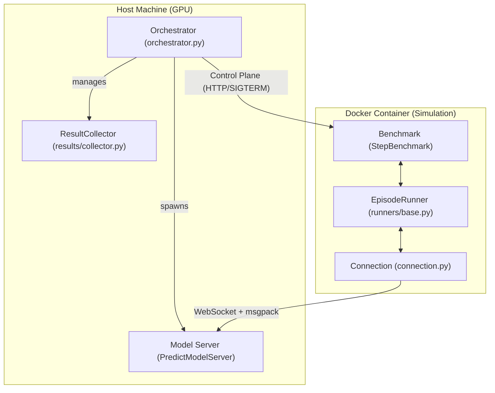
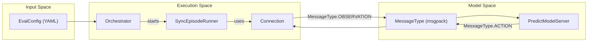

<!-- source: DeepWiki mcp.deepwiki.com · repo allenai/vla-evaluation-harness · page 1 Overview · fetched 2026-10-26 -->

# Overview

Relevant source files

The following files were used as context for generating this wiki page:

- [CLAUDE.md](CLAUDE.md)
- [CONTRIBUTING.md](CONTRIBUTING.md)
- [Makefile](Makefile)
- [README.md](README.md)
- [docs/architecture.md](docs/architecture.md)
- [docs/rfcs/0004-benchmark-and-episode-execution.md](docs/rfcs/0004-benchmark-and-episode-execution.md)
- [leaderboard/README.md](leaderboard/README.md)

The **vla-evaluation-harness** (`vla-eval`) is a unified evaluation framework designed to benchmark Vision-Language-Action (VLA) models across a diverse set of robot simulation environments. It addresses the fragmentation in robotic AI research by providing a standardized abstraction layer that decouples model implementations from simulation dependencies.

By utilizing a client-server architecture, the harness allows researchers to integrate a model once and evaluate it across 14+ benchmarks—including LIBERO, CALVIN, and SimplerEnv—without managing conflicting library requirements or manual setup scripts.

### Core Capabilities

*   **Zero-Setup Environments**: All benchmarks are containerized via Docker, ensuring exact reproducibility and eliminating "dependency hell" [README.md:38-39]().
*   **High-Throughput Evaluation**: Supports episode sharding and batched GPU inference, achieving up to 47× speedup over sequential evaluation [README.md:23-23]().
*   **Real-Time Testing**: Includes an `AsyncEpisodeRunner` that simulates "Sim2Live" conditions where the environment advances during model inference [docs/rfcs/0004-benchmark-and-episode-execution.md:72-74]().
*   **Unified Leaderboard**: Provides a central repository of 500+ model results across 17 benchmarks [README.md:26-26]().

---

### System Topology

The framework operates on a three-component topology: the **Orchestrator**, the **Benchmark Client**, and the **Model Server**. These components communicate over a WebSocket protocol using `msgpack` for efficient binary serialization of images and tensors.

#### Component Interaction Diagram
This diagram maps the high-level components to their respective implementation classes and files.

**Sources:** [docs/architecture.md:7-24](), [CLAUDE.md:40-47](), [docs/rfcs/0004-benchmark-and-episode-execution.md:98-111]()

---

### The Evaluation Pipeline

Evaluation is driven by a five-stage pipeline that ensures isolation between episodes and efficient resource utilization.

1.  **Orchestration**: The `Orchestrator` [src/vla_eval/orchestrator.py:1-5]() reads a `EvalConfig` [src/vla_eval/config.py:79-81](), launches the necessary Docker containers, and manages the lifecycle of the evaluation.
2.  **Benchmark Abstraction**: The `Benchmark` ABC [src/vla_eval/benchmarks/base.py:28-39]() provides a uniform interface for tasks, observations, and actions, regardless of the underlying simulator (e.g., MuJoCo, SAPIEN, or PyBullet).
3.  **Episode Execution**: The `EpisodeRunner` [src/vla_eval/runners/base.py:46-48]() handles the control loop. It can run in `Sync` mode (lock-step) or `Async` mode (wall-clock pacing).
4.  **Communication**: The `Connection` class [src/vla_eval/connection.py:78-80]() manages the WebSocket bridge, handling retries and binary encoding of `Observation` and `Action` types.
5.  **Inference**: The `ModelServer` [src/vla_eval/model_servers/base.py:110-113]() receives observations and returns actions. It often utilizes `BatchPredictModelServer` to process requests from multiple parallel benchmark shards simultaneously.

#### Pipeline Entity Map
This diagram associates natural language pipeline stages with specific code entities and data structures.

**Sources:** [docs/architecture.md:54-70](), [src/vla_eval/protocol/messages.py:1-20](), [docs/rfcs/0004-benchmark-and-episode-execution.md:124-135]()

---

### Navigation

For detailed technical information, please refer to the following sub-pages:

*   **[Getting Started](#1.1)**: Installation via `uv`, CLI commands (`run`, `serve`, `test`), and the zero-setup Docker workflow.
*   **[Design Philosophy](#1.2)**: The principles of freshness, convenience, and layered abstraction that guide the development of the harness.
*   **[Core Architecture](#2)**: Deep dive into the internal components, the communication protocol, and result collection.
*   **[Model Servers](#3)**: How to implement and deploy model servers using the `uv` script pattern.
*   **[Benchmark Integrations](#4)**: Details on the 14+ supported benchmarks and the Docker packaging system.
*   **[CLI and Execution Orchestration](#5)**: Advanced usage of the `vla-eval` command, including sharding and performance tuning.
*   **[Extending the Harness](#6)**: Step-by-step guides for adding new models or benchmarks using AI-assisted scaffolding.
*   **[Testing Infrastructure](#7)**: Overview of the unit, integration, and smoke testing suites.
*   **[Leaderboard](#8)**: The data pipeline and frontend architecture for the VLA comparison site.
*   **[Glossary](#9)**: Definitions of terms and code pointers for onboarding.

---

