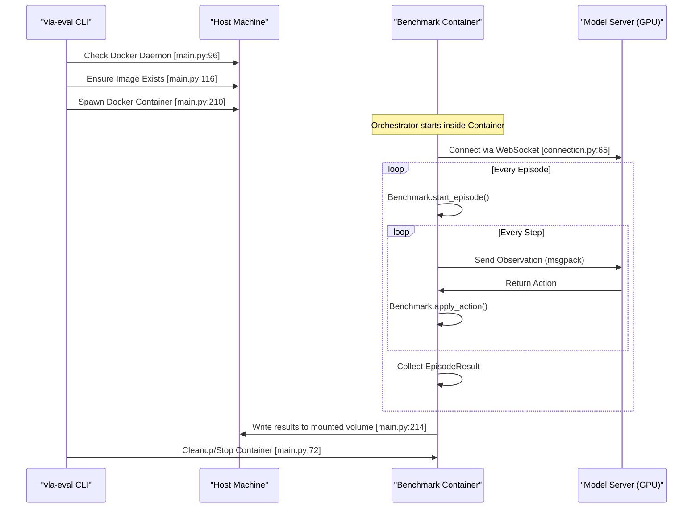
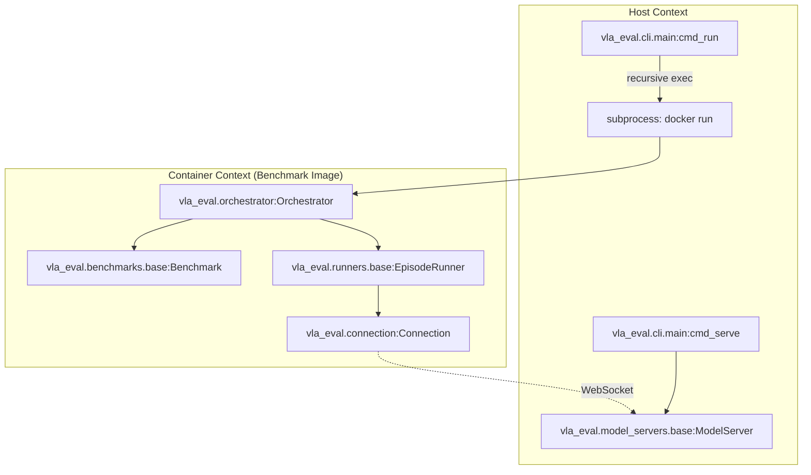

<!-- source: DeepWiki mcp.deepwiki.com · repo allenai/vla-evaluation-harness · page 1.1 Getting Started · fetched 2026-10-26 -->

# Getting Started

<details>
<summary>Relevant source files</summary>

The following files were used as context for generating this wiki page:

- [CLAUDE.md](CLAUDE.md)
- [Makefile](Makefile)
- [README.md](README.md)
- [leaderboard/README.md](leaderboard/README.md)
- [pyproject.toml](pyproject.toml)
- [src/vla_eval/cli/main.py](src/vla_eval/cli/main.py)
- [uv.lock](uv.lock)

</details>


The `vla-evaluation-harness` is a unified framework designed to evaluate Vision-Language-Action (VLA) models across a diverse set of robot simulation benchmarks. It solves the "dependency hell" of robotics evaluation by decoupling model dependencies from benchmark environments using a client-server architecture over WebSockets and Docker containerization.

## Installation

The project uses `uv` for fast, reproducible dependency management and supports PEP 723 inline script dependencies for model servers.

### Prerequisites
- **Python 3.8+** (3.11 recommended) [pyproject.toml:10-10]()
- **Docker**: Required for running benchmarks [src/vla_eval/cli/main.py:172-177]()
- **NVIDIA Container Toolkit**: Required if GPU acceleration is needed inside Docker containers (e.g., for rendering) [src/vla_eval/docker_resources.py:22-35]()

### Setup via uv
To install the harness and its development dependencies:

```bash
git clone https://github.com/allenai/vla-evaluation-harness.git
cd vla-evaluation-harness
uv sync --python 3.11 --all-extras --dev
```
Sources: [README.md:53-57](), [CLAUDE.md:15-15]()

### Pip Install
For users who only need the CLI and core library:
```bash
pip install vla-eval
```
Sources: [README.md:48-48]()

---

## Project Layout

The codebase is structured to separate the orchestration logic from specific model and benchmark implementations.

| Directory | Purpose | Key Entities |
|:---|:---|:---|
| `src/vla_eval/` | Core library source | `Orchestrator`, `Connection` |
| `src/vla_eval/cli/` | Command-line interface logic | `main.py` (entry point) |
| `src/vla_eval/benchmarks/` | Benchmark adapter ABCs and implementations | `Benchmark`, `StepBenchmark` |
| `src/vla_eval/model_servers/` | Model server ABCs and utilities | `PredictModelServer`, `BatchPredictModelServer` |
| `src/vla_eval/runners/` | Episode execution logic | `SyncEpisodeRunner`, `AsyncEpisodeRunner` |
| `configs/` | YAML configuration files | `EvalConfig`, `ServerConfig` |

Sources: [CLAUDE.md:40-47](), [pyproject.toml:33-34]()

---

## Key CLI Commands

The `vla-eval` command is the primary entry point for all operations.

### `vla-eval serve`
Starts a model server on the host machine. This process loads the weights and listens for WebSocket connections from benchmark clients.
```bash
vla-eval serve --config configs/model_servers/openvla.yaml
```
Sources: [README.md:67-67](), [src/vla_eval/cli/main.py:440-458]()

### `vla-eval run`
Executes an evaluation suite. By default, it detects if it should run the benchmark inside a Docker container.
```bash
vla-eval run --config configs/libero_smoke_test.yaml
```
- **Sharding**: Use `--shard-id` and `--num-shards` to split tasks across multiple GPUs/machines [src/vla_eval/cli/main.py:263-264]().
- **Dev Mode**: Use `--dev` to bind-mount the local `src/` directory into the Docker container for rapid iteration [src/vla_eval/cli/main.py:220-223]().

### `vla-eval merge`
Combines multiple shard result files into a single unified JSON report.
```bash
vla-eval merge results/libero_spatial/shard_*.json --output results/libero_spatial_final.json
```
Sources: [src/vla_eval/cli/main.py:488-510]()

### `vla-eval test`
Runs smoke tests to validate configurations, model server connectivity, or benchmark environment integrity.
```bash
vla-eval test --all  # Validates configs, servers, and benchmarks
```
Sources: [CLAUDE.md:27-33](), [src/vla_eval/cli/main.py:339-380]()

---

## Configuration File Structure

The harness relies on YAML configurations to define the evaluation parameters. These map to typed dataclasses in `vla_eval.config`.

### Evaluation Config (`EvalConfig`)
Defines the benchmark to run and the connection details for the model server.
```yaml
benchmark:
  name: "libero"
  suite: "libero_spatial"
  max_steps: 600
server:
  host: "localhost"
  port: 8000
docker:
  image: "ghcr.io/allenai/vla-eval-libero:latest"
output_dir: "./results"
```
Sources: [src/vla_eval/config.py:155-188](), [src/vla_eval/cli/main.py:181-186]()

---

## Zero-Setup Docker Workflow

The "Zero-Setup" philosophy ensures that users can run complex benchmarks like LIBERO or CALVIN without manually installing their often-conflicting simulation dependencies.

### System Topology and Data Flow

The following diagram illustrates how the `Orchestrator` manages the lifecycle between the host and the Docker container.

**Evaluation Execution Flow**

Sources: [src/vla_eval/cli/main.py:64-95](), [src/vla_eval/cli/main.py:161-240](), [src/vla_eval/orchestrator.py:44-95]()

### Code Entity Association

This diagram bridges the CLI commands to the underlying Python classes and execution contexts.

**CLI to Code Entity Mapping**

Sources: [src/vla_eval/cli/main.py:242-268](), [src/vla_eval/orchestrator.py:24-42](), [src/vla_eval/runners/sync_runner.py:15-30]()

### Key Implementation Details
1.  **Recursive Execution**: When `vla-eval run` is called on the host, it detects it is not in Docker [src/vla_eval/cli/main.py:45-47](), pulls the required image [src/vla_eval/cli/main.py:186](), and re-executes itself inside the container with the `--no-docker` flag [src/vla_eval/cli/main.py:228-230]().
2.  **Volume Mounting**: The host's results directory is mounted to `/workspace/results` inside the container so that JSON results persist after the container exits [src/vla_eval/cli/main.py:214]().
3.  **Signal Handling**: The CLI registers `atexit` and `signal` handlers to ensure that if the host process is killed, the Docker container is stopped gracefully, preventing "orphan" simulation processes [src/vla_eval/cli/main.py:64-95]().

Sources: [src/vla_eval/cli/main.py:64-240]()

---

