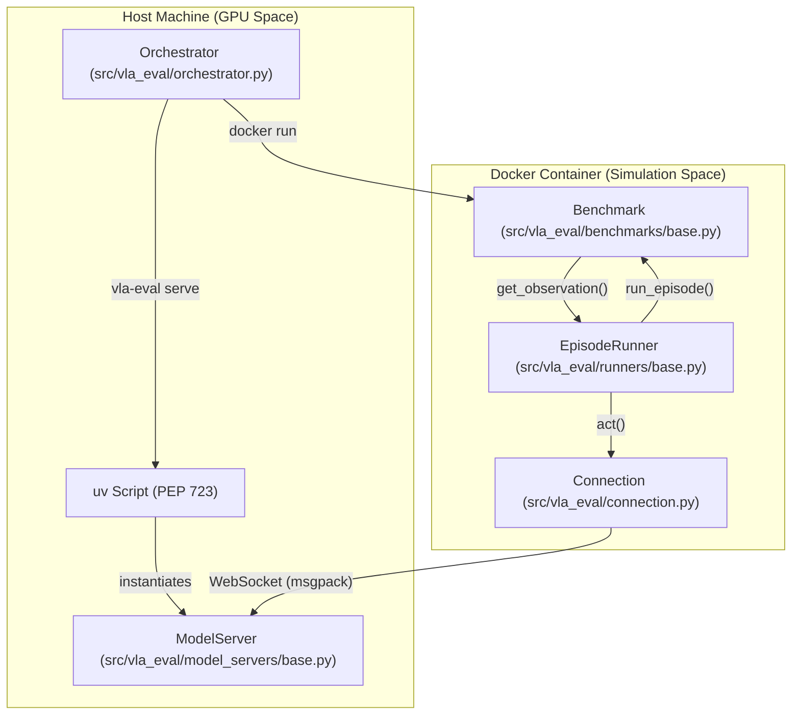
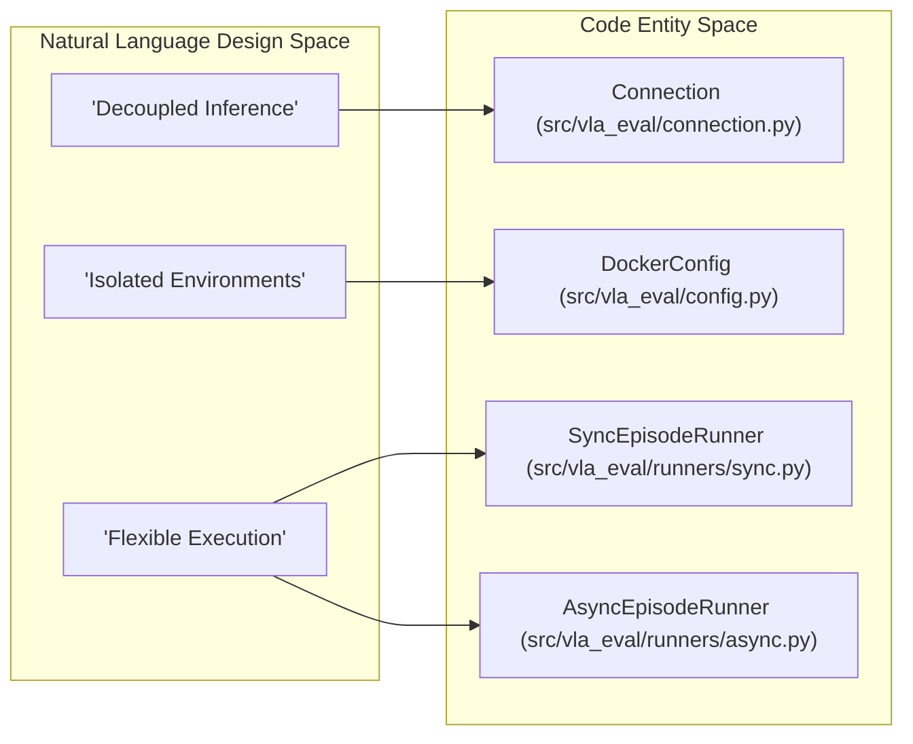

<!-- source: DeepWiki mcp.deepwiki.com · repo allenai/vla-evaluation-harness · page 1.2 Design Philosophy · fetched 2026-10-26 -->

# Design Philosophy

Relevant source files

The following files were used as context for generating this wiki page:

- [CONTRIBUTING.md](CONTRIBUTING.md)
- [README.md](README.md)
- [docs/architecture.md](docs/architecture.md)
- [docs/rfcs/0004-benchmark-and-episode-execution.md](docs/rfcs/0004-benchmark-and-episode-execution.md)
- [leaderboard/README.md](leaderboard/README.md)

The `vla-evaluation-harness` is built to solve the fragmentation and reproducibility crisis in Vision-Language-Action (VLA) model evaluation [README.md:30-34](). By decoupling the model's inference environment from the benchmark's simulation environment, the harness allows researchers to integrate a model once and evaluate it across a diverse matrix of benchmarks without manual setup or dependency conflicts [README.md:34-40]().

## 1. Guiding Principles

The architecture is governed by three core principles designed to maximize research velocity and result integrity.

### Freshness
The harness prioritizes "real-time" evaluation capabilities. Unlike traditional static evaluations where the environment waits for the model (Sync), the harness supports an `AsyncEpisodeRunner` [docs/rfcs/0004-benchmark-and-episode-execution.md:72-81]() that ties the simulation clock to wall-clock time. This ensures that models are tested under realistic conditions where the environment continues to advance during inference [README.md:32-33]().

### Convenience
Integration is designed to be "zero-setup." Benchmarks are packaged in **Docker** containers to eliminate "dependency hell" [README.md:38-39](). Model servers are implemented as standalone **uv scripts** [README.md:24-25]() using PEP 723 inline dependency metadata, allowing them to run with a single command without manual virtualenv management.

### Layered Abstraction
The system uses a five-component pipeline to separate concerns [docs/architecture.md:5-24]():
1.  **Orchestrator**: Manages the lifecycle of the evaluation [src/vla_eval/orchestrator.py:1-20]().
2.  **Benchmark**: Encapsulates environment-specific logic (e.g., LIBERO, CALVIN) [docs/rfcs/0004-benchmark-and-episode-execution.md:16-37]().
3.  **EpisodeRunner**: Defines the execution strategy (Sync vs. Async) [docs/rfcs/0004-benchmark-and-episode-execution.md:41-48]().
4.  **Connection**: Handles the WebSocket/msgpack wire protocol [docs/architecture.md:20-23]().
5.  **ModelServer**: Hosts the VLA model and provides inference [docs/architecture.md:107-113]().

**Sources:** [README.md:30-40](), [docs/rfcs/0004-benchmark-and-episode-execution.md:12-81](), [docs/architecture.md:5-24]()

---

## 2. Decoupling Rationale

The primary technical challenge in VLA evaluation is the conflict between simulation dependencies (e.g., MuJoCo, SAPIEN, various versions of `robosuite`) and model dependencies (e.g., specific PyTorch, CUDA, or Transformers versions).

### Docker for Benchmarks
By containerizing the `Benchmark` implementations [docs/rfcs/0004-benchmark-and-episode-execution.md:86-94](), the harness ensures that the complex system dependencies required for simulation do not leak into the host environment. The Orchestrator manages the container lifecycle, communicating with the internal benchmark logic via a control channel [docs/rfcs/0004-benchmark-and-episode-execution.md:97-111]().

### uv Scripts for Models
Model servers are treated as ephemeral services. Using `uv` scripts allows for "just-in-time" environment creation. This is critical for evaluating multiple models (e.g., OpenVLA vs. π₀) on the same machine without cross-contamination of Python site-packages [README.md:24-25]().

### Data Flow and System Decoupling
The following diagram illustrates how the `Orchestrator` bridges the gap between the isolated `Benchmark` (in Docker) and the `ModelServer` (on Host).

**VLA Evaluation Component Interaction**

**Sources:** [README.md:34-40](), [docs/rfcs/0004-benchmark-and-episode-execution.md:86-111](), [docs/architecture.md:37-47]()

---

## 3. RFC-Driven Design Process

The harness follows a formal **Request for Comments (RFC)** process to ensure architectural consistency. Major features, such as the transition to batched inference or the implementation of episode sharding, are documented as RFCs before implementation.

| RFC ID | Title | Purpose |
| :--- | :--- | :--- |
| **RFC-0004** | Benchmark and Episode Execution | Defined the `Benchmark` ABC and `EpisodeRunner` strategy [docs/rfcs/0004-benchmark-and-episode-execution.md:1-12](). |
| **RFC-0006** | Episode Sharding | Enabled environment parallelism by splitting tasks across processes [README.md:99-100](). |
| **RFC-0007** | Batch Predict Model Server | Implemented `BatchPredictModelServer` to aggregate inference requests [README.md:97-98](). |

### From Specification to Code
The design process ensures that high-level principles like "Layered Abstraction" are reflected in the class hierarchy. For instance, the distinction between a `Benchmark` (the "what") and an `EpisodeRunner` (the "how") allows for modular testing and reuse [docs/rfcs/0004-benchmark-and-episode-execution.md:14-15]().

**Entity Mapping: Specification to Implementation**

**Sources:** [docs/rfcs/0004-benchmark-and-episode-execution.md:1-15](), [README.md:97-100](), [docs/architecture.md:26-36]()

---

