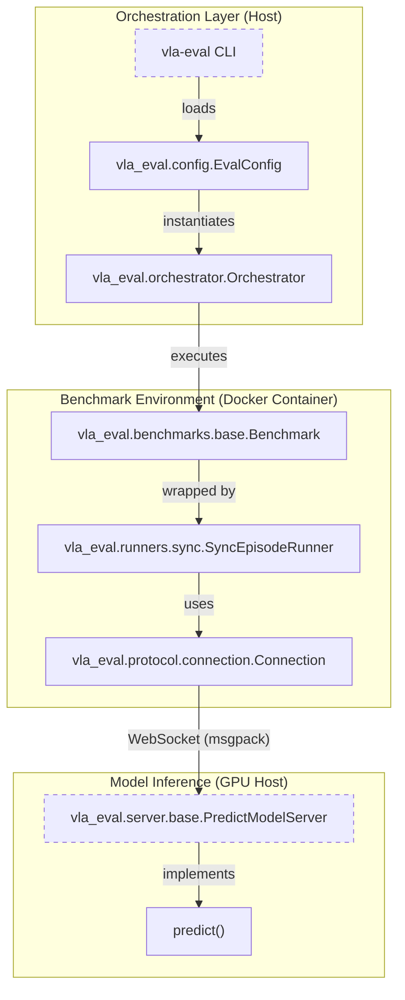
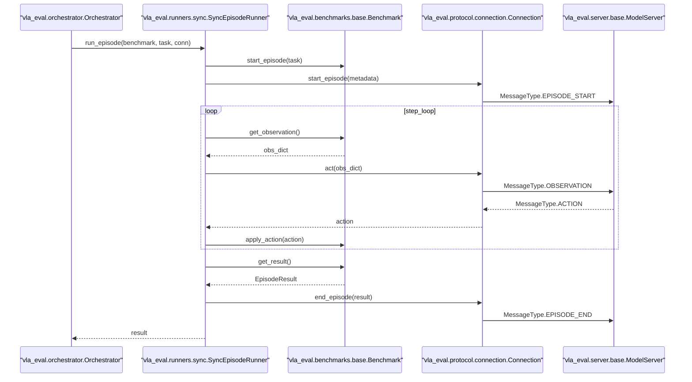

<!-- source: DeepWiki mcp.deepwiki.com · repo allenai/vla-evaluation-harness · page 2 Core Architecture · fetched 2026-10-26 -->

# Core Architecture

Relevant source files

The following files were used as context for generating this wiki page:

- [.dockerignore](.dockerignore)
- [README.md](README.md)
- [docker/rlbench_entrypoint.sh](docker/rlbench_entrypoint.sh)
- [docs/architecture.md](docs/architecture.md)
- [docs/rfcs/0004-benchmark-and-episode-execution.md](docs/rfcs/0004-benchmark-and-episode-execution.md)
- [leaderboard/README.md](leaderboard/README.md)
- [src/vla_eval/types.py](src/vla_eval/types.py)

The `vla-evaluation-harness` is designed to fully decouple robotic simulation environments from the VLA models being evaluated. This is achieved through a five-component pipeline that abstracts environment logic, execution strategies, and communication.

## Pipeline Overview

The evaluation flow follows a linear dependency chain where the **Orchestrator** manages the lifecycle of the other components. The architecture ensures that a single model integration can be tested against any benchmark integration without dependency conflicts.

### Component Roles

| Component | Responsibility | Primary Code Entity |
| :--- | :--- | :--- |
| **Orchestrator** | Parses configs, manages Docker containers, and iterates through episodes. | `vla_eval.orchestrator.Orchestrator` |
| **Benchmark** | Encapsulates environment-specific logic (reset, step, success criteria). | `vla_eval.benchmarks.base.Benchmark` |
| **EpisodeRunner** | Defines the execution loop (e.g., synchronous lock-step vs. real-time wall-clock). | `vla_eval.runners.base.EpisodeRunner` |
| **Connection** | Handles the WebSocket/msgpack wire protocol between client and server. | `vla_eval.protocol.connection.Connection` |
| **ModelServer** | Hosts the VLA model and provides an interface for inference. | `vla_eval.server.base.ModelServer` |

### System Topology

The following diagram illustrates how high-level system components map to specific code entities and their interactions.

**Architecture: Natural Language to Code Entity Mapping**

Sources: [docs/architecture.md:5-24](), [docs/rfcs/0004-benchmark-and-episode-execution.md:124-135](), [src/vla_eval/types.py:1-61]()

---

## 1. Orchestrator and Configuration
The **Orchestrator** is the central authority for an evaluation run. It is responsible for resolving import strings in the YAML configuration to actual Python classes, launching Docker containers for benchmarks, and managing the result collection lifecycle.

*   **Configuration**: Uses typed dataclasses (`EvalConfig`) to validate experiment parameters before execution.
*   **Isolation**: Automatically handles `docker run` and `docker stop` commands to ensure a clean environment for every benchmark suite.

For details, see [Orchestrator and Configuration](#2.1).

Sources: [docs/rfcs/0004-benchmark-and-episode-execution.md:124-135](), [docs/architecture.md:119-137]()

## 2. Communication Protocol
The harness uses a **WebSocket + msgpack** wire protocol to bridge the gap between the benchmark (often in a CPU-heavy Docker container) and the model (on a GPU-enabled host). 

*   **Serialization**: Custom codecs handle `numpy` arrays and compressed images (JPEG/PNG) efficiently.
*   **Schema**: A lightweight `Message` structure includes `type`, `payload`, `seq` (sequence number), and `timestamp`.

For details, see [Communication Protocol](#2.2).

Sources: [docs/architecture.md:72-96](), [src/vla_eval/types.py:11-44]()

## 3. Episode Runners
The **EpisodeRunner** determines *how* the `Benchmark` and `Connection` interact. This separation allows the same benchmark code to be used for different evaluation modes:

*   **SyncEpisodeRunner**: A standard lock-step loop where the environment waits for the model's action before proceeding to the next step.
*   **AsyncEpisodeRunner**: A real-time mode where the environment clock keeps ticking at a fixed frequency (Hz). If the model is slow, a "hold policy" (like repeating the last action) is applied.

For details, see [Episode Runners](#2.3).

Sources: [docs/rfcs/0004-benchmark-and-episode-execution.md:41-85](), [docs/architecture.md:51-70]()

## 4. Model Server
The **ModelServer** is the entry point for the VLA. It provides a standardized API (`on_observation`, `on_episode_start`) so that models from different frameworks (PyTorch, JAX, etc.) can be evaluated identically.

*   **Batching**: The `BatchPredictModelServer` can group requests from multiple parallel benchmark shards into a single GPU forward pass.
*   **Action Chunking**: Built-in support for models that predict multiple future timesteps, including temporal ensemble strategies.

For details, see [Model Servers](#3).

Sources: [docs/architecture.md:107-118](), [README.md:91-97]()

## 5. Results Collection and Merging
As episodes complete, the **ResultCollector** aggregates metrics (success rates, reward, episode length). Because evaluations are often sharded across multiple machines or GPUs, the harness provides utilities to merge these JSON shards into a single unified report.

For details, see [Results Collection and Merging](#2.4).

Sources: [docs/architecture.md:153-170](), [README.md:99-110]()

---

## Interaction Sequence

The following diagram shows the sequence of calls during a standard synchronous episode.

**Sequence: Episode Execution Flow**

Sources: [docs/architecture.md:51-70](), [docs/rfcs/0004-benchmark-and-episode-execution.md:55-70]()

---

