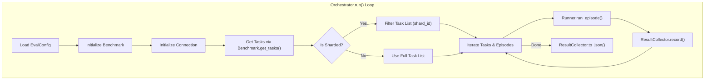
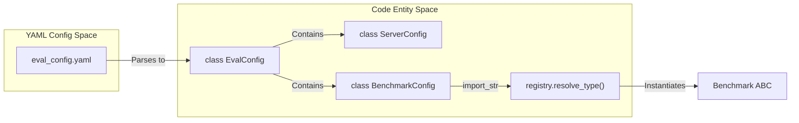
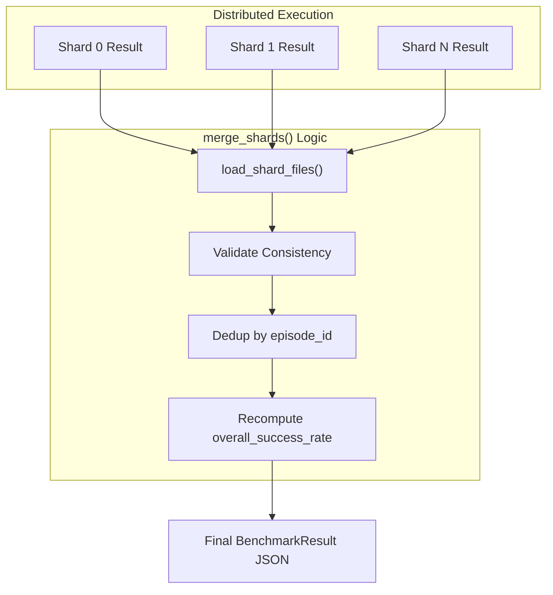

<!-- source: DeepWiki mcp.deepwiki.com · repo allenai/vla-evaluation-harness · page 2.1 Orchestrator and Configuration · fetched 2026-10-26 -->

# Orchestrator and Configuration

Relevant source files

The following files were used as context for generating this wiki page:

- [.dockerignore](.dockerignore)
- [docker/rlbench_entrypoint.sh](docker/rlbench_entrypoint.sh)
- [src/vla_eval/cli/main.py](src/vla_eval/cli/main.py)
- [src/vla_eval/results/collector.py](src/vla_eval/results/collector.py)
- [src/vla_eval/results/merge.py](src/vla_eval/results/merge.py)
- [src/vla_eval/types.py](src/vla_eval/types.py)

The Orchestrator and Configuration layer forms the backbone of the `vla-evaluation-harness`, responsible for managing the lifecycle of an evaluation run, ensuring reproducible execution via typed configurations, and providing robust error isolation across thousands of robotic simulation episodes.

## Orchestrator (`orchestrator.py`)

The `Orchestrator` class is the central execution engine. It coordinates the interaction between the `Benchmark` (environment), the `Connection` (model server bridge), and the `EpisodeRunner` (control loop).

### Key Responsibilities
*   **Episode Iteration:** Iterates through tasks and episodes, managing the setup and teardown of each trial [src/vla_eval/orchestrator.py:72-118]().
*   **Error Isolation:** Wraps individual episode executions in `try...except` blocks to ensure that a single environment crash or network timeout does not terminate the entire evaluation suite [src/vla_eval/orchestrator.py:126-140]().
*   **Sharding Support:** Filters the global task list based on `shard_id` and `num_shards` to allow parallel execution across multiple machines or GPUs [src/vla_eval/orchestrator.py:80-95]().
*   **Result Persistence:** Utilizes the `ResultCollector` to aggregate metrics and write them to unique JSON files [src/vla_eval/orchestrator.py:155-175]().

### Result File Naming Convention
To prevent overwriting data in distributed settings, the Orchestrator generates filenames based on the following logic:
*   **Standard:** `{benchmark}_{mode}_{timestamp}.json` [src/vla_eval/results/collector.py:46-47]().
*   **Sharded:** `{benchmark}_shard{id}of{total}.json` [src/vla_eval/results/collector.py:48-48]().

### Logic Flow: Orchestration Loop
The following diagram illustrates how the `Orchestrator` manages the flow from a YAML configuration to individual episode execution.

**Orchestrator Execution Flow**

**Sources:** [src/vla_eval/orchestrator.py:53-153](), [src/vla_eval/results/collector.py:41-95]()

---

## Configuration System (`config.py`)

The harness uses a hierarchical configuration system built on Python dataclasses. This ensures type safety and provides a clear schema for YAML configuration files.

### Core Dataclasses
*   **`EvalConfig`**: The root configuration object. It contains references to the benchmark, server, and runner settings [src/vla_eval/config.py:124-142]().
*   **`ServerConfig`**: Defines how to connect to the model server (host, port) and specifies the `import_str` for the server implementation [src/vla_eval/config.py:45-56]().
*   **`DockerConfig`**: Contains metadata for containerized execution, including the image name and resource constraints [src/vla_eval/config.py:18-32]().

### Registry and Import Resolution
The `registry.py` module handles the mapping between string identifiers in YAML and actual Python classes. This allows users to specify components like `vla_eval.benchmarks.libero.LiberoBenchmark` as simple strings [src/vla_eval/registry.py:10-35]().

**Configuration Entity Mapping**

**Sources:** [src/vla_eval/config.py:124-142](), [src/vla_eval/registry.py:10-25]()

---

## YAML Configuration Schema

Users interact with the system primarily through YAML files located in `configs/`. A typical configuration defines the environment, the model server location, and the execution mode.

### Example Schema Breakdown
| Key | Type | Description |
| :--- | :--- | :--- |
| `benchmark` | `dict` | Configuration for the benchmark (e.g., `import_str`, `suite`, `num_episodes`). |
| `server` | `dict` | Connection details (`host`, `port`) and server-side settings. |
| `runner` | `dict` | Controls the episode loop (`type: sync` or `async`). |
| `docker` | `dict` | Specifies the `image` used when running via `vla-eval run`. |

**Sources:** [src/vla_eval/config.py:144-180](), [src/vla_eval/cli/main.py:181-186]()

---

## Sharding and Merging

For large-scale evaluations, the harness supports horizontal scaling via sharding.

### Sharding Logic
The `Orchestrator` uses a deterministic filtering mechanism:
1.  Collect all task/episode pairs into a flat list.
2.  If `num_shards > 1`, keep only items where `index % num_shards == shard_id` [src/vla_eval/orchestrator.py:87-95]().

### Merging Shards (`merge.py`)
After sharded runs complete, the `vla-eval merge` command combines the partial JSON files.
*   **Consistency Check:** Validates that all shards belong to the same benchmark and share the same total shard count [src/vla_eval/results/merge.py:52-59]().
*   **Deduplication:** Uses `episode_id` to ensure no duplicate results exist; in case of collisions, the last file processed wins [src/vla_eval/results/merge.py:82-86]().
*   **Partial Detection:** If shards are missing, the final result is marked with `"partial": true` [src/vla_eval/results/merge.py:108-125]().

**Shard Merging Process**

**Sources:** [src/vla_eval/results/merge.py:43-127](), [src/vla_eval/orchestrator.py:80-95]()

---

