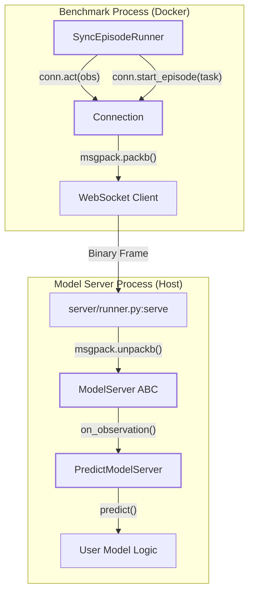
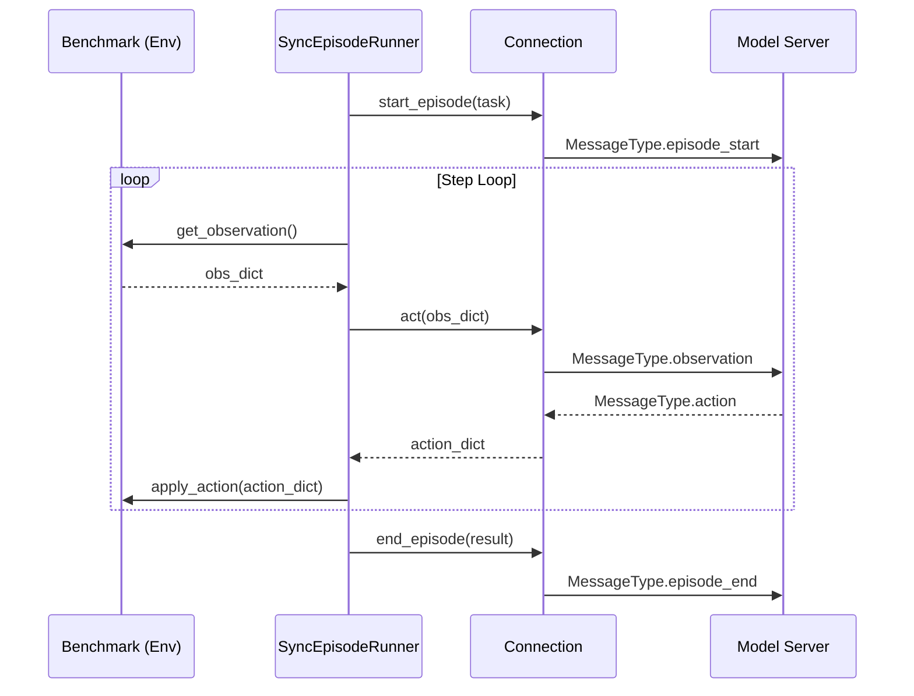

<!-- source: DeepWiki mcp.deepwiki.com · repo allenai/vla-evaluation-harness · page 2.2 Communication Protocol · fetched 2026-10-26 -->

# Communication Protocol

<details>
<summary>Relevant source files</summary>

The following files were used as context for generating this wiki page:

- [.dockerignore](.dockerignore)
- [docker/rlbench_entrypoint.sh](docker/rlbench_entrypoint.sh)
- [docs/architecture.md](docs/architecture.md)
- [docs/rfcs/0004-benchmark-and-episode-execution.md](docs/rfcs/0004-benchmark-and-episode-execution.md)
- [src/vla_eval/types.py](src/vla_eval/types.py)

</details>


The `vla-evaluation-harness` employs a high-performance, asynchronous wire protocol designed to decouple simulation environments (benchmarks) from model inference servers. This protocol ensures that heavy simulation dependencies (e.g., MuJoCo, SAPIEN) do not conflict with model dependencies (e.g., specific PyTorch or JAX versions) by communicating over a network socket using binary serialization.

## Wire Protocol Overview

The protocol is built on **WebSocket** for bidirectional communication and **msgpack** for efficient binary serialization [docs/architecture.md:72-74](). Every message exchanged between a benchmark client and a model server follows a strict schema to ensure reliability and sequence tracking.

### Message Schema

All messages are msgpack binary frames containing four top-level keys:

| Key | Type | Description |
| :--- | :--- | :--- |
| `type` | `str` | The message category (see MessageType enum). |
| `payload` | `dict` | The actual data (observation, action, etc.). Benchmarks define their own schema here. |
| `seq` | `int` | Monotonically increasing sequence number for ordering. |
| `timestamp` | `float` | Wall-clock Unix epoch of message creation. |

Sources: [docs/architecture.md:78-85]()

### MessageType Enum

The `type` field in the message envelope must be one of the following:

*   `observation`: Sent by the benchmark to the model server containing sensor data.
*   `action`: Sent by the model server to the benchmark containing control signals.
*   `episode_start`: Signals the beginning of a new task/episode.
*   `episode_end`: Signals the completion of an episode, often including final metrics.
*   `error`: Used to propagate exceptions across the wire.

Sources: [docs/architecture.md:79-80]()

## Codecs and Serialization

To handle high-dimensional robotic data efficiently, the protocol includes specialized codecs for NumPy arrays and images.

### NumPy Codec

NumPy arrays are encoded inline within the msgpack payload. To prevent security vulnerabilities, the deserializer explicitly rejects `Void`, `Object`, and `Complex` dtypes [docs/architecture.md:91-95]().

**Serialized Format:**
```python
{
    "__ndarray__": True, 
    "data": bytes, 
    "dtype": str, 
    "shape": tuple
}
```
Sources: [docs/architecture.md:91-95]()

### Image and Observation Conventions

While the framework imposes no fixed schema on the `payload` [docs/architecture.md:81](), all built-in benchmarks follow a standard convention for `Observation` and `Action` types [src/vla_eval/types.py:14-44]().

**Recommended Observation Structure:**
*   `images`: A dictionary mapping camera names (e.g., `"agentview"`, `"wrist"`) to `[H, W, C]` uint8 NumPy arrays [src/vla_eval/types.py:22-24]().
*   `state`: A NumPy array containing proprioceptive data (joint positions, gripper state) [src/vla_eval/types.py:26-27]().
*   `task_description`: A string containing the natural language instruction [src/vla_eval/types.py:24-25]().

Sources: [src/vla_eval/types.py:14-44](), [docs/architecture.md:99-106]()

## Connection Management

The `Connection` class serves as the client-side library for benchmarks to communicate with the model server [docs/architecture.md:30](). It handles the underlying WebSocket lifecycle, including reconnection and error propagation.

### Connection Lifecycle and Flow

The `Orchestrator` manages the high-level lifecycle of the connection, while the `EpisodeRunner` uses the `Connection` to drive the loop.

**Protocol Entity Mapping:**
The following diagram bridges the high-level communication concepts to the specific classes and methods implemented in the codebase.

Title: Communication Entity Mapping

Sources: [docs/architecture.md:14-24](), [docs/architecture.md:53-70](), [docs/architecture.md:109-117]()

### Reconnection and Health Logic

The `Orchestrator` coordinates the startup sequence to ensure the model server is reachable before the benchmark begins execution:

1.  **Container Start**: Launches the benchmark Docker image [docs/rfcs/0004-benchmark-and-episode-execution.md:128]().
2.  **Health Check**: Polls the `/healthz` endpoint of the benchmark container until it returns 200 OK (up to 120s) [docs/rfcs/0004-benchmark-and-episode-execution.md:129]().
3.  **WebSocket Connect**: Establishes the connection to the model server with **exponential backoff** (max 5 retries) [docs/rfcs/0004-benchmark-and-episode-execution.md:130]().

### Interaction Sequence (Sync Mode)

In synchronous evaluation, the `Connection` blocks until the model server returns an action, effectively coupling simulation time to inference latency.

Title: Synchronous Interaction Flow

Sources: [docs/architecture.md:53-70](), [docs/rfcs/0004-benchmark-and-episode-execution.md:54-70]()

## Implementation Details

### Environment Isolation

Benchmarks are isolated in Docker containers, while the model server typically runs on the host machine to facilitate direct GPU access for inference [docs/architecture.md:37-47](). Benchmark containers include the `vla-eval` connection library and expose port 8080 for the orchestrator control channel [docs/rfcs/0004-benchmark-and-episode-execution.md:91-92]().

### Error Handling

If the model server encounters an exception during `predict()`, it wraps the traceback in a `MessageType.error` message. The `Connection` client on the benchmark side receives this and raises a corresponding local exception, allowing the `Orchestrator` to catch the error, log it, and move to the next episode or task without crashing the entire evaluation suite [docs/rfcs/0004-benchmark-and-episode-execution.md:12]().

Sources: [docs/rfcs/0004-benchmark-and-episode-execution.md:86-111](), [docs/architecture.md:37-47]()

---

