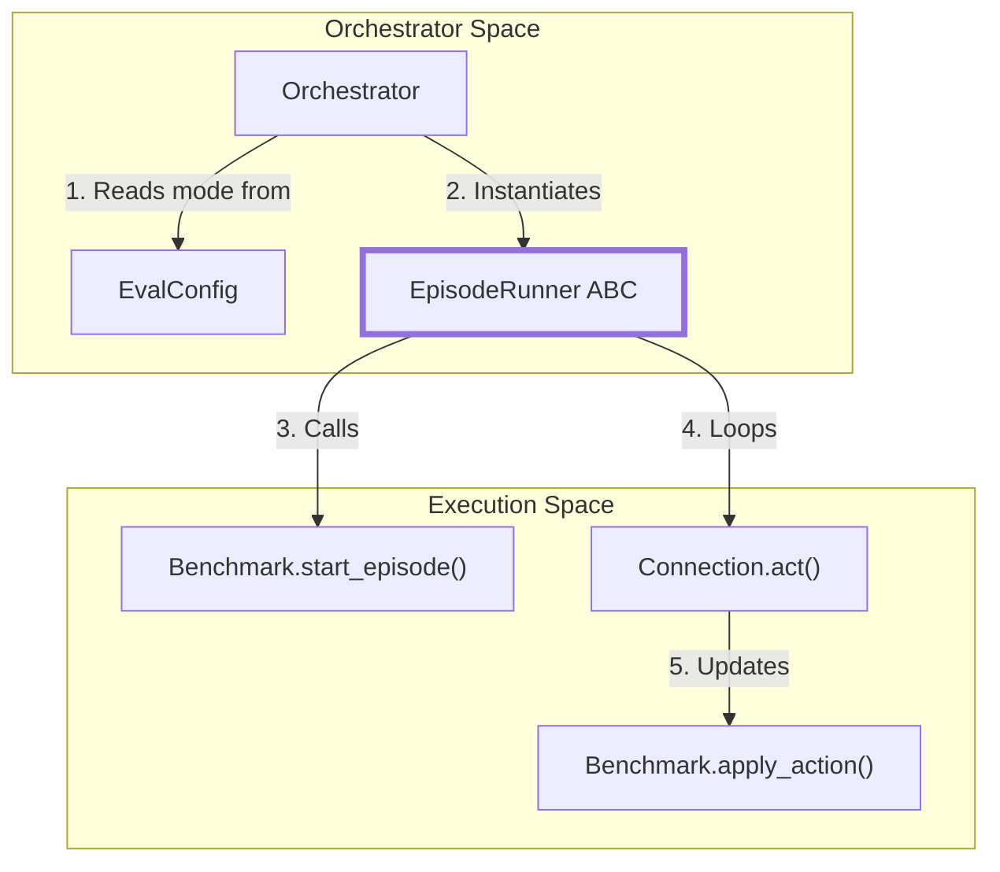
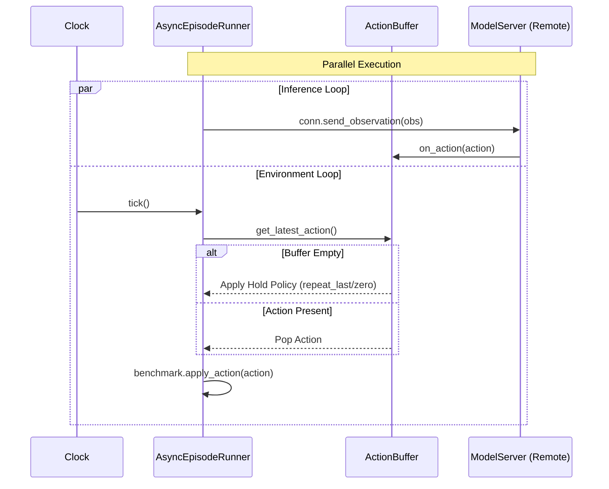

<!-- source: DeepWiki mcp.deepwiki.com · repo allenai/vla-evaluation-harness · page 2.3 Episode Runners · fetched 2026-10-26 -->

# Episode Runners

Relevant source files

The following files were used as context for generating this wiki page:

- [docs/architecture.md](docs/architecture.md)
- [docs/rfcs/0004-benchmark-and-episode-execution.md](docs/rfcs/0004-benchmark-and-episode-execution.md)
- [src/vla_eval/cli/main.py](src/vla_eval/cli/main.py)

Episode Runners define the execution strategy for an evaluation episode. They act as the "glue" between a `Benchmark` (the environment logic) and a `Connection` (the communication layer to the model server). By separating *what* the environment does from *how* the episode is stepped, the harness supports both traditional lock-step simulation and real-time wall-clock evaluation without modifying benchmark implementations [docs/rfcs/0004-benchmark-and-episode-execution.md:12-15]().

### The EpisodeRunner Hierarchy

All runners implement the `EpisodeRunner` abstract base class, which defines a single asynchronous entry point for executing a task [docs/rfcs/0004-benchmark-and-episode-execution.md:46-48]().

| Class | Mode | Pacing | Use Case |
| :--- | :--- | :--- | :--- |
| `SyncEpisodeRunner` | `sync` | Lock-step (wait for model) | Standard simulation benchmarks (LIBERO, CALVIN). |
| `AsyncEpisodeRunner` | `realtime` | Wall-clock (fixed HZ) | Sim-to-live testing, high-frequency control. |

#### Code Entity Map: Runner Orchestration
The following diagram shows how the `Orchestrator` selects and invokes an `EpisodeRunner` based on the `EvalConfig`.

Sources: [docs/rfcs/0004-benchmark-and-episode-execution.md:124-135](), [docs/architecture.md:54-70]()

---

### SyncEpisodeRunner
The `SyncEpisodeRunner` implements a blocking observation-action loop. The environment's "time" is coupled to the model's inference speed; the runner waits for the `Connection` to return an action before calling `benchmark.apply_action()` [docs/rfcs/0004-benchmark-and-episode-execution.md:55-70]().

**Data Flow:**
1.  **Initialization**: Calls `benchmark.start_episode(task)` and `conn.start_episode()`.
2.  **Observation**: Retrieves the initial observation via `benchmark.get_observation()`.
3.  **Inference**: Calls `await conn.act(obs)`, which blocks until the Model Server responds.
4.  **Step**: Applies the action to the benchmark.
5.  **Termination**: Repeats until `benchmark.is_done()` is true or `max_steps` is reached.

Sources: [docs/rfcs/0004-benchmark-and-episode-execution.md:55-70](), [docs/architecture.md:51-70]()

---

### AsyncEpisodeRunner
The `AsyncEpisodeRunner` decouples environment stepping from model inference to simulate real-time performance. It uses a `Clock` to maintain a fixed frequency (e.g., 10Hz or 20Hz) regardless of how long the model takes to compute an action [docs/rfcs/0004-benchmark-and-episode-execution.md:72-81]().

#### Real-time Pacing with Clock
The runner uses an internal `Clock` (typically `asyncio.sleep(1/hz)`) to ensure that `benchmark.apply_action()` is called at precise intervals. If the model server has not returned a new action by the time the next tick occurs, the runner consults an **Action Buffer** [docs/rfcs/0004-benchmark-and-episode-execution.md:76-80]().

#### ActionBuffer and Hold Policies
The `ActionBuffer` manages the queue of incoming actions from the model. Because network latency and inference time vary, the runner must decide what to do when the buffer is empty at a clock tick. This is governed by a **Hold Policy**:

*   **`repeat_last`**: The default policy. If no new action is available, the runner re-applies the most recent action received from the model [docs/rfcs/0004-benchmark-and-episode-execution.md:79-80]().
*   **`zero`**: Applies a "zero" action (usually meaning no movement or delta) to the environment [docs/rfcs/0004-benchmark-and-episode-execution.md:79-80]().
*   **Custom Callable**: Users can provide a custom function to determine the fallback behavior.

#### Code Entity Map: Async Logic
This diagram associates the conceptual "Real-time Loop" with the specific classes and methods that implement the asynchronous behavior.

Sources: [docs/rfcs/0004-benchmark-and-episode-execution.md:72-81](), [docs/architecture.md:110-117]()

---

### Implementation Details

#### Task and Metadata Resolution
Runners do not hardcode limits like `max_steps`. Instead, they resolve these values dynamically:
1.  **Config Override**: If `max_steps` is provided in the YAML `benchmarks` section, it is used [docs/rfcs/0004-benchmark-and-episode-execution.md:142-152]().
2.  **Benchmark Metadata**: If not in config, the runner calls `benchmark.get_metadata()` to retrieve the benchmark's native step limit [docs/rfcs/0004-benchmark-and-episode-execution.md:35-39]().

#### Result Aggregation
At the end of an episode, the runner calls `benchmark.get_result()` to obtain an `EpisodeResult` object. This result is then passed back to the `Orchestrator`, which routes it to the `ResultCollector` for JSON serialization [docs/rfcs/0004-benchmark-and-episode-execution.md:67-69](), [docs/architecture.md:153-164]().

Sources: [docs/rfcs/0004-benchmark-and-episode-execution.md:35-39](), [docs/rfcs/0004-benchmark-and-episode-execution.md:142-152](), [docs/architecture.md:153-164]()

---

