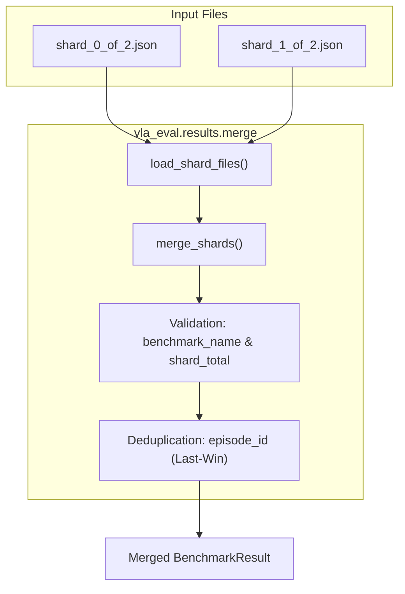

<!-- source: DeepWiki mcp.deepwiki.com · repo allenai/vla-evaluation-harness · page 2.4 Results Collection and Merging · fetched 2026-10-26 -->

# Results Collection and Merging

<details>
<summary>Relevant source files</summary>

The following files were used as context for generating this wiki page:

- [src/vla_eval/cli/main.py](src/vla_eval/cli/main.py)
- [src/vla_eval/results/collector.py](src/vla_eval/results/collector.py)
- [src/vla_eval/results/merge.py](src/vla_eval/results/merge.py)

</details>


The `vla-evaluation-harness` employs a structured hierarchy for aggregating simulation outcomes, transitioning from individual step data to comprehensive benchmark summaries. This system supports both monolithic execution and distributed sharding, with robust logic for merging partial results and handling duplicates.

## ResultCollector Hierarchy

The `ResultCollector` class [src/vla_eval/results/collector.py:41-51]() manages the aggregation of results across three primary layers of abstraction: **Episode**, **Task**, and **Benchmark**.

### Data Structures
The hierarchy is implemented using `TypedDict` definitions to ensure schema consistency across the pipeline:

| Level | Entity | Description |
| :--- | :--- | :--- |
| **Episode** | `EpisodeResult` | The smallest unit of measurement, containing success status, step count, and timing for a single rollout [src/vla_eval/results/collector.py:15-23](). |
| **Task** | `TaskResult` | A collection of `EpisodeResult` objects for a specific task (e.g., "pick_up_cube"), including calculated success rates and average steps [src/vla_eval/results/collector.py:25-30](). |
| **Benchmark** | `BenchmarkResult` | The top-level summary containing all `TaskResult` objects, an overall success rate, and a snapshot of the `EvalConfig` used [src/vla_eval/results/collector.py:32-39](). |

### Logical Flow
1. **Record**: As episodes complete, the `Orchestrator` calls `record()` [src/vla_eval/results/collector.py:58-65]().
2. **Normalize**: The collector ensures data types (like numpy booleans) are converted to standard Python types for JSON serialization [src/vla_eval/results/collector.py:61-62]().
3. **Aggregate**: When requested via `get_benchmark_result()`, the collector iterates through all recorded tasks to compute global metrics [src/vla_eval/results/collector.py:80-95]().

### Result Hierarchy Mapping
The following diagram illustrates how code entities map to the logical results hierarchy.

"Results Data Flow"
```mermaid
graph TD
    subgraph "Natural Language Space"
        "Individual Rollout"
        "Task Performance"
        "Full Evaluation"
    end

    subgraph "Code Entity Space"
        ER["EpisodeResult (TypedDict)"]
        TR["TaskResult (TypedDict)"]
        BR["BenchmarkResult (TypedDict)"]
        RC["ResultCollector (Class)"]
    end

    "Individual Rollout" --- ER
    "Task Performance" --- TR
    "Full Evaluation" --- BR

    RC -- "record()" --> ER
    ER -- "aggregated into" --> TR
    TR -- "aggregated into" --> BR
    RC -- "get_benchmark_result()" --> BR
```
Sources: [src/vla_eval/results/collector.py:15-51](), [src/vla_eval/results/collector.py:58-95]()

## File Naming and Persistence

The `Orchestrator` handles the naming and writing of result files to the `output_dir` [src/vla_eval/results/collector.py:46-49]().

*   **Non-sharded runs**: Files are named using the pattern `{name}_{mode}_{timestamp}.json`.
*   **Sharded runs**: When using `--shard-id`, files follow the pattern `{name}_shard{id}of{total}.json`.

The final output is a JSON string generated by `ResultCollector.to_json()`, which includes the `harness_version` and the full `config` dict to ensure reproducibility [src/vla_eval/results/collector.py:118-120]().

Sources: [src/vla_eval/results/collector.py:46-51](), [src/vla_eval/results/collector.py:118-120]()

## Shard Merging Logic

When evaluations are split across multiple nodes or GPUs using the `--num-shards` flag, the `vla-eval merge` command (backed by `merge.py`) is used to combine the resulting shard files.

### The `merge_shards` Process
The `merge_shards` function [src/vla_eval/results/merge.py:43-127]() performs several validation and reconciliation steps:

1.  **Consistency Check**: Validates that all shards belong to the same benchmark and share the same `shard.total` value [src/vla_eval/results/merge.py:51-58]().
2.  **Missing Shard Detection**: Identifies which shard IDs (0 to `total-1`) are missing from the input set [src/vla_eval/results/merge.py:61-63]().
3.  **Duplicate Handling**: If the same `episode_id` appears in multiple shards, the **last file processed wins** (overwrites the previous entry), and a warning is logged [src/vla_eval/results/merge.py:82-86]().
4.  **Metric Recomputation**: Success rates and average steps are re-calculated from the complete set of unique episodes [src/vla_eval/results/merge.py:89-106]().
5.  **Partial Flagging**: If any shards are missing, the resulting JSON is marked with `"partial": true` [src/vla_eval/results/merge.py:108-125]().

### Merge Execution Architecture
"Merge Logic and Validation"

Sources: [src/vla_eval/results/merge.py:32-40](), [src/vla_eval/results/merge.py:43-127]()

## CLI Usage: `vla-eval merge`

The `merge` command provides a human-readable report via `print_merge_report` [src/vla_eval/results/merge.py:130-168](). This report highlights:
*   Total episodes collected across all shards.
*   Specific IDs of missing shards.
*   A command suggestion to complete the missing shards (e.g., `vla-eval run ... --shard-id X`) [src/vla_eval/results/merge.py:147-150]().

### Summary Table Generation
The `ResultCollector` and `merge` logic both utilize the `rich` library to print formatted tables to the console, showing per-task success rates and an overall benchmark score [src/vla_eval/results/collector.py:97-116](), [src/vla_eval/results/merge.py:156-167]().

Sources: [src/vla_eval/results/merge.py:130-168](), [src/vla_eval/results/collector.py:97-116]()

---

