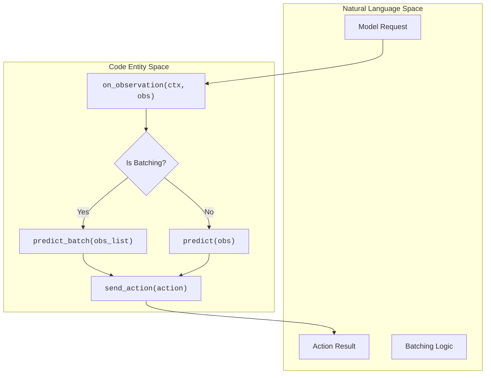
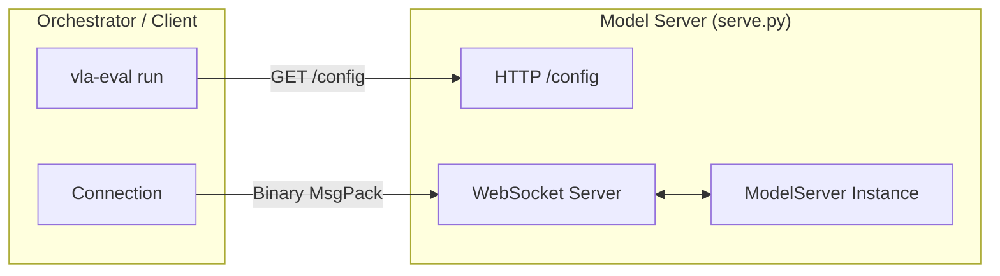

<!-- source: DeepWiki mcp.deepwiki.com · repo allenai/vla-evaluation-harness · page 3.1 Model Server API · fetched 2026-10-26 -->

# Model Server API

Relevant source files

The following files were used as context for generating this wiki page:

- [configs/model_servers/starvla_groot_simpler.yaml](configs/model_servers/starvla_groot_simpler.yaml)
- [src/vla_eval/cli/smoke.py](src/vla_eval/cli/smoke.py)
- [src/vla_eval/model_servers/starvla.py](src/vla_eval/model_servers/starvla.py)

The Model Server API provides a standardized interface for wrapping Vision-Language-Action (VLA) models as remote inference services. It decouples the heavy model dependencies (often requiring specific CUDA versions or Python packages) from the benchmark environments. The API supports both simple request-response interaction and high-performance batched inference.

### Sources:
- [src/vla_eval/model_servers/base.py:1-10]()
- [src/vla_eval/model_servers/predict.py:1-15]()

---

## ModelServer ABC

The `ModelServer` abstract base class defines the lifecycle of a model during an evaluation session. It is designed to handle stateful interactions where a model might need to reset internal memory or history between episodes.

| Method | Description |
| :--- | :--- |
| `on_episode_start(ctx)` | Called when a new episode begins. Used to reset RNN states or KV caches. |
| `on_observation(ctx, obs)` | The primary entry point. Receives a `Observation` and must return an `Action`. |
| `on_episode_end(ctx)` | Called when an episode terminates (success, failure, or timeout). |

### SessionContext
Every method in the `ModelServer` receives a `SessionContext` object [src/vla_eval/model_servers/base.py:25-35](). This object provides metadata about the current execution:
- `session_id`: Unique ID for the connection.
- `episode_id`: Unique ID for the current trajectory.
- `step`: The current timestep index within the episode.
- `is_first`: Boolean indicating if this is the first observation of the episode.
- `send_action(action)`: A callback used by the server to return the computed action to the client.

### Sources:
- [src/vla_eval/model_servers/base.py:25-70]()

---

## PredictModelServer

`PredictModelServer` is a specialized subclass of `ModelServer` that simplifies the implementation for most VLA models. Instead of managing the `SessionContext` and manual action sending, developers implement a simplified `predict` or `predict_batch` method.

### Dispatch Logic
The class automatically dispatches incoming observations based on the server's configuration:
1. **Single Inference**: If `predict` is implemented, it processes one observation at a time.
2. **Batch Inference**: If `predict_batch` is implemented and the server is configured for batching, it aggregates requests from multiple concurrent episodes into a single forward pass.

### Implementation Pattern
A typical implementation like `StarVLAModelServer` [src/vla_eval/model_servers/starvla.py:57-62]() inherits from `PredictModelServer` and defines the model loading and inference logic.

**Natural Language Space to Code Entity Space: PredictModelServer**

### Sources:
- [src/vla_eval/model_servers/predict.py:18-60]()
- [src/vla_eval/model_servers/starvla.py:57-104]()

---

## WebSocket Runner and Control Plane

The `serve` and `serve_async` functions act as the execution engine for a `ModelServer`. They wrap the model in a WebSocket server for high-throughput data transfer and an HTTP control plane for configuration.

### WebSocket Communication
The server uses a binary protocol (msgpack + numpy/image codecs) to communicate with `Connection` clients. 
- **Inbound**: Messages of type `OBSERVATION`, `EPISODE_START`, or `EPISODE_END`.
- **Outbound**: Messages of type `ACTION`.

### HTTP Control Plane
The server exposes a `/config` endpoint. This allows the Orchestrator to verify that the remote model server is running the expected configuration (e.g., correct checkpoint, unnormalization keys, or action chunk size) before starting a benchmark run [src/vla_eval/model_servers/serve.py:40-55]().

### Server Lifecycle
1. **Initialization**: The server starts and calls `_load_model()` (if implemented) to move weights to GPU.
2. **Listening**: It opens a WebSocket port (default `8000`).
3. **Session Management**: For every new connection, it creates a `SessionContext`.
4. **Cleanup**: On SIGTERM or keyboard interrupt, it shuts down gracefully, ensuring all pending actions are flushed.

**System Architecture: Server Runner**

### Sources:
- [src/vla_eval/model_servers/serve.py:15-120]()
- [src/vla_eval/cli/smoke.py:102-115]()
- [configs/model_servers/starvla_groot_simpler.yaml:5-12]()

---

