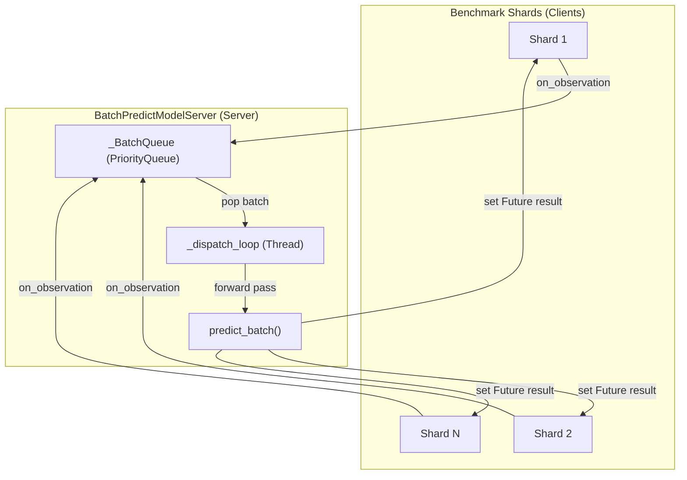
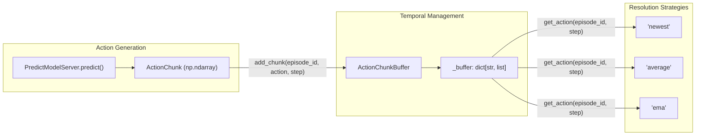

<!-- source: DeepWiki mcp.deepwiki.com · repo allenai/vla-evaluation-harness · page 3.2 Batching and Action Chunking · fetched 2026-10-26 -->

# Batching and Action Chunking

Relevant source files

The following files were used as context for generating this wiki page:

- [README.md](README.md)
- [configs/model_servers/starvla_groot_simpler.yaml](configs/model_servers/starvla_groot_simpler.yaml)
- [leaderboard/README.md](leaderboard/README.md)
- [src/vla_eval/model_servers/starvla.py](src/vla_eval/model_servers/starvla.py)

This page details the internal mechanisms of the `BatchPredictModelServer` and the `ActionChunkBuffer`. These components are responsible for maximizing GPU throughput via request batching and managing multi-step model outputs through temporal ensembling.

## BatchPredictModelServer Internals

The `BatchPredictModelServer` (defined in `[src/vla_eval/model_servers/predict.py:84-210]()`) extends the base model server to support high-throughput evaluation. It decouples the incoming WebSocket request stream from the model inference loop using an internal queue and a dedicated dispatch thread.

### The Dispatch Loop and Queueing

When an observation arrives via `on_observation`, it is not processed immediately. Instead, it is wrapped in a `_BatchItem` and placed into a `_BatchQueue`.

1.  **`on_observation`**: Captures the `Observation` and `SessionContext`, creates a `Future` for the result, and pushes it to the queue `[src/vla_eval/model_servers/predict.py:145-159]()`.
2.  **`_dispatch_loop`**: A background thread that continuously monitors the queue. It waits until either `max_batch_size` items are collected or `max_wait_time` (seconds) has elapsed since the first item arrived `[src/vla_eval/model_servers/predict.py:168-210]()`.
3.  **`predict_batch`**: Once a batch is formed, the server calls the subclass-implemented `predict_batch()` method. The resulting actions are then used to set the results of the awaiting `Futures` `[src/vla_eval/model_servers/predict.py:199-206]()`.

### Data Flow: Request to Batched Inference

The following diagram illustrates how multiple benchmark clients (shards) have their individual requests coalesced into a single GPU forward pass.

**Model Server Batching Architecture**

**Sources:** `[src/vla_eval/model_servers/predict.py:84-210]()`

---

## Action Chunking and Ensembling

Many modern VLA models (e.g., π₀, OpenVLA, StarVLA) do not predict a single action; they predict a "chunk" of future actions (e.g., the next 8 or 16 steps). The `ActionChunkBuffer` (defined in `[src/vla_eval/model_servers/predict.py:11-81]()`) manages these temporal sequences.

### ActionChunkBuffer Implementation

The buffer maintains a mapping of `episode_id` to a list of predicted action chunks. When the orchestrator requests an action for a specific timestep, the buffer aggregates all overlapping chunks that cover that timestep.

Key parameters in `PredictModelServer` that control this behavior:
*   `chunk_size`: The number of steps the model predicts per forward pass `[src/vla_eval/model_servers/predict.py:218-219]()`.
*   `action_ensemble`: The strategy used to blend overlapping predictions `[src/vla_eval/model_servers/predict.py:221-222]()`.

### Blending Strategies

The `ActionChunkBuffer.get_action` method implements three primary strategies for resolving multiple predictions for the same timestep `[src/vla_eval/model_servers/predict.py:44-77]()`:

| Strategy | Logic | Use Case |
| :--- | :--- | :--- |
| `newest` | Returns the action from the most recently received chunk. | Models with high temporal drift where the latest info is best. |
| `average` | Computes the arithmetic mean of all available predictions for that step. | Reducing variance in stochastic models (e.g., Diffusion Policy). |
| `ema` | Applies an Exponential Moving Average across overlapping predictions. | Smoothing trajectories for jittery action heads. |

**Code to Logic Mapping**

**Sources:** `[src/vla_eval/model_servers/predict.py:11-81]()`, `[src/vla_eval/model_servers/predict.py:213-288]()`

---

## Integration in Model Implementations

Model servers like `StarVLAModelServer` leverage these features by setting class attributes. For example, a StarVLA variant might predict chunks of size 1 but allow for ensemble strategies if configured.

In `[src/vla_eval/model_servers/starvla.py:57-61]()`, the server defines:
*   `chunk_size = 1`
*   `action_ensemble = "newest"`

While in the configuration file `[configs/model_servers/starvla_groot_simpler.yaml:10]()`, these can be overridden to tune the execution behavior without changing the model code itself.

**Sources:** `[src/vla_eval/model_servers/starvla.py:57-61]()`, `[configs/model_servers/starvla_groot_simpler.yaml:1-13]()`

---

