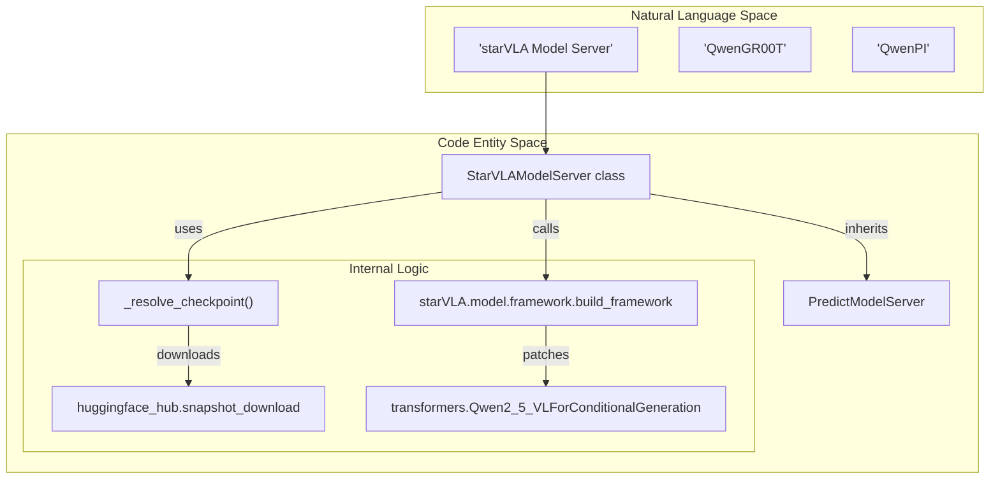
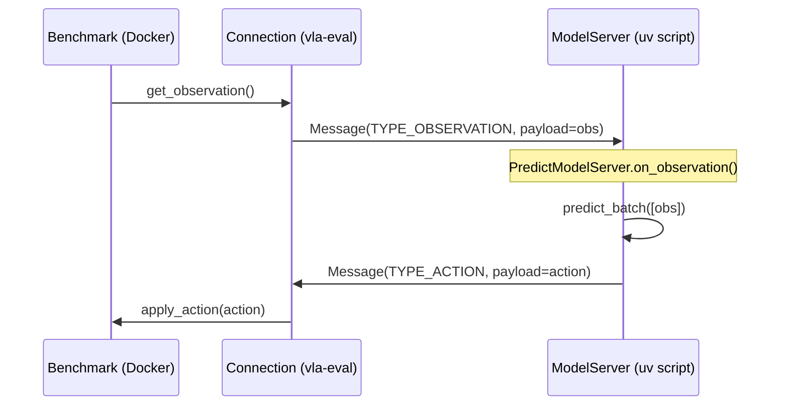

<!-- source: DeepWiki mcp.deepwiki.com · repo allenai/vla-evaluation-harness · page 3.3 Built-in Model Server Implementations · fetched 2026-10-26 -->

# Built-in Model Server Implementations

<details>
<summary>Relevant source files</summary>

The following files were used as context for generating this wiki page:

- [README.md](README.md)
- [configs/model_servers/starvla_groot_simpler.yaml](configs/model_servers/starvla_groot_simpler.yaml)
- [leaderboard/README.md](leaderboard/README.md)
- [src/vla_eval/cli/smoke.py](src/vla_eval/cli/smoke.py)
- [src/vla_eval/model_servers/starvla.py](src/vla_eval/model_servers/starvla.py)

</details>


The `vla-evaluation-harness` includes a catalog of pre-integrated Vision-Language-Action (VLA) models. These implementations are designed for high-throughput evaluation, supporting both sequential and batched inference. Each model server is encapsulated as a standalone **uv script** utilizing PEP 723 inline dependency metadata, ensuring that complex, often conflicting model dependencies (e.g., specific versions of `transformers`, `torch`, or custom CUDA kernels) are isolated from the benchmark environments.

## Overview of Model Servers

Model servers in the harness follow a standardized structure defined by the `PredictModelServer` base class. They are typically invoked via the `vla-eval serve` command, which resolves the `script` path provided in a YAML configuration and executes it using `uv run`.

### Supported Models and Configs
The following table lists the built-in model servers and their corresponding configuration files located in `configs/model_servers/`.

| Model Name | Config File | Implementation Script | Key Features |
| :--- | :--- | :--- | :--- |
| **OpenVLA** | `openvla.yaml` | `openvla.py` | Prismatic-VLM based, discrete action tokens. |
| **π₀ (pi0)** | `pi0_libero.yaml` | `pi0.py` | Flow-matching DiT, continuous actions. |
| **CogACT** | `cogact.yaml` | `cogact.py` | Contrastive action learning. |
| **GR00T** | `groot.yaml` | `groot.py` | GR00T N1.6 official implementation. |
| **OFT** | `oft_libero.yaml` | `oft.py` | One-stage Flow-matching Transformer. |
| **X-VLA** | `xvla_libero.yaml` | `xvla.py` | Cross-modal VLA. |
| **RTC** | `rtc_kinetix.yaml` | `rtc.py` | Real-time control optimized. |
| **starVLA** | `starvla_groot_simpler.yaml` | `starvla.py` | Supports QwenGR00T, QwenOFT, QwenPI, QwenFast. |
| **DexBotic** | `dexbotic_cogact_libero.yaml` | `cogact.py` | DexBotic variants of CogACT. |

Sources: [README.md:12-15](), [src/vla_eval/cli/smoke.py:102-115]()

---

## Implementation Structure: The uv Script Pattern

All built-in model servers utilize the **PEP 723 script tag** to define their environment. This allows the `vla-eval` CLI to automatically provision the correct environment without user intervention.

### Anatomy of a Model Server Script
Taking `starvla.py` as an example, the script contains:
1.  **Metadata Block**: Defines Python version and PyPI dependencies.
2.  **Tool Sources**: Points to specific git revisions or local paths (e.g., `starvla` git repo).
3.  **Server Class**: Subclasses `PredictModelServer` and implements `predict` or `predict_batch`.
4.  **Entry Point**: A `main` block that calls `serve()` or `serve_async()`.

### StarVLA Implementation Example
The `StarVLAModelServer` demonstrates how the harness handles complex multi-framework models. It supports four different architectures (GR00T, OFT, π₀, and Fast) within a single script by auto-detecting the framework from the checkpoint config.


Sources: [src/vla_eval/model_servers/starvla.py:1-37](), [src/vla_eval/model_servers/starvla.py:57-60](), [src/vla_eval/model_servers/starvla.py:104-136]()

---

## Configuration Reference

Model servers are configured via YAML files. These files bridge the CLI to the specific implementation script and its constructor arguments.

### Common YAML Fields
| Field | Description |
| :--- | :--- |
| `script` | Path to the `.py` model server script. |
| `args` | Dictionary passed as keyword arguments to the server class `__init__`. |
| `args.checkpoint` | Local path or HuggingFace ID for model weights. |
| `args.port` | Port for the WebSocket server (default: 8000). |
| `args.chunk_size` | Number of actions to predict per inference step. |

**Example: `configs/model_servers/starvla_groot_simpler.yaml`**
```yaml
script: "src/vla_eval/model_servers/starvla.py"
args:
  checkpoint: StarVLA/Qwen-GR00T-Bridge-RT-1
  unnorm_key: oxe_bridge
  use_bf16: true
  chunk_size: 1
  port: 8000
```
Sources: [configs/model_servers/starvla_groot_simpler.yaml:1-12](), [src/vla_eval/cli/smoke.py:124-130]()

---

## Data Flow: From Observation to Action

The model server sits at the end of the evaluation pipeline. It receives `Observation` objects via WebSockets and returns `Action` objects.



### Key Functions and Classes
- **`PredictModelServer`**: The primary entry point for built-in models. It manages the dispatch of single observations to the underlying model. [src/vla_eval/model_servers/starvla.py:57-60]()
- **`_resolve_checkpoint`**: A utility frequently used in built-in scripts to handle HuggingFace Hub downloads and local path resolution. [src/vla_eval/model_servers/starvla.py:70-102]()
- **`serve`**: The runner function that starts the WebSocket server and hooks into the `ModelServer` lifecycle methods. [src/vla_eval/model_servers/starvla.py:52]()

Sources: [src/vla_eval/model_servers/starvla.py:48-52](), [src/vla_eval/cli/smoke.py:186-192]()

## Model-Specific Handling

Many built-in servers require complex "monkey-patching" to ensure compatibility across different environments or to fix upstream bugs without modifying the original model code.

### Case Study: StarVLA Patches
The `starvla.py` implementation performs several runtime modifications:
1.  **Flash Attention Redirection**: Redirects `flash_attention_2` to the `kernels-community/flash-attn2` package for better environment compatibility. [src/vla_eval/model_servers/starvla.py:120-136]()
2.  **Path Resolution**: Intercepts local training paths (e.g., `/home/user/weights`) embedded in checkpoint configs and maps them to HuggingFace IDs. [src/vla_eval/model_servers/starvla.py:162-171]()
3.  **Framework Aliasing**: Maps legacy framework names (like `QwenFM`) to current ones (`QwenGR00T`). [src/vla_eval/model_servers/starvla.py:151-160]()

Sources: [src/vla_eval/model_servers/starvla.py:104-180]()

---

