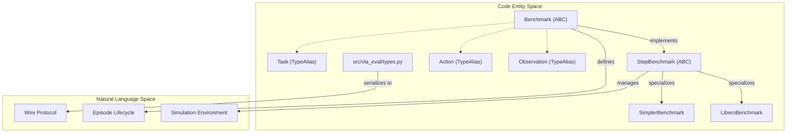
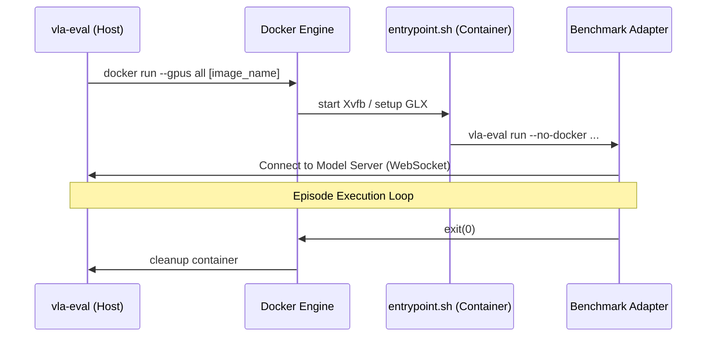

<!-- source: DeepWiki mcp.deepwiki.com · repo allenai/vla-evaluation-harness · page 4 Benchmark Integrations · fetched 2026-10-26 -->

# Benchmark Integrations

Relevant source files

The following files were used as context for generating this wiki page:

- [.dockerignore](.dockerignore)
- [README.md](README.md)
- [docker/rlbench_entrypoint.sh](docker/rlbench_entrypoint.sh)
- [leaderboard/README.md](leaderboard/README.md)
- [src/vla_eval/types.py](src/vla_eval/types.py)

The benchmark subsystem is a decoupled layer designed to execute robot simulation environments in isolation. By wrapping diverse benchmarks—each with conflicting dependencies and unique observation spaces—into a unified Python API and containerizing them via Docker, the harness allows any VLA model to be evaluated across the entire suite matrix without manual environment setup.

### Core Abstractions: Benchmark and StepBenchmark

All integrations are built upon the `Benchmark` Abstract Base Class (ABC). This interface defines the lifecycle of an evaluation episode, from task discovery to result reporting. For environments following the standard OpenAI Gym `reset`/`step` pattern, the `StepBenchmark` subclass provides a simplified template that handles observation formatting and termination logic.

The interaction between the orchestrator and the benchmark is governed by four primary data types defined in `src/vla_eval/types.py`: `Observation`, `Action`, `Task`, and `EpisodeResult`.

#### Benchmark Entity Relationship
The following diagram illustrates how the abstract classes in the codebase map to the conceptual flow of an evaluation.

**Diagram: Benchmark Class Hierarchy and Data Flow**

**Sources:** [src/vla_eval/benchmarks/base.py:1-120](), [src/vla_eval/types.py:1-61]()

For a deep dive into the method signatures and type definitions, see **[Benchmark API](#4.1)**.

---

### Built-in Benchmark Adapters

The harness includes 14 built-in adapters covering the majority of modern VLA research benchmarks. These adapters translate benchmark-specific states into the common `Observation` format (typically containing `images`, `state`, and `task_description`) and handle the conversion of model `Action` chunks back into simulator-specific control signals.

| Benchmark | Suite Examples | Observation Keys | Max Steps |
| :--- | :--- | :--- | :--- |
| **LIBERO** | Spatial, Object, Goal, Long | `agentview`, `robot0_eye_in_hand` | 600 |
| **CALVIN** | Task ABC/D | `rgb_static`, `rgb_gripper` | 360 |
| **SimplerEnv** | Google Robot, WidowX | `image` | 120-400 |
| **ManiSkill2** | PickCube, MoveBucket | `base_rgb`, `hand_rgb` | 200+ |
| **RoboCasa** | Kitchen tasks | `robot0_agentview_left`, `hand` | 500 |
| **RLBench** | Multi-task | `front_rgb`, `left_shoulder_rgb` | 500 |

For a complete catalog of all 14 adapters, including their YAML configuration schemas and specific observation dimensions, see **[Built-in Benchmark Adapters](#4.2)**.

**Sources:** [README.md:10-15](), [src/vla_eval/types.py:14-36]()

---

### Docker Packaging

To solve "dependency hell," every benchmark is packaged into a Docker image. These images use a standardized base (`nvidia/cuda:12.1.1-runtime-ubuntu22.04`) and include all necessary system dependencies (e.g., MuJoCo, EGL, Xvfb). 

The orchestration logic in `vla-eval` automatically detects if a benchmark should run in a container and manages the lifecycle of the `docker run` command, including GPU passthrough and volume mounting for results.

**Diagram: Containerized Execution Flow**

**Sources:** [docker/rlbench_entrypoint.sh:1-20](), [.dockerignore:1-11](), [README.md:38-41]()

For details on the container specifications, entrypoint scripts, and how to build your own images, see **[Docker Packaging for Benchmarks](#4.3)**.

---

### Child Pages
- **[Benchmark API](#4.1)**: Technical documentation of the `Benchmark` and `StepBenchmark` classes and the `vla_eval.types` module.
- **[Built-in Benchmark Adapters](#4.2)**: Detailed breakdown of the 14 supported benchmarks, their task structures, and configuration options.
- **[Docker Packaging for Benchmarks](#4.3)**: Guide to the Dockerfile structures, image registry, and the containerized execution environment.

---

