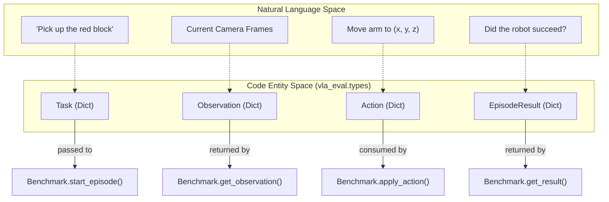
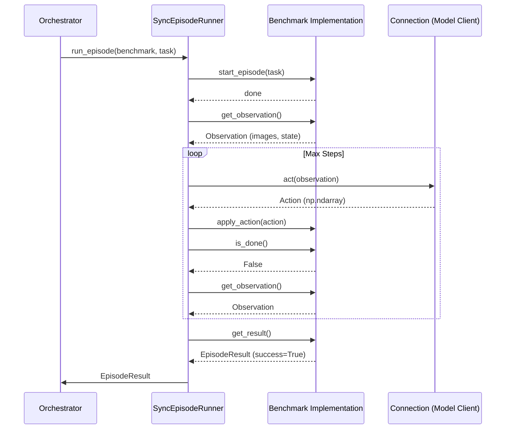

<!-- source: DeepWiki mcp.deepwiki.com · repo allenai/vla-evaluation-harness · page 4.1 Benchmark API · fetched 2026-10-26 -->

# Benchmark API

Relevant source files

The following files were used as context for generating this wiki page:

- [.dockerignore](.dockerignore)
- [docker/rlbench_entrypoint.sh](docker/rlbench_entrypoint.sh)
- [docs/architecture.md](docs/architecture.md)
- [docs/rfcs/0004-benchmark-and-episode-execution.md](docs/rfcs/0004-benchmark-and-episode-execution.md)
- [src/vla_eval/types.py](src/vla_eval/types.py)

The Benchmark API defines the implementation contract for simulation environments and physical robot interfaces within the `vla-evaluation-harness`. It decouples environment-specific logic (physics, rendering, success criteria) from the execution strategy (synchronous vs. asynchronous loops) and communication protocols.

## Benchmark ABC

The `Benchmark` Abstract Base Class (ABC) is the primary interface for all environment integrations. Every supported benchmark, from LIBERO to RoboTwin, implements this interface to allow the `Orchestrator` and `EpisodeRunner` to drive evaluations uniformly [docs/rfcs/0004-benchmark-and-episode-execution.md:16-19]().

### Interface Definition
The interface consists of six mandatory abstract methods and two optional overrides [docs/rfcs/0004-benchmark-and-episode-execution.md:28-37]():

| Method | Type | Description |
|:---|:---|:---|
| `get_tasks()` | Synchronous | Returns a list of task descriptors to be evaluated. |
| `start_episode(task)` | Asynchronous | Resets the environment for a specific task. |
| `apply_action(action)` | Asynchronous | Executes the model's predicted action in the environment. |
| `get_observation()` | Asynchronous | Retrieves the current state/images from the environment. |
| `is_done()` | Asynchronous | Returns whether the episode has finished (success or failure). |
| `get_result()` | Asynchronous | Returns final metrics (e.g., success status) for the episode. |
| `get_metadata()` | Optional | Returns default parameters like `max_steps` or `fps`. |
| `render()` | Optional | Returns an RGB image for video recording/visualization. |

### Data Flow: Natural Language to Code Entities
The following diagram illustrates how high-level benchmark concepts map to specific code entities and data structures.

**Conceptual Mapping: Benchmark Space**

Sources: [src/vla_eval/types.py:14-60](), [docs/rfcs/0004-benchmark-and-episode-execution.md:28-37]()

## StepBenchmark Convenience Subclass

To simplify integration for environments following the standard OpenAI Gym `reset`/`step` pattern, the harness provides a `StepBenchmark` subclass. This wrapper manages the internal environment handle (`self._env`) and translates the granular `Benchmark` ABC methods into standard Gym calls.

### Execution Flow (Sync Mode)
The `SyncEpisodeRunner` interacts with the `Benchmark` implementation in a lock-step loop [docs/rfcs/0004-benchmark-and-episode-execution.md:55-70]().

**Sequence: Episode Execution**

Sources: [docs/architecture.md:54-70](), [docs/rfcs/0004-benchmark-and-episode-execution.md:55-70]()

## Core Types

The `vla_eval.types` module defines the schemas for data exchanged between the benchmark and the model server. These are defined as `TypeAlias` for `Dict[str, Any]` to maintain flexibility across different simulation suites [src/vla_eval/types.py:1-12]().

### Observation
The `Observation` dict is passed from the benchmark to the model server. While the schema is open, built-in benchmarks follow a specific convention [src/vla_eval/types.py:14-36]():
*   **`images`**: A dictionary mapping camera names (e.g., "agentview", "wrist") to `[H, W, C]` uint8 `np.ndarray`.
*   **`task_description`**: A string containing the natural language instruction.
*   **`state`**: A `np.ndarray` containing proprioceptive data (joint positions, gripper state).

### Action
The `Action` dict is the response from the model server. It typically contains an `actions` key mapping to a `np.ndarray` of shape `(action_dim,)` or `(chunk_size, action_dim)` [src/vla_eval/types.py:38-44]().

### Task and EpisodeResult
*   **`Task`**: A descriptor returned by `get_tasks()`. It must contain enough information for `start_episode` to initialize the environment (e.g., `task_name`, `variation_id`) [src/vla_eval/types.py:46-53]().
*   **`EpisodeResult`**: Returned at the end of an episode. It must contain at least `{"success": bool}` [src/vla_eval/types.py:55-60]().

Sources: [src/vla_eval/types.py:14-60]()

## Environment Isolation and Entrypoints

Benchmarks are executed inside Docker containers to prevent dependency conflicts (e.g., differing versions of MuJoCo or SAPIEN) [docs/architecture.md:37-40]().

The `Orchestrator` launches these containers and communicates with them via a control channel. For benchmarks requiring a virtual display (like RLBench or RoboCasa), an entrypoint script initializes `Xvfb` before starting the `vla-eval` process [docker/rlbench_entrypoint.sh:1-19]().

### Import Resolution
Benchmarks are loaded dynamically using import strings (e.g., `"vla_eval.benchmarks.libero.benchmark:LIBEROBenchmark"`) [docs/rfcs/0004-benchmark-and-episode-execution.md:113-120](). This allows the harness to instantiate the benchmark class inside the container without requiring a central registry that would force all dependencies to be installed in the host environment [docs/architecture.md:141-152]().

Sources: [docs/architecture.md:37-49](), [docs/rfcs/0004-benchmark-and-episode-execution.md:86-94](), [docker/rlbench_entrypoint.sh:1-20]()

---

