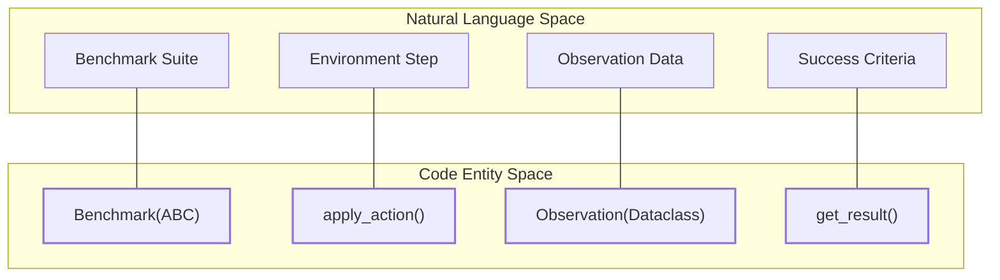
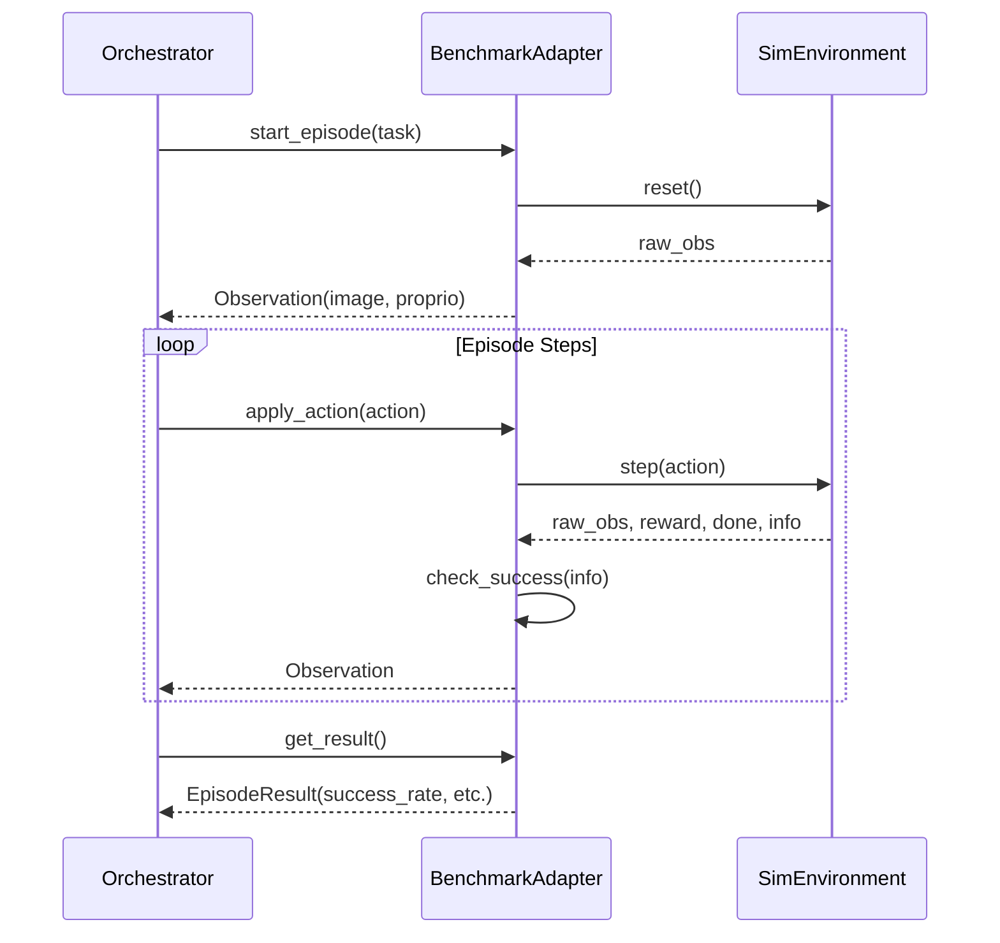

<!-- source: DeepWiki mcp.deepwiki.com · repo allenai/vla-evaluation-harness · page 4.2 Built-in Benchmark Adapters · fetched 2026-10-26 -->

# Built-in Benchmark Adapters

<details>
<summary>Relevant source files</summary>

The following files were used as context for generating this wiki page:

- [README.md](README.md)
- [leaderboard/CONTRIBUTING.md](leaderboard/CONTRIBUTING.md)
- [leaderboard/README.md](leaderboard/README.md)
- [src/vla_eval/cli/smoke.py](src/vla_eval/cli/smoke.py)

</details>


The `vla-evaluation-harness` provides a suite of 14 built-in benchmark adapters that translate high-level evaluation requests into environment-specific API calls. These adapters are decoupled from model logic, allowing any supported VLA to be evaluated across any benchmark without code modification.

## Overview of Supported Benchmarks

The harness categorizes benchmarks by their simulation backend and observation requirements. Most adapters inherit from `StepBenchmark` [src/vla_eval/benchmarks/base.py:108-110](), which simplifies the `reset`/`step` loop common in `gym`-like environments.

| Benchmark | Suite Structure | Max Steps | Observation Format |
| :--- | :--- | :--- | :--- |
| **LIBERO** | Spatial, Object, Goal, Long | 600 | RGB (128x128) + Proprio |
| **LIBERO-Mem** | Memory-augmented tasks | 600 | RGB + Proprio |
| **LIBERO-Pro** | Procedural generation | 600 | RGB + Proprio |
| **CALVIN** | A, B, C, D (Split) | 360 | RGB (Static/Wrist) + Proprio |
| **SimplerEnv** | Google Robot, WidowX | 200-400 | RGB + Proprio |
| **ManiSkill2** | PickPlace, TurnFaucet, etc. | Varies | RGB + Depth + Segmentation |
| **RoboCasa** | Kitchen activities | 500-1000 | Multi-view RGB |
| **RLBench** | 100+ precision tasks | 500 | RGB + Pointcloud |
| **RoboTwin** | Dual-arm manipulation | 400 | Multi-view RGB |
| **VLABench** | Reasoning-heavy tasks | 600 | RGB + Instruction |
| **MIKASA-Robo** | Multi-modal interaction | 500 | RGB + State |
| **RoboCerebra** | Cognitive robotics | 600 | RGB |
| **Kinetix** | Physics-based puzzles | 1000 | RGB |

Sources: [README.md:12-15](), [leaderboard/CONTRIBUTING.md:11-16](), [src/vla_eval/cli/smoke.py:85-99]()

## Adapter Architecture and Data Flow

The benchmark adapters act as the bridge between the `Orchestrator` and the underlying simulation engine (running inside Docker). They implement the `Benchmark` abstract base class to provide a unified interface for task discovery and episode execution.

### Entity Mapping: Natural Language to Code

The following diagram maps conceptual benchmark entities to their specific Python implementations within the harness.

**Benchmark Entity Mapping**

Sources: [src/vla_eval/benchmarks/base.py:18-106]()

### Data Flow: Observation to Result
This diagram illustrates how data flows through a benchmark adapter during a single evaluation episode.

**Benchmark Data Flow**

Sources: [src/vla_eval/benchmarks/base.py:30-100]()

## Detailed Adapter Catalog

### LIBERO Family (LIBERO, Mem, Pro)
The LIBERO adapters handle four main suites (Spatial, Object, Goal, Long). They are configured to use a standard 128x128 image resolution and a 7-DOF action space (6-DOF delta pose + 1-DOF gripper).

*   **Config Reference**: `configs/libero_all.yaml`, `configs/libero_mem.yaml`, `configs/libero_pro_eval.yaml` [src/vla_eval/cli/smoke.py:86-88]()
*   **Key Implementation**: These adapters often require specific `init_states` to be mounted into the Docker container to ensure reproducible starting configurations.

### CALVIN
The CALVIN adapter evaluates long-horizon manipulation. It supports "Chain" evaluation where the model must complete multiple subtasks in sequence.
*   **Metric**: Average length (number of subtasks completed in a row, 0–5) [leaderboard/CONTRIBUTING.md:15]().
*   **Config Reference**: `configs/calvin_eval.yaml` [src/vla_eval/cli/smoke.py:89]().

### SimplerEnv
SimplerEnv focuses on visual matching between simulation and real-world data. It is split into three primary evaluation dimensions: Google Robot Visual Matching (VM), Google Robot Variant Aggregation (VA), and WidowX VM.
*   **Protocol Note**: The harness enforces that these dimensions are never averaged together [leaderboard/CONTRIBUTING.md:101-105]().
*   **Config Reference**: `configs/simpler_all_tasks.yaml` [src/vla_eval/cli/smoke.py:91]().

### Specialized Benchmarks
*   **ManiSkill2**: Focuses on articulated object manipulation (e.g., turning faucets). Config: `configs/maniskill2_eval.yaml` [src/vla_eval/cli/smoke.py:90]().
*   **RoboCasa**: Large-scale kitchen environment evaluation. Config: `configs/robocasa_eval.yaml` [src/vla_eval/cli/smoke.py:92]().
*   **RLBench**: Provides 100+ tasks with high-precision requirements. Config: `configs/rlbench_eval.yaml` [src/vla_eval/cli/smoke.py:96]().
*   **Kinetix**: Physics-based puzzle solving where the model must manipulate objects to reach a goal state. Config: `configs/kinetix_eval.yaml` [src/vla_eval/cli/smoke.py:98]().

## Configuration and Registry

Benchmarks are registered in the `BENCHMARK_REGISTRY` within the smoke test infrastructure, which maps benchmark IDs to their default evaluation configurations.

| Registry Key | Config Path |
| :--- | :--- |
| `libero` | `configs/libero_smoke_test.yaml` |
| `robocasa` | `configs/robocasa_eval.yaml` |
| `vlabench` | `configs/vlabench_eval.yaml` |
| `robotwin` | `configs/robotwin_eval.yaml` |

Sources: [src/vla_eval/cli/smoke.py:85-99]()

### YAML Configuration Schema
Each benchmark config typically defines the Docker image to use and the specific tasks to be evaluated:

```yaml
# Example Benchmark Config
docker:
  image: "ghcr.io/allenai/vla-evaluation-harness-libero:latest"
  gpu: true
benchmarks:
  - name: "libero_spatial"
    tasks: ["pick_up_cup", "put_down_bowl"]
    max_steps: 600
```
Sources: [src/vla_eval/cli/smoke.py:158-161](), [README.md:38-39]()

---

