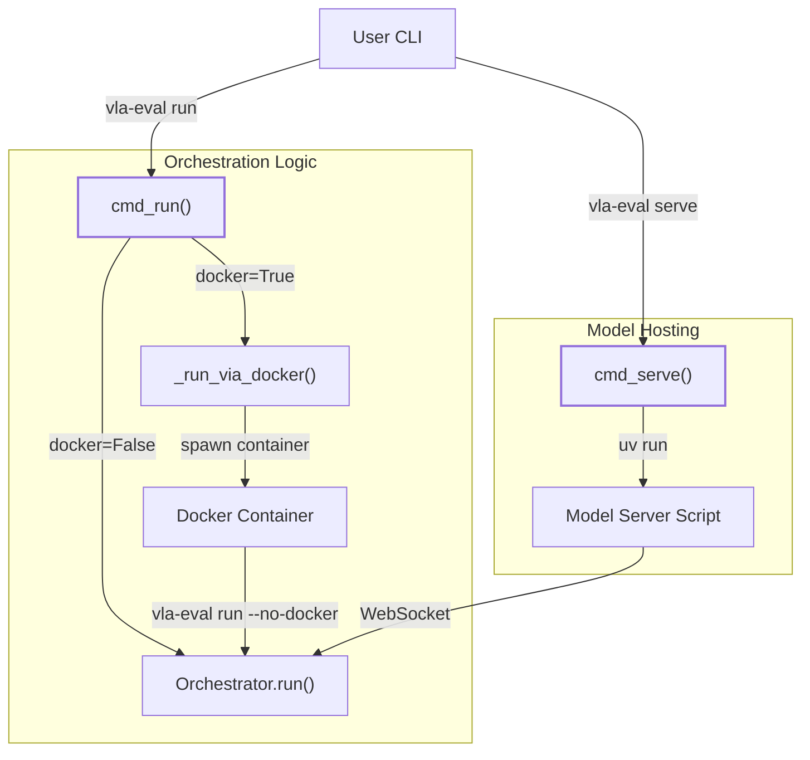

<!-- source: DeepWiki mcp.deepwiki.com · repo allenai/vla-evaluation-harness · page 5 CLI and Execution Orchestration · fetched 2026-10-26 -->

# CLI and Execution Orchestration

Relevant source files

The following files were used as context for generating this wiki page:

- [README.md](README.md)
- [leaderboard/README.md](leaderboard/README.md)
- [src/vla_eval/cli/main.py](src/vla_eval/cli/main.py)

The `vla-eval` command-line interface is the primary entry point for managing the lifecycle of VLA evaluations. It orchestrates the interaction between model servers (typically running on host GPUs) and benchmark environments (typically isolated within Docker containers). The CLI handles configuration resolution, resource partitioning, and the recursive dispatching required for sharded execution.

### CLI Structure and Commands

The CLI is implemented in `src/vla_eval/cli/main.py` using `argparse` [src/vla_eval/cli/main.py:1-12](). It provides four primary sub-commands to handle different stages of the evaluation pipeline:

| Command | Purpose | Key Responsibilities |
| :--- | :--- | :--- |
| `run` | Execute Evaluation | Resolves configs, manages Docker lifecycle, and handles sharding. |
| `serve` | Start Model Server | Launches a model server (usually via `uv run`) to listen for benchmark requests. |
| `test` | Smoke Testing | Validates that models and benchmarks are correctly integrated and reachable. |
| `merge` | Result Aggregation | Combines JSON shards from parallel runs into a single final report. |

**Sources:** [src/vla_eval/cli/main.py:288-340]()

---

### Execution Flow and Orchestration

The orchestration logic bridges the gap between the user's high-level YAML configuration and the low-level system processes (Docker, Subprocesses, and WebSockets).

#### Command Dispatch Diagram
This diagram maps the CLI command entry points to the underlying execution logic and system entities.

**Sources:** [src/vla_eval/cli/main.py:161-224](), [src/vla_eval/cli/main.py:263-286](), [src/vla_eval/orchestrator.py:38-50]()

---

### Key Orchestration Features

#### 1. Docker Lifecycle Management
By default, `vla-eval run` executes benchmarks inside Docker to ensure environment reproducibility [src/vla_eval/cli/main.py:161-169](). The CLI manages:
*   **Image Detection:** Checks for local images and prompts for pulls if missing [src/vla_eval/cli/main.py:116-143]().
*   **Recursive Execution:** The host process launches a container that calls `vla-eval run --no-docker` internally [src/vla_eval/cli/main.py:230-235]().
*   **Cleanup:** Uses `atexit` and signal handlers (`SIGTERM`, `SIGHUP`) to ensure containers are stopped if the host process is interrupted [src/vla_eval/cli/main.py:72-86]().

#### 2. Resource Partitioning and Sharding
To maximize throughput, the harness supports **Episode Sharding**. The CLI uses `--num-shards` and `--shard-id` flags to split the workload [src/vla_eval/cli/main.py:304-305]().
*   **GPU/CPU Assignment:** The `docker_resources.py` utility automatically partitions available GPUs and CPU cores among shards to prevent resource contention [src/vla_eval/cli/main.py:207-217]().
*   **Dev Mode:** The `--dev` flag allows mounting the local `src/` directory into the container for rapid iteration without rebuilding images [src/vla_eval/cli/main.py:220-223]().

#### 3. Smoke Testing (`vla-eval test`)
The `test` command provides a suite of "smoke tests" to verify integration before launching expensive full-scale runs. It validates three tiers:
*   **Validate:** Config schema and registry checks.
*   **Server:** Connection and inference checks using `_EchoModelServer`.
*   **Benchmark:** Environment stepping checks using `_StubBenchmark`.

For details, see [Smoke Testing (vla-eval test)](#5.2).

#### 4. Performance Tuning
The orchestration layer is designed to support high-concurrency batching. By combining episode sharding (multiple benchmark clients) with a `BatchPredictModelServer`, the system can achieve up to 47x speedups on benchmarks like LIBERO [README.md:93-97]().

For details, see [Performance Tuning: Sharding and Batching](#5.3).

---

### Sub-topic Detail Pages

*   **[run and serve Commands](#5.1)**: Deep dive into the `cmd_run` flow, Docker detection, container lifecycle management, and resource partitioning via `docker_resources.py`.
*   **[Smoke Testing (vla-eval test)](#5.2)**: Details on the `vla-eval test` suite, including the `SERVER_REGISTRY`, `BENCHMARK_REGISTRY`, and parallel test execution.
*   **[Performance Tuning: Sharding and Batching](#5.3)**: Technical methodology for optimizing `num_shards` and `max_batch_size` to maximize evaluation throughput.

**Sources:** [src/vla_eval/cli/main.py:161-286](), [README.md:89-102](), [src/vla_eval/docker_resources.py:1-20]()

---

