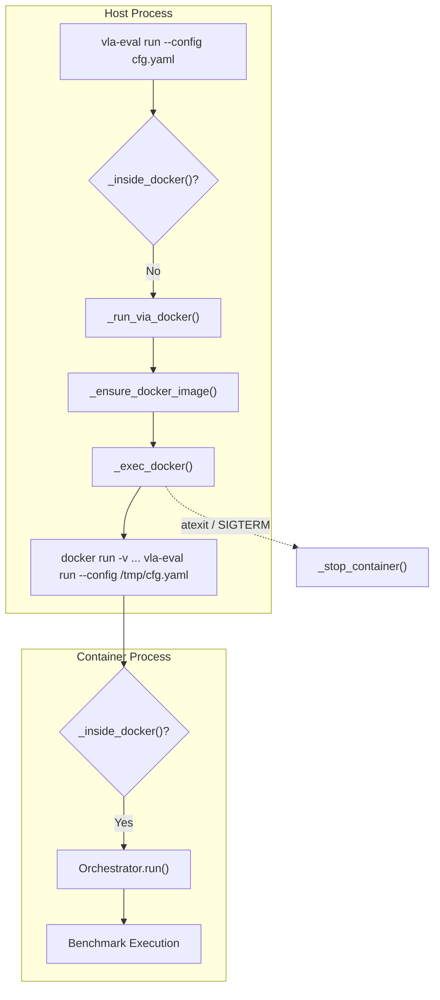
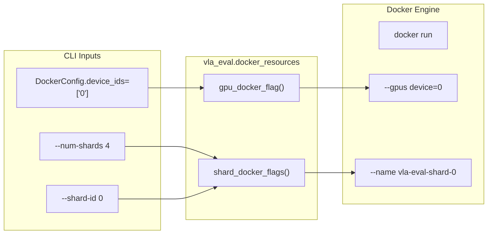

<!-- source: DeepWiki mcp.deepwiki.com · repo allenai/vla-evaluation-harness · page 5.1 run and serve Commands · fetched 2026-10-26 -->

# run and serve Commands

Relevant source files

The following files were used as context for generating this wiki page:

- [.dockerignore](.dockerignore)
- [docker/rlbench_entrypoint.sh](docker/rlbench_entrypoint.sh)
- [src/vla_eval/cli/main.py](src/vla_eval/cli/main.py)
- [src/vla_eval/types.py](src/vla_eval/types.py)

The `vla-eval` CLI provides two primary commands for executing evaluations: `run` for orchestrating full benchmark suites (often involving Docker) and `serve` for launching model servers as standalone processes. These commands handle the complexity of environment isolation, resource partitioning, and lifecycle management.

## cmd_run: Orchestration and Execution Flow

The `run` command is the entry point for executing an evaluation suite. It is responsible for resolving configurations, detecting the execution environment, and managing the lifecycle of benchmark containers.

### Configuration Resolution and Docker Detection
When `vla-eval run` is invoked, the system first loads the YAML configuration file [src/vla_eval/cli/main.py:29-32](). It then checks if it is already executing inside a Docker container by looking for the `/.dockerenv` file [src/vla_eval/cli/main.py:45-47]().

1.  **Outside Docker:** If the command is run on a host machine, it enters the `_run_via_docker` flow. This recursive execution pattern ensures that the benchmark environment (which often has complex system dependencies like MuJoCo or specific CUDA versions) is isolated [src/vla_eval/cli/main.py:161-168]().
2.  **Inside Docker:** If already inside a container (either via a manual `docker run` or the recursive call), it initializes the `Orchestrator` and begins the evaluation loop [src/vla_eval/cli/main.py:273-277]().

### The _run_via_docker Recursive Execution
The `_run_via_docker` function automates the setup of the evaluation container [src/vla_eval/cli/main.py:161-168](). It performs the following steps:
*   **Image Validation:** Verifies the Docker daemon is reachable and ensures the required benchmark image (specified in `docker.image` config) is available locally, pulling it if necessary [src/vla_eval/cli/main.py:179-186]().
*   **Config Rewriting:** It creates a temporary YAML config where `output_dir` is remapped to the internal container path `/workspace/results` [src/vla_eval/cli/main.py:193-200]().
*   **Volume Mounting:** It mounts the host's results directory and the temporary config into the container [src/vla_eval/cli/main.py:211-216]().
*   **Resource Flags:** It appends GPU and CPU/Sharding flags based on `docker_resources.py` logic [src/vla_eval/cli/main.py:207-210]().

### Container Lifecycle and Cleanup
To prevent "orphan" containers (containers that keep running after the host process crashes or is interrupted), the CLI implements a robust cleanup mechanism using `atexit` and signal handlers [src/vla_eval/cli/main.py:64-94]().

| Mechanism | Implementation | Role |
| :--- | :--- | :--- |
| `atexit.register` | `_stop_container` | Ensures `docker stop` is called when the Python process exits normally. |
| `signal.SIGHUP/SIGTERM` | `_handle_signal` | Catches termination signals to stop the container before exiting. |
| `subprocess.Popen` | `proc.wait()` | Monitors the container process and retrieves the exit code. |

**Sources:** [src/vla_eval/cli/main.py:45-105](), [src/vla_eval/cli/main.py:161-230]()

---

## cmd_serve: Model Server Delegation

The `serve` command is used to launch a model server. Unlike `run`, which manages containers, `serve` typically runs directly on the host (or inside a model-specific environment) using `uv`.

The command delegates execution to `uv run`, which parses the model's script (often a PEP 723 script with inline dependencies) and starts the WebSocket server [src/vla_eval/cli/main.py:306-318](). It passes arguments like `--port` and `--host` directly to the underlying model server implementation.

**Sources:** [src/vla_eval/cli/main.py:301-318]()

---

## Resource Partitioning and Sharding

The harness supports horizontal scaling via sharding, allowing a single benchmark suite to be split across multiple processes or GPUs.

### Sharding Flags
*   `--num-shards`: The total number of parallel instances to divide the task list into.
*   `--shard-id`: The index (0-indexed) of the current instance.

The `Orchestrator` uses these values to slice the task list, ensuring no two shards execute the same episode [src/vla_eval/orchestrator.py:115-121]().

### docker_resources.py Logic
The `docker_resources.py` module provides utility functions to translate sharding and GPU requirements into Docker CLI flags.

*   **GPU Partitioning:** `gpu_docker_flag` generates the `--gpus` string. If `DockerConfig.device_ids` is provided, it targets specific IDs; otherwise, it uses `all` [src/vla_eval/docker_resources.py:10-22]().
*   **CPU Sharding:** `shard_docker_flags` can be used to pin containers to specific CPU cores or memory nodes (using `--cpuset-cpus`), though the primary use case in `vla-eval` is ensuring each shard has access to the necessary hardware [src/vla_eval/docker_resources.py:25-30]().

**Sources:** [src/vla_eval/docker_resources.py:7-30](), [src/vla_eval/orchestrator.py:115-125]()

---

## Dev Mode and Bind-Mounts

The `--dev` flag is a critical feature for developers modifying the `vla_eval` source code. When enabled:
1.  **Source Resolution:** The CLI locates the `src/vla_eval` directory on the host, either from the CWD or via the path of an editable installation [src/vla_eval/cli/main.py:144-158]().
2.  **Bind Mount:** The host `src/` directory is mounted into the container at `/workspace/src` [src/vla_eval/cli/main.py:221-223]().
3.  **Code Override:** Because the Docker images are built with an editable install (`pip install -e .`), the container immediately uses the host's code changes without needing an image rebuild.

**Sources:** [src/vla_eval/cli/main.py:144-160](), [src/vla_eval/cli/main.py:220-225]()

---

## Execution Flow Diagrams

### Command Dispatch and Docker Recursion
This diagram illustrates how `cmd_run` handles the transition from the host machine into the isolated Docker environment.

**Sources:** [src/vla_eval/cli/main.py:45-94](), [src/vla_eval/cli/main.py:161-230](), [src/vla_eval/orchestrator.py:90-100]()

### Sharded Execution Resource Mapping
This diagram shows how CLI flags are transformed into Docker resource constraints via `docker_resources.py`.

**Sources:** [src/vla_eval/docker_resources.py:7-30](), [src/vla_eval/cli/main.py:205-215]()

---

## Entrypoint Scripts

For benchmarks requiring graphical displays (like RLBench or RoboTwin), the Docker containers use entrypoint scripts to initialize a virtual framebuffer (`Xvfb`) before calling `vla-eval`.

**Example: `rlbench_entrypoint.sh`**
1.  Starts `Xvfb` on display `:99` [docker/rlbench_entrypoint.sh:3-4]().
2.  Waits for the X11 socket to become available [docker/rlbench_entrypoint.sh:7-14]().
3.  Activates the specific Conda environment for the benchmark [docker/rlbench_entrypoint.sh:17-18]().
4.  Executes `vla-eval "$@"` to pass through the original CLI command [docker/rlbench_entrypoint.sh:19]().

**Sources:** [docker/rlbench_entrypoint.sh:1-20]()

---

