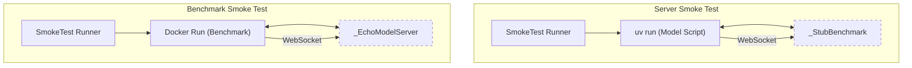
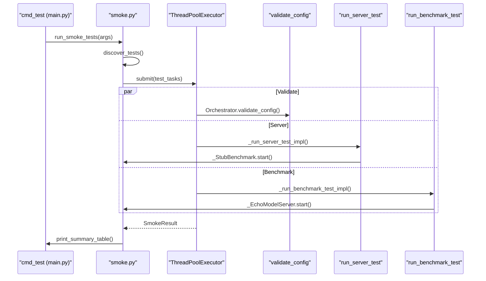

<!-- source: DeepWiki mcp.deepwiki.com · repo allenai/vla-evaluation-harness · page 5.2 Smoke Testing (vla-eval test) · fetched 2026-10-26 -->

# Smoke Testing (vla-eval test)

Relevant source files

The following files were used as context for generating this wiki page:

- [src/vla_eval/cli/main.py](src/vla_eval/cli/main.py)
- [src/vla_eval/cli/smoke.py](src/vla_eval/cli/smoke.py)

The `vla-eval test` command provides a suite of smoke tests designed to verify the integrity of the evaluation harness, its configurations, model server scripts, and benchmark Docker images. Unlike the standard evaluation pipeline which orchestrates full runs, the smoke test infrastructure is self-contained and focuses on rapid validation of components using test doubles and resource checks.

## Overview of Smoke Test Categories

The smoke testing suite is divided into three primary categories, each targeting a different layer of the system:

| Category | Purpose | Implementation Detail |
| :--- | :--- | :--- |
| **Validate** | Verifies that YAML configurations are syntactically correct and can be parsed into `EvalConfig` objects. | Uses `Orchestrator.validate_config` [src/vla_eval/orchestrator.py:101-118](). |
| **Server** | Verifies that a model server's `uv` script can boot, load its model, and respond to a handshake. | Uses `_EchoModelServer` to simulate a client and checks for script exit codes. |
| **Benchmark** | Verifies that a benchmark Docker image can be pulled and that a single episode can run using a stub model. | Uses `_StubBenchmark` and `_EchoModelServer` to isolate the benchmark container. |

Sources: [src/vla_eval/cli/smoke.py:40-56](), [src/vla_eval/cli/smoke.py:133-141]()

## Data Structures and Registries

Smoke tests are driven by two central registries that map logical names (e.g., `openvla`, `libero`) to their canonical smoke test configuration files.

### Registries
- **`SERVER_REGISTRY`**: Maps model names to YAML files in `configs/model_servers/` [src/vla_eval/cli/smoke.py:102-115]().
- **`BENCHMARK_REGISTRY`**: Maps benchmark names to YAML files in `configs/` [src/vla_eval/cli/smoke.py:85-99]().

### Data Classes
The infrastructure uses two primary dataclasses to manage test execution and reporting:
- **`SmokeTest`**: Defines the test metadata, including category, name, config path, and required Docker image [src/vla_eval/cli/smoke.py:40-47]().
- **`SmokeResult`**: Captures the outcome of a test, including status (`pass`, `fail`, `skip`), duration, and `stderr` logs for debugging [src/vla_eval/cli/smoke.py:49-56]().

Sources: [src/vla_eval/cli/smoke.py:32-56](), [src/vla_eval/cli/smoke.py:80-117]()

## Test Doubles and Isolation

To test components in isolation without requiring massive GPU resources or complex environment setups, the smoke test suite employs two internal test doubles.

### `_EchoModelServer`
This is a minimal implementation of the `ModelServer` protocol. It is used during **Benchmark** smoke tests to act as a model that simply returns zero-actions, allowing the test to verify that the benchmark container can communicate over the network and complete an episode [src/vla_eval/cli/smoke.py:537-561]().

### `_StubBenchmark`
This is a minimal implementation of the `Benchmark` ABC. It is used during **Server** smoke tests to verify that a model server script can receive observations and produce actions without needing a heavy simulator (like MuJoCo or Unity) running [src/vla_eval/cli/smoke.py:445-484]().

### Component Interaction Diagram
The following diagram illustrates how smoke tests use these doubles to isolate the Model Server and Benchmark components.

"Smoke Test Component Isolation"

Sources: [src/vla_eval/cli/smoke.py:445-484](), [src/vla_eval/cli/smoke.py:537-561]()

## Execution Flow and Parallelism

The `vla-eval test` command performs several prerequisite checks before execution:
1. **Tool Check**: Verifies `uv` and `docker` are installed [src/vla_eval/cli/smoke.py:756-764]().
2. **Image Check**: For benchmark tests, it verifies the existence of the required Docker image [src/vla_eval/cli/main.py:108-114]().

### Parallel Execution
To speed up validation, tests are executed in parallel using a `ThreadPoolExecutor`. The number of workers is determined by the `--workers` flag (defaulting to the number of CPU cores) [src/vla_eval/cli/smoke.py:795-802]().

### Resource Awareness
When running **Server** tests, the harness attempts to assign GPUs to different workers to avoid OOM (Out of Memory) errors. It uses a simple `threading.Lock` to manage a pool of available GPU indices [src/vla_eval/cli/smoke.py:378-384]().

### Execution Logic Diagram
This diagram maps the CLI command to the internal function calls and classes.

"vla-eval test Execution Flow"

Sources: [src/vla_eval/cli/main.py:270-302](), [src/vla_eval/cli/smoke.py:734-825](), [src/vla_eval/orchestrator.py:101-118]()

## Key Functions and Classes

| Entity | Location | Description |
| :--- | :--- | :--- |
| `run_smoke_tests` | [src/vla_eval/cli/smoke.py:734]() | Entry point for the test command; manages discovery and the thread pool. |
| `_run_server_test_impl` | [src/vla_eval/cli/smoke.py:487]() | Executes a model server script using `uv run` and connects it to a `_StubBenchmark`. |
| `_run_benchmark_test_impl` | [src/vla_eval/cli/smoke.py:564]() | Spawns a benchmark Docker container and connects it to an `_EchoModelServer`. |
| `_check_uv_installed` | [src/vla_eval/cli/smoke.py:246]() | Ensures the `uv` package manager is available for server tests. |
| `_check_docker_daemon` | [src/vla_eval/cli/main.py:96]() | Ensures the Docker daemon is reachable for benchmark tests. |

Sources: [src/vla_eval/cli/smoke.py:734-825](), [src/vla_eval/cli/smoke.py:487-534](), [src/vla_eval/cli/smoke.py:564-625](), [src/vla_eval/cli/smoke.py:246-253](), [src/vla_eval/cli/main.py:96-106]()

---

