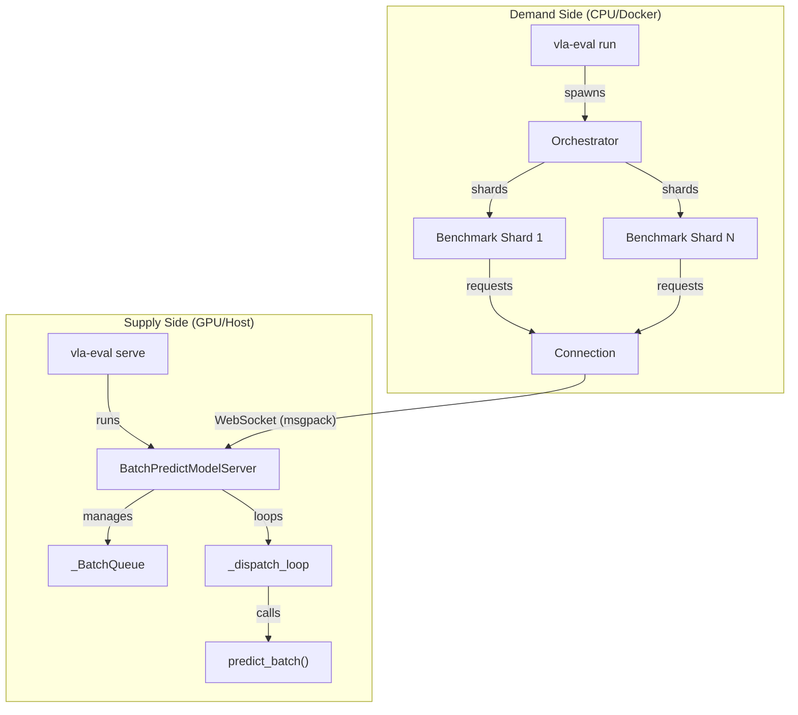
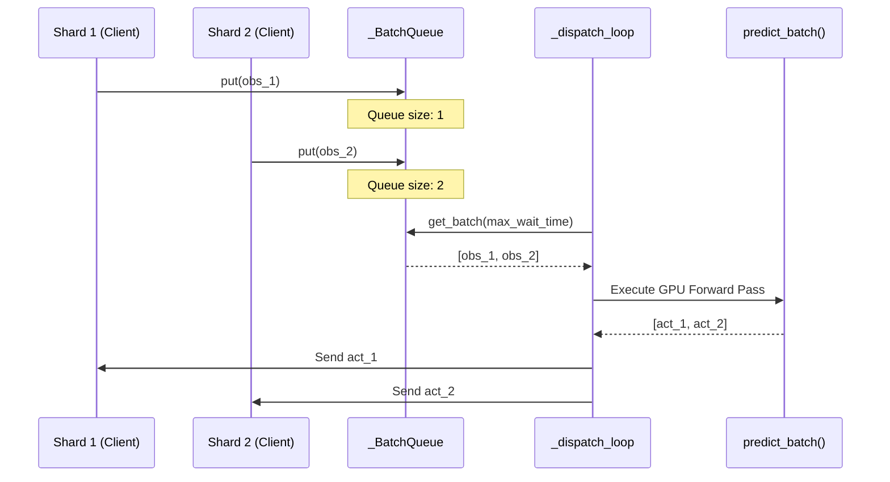

<!-- source: DeepWiki mcp.deepwiki.com · repo allenai/vla-evaluation-harness · page 5.3 Performance Tuning: Sharding and Batching · fetched 2026-10-26 -->

# Performance Tuning: Sharding and Batching

Relevant source files

The following files were used as context for generating this wiki page:

- [.dockerignore](.dockerignore)
- [README.md](README.md)
- [docker/rlbench_entrypoint.sh](docker/rlbench_entrypoint.sh)
- [leaderboard/README.md](leaderboard/README.md)
- [src/vla_eval/cli/main.py](src/vla_eval/cli/main.py)
- [src/vla_eval/types.py](src/vla_eval/types.py)

This page details the methodology and implementation for optimizing evaluation throughput in the `vla-evaluation-harness`. By decoupling environment simulation from model inference, the harness enables massive speedups through horizontal scaling (sharding) and vertical GPU utilization (batching).

## Overview: The Demand/Supply Methodology

Performance tuning in the harness is treated as a balancing act between the **Demand** (benchmark clients requesting actions) and the **Supply** (the model server processing those requests). 

- **Demand $\lambda(N)$**: The rate at which $N$ parallel benchmark shards can generate observation requests.
- **Supply $\mu(B)$**: The rate at which a model server can process batches of size $B$.

Optimal performance is achieved when $N$ is large enough to keep the GPU saturated at its most efficient batch size $B$, without exceeding the memory limits of the hardware.

### System Topology for Tuning
The following diagram bridges the high-level tuning concepts to the specific code entities responsible for execution.

**Tuning Entity Map**

Sources: [src/vla_eval/orchestrator.py:1-50](), [README.md:89-110]()

---

## Sharding: Environment Parallelism

Episode sharding splits the total workload (e.g., 500 episodes) across $N$ independent processes. This is controlled via the `--num-shards` and `--shard-id` flags [src/vla_eval/cli/main.py:210-230]().

### Resource Allocation and Thread Pinning
When running multiple shards on a single machine, resource contention can degrade performance. The harness provides flags to partition CPU and GPU resources:

- **GPU Partitioning**: The `gpu_docker_flag` function in `docker_resources.py` manages how many GPUs are visible to each Docker container [src/vla_eval/docker_resources.py:1-30]().
- **CPU Pinning**: The `shard_docker_flags` function calculates CPU sets to ensure shards do not thrash on the same physical cores [src/vla_eval/docker_resources.py:31-60]().
- **OMP_NUM_THREADS**: For benchmarks with heavy internal physics (like RLBench or ManiSkill2), setting `OMP_NUM_THREADS=1` is often necessary to prevent over-subscription of CPU threads within a single shard [docker/rlbench_entrypoint.sh:1-20]().

### Sharding Logic
The `Orchestrator` filters the task list based on the provided shard configuration, ensuring that each instance of the harness processes a unique subset of `(task, episode_index)` pairs [src/vla_eval/orchestrator.py:80-120]().

---

## Batching: Inference Parallelism

The `BatchPredictModelServer` (and its underlying `_BatchQueue`) allows a single GPU process to aggregate requests from multiple remote shards into a single Tensor batch.

### Key Parameters
1.  **`max_batch_size`**: The maximum number of observations to group together. Increasing this improves GPU utilization but increases latency per request.
2.  **`max_wait_time`**: The maximum time (in seconds) the `_dispatch_loop` will wait for the queue to fill to `max_batch_size` before processing a partial batch. This prevents "starvation" when demand is low.

**Batch Dispatch Flow**

Sources: [README.md:93-98](), [src/vla_eval/types.py:14-44]()

---

## Experiment Scripts: bench_demand.py and bench_supply.py

To find the "sweet spot" for a specific hardware/model/benchmark combination, the harness includes two benchmarking scripts (located in `scripts/tuning/`).

### 1. bench_demand.py
This script measures the maximum request rate $\lambda$ a benchmark can sustain. It runs a `_StubModelServer` that returns actions instantly, measuring how fast the environment can produce observations.
- **Output**: A curve of `FPS vs. Num Shards`.
- **Goal**: Identify the point of diminishing returns where CPU/IO saturation occurs.

### 2. bench_supply.py
This script measures the inference throughput $\mu$ of the model server. It bypasses the network by feeding synthetic observations directly into `predict_batch()`.
- **Output**: A curve of `Inference FPS vs. Batch Size`.
- **Goal**: Identify the `max_batch_size` that maximizes throughput without causing Out-of-Memory (OOM) errors.

---

## Optimal Configuration Selection

The goal of tuning is to select $N$ (shards) and $B$ (batch size) such that:
$$\lambda(N) \approx \mu(B)$$

### Example Tuning Profile (LIBERO on H100)
| Metric | Sequential | Batched (N=50, B=64) | Speedup |
| :--- | :--- | :--- | :--- |
| **Throughput** | ~2.5 FPS | ~118 FPS | **47x** |
| **2000 Episodes** | ~14 hours | ~18 minutes | - |

### Recommended Settings
- **For Low-VRAM GPUs (8-16GB)**: Keep `max_batch_size` small (4-8) and `num_shards` around 8-12.
- **For High-VRAM GPUs (40-80GB)**: Use `max_batch_size` of 64-128 and `num_shards` of 40-60.
- **Max Wait Time**: Typically set to `0.01` to `0.05` seconds. If your benchmark is very slow (e.g., RoboCasa), increase this to allow larger batches to form.

Sources: [README.md:23-26](), [README.md:89-110]()

---

