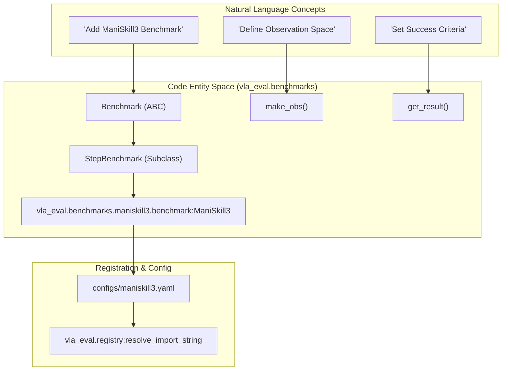
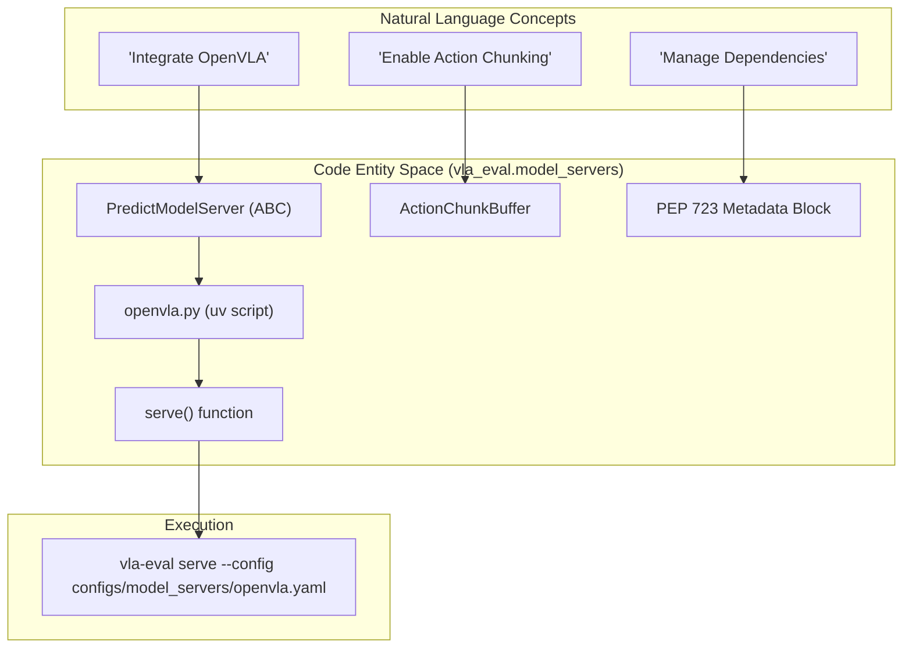

<!-- source: DeepWiki mcp.deepwiki.com · repo allenai/vla-evaluation-harness · page 6 Extending the Harness · fetched 2026-10-26 -->

# Extending the Harness

Relevant source files

The following files were used as context for generating this wiki page:

- [.claude/skills/add-benchmark/SKILL.md](.claude/skills/add-benchmark/SKILL.md)
- [.claude/skills/add-model-server/SKILL.md](.claude/skills/add-model-server/SKILL.md)
- [CONTRIBUTING.md](CONTRIBUTING.md)
- [docs/architecture.md](docs/architecture.md)
- [docs/rfcs/0004-benchmark-and-episode-execution.md](docs/rfcs/0004-benchmark-and-episode-execution.md)

The `vla-evaluation-harness` is designed to be modular, allowing researchers to integrate new simulation environments and VLA models with minimal friction. This page provides a high-level overview of the extension points for benchmarks and model servers, referencing the standardized RFC process and automated scaffolding tools.

## Extension Philosophy

The harness follows a decoupled architecture where benchmarks and models communicate over a language-agnostic WebSocket protocol [src/vla_eval/protocol/message.py:1-40](). This separation ensures that:
- **Benchmarks** can run in isolated Docker containers to avoid dependency conflicts (e.g., different MuJoCo or SAPIEN versions) [docs/architecture.md:37-49]().
- **Model Servers** can run in their own optimized environments using `uv` scripts with inline dependency declarations [CONTRIBUTING.md:97-106]().

### The RFC Process
Major architectural changes or complex integrations should follow the RFC (Request for Comments) process. Existing standards like RFC-0004 define the core interfaces for benchmarks and episode execution [docs/rfcs/0004-benchmark-and-episode-execution.md:1-15]().

---

## Adding a New Benchmark

Integrating a new benchmark involves implementing the `Benchmark` abstract base class (ABC) and packaging the environment in a Docker container.

### Implementation Flow
1.  **Module Creation**: Create a new directory in `src/vla_eval/benchmarks/<name>/` [CONTRIBUTING.md:85]().
2.  **Subclassing**: Implement the `Benchmark` or `StepBenchmark` ABC [src/vla_eval/benchmarks/base.py:1-50](). You must implement 6 core methods: `get_tasks`, `start_episode`, `apply_action`, `get_observation`, `is_done`, and `get_result` [docs/rfcs/0004-benchmark-and-episode-execution.md:20-37]().
3.  **Dockerization**: Create a `docker/Dockerfile.<name>` that installs the harness and the simulation's specific dependencies [CONTRIBUTING.md:91]().
4.  **Configuration**: Define a YAML config in `configs/` that points to your benchmark class via an import string (e.g., `vla_eval.benchmarks.my_bench.benchmark:MyBenchmark`) [CONTRIBUTING.md:89]().

For a step-by-step guide, see **[Adding a New Benchmark](#6.1)**.

**Sources:** [CONTRIBUTING.md:83-95](), [docs/rfcs/0004-benchmark-and-episode-execution.md:16-40](), [.claude/skills/add-benchmark/SKILL.md:1-80]().

---

## Adding a New Model Server

Model servers are standalone Python scripts managed by `uv`. They wrap VLA models and expose them to the benchmark clients.

### Implementation Flow
1.  **Script Creation**: Create `src/vla_eval/model_servers/<name>.py` with a PEP 723 metadata block for inline dependencies [CONTRIBUTING.md:99](), [.claude/skills/add-model-server/SKILL.md:23-43]().
2.  **Subclassing**: Most models should subclass `PredictModelServer`, which provides built-in support for action chunking and ensembling [src/vla_eval/model_servers/predict.py:1-30]().
3.  **Inference Logic**: Implement the `predict()` method to handle observations and return actions [CONTRIBUTING.md:101]().
4.  **Serving**: Use the `serve()` utility to launch the WebSocket server [src/vla_eval/model_servers/serve.py:1-20]().

For a step-by-step guide, see **[Adding a New Model Server](#6.2)**.

**Sources:** [CONTRIBUTING.md:97-106](), [docs/architecture.md:107-118](), [.claude/skills/add-model-server/SKILL.md:45-85]().

---

## Technical Mapping: From Concept to Code

The following diagrams illustrate how natural language extension concepts map to specific code entities within the harness.

### Benchmark Extension Mapping
This diagram shows how the requirement for a "New Benchmark" translates into the specific class hierarchy and registration points.

**Sources:** [CONTRIBUTING.md:83-95](), [src/vla_eval/registry.py:1-20](), [docs/rfcs/0004-benchmark-and-episode-execution.md:113-123]().

### Model Server Extension Mapping
This diagram shows how adding a "New Model" relates to the server hierarchy and the `uv` execution model.

**Sources:** [CONTRIBUTING.md:97-106](), [src/vla_eval/model_servers/predict.py:1-30](), [.claude/skills/add-model-server/SKILL.md:25-43]().

---

## Verification and Testing

After extending the harness, use the built-in smoke testing suite to verify your implementation:

| Command | Purpose | Requirement |
| :--- | :--- | :--- |
| `vla-eval test --validate` | Checks if all benchmark import strings in configs are resolvable. | None |
| `vla-eval test --benchmark` | Runs 1 episode of each benchmark using an `EchoModelServer`. | Docker + Image |
| `vla-eval test --server` | Launches model servers and sends dummy observations via `StubBenchmark`. | `uv` + GPU + Weights |
| `vla-eval test -c <config>` | Runs a targeted smoke test for a specific configuration file. | Varies |

**Sources:** [CONTRIBUTING.md:37-51](), [docs/architecture.md:138-140]().

---

