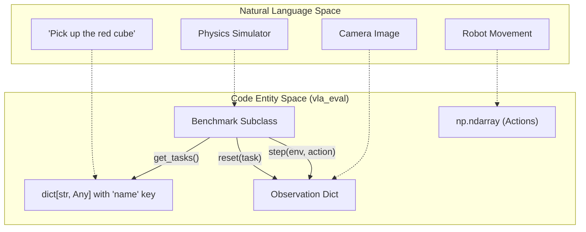
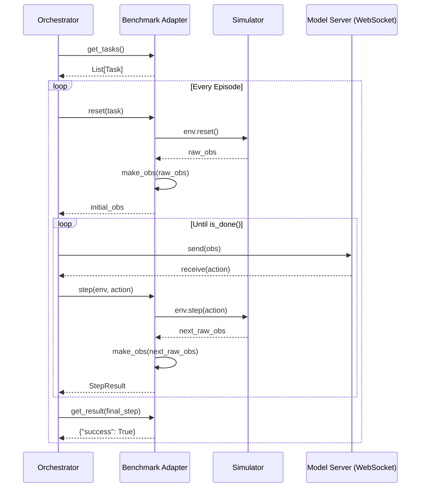

<!-- source: DeepWiki mcp.deepwiki.com · repo allenai/vla-evaluation-harness · page 6.1 Adding a New Benchmark · fetched 2026-10-26 -->

# Adding a New Benchmark

<details>
<summary>Relevant source files</summary>

The following files were used as context for generating this wiki page:

- [.claude/skills/add-benchmark/SKILL.md](.claude/skills/add-benchmark/SKILL.md)
- [.claude/skills/add-model-server/SKILL.md](.claude/skills/add-model-server/SKILL.md)
- [docker/Dockerfile.libero](docker/Dockerfile.libero)
- [src/vla_eval/cli/smoke.py](src/vla_eval/cli/smoke.py)

</details>


This guide provides a step-by-step technical walkthrough for integrating a new simulation benchmark into the VLA evaluation harness. The process involves creating a benchmark adapter, containerizing the environment, and registering it for orchestration.

## Overview of the Integration Process

Integrating a benchmark requires bridging the gap between the universal `vla-eval` protocol and the specific simulation framework (e.g., MuJoCo, SAPIEN, PyBullet). The harness uses a decoupled architecture where benchmarks run inside Docker containers and communicate with model servers via WebSockets.

### Data Flow and Entity Mapping

The following diagram illustrates how natural language concepts map to specific code entities during a benchmark execution cycle.

**Figure 1: Conceptual to Code Entity Mapping**

**Sources:** [.claude/skills/add-benchmark/SKILL.md:44-67](), [src/vla_eval/benchmarks/base.py]() (implied by skill).

---

## 1. Create the Benchmark Module

All benchmark adapters reside in `src/vla_eval/benchmarks/<name>/`. You must implement a class that subclasses `Benchmark` and provides the core simulation logic.

### Required Methods
The `Benchmark` abstract base class requires the implementation of 6 core methods:

1.  **`__init__(self, **kwargs)`**: Receives parameters from the YAML configuration `params:` section. **Critical:** Heavy simulation dependencies (e.g., `import mujoco`) must be imported lazily inside methods to prevent registry import errors [.claude/skills/add-benchmark/SKILL.md:39-42]().
2.  **`get_tasks(self)`**: Returns a list of dictionaries. Each must contain a `name` key and optionally a `suite` key for filtering [.claude/skills/add-benchmark/SKILL.md:44-47]().
3.  **`reset(self, task)`**: Initializes the environment for a specific task. Returns an opaque environment handle and the initial observation dictionary [.claude/skills/add-benchmark/SKILL.md:49-54]().
4.  **`step(self, env, action)`**: Executes the action (provided as a `dict` with an `actions` key) and returns a `StepResult` [.claude/skills/add-benchmark/SKILL.md:56-59]().
5.  **`make_obs(self, raw_obs, task)`**: Standardizes raw simulator output into the harness format: `{"images": {"cam_name": np.ndarray}, "task_description": str}` [.claude/skills/add-benchmark/SKILL.md:61-66]().
6.  **`get_result(self, step_result)`**: Evaluates success. Must return a dictionary containing at least `{"success": bool}` [.claude/skills/add-benchmark/SKILL.md:72-74]().

**Sources:** [.claude/skills/add-benchmark/SKILL.md:24-79]()

---

## 2. Docker Containerization

Every benchmark must be containerized to ensure environment isolation and reproducibility.

### Dockerfile Structure
The Dockerfile typically follows these stages:
1.  **Base Image**: Use a standard CUDA runtime or the internal `vla-evaluation-harness/base` image [docker/Dockerfile.libero:1-2]().
2.  **Environment Setup**: Install system dependencies (OpenGL, X11, etc.) and create a Python environment (Conda or Venv) [docker/Dockerfile.libero:5-17]().
3.  **Simulator Installation**: Install the specific simulator (e.g., LIBERO, SimplerEnv) [docker/Dockerfile.libero:22-24]().
4.  **Harness Installation**: Copy the `vla-eval` source code and install it in editable mode to allow the container to run the orchestrator [docker/Dockerfile.libero:35-40]().

### Entrypoint Configuration
The `ENTRYPOINT` should call `vla-eval` and the `CMD` should point to the benchmark's default evaluation config [docker/Dockerfile.libero:43-44]().

**Sources:** [docker/Dockerfile.libero:1-45](), [.claude/skills/add-benchmark/SKILL.md:118-137]()

---

## 3. Configuration and Registration

Benchmarks are defined in YAML files located in `configs/`.

### Config YAML Schema
```yaml
server:
  url: "ws://localhost:8000"
docker:
  image: "my-benchmark-image"
benchmarks:
  - benchmark: "vla_eval.benchmarks.my_bench.benchmark:MyBenchmark"
    mode: sync
    episodes_per_task: 50
    params:
      suite: "visual_manipulation"
```
The `benchmark` string uses the format `package.module:ClassName` which is resolved by the `vla-eval` registry [.claude/skills/add-benchmark/SKILL.md:91-116]().

### Smoke Test Registration
To ensure the benchmark remains functional, add it to the `BENCHMARK_REGISTRY` in `src/vla_eval/cli/smoke.py`:

```python
BENCHMARK_REGISTRY: dict[str, str] = {
    "my_bench": "configs/my_bench_eval.yaml",
    # ...
}
```
**Sources:** [src/vla_eval/cli/smoke.py:85-99](), [.claude/skills/add-benchmark/SKILL.md:91-116]()

---

## 4. Execution Flow

The following diagram details the interaction between the `Orchestrator`, the `Benchmark` adapter, and the `ModelServer`.

**Figure 2: Benchmark Execution Pipeline**

**Sources:** [.claude/skills/add-benchmark/SKILL.md:33-79](), [src/vla_eval/cli/smoke.py:186-200]() (implied orchestration logic).

---

## 5. Verification Checklist

After implementation, verify the integration using the following commands:

1.  **Validation**: `vla-eval test --validate` checks if all config import strings are resolvable [src/vla_eval/cli/smoke.py:133-141]().
2.  **Smoke Test**: `vla-eval test -n <benchmark_name>` runs a single episode of the benchmark using an `EchoModelServer` to verify the simulation loop and Docker container without requiring a real GPU or VLA model [src/vla_eval/cli/smoke.py:176-183]().
3.  **Linting**: Run `make check` to ensure code style compliance [.claude/skills/add-benchmark/SKILL.md:150]().

**Sources:** [src/vla_eval/cli/smoke.py:133-183](), [.claude/skills/add-benchmark/SKILL.md:148-154]()

---

