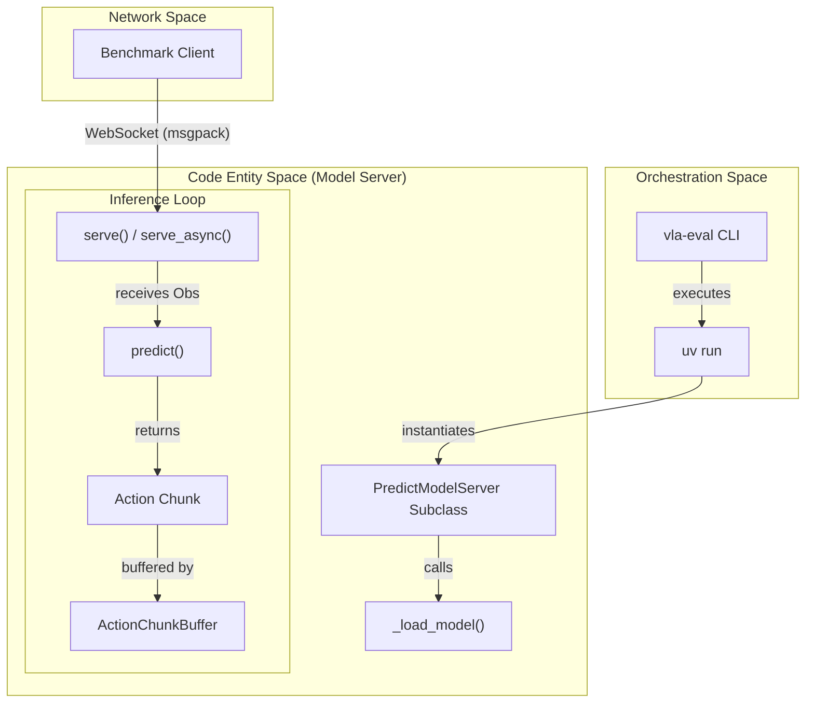
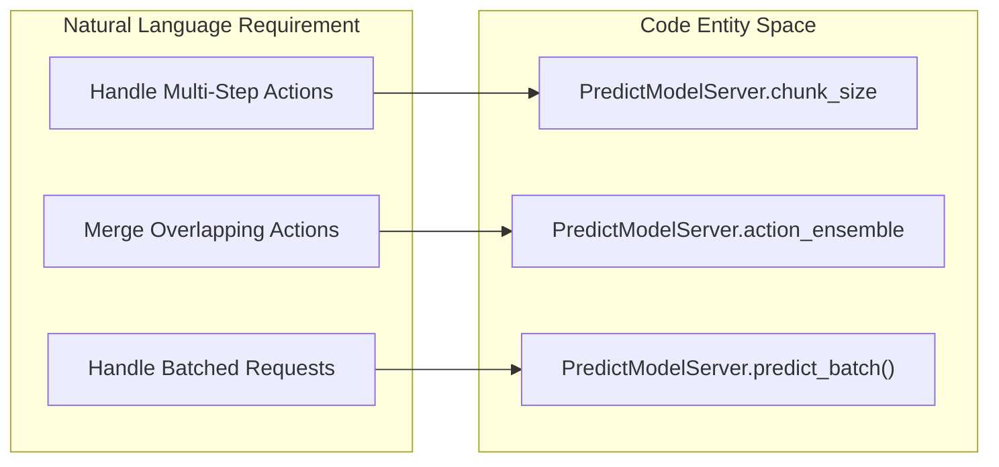

<!-- source: DeepWiki mcp.deepwiki.com · repo allenai/vla-evaluation-harness · page 6.2 Adding a New Model Server · fetched 2026-10-26 -->

# Adding a New Model Server

<details>
<summary>Relevant source files</summary>

The following files were used as context for generating this wiki page:

- [.claude/skills/add-benchmark/SKILL.md](.claude/skills/add-benchmark/SKILL.md)
- [.claude/skills/add-model-server/SKILL.md](.claude/skills/add-model-server/SKILL.md)
- [configs/model_servers/starvla_groot_simpler.yaml](configs/model_servers/starvla_groot_simpler.yaml)
- [src/vla_eval/cli/smoke.py](src/vla_eval/cli/smoke.py)
- [src/vla_eval/model_servers/starvla.py](src/vla_eval/model_servers/starvla.py)

</details>


This guide provides a step-by-step technical walkthrough for integrating a new Vision-Language-Action (VLA) model into the `vla-evaluation-harness`. The harness uses a decoupled architecture where model servers run as standalone processes, often managed via `uv` scripts with inline dependency specifications.

## Architectural Overview

Model servers in this repository are designed to be independent of the simulation environments. They communicate over a WebSocket protocol using `msgpack` for serialization. To add a model, you typically implement a subclass of `PredictModelServer`, which handles the complexities of session management, action chunking, and optional batching.

### Class Hierarchy and Data Flow

The following diagram illustrates how a new model server fits into the system's execution flow.

**Model Server Integration Topology**

Sources: [.claude/skills/add-model-server/SKILL.md:171-181](), [src/vla_eval/model_servers/predict.py:1-50]()

---

## Step 1: Create the uv Script

Create a new Python file in `src/vla_eval/model_servers/<name>.py`. This script must use PEP 723 inline script metadata to ensure all model-specific dependencies (e.g., specific `torch` versions or custom research repositories) are isolated.

### Dependency Specification
The script header defines the environment. Use the `[tool.uv.sources]` section to link the local `vla-eval` package.

```python
# /// script
# requires-python = "~=3.11"
# dependencies = [
#     "vla-eval",
#     "torch>=2.0",
#     "transformers>=4.40",
#     "numpy",
# ]
#
# [tool.uv.sources]
# vla-eval = { path = "../../.." }
# ///
```
Sources: [src/vla_eval/model_servers/starvla.py:1-29](), [.claude/skills/add-model-server/SKILL.md:21-43]()

---

## Step 2: Implement the Model Server Class

Subclass `vla_eval.model_servers.predict.PredictModelServer`. This class provides high-level abstractions for common VLA patterns.

### Key Implementation Requirements

1.  **Lazy Loading**: Implement `_load_model()` to prevent heavy GPU memory allocation during class instantiation. Call this inside `predict()`.
2.  **Observation Parsing**: Extract images and text from the `obs` dictionary.
3.  **Action Formatting**: Return a dictionary containing an `"actions"` key as a `numpy.ndarray`.

| Method | Purpose | Data Format |
| :--- | :--- | :--- |
| `__init__` | Store config (checkpoints, hyperparameters). | `checkpoint: str`, `chunk_size: int` |
| `_load_model` | Initialize weights and move to device. | N/A |
| `predict` | Perform inference on a single observation. | In: `dict[str, Any]`, Out: `{"actions": np.ndarray}` |

**Internal Logic Association**

Sources: [.claude/skills/add-model-server/SKILL.md:53-84](), [src/vla_eval/model_servers/starvla.py:57-104]()

---

## Step 3: Define the Entry Point

The script must include a `main` block that parses CLI arguments and starts the server using `vla_eval.model_servers.serve.serve`.

```python
if __name__ == "__main__":
    parser = argparse.ArgumentParser()
    parser.add_argument("--checkpoint", required=True)
    parser.add_argument("--port", type=int, default=8000)
    args = parser.parse_args()

    server = MyModelServer(args.checkpoint)
    # Optional: pre-load to catch errors early
    server._load_model() 
    serve(server, port=args.port)
```
Sources: [.claude/skills/add-model-server/SKILL.md:110-138](), [src/vla_eval/model_servers/starvla.py:270-300]()

---

## Step 4: Configuration and Registration

### YAML Configuration
Create a configuration file in `configs/model_servers/<name>.yaml`. The `args` mapping in the YAML is passed directly as CLI flags to the `uv` script.

```yaml
script: "src/vla_eval/model_servers/my_model.py"
args:
  checkpoint: "org/my-vla-weights"
  chunk_size: 1
  port: 8000
```
Sources: [configs/model_servers/starvla_groot_simpler.yaml:1-11](), [.claude/skills/add-model-server/SKILL.md:140-158]()

### Smoke Test Registration
To enable automated testing via `vla-eval test`, add the new config path to the `SERVER_REGISTRY` in `src/vla_eval/cli/smoke.py`.

```python
SERVER_REGISTRY: dict[str, str] = {
    "my_model": "configs/model_servers/my_model.yaml",
    # ...
}
```
Sources: [src/vla_eval/cli/smoke.py:101-116]()

---

## Step 5: Verification

Use the built-in smoke testing infrastructure to verify the implementation. This command starts the model server, instantiates a stub benchmark that sends dummy observations, and validates that the model returns correctly shaped action arrays.

```bash
vla-eval test --server my_model
```

This test checks:
1.  **Environment**: `uv` can resolve all inline dependencies.
2.  **Weights**: The model can successfully load (e.g., from HuggingFace Hub).
3.  **Protocol**: The server responds to `MessageType.OBSERVATION` with a valid `MessageType.ACTION` payload.

Sources: [src/vla_eval/cli/smoke.py:164-173](), [.claude/skills/add-model-server/SKILL.md:159-164]()

---

